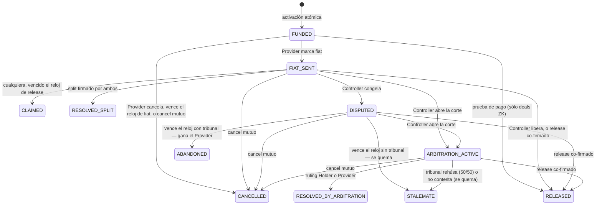
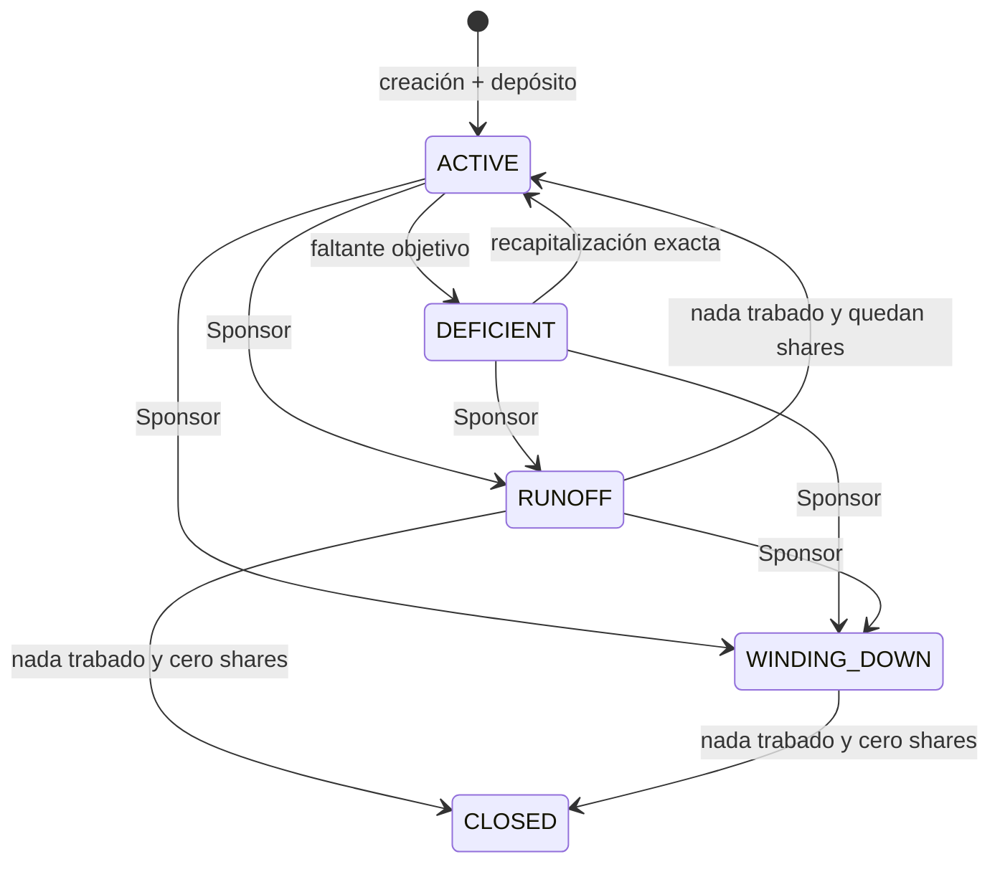
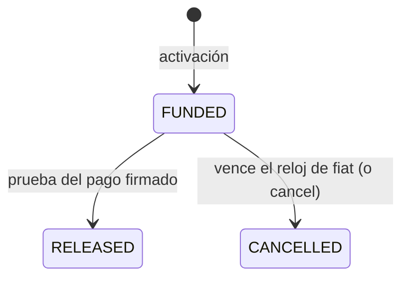
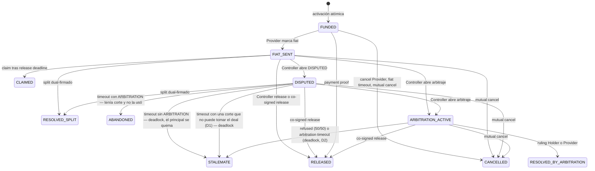
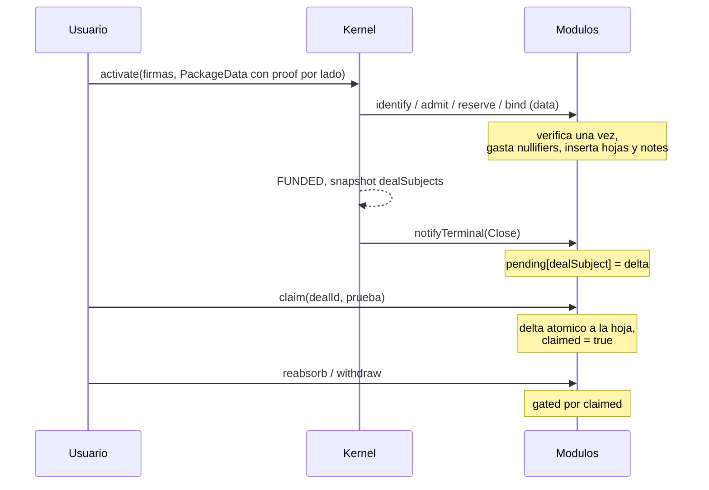
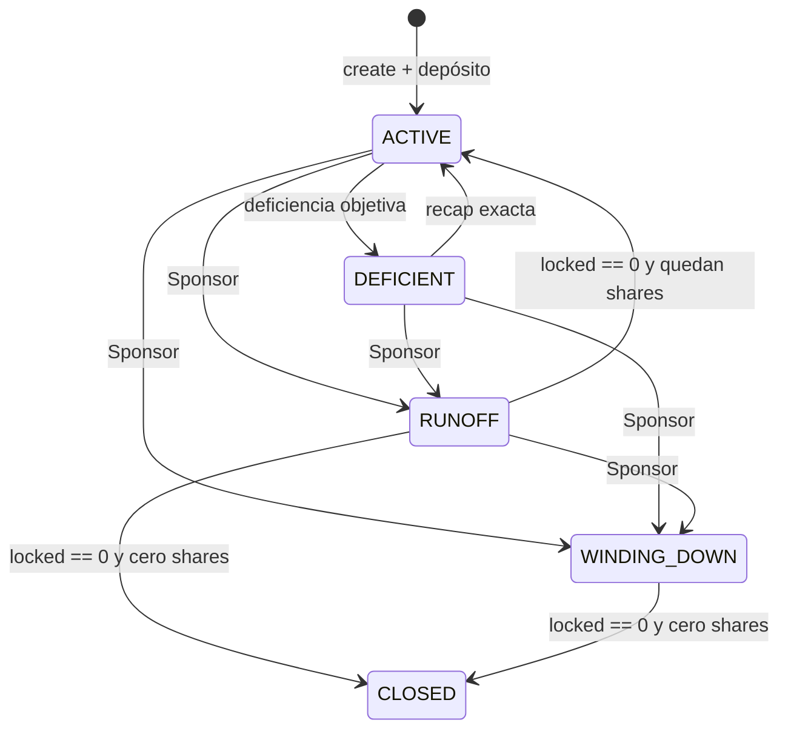

# PluriSwap — el protocolo explicado

Para la dirección y para los developers. Explica qué es PluriSwap, quién es quién, cómo gana plata,
cómo está hecho cada componente y **por qué** está hecho así, y qué falta para que el producto esté
completo. **Es autocontenido**: se entiende entero sin abrir el código ni ningún otro documento.

**Es la fuente de verdad del protocolo.** El código y los tests se escriben contra este archivo. Las
secciones 1 a 8 explican; el **Anexo E** es el detalle normativo (catálogo de transiciones, invariantes,
encoding, circuitos, implementación) y el **Anexo R** es el registro fechado de decisiones. Los conflictos
se resuelven hacia arriba: una decisión posterior del Anexo R pisa al Anexo E, el Anexo E pisa a la
explicación, y los principios (§1.5) le ganan a todo. Cambiar el protocolo es cambiar este archivo: una
entrada nueva en el Anexo R, el Anexo E al día, y la explicación que corresponda.

No es un dictamen jurídico: jurisdicción, contrato con la DAO e impuestos los cierra un abogado antes de
mainnet.

Fecha: 2026-10-05. Los números de fees y gas salen de `script/sim/fees.ts` (Arbitrum quieto, ETH 2.650
USD) y de la suite de tests; donde un número es una estimación, lo dice.

---

## Resumen en una página

- **Qué es.** Un escrow on-chain de stablecoins contra un pago fiat que ocurre fuera de la chain. Dos
  personas acuerdan; el contrato custodia la cripto hasta que el acuerdo se cierra: el pago quedó
  probado, las dos partes firmaron, venció un reloj o falló un tribunal que ellas eligieron.
- **Qué no es.** No es un exchange, no tiene libro de órdenes, no toca el fiat, no conoce a las personas
  y no tiene dueño.
- **El kernel está muerto** —sin dueño, sin pausa, sin upgrade— y eso es a la vez la garantía para el
  usuario y la defensa legal del protocolo: no hay un operador del servicio. Cobra un fee fijo, grabado
  al desplegarlo, que va a la DAO y que nadie puede cambiar, apagar ni redirigir.
- **Todo lo demás es opcional y se firma.** Identidad, reputación, garantías, prueba de pago y tribunal
  son *paquetes*. El deal nombra la huella exacta de cada uno (`packageId`), que incluye su precio y su
  destinatario. Lo que no se firmó no existe para ese deal.
- **La DAO ajusta, no opera.** Cambia, con topes fijos y 30 días de aviso, los términos de los paquetes
  oficiales para los deals que vienen, y decide qué versiones son oficiales. No toca un deal activado, un
  activo ni un resultado, y no pausa nada (sección 3.9).
- **Privacidad como regla de arquitectura.** La reputación no está atada a una wallet ni a un nombre: se
  prueba con zero-knowledge. On-chain no queda el historial de nadie.
- **El negocio.** El kernel cobra **0,3% al Holder al abrir y 0,3% al cerrar** en todo deal (a la DAO),
  y el panel **0,2% por árbitro** cuando lo hay (a los árbitros). Si hay disputa, el panel cobra el
  **30% del bond del que pierde**; abrir la corte no cuesta nada. Un deal oficial cuesta
  **~0,6–0,76% en total** con gas, contra hasta 0,95% de peer.xyz. La DAO le paga a PluriSwap Labs una
  cifra fija por período; Labs nunca cobra un porcentaje del flujo.
- **Estado.** Kernel, paquetes privados, panel de árbitros y pools están construidos y testeados (952
  tests en verde, e2e sobre una chain fría). **Falta el `PAYMENT_PROOF` real**: el verificador de un
  rail de pago concreto. Es la pieza que convierte "dos extraños con relojes y tribunal" en "dos extraños
  sin confiar en nadie". La sección 6 explica qué implica.

---

## 1. Visión

### 1.1 El problema

Cambiar cripto por dinero de banco persona a persona tiene hoy dos salidas malas:

- **La rampa custodiada** (exchange, fintech): exige entregar identidad e historial. Cada operación
  queda en un registro permanente, y la cuenta puede cerrarse.
- **El OTC "de confianza"** (grupo de Telegram, conocido de un conocido): sin escrow, alguien tiene que
  mandar primero. Es una estafa esperando turno.

Y del lado bancario, el mismo dolor en Europa y en Latam: cuentas congeladas por recibir transferencias
de terceros, debanking del que vende cripto.

### 1.2 Qué quiere PluriSwap

Que dos extraños hagan negocio cripto↔fiat **sin que ninguno —ni un tercero— rinda su privacidad**, y
sin un intermediario que los conozca, los catalogue o les pueda cerrar la puerta.

La respuesta de diseño es doble: **un recinto que nadie controla** (el kernel) y **una reputación que no
expone personas** (la capa privada).

### 1.3 Los cuatro pilares

| Pilar | Qué significa | Qué decide en el diseño |
| --- | --- | --- |
| **Kernel muerto** | Sin dueño, sin pausa, sin allowlist, sin upgrade; su fee es inmutable | No hay a quién demandar como operador; nadie puede cerrar el recinto. Un bug se arregla con otro deployment, no con un botón |
| **Privacidad por diseño** | Sujeto ≠ wallet; dos deals de la misma persona no se vinculan on-chain | La reputación se prueba en ZK; el pago fiat se firma oculto; la evidencia de una disputa viaja cifrada |
| **Todo opt-in por firma** | Protección, tribunales y sus fees no se imponen; el del kernel se firma con su dominio | El deal nombra paquetes por su huella; el precio vive en la huella; cambiar un precio es publicar otro paquete. El fee del kernel vive en el kernel: cambiarlo es otro deployment |
| **Sin entidad detrás del protocolo** | Quien monetiza u opera es visible y asume lo suyo | La DAO es una caja que recibe; Labs es un proveedor de infraestructura; los Sponsors de pools responden por sus pools |

### 1.4 La pata fiat

El fiat se mueve **siempre fuera de la chain** y lo mueven las personas. El protocolo no lo ejecuta,
pero sí lo **firma**: cada deal lleva `fiatCommit`, un compromiso oculto de rail, moneda, monto, cuenta
destino y un salt. Así las dos partes firman el mismo pago, y una prueba de pago tiene contra qué
compararse.

La cripto, una vez asignada, es final. El fiat no lo es nunca: un contracargo o un banco que revierte es
riesgo de las partes. Ni la DAO ni Labs lo garantizan, y ningún material puede venderlo como pago
asegurado.

### 1.5 Los catorce principios

Si un diseño propuesto viola uno de estos, no es una extensión: es otro protocolo. Casi todas las
decisiones de este documento se explican por alguno.

| # | Principio | En una línea |
| ---: | --- | --- |
| 1 | **El kernel está muerto** | Sin dueño, sin pausa, sin allowlist, sin upgrade. El constructor sólo fija su fee, inmutable. La neutralidad es la defensa legal |
| 2 | **Mandatory Core** | Cualquier Holder y Provider activan, fondean y llegan a un final sin paquetes, pool, rampa ni interfaz, y sin que la DAO haga nada: el fee del kernel le llega sin que actúe |
| 3 | **Publicar no es usar** | Cualquiera publica un paquete; usarlo exige que las partes firmen su `packageId` |
| 4 | **Privacidad por diseño** | Sujeto ≠ wallet. Dos deals del mismo sujeto no se vinculan. Disputar es salir a la luz: declarado, raro y caro |
| 5 | **Quien firma es quien cobra** | No hay campo receiver ni payout redirigido. El Controller nunca cobra principal |
| 6 | **El dinero se mueve con culpa probada, acuerdo probado o desacuerdo elegido** | El bond no va a la contraparte sin un veredicto. Con tribunal, abandonar una pelea es perderla. Sin tribunal, un desacuerdo que nadie cede quema el principal |
| 7 | **El happy path paga lo mismo; desviarse cuesta** | El kernel cobra igual a todo deal. Contest fee no-cero y sin devolución. Completion fee sólo si el Provider cobró algo y no es `STALEMATE` |
| 8 | **La DAO ajusta, nunca opera** | El kernel nombra sólo a su tesorería, como destino inmutable de su fee, sin ningún verbo. La tesorería recibe y no tiene permisos; el gobierno tiene permisos y no recibe. Sobre los paquetes oficiales ajusta, con topes y demora, los términos de los deals que vienen; nunca toca un deal activado, un activo ni un resultado, y no pausa nada (§3.9). Fee de paquete nuevo = `packageId` nuevo + firmas nuevas; fee de kernel nuevo = kernel nuevo |
| 9 | **Labs es infraestructura, no plataforma** | Sin custodia de fondos ni claves, sin matching, sin contacto con el fiat. Cobra por MSA; nunca es `feeRecipient` |
| 10 | **Los pools son de sus Sponsors** | El protocolo no cobra por pools ni opera el descubrimiento. El cumplimiento es de quien abre el pool |
| 11 | **Fees en el kernel o en el paquete, nunca en el deal** | El deal nombra ids; el kernel y los paquetes nombran montos y destinatarios. Un clon con fee cero es otro hash, u otro kernel |
| 12 | **Un escritor, un motor** | El escrow escribe todo estado del deal y mueve todo principal. Credit-first. Un consumidor post-terminal nunca revierte el escrow |
| 13 | **Los relojes son de las partes y los ejecuta cualquiera** | Duraciones firmadas, timeouts permissionless, sin keeper privilegiado. Un derecho no caduca porque nadie actuó |
| 14 | **Completitud** | Una transición no definida está prohibida; un rol no tiene autoridad no consentida; en una carrera gana la primera transacción válida |

---

## 2. Glosario

### 2.1 Actores

El kernel sólo ve tres roles por deal: **Holder, Provider y Controller**. Todo lo demás vive alrededor.

| Actor | Qué es | Qué pone / qué hace | Qué no puede hacer |
| --- | --- | --- | --- |
| **Holder** | Quien vende la cripto | Deposita el principal (stablecoins). Recibe el fiat fuera de la chain. Paga el fee de activación y el gas de activación | Redirigir la cripto a otro destino; operar el deal después de firmar, salvo que también sea el Controller |
| **Provider** | Quien compra la cripto | Paga el fiat fuera de la chain; marca que pagó; prueba el pago si hay `PAYMENT_PROOF`. Paga el fee de cierre | Llevarse la cripto antes de tiempo por su sola voluntad |
| **Controller** | Quien opera el lado holder | Libera, disputa, abre la corte, firma acuerdos. En una venta entre dos personas es el mismo Holder; en un pool es un operador designado | Cobrar el principal; cambiar Holder o Provider; inventar la firma del Holder |
| **Relayer** | Cualquiera que manda una transacción | Transporta firmas ajenas | Nada que las firmas no autoricen |
| **"Cualquiera"** | Cualquier address | Ejecuta los relojes vencidos (timeouts, claim, cierre del panel) | — Ningún derecho depende de un keeper del protocolo |
| **Árbitro** | Persona registrada en `ArbiterRegistry` con un bond | Vota en los deals donde las partes lo eligieron | Ser parte del deal que juzga (se prueba en ZK a nivel humano) |
| **Sponsor** | Operador de un pool | Escrito inmutable al crear el pool; nombra designados y fija límites | Echar a otro Sponsor; redirigir principal |
| **Designado** | Wallet que un Sponsor habilita | Puede ser Controller de deals del pool | Operar fuera de lo que el pool autoriza |
| **LP** | Quien deposita en un pool | Tiene shares sobre el NAV | Operar deals por tener shares |
| **DAO (gobierno)** | El contrato con el que decide la DAO: un `TimelockController` cuyo proponente es un Governor o un Safe. Es el `governor` de los paquetes oficiales | Ajusta, con topes y 30 días de demora, los parámetros de los paquetes oficiales para los deals que vienen; decide el set oficial; ordena los pagos de la tesorería (§3.9) | Recibir fees; tocar un deal activado, un activo o un resultado; pausar; filtrar quién entra; elegir o vetar árbitros; cambiar el fee del kernel |
| **Tesorería** | El contrato de la DAO que recibe: un Safe o un vault mínimo, que obedece al gobierno | Es el `feeRecipient` del kernel y de los paquetes oficiales; paga el MSA de Labs y los grants cuando el gobierno lo ordena | Cualquier permiso sobre un contrato del protocolo. El kernel la nombra sólo como destino, y su address no puede migrar nunca |
| **PluriSwap Labs** | La sociedad | Mantiene la infraestructura bajo un acuerdo de servicios (MSA) con la DAO | Ser `feeRecipient`, custodiar fondos o claves, juntar contrapartes, tocar el fiat |
| **Human Passport** | Dependencia externa | Da la prueba de humanidad con la que se registra una cuenta | Nada sobre deals vivos |

### 2.2 Términos

| Término | Qué significa |
| --- | --- |
| **Deal** | Un acuerdo entre Holder y Provider. Tiene exactamente un resultado económico final |
| **Kernel / escrow** | `Escrow.sol`: la máquina de estados que custodia el principal y decide el resultado. Único escritor del estado del deal |
| **Core** | Un deal sin paquetes. Entra, se fondea y termina igual. Es el recinto completo, no una versión capada |
| **Principal** | El monto en stablecoins que el Holder deposita |
| **Pull exacto** | En la activación, el kernel verifica que entró desde el Holder exactamente el principal. Un token con fee-on-transfer o rebase no activa |
| **EIP-712 / EIP-1271** | El estándar de firmas tipadas, y el de firmas de contratos. Una wallet y un pool firman el mismo digest |
| **Paquete** | Módulo opt-in que el kernel llama en momentos fijos: passport, reputación, bonds, prueba de pago, tribunal |
| **Kind** | El tipo de paquete. Hay cinco, y un sexto sería otro kernel |
| **`packageId`** | La huella de un paquete: `hash(kind, address, policy)`. La policy incluye fees y destinatarios. Firmar el id es aceptar ese precio |
| **`DealTerms`** | El struct EIP-712 que firman las partes: roles, token, principal, relojes, `fiatCommit`, `packageIds` |
| **`fiatCommit`** | Compromiso Poseidon oculto del pago fiat acordado: rail, moneda, monto, cuenta del Holder, salt |
| **Relojes** | Cuatro duraciones que firman las partes: fiat, release, dispute y arbitration |
| **Terminal** | Estado final del deal: `RELEASED`, `CLAIMED`, `CANCELLED`, `RESOLVED_SPLIT`, `STALEMATE`, `ABANDONED`, `RESOLVED_BY_ARBITRATION` |
| **Dual-sign** | Un acuerdo firmado por el Provider y el Controller después de activar: cancel mutuo, release co-firmado o split |
| **Credit-first** | En el cierre, el resultado se escribe y se acredita antes de intentar transferir. Una transferencia fallida deja un crédito retirable; nunca reescribe el resultado |
| **`sk_id`** | Secreto del usuario, que nunca sale de su dispositivo. De él sale su cuenta |
| **Cuenta (`S`)** | `Poseidon(sk_id)`. Nunca aparece on-chain en claro |
| **`dealSubject`** | `Poseidon(sk_id, dealId)`. El seudónimo de la cuenta *en un deal*. Es lo único que el kernel ve |
| **`hn`** | Nullifier de humanidad: un humano registrado, una cuenta |
| **Nullifier** | Valor que se publica al gastar algo una vez (una versión de la cuenta, una note, un pago) para que no se gaste dos veces |
| **`pairTag` / `pair_secret`** | El nombre del par de cuentas de un deal, cegado con un secreto que las dos acuerdan. Prueba el par dentro de un deal sin vincularlo con otros |
| **Score, tier, cap** | La reputación: el score define el tier; el tier define el cap, que es lo máximo que una cuenta puede tener **abierto al mismo tiempo** |
| **`UNIT` (lote)** | 250 tokens enteros del deal. Es el mínimo oficial, el cap de T1 y la unidad de volumen del score |
| **`inFlight`** | Lo que una cuenta tiene abierto ahora. `inFlight + principal ≤ cap` |
| **Bond** | Garantía propia, 10% de cada deal, que sube el cap. No es un fee, pero de un bond que pierde una disputa sale el pago del panel |
| **Note** | Un saldo privado del vault de bonds, como un billete que sólo su dueño sabe gastar |
| **Sink** | Address inmutable adonde se queman bonds o principal en un deadlock. No es la DAO |
| **Panel** | Uno o tres árbitros elegidos al negociar el deal |
| **Chat key** | La key que firma los mensajes de una parte en la conversación de un deal. La address de los términos la delega una vez (`ChatKey`); no firma nada on-chain |
| **Cuenta y operador** | Cada lado de un deal es una cuenta (reputación, tier, cap, bond, penalidades) y un operador (el humano que actúa). En una persona son lo mismo; en un pool, la cuenta es el pool y el operador su Controller |
| **Aval (`vouch`)** | La prueba del operador de un pool: el Controller verificado que el pool registró forma el par con el Provider del otro lado. Obligatoria en todo lado de un pool |
| **`PackageData`** | Bloque opaco por lado que viaja en la activación con los proofs ZK de cada parte |
| **NAV** | El valor de un pool: lo libre + los créditos + lo trabado en deals vivos + su bond |
| **Handle** | Seudónimo de mercado, opcional y rotable |

---

## 3. El marco de compliance

Este marco explica casi todas las decisiones de los componentes, por eso va antes que ellos.

### 3.1 La pregunta del regulador

Un regulador no empieza por el whitepaper. Pregunta **quién presta el servicio y quién cobra**. Cambiar
cripto por fondos es una actividad regulada: proveedor de servicios de criptoactivos en Europa (MiCA),
proveedor de servicios de activos virtuales frente a la UIF o el registro local en Latam, transmisor de
dinero en Estados Unidos. El punto común: **si hay una organización que se queda con una tajada de cada
operación, o que puede abrir y cerrar la puerta, esa organización es el servicio**.

El diseño hace que esa pregunta no tenga respuesta adentro del contrato:

- El kernel no tiene administrador, no se pausa y no se actualiza. Cobra un fee fijo desde su
  despliegue, que nadie puede cambiar, apagar ni redirigir.
- Quien cobra (la tesorería de la DAO) recibe ese fee y lo que las partes eligieron firmar de los
  paquetes, y no tiene ninguna función sobre un contrato: no fija el fee del kernel, no lo cobra, no lo
  puede negar.
- Quien gobierna (la DAO, por su timelock) no recibe nada, y lo único que ajusta son los parámetros
  acotados de los paquetes oficiales para los deals que todavía no empezaron (3.9).
- Quien trabaja (Labs) cobra por mantener infraestructura, una cifra fija, y tiene prohibido por
  contrato ser el mercado.

### 3.2 Las tres entidades

La DAO es una entidad con **dos contratos** (Anexo R, 2026-10-06): la tesorería, que recibe, y el
gobierno, que decide. Mismo soberano, dos direcciones. La que recibe no tiene permisos; la que tiene
permisos no recibe.

| | Protocolo | DAO: gobierno | DAO: tesorería | PluriSwap Labs |
| --- | --- | --- | --- | --- |
| Qué es | El kernel y las reglas que las partes firman | Un `TimelockController` en Arbitrum, con un Governor o un Safe como proponente, sin control unilateral ni conjunto de Labs | Un Safe o un vault mínimo en Arbitrum, que obedece al gobierno; tesoro chico | La sociedad que emplea y factura |
| Rol on-chain | — | `governor` de los paquetes oficiales | `feeRecipient` del kernel y de los paquetes oficiales | Ninguno |
| De dónde sale la plata | De ningún lado | De ningún lado: no recibe | El fee del kernel + fees de paquetes oficiales firmados + tesoro inicial | La invoice que le paga la tesorería por el MSA |
| Qué no es | Una empresa, una plataforma, un servicio | Un operador, un gate, un actor del escrow | Un actor de nada: no tiene permisos sobre ningún contrato | El dueño del protocolo, un exchange, un custodio, el que recibe el fee |

**Por qué dos contratos.** Las dos direcciones son permanentes por motivos distintos. El `feeRecipient` del
kernel es inmutable para siempre, así que la tesorería no puede necesitar migrar: tiene que ser lo más
simple posible. El gobierno va a cambiar de forma (de un Safe a un Governor, de firmantes); siendo un
`TimelockController`, la DAO cambia quién propone sin cambiar la dirección que los paquetes tienen como
`governor`, y no hay que redesplegar nada. Además, una brecha en uno no alcanza al otro, y los ingresos
llegan a una caja sin permisos. Lo que la separación **no** resuelve: si el mismo soberano controla las
dos, la DAO sigue fijando fees que cobra. Eso lo acotan los topes y la demora (3.9).

Labs absorbe a propósito la exposición que el kernel no puede tener: hay una persona jurídica, hay
empleados, hay gente que firma contratos y paga auditorías. El límite es lo que el MSA le prohíbe. Si Labs
junta contrapartes, custodia fondos o claves, o toca el fiat, el límite ya se rompió y ningún párrafo lo
repara.

### 3.3 Los cuatro flujos de dinero

Mezclarlos es el error que convierte a alguien en el operador.

1. **El principal.** Del Holder al escrow, y del escrow al Holder o al Provider. La DAO y Labs no lo ven.
2. **Los bonds.** Garantía de las personas en un vault aparte. Vuelven, se los lleva el ganador de un
   veredicto o se queman en el sink. Nunca entran a la DAO: un bond en el balance de la compañía sería un
   reclamo de custodia.
3. **Los fees.** El del kernel, en todo deal, se acumula en el escrow y cualquiera lo barre al
   la tesorería (`sweepFees`). Los de paquete, sólo si el deal los firmó: en los oficiales, a la
   tesorería, o a los árbitros en el caso del panel.
4. **El acuerdo de servicios.** La DAO le paga a Labs desde el tesoro, fuera de la chain, una cifra por
   período. No es un porcentaje del volumen ni de los fees: el mes en que los fees son cero, la invoice
   se paga igual.

Lo que cobran otros no es ingreso nuestro: el Sponsor cobra su fee de operador dentro de su pool, una
interfaz de un tercero puede cobrar por usarla, y la rampa cobra su propio costo de infraestructura y
cero al protocolo.

### 3.4 Por qué el kernel cobra, y cómo sin volverse un operador

Hasta el 2026-10-01 el kernel no cobraba: todo fee vivía en un paquete que las partes elegían firmar. Desde
el 2026-10-02 el kernel cobra el suyo (Anexo R). El argumento de antes era que un beneficiario fijo de cada
operación es la organización que el regulador está buscando. El dictamen de Legix (2026-05-12) analizó a
Labs con un fee de protocolo asignado a la DAO y no a la Company, y la consulta posterior sobre el fee
obligatorio no cambió la conclusión. Lo que separa un fee de protocolo de un operador es otra cosa, y es lo
que el diseño fija:

- **Nadie lo gobierna sobre el escrow.** El recipient y los dos porcentajes son `immutable`, fijados en el
  constructor. No hay setter, interruptor ni voto. Otro fee es otro deployment, y los deals viejos terminan
  en el viejo.
- **Se firma.** El dominio EIP-712 nombra al kernel como `verifyingContract`; su fee no cambia, así que
  firmar un deal para ese kernel es firmar ese fee. Una firma para otro kernel no activa en este.
- **No traba nada.** El fee se acumula en el escrow (`feesOwed`) y cualquiera lo barre al recipient
  (`sweepFees`). Un recipient que el token rechaza (una blacklist, una pausa) frena el barrido, nunca una
  activación ni un terminal.
- **No gana con lo que falla.** El fee de cierre no se cobra en un refund, en un `STALEMATE` ni en un
  deadlock: la DAO nunca cobra por un deal que se rompió ni por un principal que se quemó.
- **No llega a Labs.** El recipient es la tesorería, un contrato de la DAO que Labs no mueve, ni sola ni en
  conjunto.
  Un Governor con el token concentrado en el equipo es control conjunto con otro nombre.

El fee de activación sigue siendo el precio de que el deal haya existido: se paga aunque se cancele.

**Qué se toma de Uniswap.** En diciembre de 2025 Uniswap prendió su *fee switch* (UNIfication): una parte
de la comisión de los pools va al protocolo y se usa para quemar UNI. Se pudo prender porque la factory de
pools tiene gobernanza y porque la liquidez vive adentro. La otra mitad de UNIfication es la que copiamos:
la entidad de la gobernanza le paga a Uniswap Labs por un contrato de servicios, una cifra fija anual desde
el tesoro, no un porcentaje de las comisiones, y Labs apagó el fee que cobraba su propia interfaz. De ahí
tomamos esto: una entidad visible le paga a la empresa de infraestructura desde el tesoro por una cifra de
mantenimiento, y la empresa no recibe la comisión del protocolo. No tomamos el interruptor: nuestro
contrato no tiene gobernanza que lo prenda, y un escrow de cripto contra dinero de banco se lee más fácil
como servicio regulado que un intercambio token contra token.

### 3.5 Privacidad y protección de datos

Una blockchain es pública y permanente, y no admite rectificación ni borrado. Un historial por wallet
—volumen, contrapartes, disputas— es un perfil económico de una persona, incompatible con el espíritu del
producto y con el GDPR (arts. 16 y 17). Por eso:

- La reputación se keyea por un compromiso que sólo el usuario conoce, y se prueba en ZK.
- El pago fiat se firma oculto: la cuenta bancaria nunca queda en la chain.
- La evidencia de una disputa no pasa por ningún contrato ni por IPFS: viaja cifrada sólo a los árbitros
  que las partes eligieron.

El argumento es que, con sujetos no vinculables, lo que queda on-chain deja de ser dato personal. Es un
argumento, no una sentencia.

### 3.6 Lo que la estructura cuesta, y hay que aceptar

- **No hay fee switch.** El fee del kernel no se sube, no se baja y no se apaga sobre ese kernel ni sobre
  deals existentes. Cambiarlo es desplegar otro kernel y que la gente se mude.
- **No hay gobernanza sobre un deal vivo.** La DAO ajusta términos para los deals que vienen (3.9). Un
  deal activado termina con los términos con los que se ligó, aunque la DAO los cambie al día siguiente.
- **No hay pausa.** Ante un incidente, se publica un módulo o un deployment nuevo y se avisa. Los deals
  fondeados terminan en el código en el que entraron. Quien prometa "podemos apagarlo" promete una
  función que, el día que exista, nos convierte en el operador.
- **El código se copia.** Cualquiera puede desplegar el mismo kernel con fee cero (`Escrow(0, 0, 0)`). El foso no es el
  contrato: es la reputación que la gente construyó, la calidad de los módulos oficiales y la confianza.
- **Labs no puede ser el marketplace.** Juntar comprador con vendedor, llevar un libro de órdenes o
  guardar la cuenta bancaria es el negocio de un exchange. Puede existir, a nombre de otra entidad que lo
  asuma y lo licencie.

### 3.7 Qué exposición queda de cada lado

| Quién | Exposición |
| --- | --- |
| **El kernel** | Ninguna de operador, mientras se sostengan los chequeos de 3.8: no hay tesorería, administrador ni un fee que alguien pueda mover |
| **La DAO** | La de una caja que recibe el fee del kernel y los fees opt-in (la tesorería), firma el MSA y ajusta, con topes y 30 días de aviso, los parámetros de los paquetes oficiales para los deals que vienen (el gobierno, 3.9). Es la que más cambia con el fee obligatorio: recibe algo de cada operación. Se mantiene ahí mientras el tesoro siga chico, Labs no alcance solo para moverla y ningún verbo suyo alcance un deal activado |
| **Labs** | La de quien publica software y tiene empleados. No llega a la de un exchange mientras no haya custodia, matching ni contacto con el fiat |
| **Cada Sponsor** | La de su pool ante el régimen que le toque. La factory no le pasa esa carga a nadie |
| **Las partes** | El fiat reversible |
| **Quien arme el descubrimiento de contrapartes** | La puerta. Conviene que tenga nombre, negocio y licencia propios |

### 3.8 Cómo se nota que el modelo se rompió

Se verifica mirando el código, los dos contratos de la DAO y el contrato firmado:

- Un deal sin paquetes llega a un final sin que la DAO ni Labs hagan nada, y en esa transacción Labs no
  recibe nada. La DAO recibe sólo el fee inmutable del kernel, y sólo cuando alguien lo barre.
- Cambiar un fee de paquete exige otro `packageId` y otras firmas; cambiar el del kernel, otro kernel. No
  hay botón ni voto sobre el escrow.
- El recipient del kernel es la tesorería de la DAO, nunca una address de Labs.
- El `governor` de los paquetes oficiales no es la tesorería ni recibe fees, y la tesorería no tiene
  ningún permiso sobre un contrato del protocolo (`Doctor` chequea lo primero).
- Ningún destinatario de fee del kernel o de un paquete oficial es una address de Labs o un contrato que
  Labs mueva sola.
- La invoice de Labs es una cifra por período, nunca un porcentaje del volumen.
- Nada de lo que hacen la DAO o Labs pausa, desvía o impide un deal que ya tiene la cripto adentro.
- La DAO no tiene ninguna función que reciba un `dealId`, mueva un token o pause algo. Su único verbo
  on-chain es proponer o cancelar términos dentro de topes fijos, y los aplica cualquiera después de 30
  días.
- Ningún cambio de la DAO cambia lo que paga un deal vivo: el kernel cobra la copia de precios que tomó
  al activar (`pricesOf`).

### 3.9 Qué gobierna la DAO

La DAO ajusta los parámetros de los paquetes oficiales **para los deals que vienen** (Anexo R,
2026-10-06). No toca un deal que ya se activó, no toca un activo, no pausa nada y no elige quién gana.

**Cómo un cambio no alcanza a un deal vivo.** Son dos garantías:

- **El kernel guarda los precios.** Al activar, el kernel verifica que la política de cada paquete
  coincida con el `packageId` firmado y copia lo que va a cobrar: fees de activación, cierre, contest y
  prueba, y la parte de la corte en los bonds (`Deal.prices`, `pricesOf`). Desde ahí cobra esa copia y no
  le vuelve a preguntar nada al paquete. Esto vale para **cualquier** paquete, nuestro o de un tercero.
- **El paquete guarda lo que decide el resultado.** Lo que no es un precio (plazos, slashes, el
  verificador) lo aplica el paquete. Los nuestros lo guardan por deal al ligarse: el panel copia sus
  ventanas y su slash a cada caso; `PaymentProof` no gobierna su verificador. Es *best effort*: un paquete
  de un tercero que no lo haga se comporta como su código dice, y quien lo elige acepta ese
  comportamiento.

Y un deal firmado antes de un cambio no activa después: el `packageId` es el hash de la política vigente,
así que el que firmaron ya no resuelve (`UnknownPackage`). Nadie queda ligado a términos que no vio.

**Lo que puede hacer.**

| Paquete | Qué ajusta | Cómo |
| --- | --- | --- |
| **Panel** (`ArbiterRegistry`) | Ventana de commit y de reveal, demora de salida, lock por árbitro, slash por abstención, disponibilidad y parte del bond | `proposePolicy` dentro de topes fijos en el código. La propuesta espera 30 días y después cualquiera la aplica (`enactPolicy`). Mientras espera, la DAO la puede retirar (`cancelPolicy`) |
| **Reputación** (`PrivateReputation`) | Fees de activación, cierre y contest, y el piso del contest | Igual |
| **Prueba de pago** (`PaymentProof`) | El fee por prueba | Igual. El verificador no se gobierna: qué pagos cuentan es un adaptador nuevo, nunca un voto |
| **El set oficial** | Qué kernel, paquetes, factory de pools, verificadores, adaptadores de rail (con sus claves fijas, `PinnedAnchors`) y rampas recomienda el cliente oficial | Una decisión de la DAO, que el cliente lee (`PLATAFORMA.md` TRN-01). Alguien tiene que rotar lo que vence (las claves fijas de un rail tienen `sunset`) y reemplazar lo que tenga un bug |
| **El tesoro** | El MSA con Labs y los grants | Como hasta ahora |

La mecánica es una sola (`Governed`): un `governor` inmutable (cero = congelado para siempre), la
propuesta tipada de cada paquete, `GOVERNANCE_DELAY = 30 días` y la aplicación permissionless. El
`governor` es el gobierno de la DAO, nunca la tesorería (3.2). Si el gobierno usa un timelock propio, las
demoras se suman; puede ser corto, porque la garantía para los usuarios ya está en los 30 días de cada
paquete.

**Lo que no puede hacer, por construcción.**

- Tocar un deal activado: sus paquetes, sus términos, sus precios o su resultado.
- Pausar el kernel o un paquete.
- Mover un activo: principal, bonds, créditos, el bond de un árbitro o el capital de un pool.
- Elegir, vetar o sacar árbitros, y filtrar quién entra (cuentas, pools o sujetos). El registro de
  árbitros sigue sin curador.
- Tocar la reputación o los bonds de una cuenta.
- Cambiar el `sink`, el destinatario de un fee o el fee del kernel. Otro fee de kernel sigue siendo otro
  kernel.
- Cambiar las duraciones del deal: son de las partes (principio 13).
- Cambiar lo que vive en un circuito (la escalera de tiers, el crédito por época). Eso es un circuito
  nuevo, que es otro verificador y otro paquete.

**Topes en el código.** Una DAO capturada sólo puede mover los parámetros adentro de estos rangos:

| Paquete | Parámetro | Tope | Hoy |
| --- | --- | --- | --- |
| Panel | Ventana de commit | 1 a 7 días | 3 días |
| Panel | Ventana de reveal | 12 horas a 3 días | 1 día |
| Panel | Demora de salida del árbitro | 7 a 21 días | 14 días |
| Panel | Lock por árbitro | 5% a 25% del principal | 10% |
| Panel | Slash por abstención | 25% a 100% del lock | 50% |
| Panel | Disponibilidad por árbitro | 0,05% a 1% del principal | 0,2% |
| Panel | Parte del bond del perdedor | 10% a 50% | 30% |
| Reputación | Fee de activación y de cierre | 0 a 1% cada uno | 0 (los cobra el kernel) |
| Reputación | Contest | 0 a 3%, con piso de hasta 10 tokens de 6 decimales | 1%, piso de 2 |
| Prueba de pago | Fee por prueba | hasta 5 tokens de 6 decimales | sin fijar |

Los pisos y el fee por prueba están en unidades del token del deal: los topes asumen una stablecoin de 6
decimales.

**La demora es más larga que la salida más larga.** Una propuesta espera 30 días y la salida más larga de
un árbitro es de 21. Un árbitro que no está de acuerdo pide salir el día que aparece la propuesta y está
afuera antes de que aplique. Lo que tiene trabado sigue en sus casos, con los términos viejos.

**El set oficial nunca queda vacío.** Para retirar una versión oficial, la DAO declara otra antes. Igual,
retirar no pausa: el kernel acepta cualquier deal (Mandatory Core) y un deal firmado con un paquete
retirado sigue activando. Lo que cambia es lo que recomienda el cliente oficial.

**Por qué no es operar.** Ajustar, con 30 días de aviso, los parámetros acotados de un software para las
operaciones futuras es lo que hace la gobernanza de cualquier protocolo. Frenar, desviar o decidir una
operación es lo que hace un operador. La DAO queda del primer lado. Igual cambia la exposición de 3.7: la
DAO ahora fija, dentro de topes, fees que cobra ella misma (el contest de la reputación). El abogado lo
revisa antes del deploy de producción.

---

## 4. Modelo de negocio

### 4.1 Quién cobra qué

Hay cuatro momentos en que se puede cobrar. No hay un quinto. El kernel cobra en dos de ellos, en todo
deal; en Core, los otros dos son cero.

| Momento | Quién paga | Kernel y paquetes oficiales | Destino |
| --- | --- | --- | --- |
| **Activación** | El Holder, encima del principal. Siempre, aunque el deal se cancele | Kernel: **0,3%**. Panel: **0,2% por árbitro** (0,6% con tres) | Kernel → DAO. Panel → árbitros, si cumplen |
| **Abrir una disputa** | Quien abre, de su wallet, una sola vez | Reputación: **1%** con piso bajo (~2 tokens). Panel: **nada** | Reputación → DAO |
| **Fallo del panel** | El que pierde, de su bond | Panel: **30% del lock del perdedor** (3% del principal). Si las partes acuerdan con la corte abierta, o la corte rehúsa, cada una deja el 15% de su lock | Árbitros que votaron con el ruling. El otro 70% va al ganador |
| **Probar el pago** | Lo define el paquete de prueba | Pendiente de fijar (sección 6) | DAO |
| **Cierre** | Sale del principal antes de repartir, cuando el Provider cobra algo | Kernel: **0,3%** | DAO |

El paquete de reputación oficial ya no cobra activación ni cierre (`activationBps = completionBps = 0`):
esos dos los cobra el kernel. Si los cobrara también, un deal oficial pagaría dos veces.

Reglas que afectan una proyección:

- El fee de cierre se calcula siempre sobre el **principal completo**, también en un split. **No se
  cobra** si todo volvió al Holder, ni en un `STALEMATE`. Sí se cobra en un `ABANDONED`: hubo un trade.
- El kernel cobra su cierre primero; los de paquete se miden contra lo que queda.
- Si un fee no cabe en lo que queda (`fee >= resto`), se omite: el contrato prefiere liquidar el
  principal antes que trabarse. **Una proyección no puede asumir que todo cierre paga.**
- Si en la activación un fee no se puede cobrar, no hay deal. Un pool reserva el del kernel con el
  principal.
- El fee del kernel se acumula y se barre (`sweepFees`, permissionless). El ingreso de la DAO llega
  cuando alguien barre, no en cada deal.
- El contest de reputación **no se devuelve al ganador**: una disputa significa que los dos eligieron mal
  a la contraparte, y todo desvío le cuesta a quien lo provoca. Se cobra una sola vez por deal aunque se
  congele y después se escale, y cada paquete seleccionado cobra el suyo. En un deal con prueba de pago
  no existe, porque no hay disputa.
- **El panel lo paga el que pierde, de su bond (2026-10-05).** Abrir la corte no cuesta nada: el que
  tiene razón no pone plata por adelantado. Al fallar, el 30% del lock del perdedor va a los árbitros que
  votaron con el ruling y el 70% al ganador. Por eso un deal con panel lleva **bonds de los dos lados**:
  sin bond no hay con qué pagarle al panel. El pago escala con lo que está en juego —3% del principal:
  30 USDC entre tres en un deal de 1.000, 1.500 en uno de 50.000— y el árbitro cobra lo mismo gane quien
  gane. El costo, dicho: en el deal mínimo de 250 el panel se reparte 7,5 tokens, menos que los 10 planos
  de antes; para deals chicos rinde más el panel de uno.
- El piso del contest es bajo a propósito (~2 tokens): un piso de 10 era regresivo, el 4% de un deal de
  250. Un piso distinto es otro paquete.
- Un deal con tribunal **siempre** cuesta pelear, tenga o no reputación: si no, congelar sería gratis
  para la única parte que puede congelar. Con el panel oficial ese precio ya no es un fee de apertura
  sino el bond: quien congela sin razón arriesga su lock entero.
- Identificar (Passport) no cobra: identificar no es un peaje.

### 4.2 Ejemplos por deal

**Un deal de 1.000 USDC, oficial, con panel de tres, sin disputa:**

| | Holder | Provider | DAO | Cada árbitro |
| --- | ---: | ---: | ---: | ---: |
| Activación (kernel 0,3%) | −3,00 | | +3,00 | |
| Disponibilidad del panel (3 × 0,2%) | −6,00 | | | +2,00 |
| Cierre (kernel 0,3%) | | −3,00 | +3,00 | |
| Gas (Arbitrum quieto) | ~−0,40 | ~−0,20 | | |
| **Total** | **~−9,40** | **~−3,20** | **+6,00** | **+2,00** |

Cada árbitro traba 100 USDC (10% del principal) mientras dure el deal. Si el deal dura dos días, gana 2
USDC sobre 100 trabados: es lo que hace atractivo sentarse en un panel.

**El mismo deal, con disputa y ruling a favor del Provider:** además, el Holder (que abrió) paga 10 USDC
de contest a la DAO (1% de 1.000). Abrir la corte no le cuesta nada más. Pierde el principal y su lock
de 100 USDC: **30 van a los árbitros** que votaron con el ruling (10 a cada uno si fue unánime) y **70 al
Provider**. Suma +15 de penalidad.

**Un deal de 250 USDC con prueba de pago** (el mínimo oficial), desglose en USD:

| Quién | Concepto | USD |
| --- | --- | ---: |
| Holder | Fee de activación | 0,75 |
| Holder | Gas de la activación privada (los dos lados) | 0,19 |
| Holder | Gas del claim de reputación | 0,08 |
| Provider | Fee de la prueba (placeholder) | 0,01 |
| Provider | Gas del release por prueba (estimado) | 0,05 |
| Provider | Fee de cierre | 0,75 |
| Provider | Gas del claim de reputación | 0,08 |
| **Total** | | **1,91 (0,76%)** |

**Costo total como porcentaje del principal** (gas incluido):

| Perfil | 250 | 1.000 | 5.000 |
| --- | ---: | ---: | ---: |
| Core, sin paquetes (sólo el kernel) | 0,61% | 0,60% | 0,60% |
| Oficial: passport + reputación | 0,74% | 0,64% | 0,61% |
| Oficial + prueba de pago | 0,76% | 0,64% | 0,61% |
| Oficial + bonds + prueba de pago | 0,84% | 0,66% | 0,62% |
| Oficial + bonds + panel, sin disputa | 1,42% | 1,26% | 1,22% |
| Oficial + bonds + panel, con disputa | 5,43% | 5,26% | 5,22% |
| **peer.xyz (hasta, sin bridge)** | 0,95% | 0,95% | 0,95% |

Con la red cargada (L2 5× más cara, blob en el techo), un deal con prueba de pago sube a ~1,41% en 250 y
~0,80% en 1.000. En deals chicos el gas pesa; por eso existe el **mínimo de 250 tokens** en los paquetes
oficiales. El kernel no tiene mínimo: Core liquida cualquier monto. Si una parte trae los fondos desde
otra chain, la rampa suma ~6 bps más el gas de destino (~1,5 USDC en envío directo), que domina en un
deal chico.

Dos lecturas para pricing:

- **La prueba de pago es el producto barato.** No lleva panel, así que cuesta la mitad que un deal con
  tribunal. Hoy, sin prueba de pago real, el deal oficial seguro entre extraños es el de panel, que es
  más caro que peer.xyz.
- **Una disputa cuesta lo mismo en proporción a cualquier tamaño (2026-10-05).** Antes el fee del panel
  era plano y pesaba en deals chicos (6,43% en 250, 2,42% en 5.000). Ahora es el 3% del principal, del
  bond del que pierde: ~5,2–5,4% en todo tamaño. El que tiene razón no paga esa parte.
- **Los fees se comen el spread en deals chicos.** Con un spread P2P de 1%, un deal oficial de 250 se
  come ~74% del spread. En 5.000 se come ~61% de un spread de 1% y ~30% de uno de 2%. El producto rinde
  en tickets medianos.

### 4.3 La escala

**Ingreso de la DAO.** En un deal oficial que cierra, la DAO recibe **0,6% del principal** (0,3% + 0,3%);
en uno que se cancela, 0,3%. El 0,6% del panel es de los árbitros, no de la DAO. Sobre volumen oficial
completado:

| Volumen oficial por mes | Ingreso DAO por mes | Por año | Deals por mes con ticket promedio de 1.000 |
| ---: | ---: | ---: | ---: |
| 1 M USDC | 6.000 | 72.000 | 1.000 |
| 10 M USDC | 60.000 | 720.000 | 10.000 |
| 50 M USDC | 300.000 | 3,6 M | 50.000 |
| 100 M USDC | 600.000 | 7,2 M | 100.000 |

A esto se suman los fees de contest (1% del principal de cada disputa) y el fee de prueba de pago cuando
exista. La parte del panel en el bond del perdedor es de los árbitros, no de la DAO.

**Punto de equilibrio con Labs.** El monto del MSA no está decidido. Como ilustración: un acuerdo de
50.000 USD por mes se cubre con **~8,3 M USDC de volumen oficial mensual**. Hasta llegar ahí paga el
tesoro, que tiene que alcanzar para todo el período sin fees. Un tesoro enorme, o uno que Labs pueda
mover solo, deja de ser una caja y pasa a ser el operador.

**La reputación frena el crecimiento a propósito.** El cap es concurrente y el que ata es el más chico de
los dos lados. Toda cuenta nueva empieza en T1: **250 tokens abiertos a la vez**, o sea un solo deal
oficial por vez. Subir exige operar con contrapartes **distintas**: el crédito es una vez por contraparte.

| Tier | Score | Cap | Cap con bond | Deals al tope para llegar (en aislamiento) |
| --- | ---: | ---: | ---: | ---: |
| T1 | 0 | 250 | 400 | 0 |
| T2 | 10 | 500 | 700 | 5 |
| T3 | 25 | 1.000 | 1.500 | 10 |
| T4 | 50 | 2.000 | 5.000 | 15 |
| T5 | 100 | 5.000 | sin límite | 21 |

Consecuencia para una proyección: el volumen temprano es estructuralmente de ticket chico. Contra novatos
cada deal vale 250 y llegar a T5 son unas 50 contrapartes distintas. Una cuenta en T3 que rota su cap
cada dos días mueve a lo sumo ~15.000 por mes. El ticket promedio sube a medida que **todo el mercado**
sube de tier.

**Los pools suben la escalera como cualquiera (2026-10-05).** Un pool es un peer: tiene su propia
reputación, pública, con el mismo tier y el mismo cap concurrente que una persona. Un pool nuevo
empieza en T1 —**250 tokens abiertos a la vez**, tenga el capital que tenga— y sólo T5 con bond es sin
límite. Sube con Providers **distintos**: el crédito es una vez por Provider. Antes un pool oficial no
pasaba por el cap y lo acotaban sólo su capital y sus Sponsors; esa excepción se fue, y con ella la idea
de que los pools escalan el volumen temprano. **Una proyección que contaba con pools grandes desde el día
uno se achica**: el volumen de un pool nuevo es de ticket chico hasta que se gana el tier. Es deliberado:
un pool con mucho capital y sin historia era la forma más barata de montar una estafa grande contra
Providers.

El Provider de enfrente sigue con su propio cap, y su deal contra un pool le suma reputación una vez por
par Provider–Controller, igual que entre dos personas: el Controller es el operador del pool, un humano
verificado que avala cada deal (5.8).

**Los árbitros escalan con su bond.** Cada árbitro traba 10% de cada deal que acepta; su capacidad libre
acota cuántos deals toma a la vez. Un árbitro con 10.000 USDC de bond cubre 100.000 USDC de principal
abierto. Para 10 M/mes en deals de dos días con panel de tres hacen falta ~200.000 USDC de bond de
árbitros en el registro.

### 4.4 Lo que se puede y no se puede prometer

**Se puede decir:** Labs es el equipo que mantiene la infraestructura de referencia, cobrado por una DAO
con un tesoro y un contrato; los módulos oficiales generan fees cuando la gente los elige, y esos fees
reponen el tesoro.

**No se puede decir:** que controlamos el protocolo, que cobramos un take rate sobre el volumen, que el
fee se puede prender por gobierno, que podemos apagarlo en una crisis, que el pago fiat está garantizado,
o que "el tribunal nos protege" como si fuera infalible. Un modelo que multiplique volumen total por un
porcentaje nuestro describe otro producto.

### 4.5 Lo que hay que constituir antes de decir que el negocio opera

1. La sociedad de Labs, en la jurisdicción que elija el abogado.
2. Los dos contratos de la DAO en Arbitrum, sin control unilateral ni conjunto de Labs (3.2):
   - **La tesorería**, un Safe o un vault mínimo que obedece al gobierno, con el tesoro cargado para el
     período sin fees. Su address entra inmutable al kernel: hay que tenerla antes de desplegarlo.
   - **El gobierno**, un `TimelockController` con un Governor o un Safe como proponente. Su address entra
     inmutable a los paquetes oficiales como `governor`.
3. El MSA: cifra por período y prohibiciones como obligaciones —no juntar contrapartes, no llevar libro
   de órdenes, no guardar la cuenta donde cae el fiat, no cobrar peaje de interfaz, no pausar ni impedir
   un deal, no ser `feeRecipient` ni el sink, no tener votos ni firmas suficientes para mover el tesoro
   sola— y una rescisión que no le pide nada al código.
4. El kernel oficial con la tesorería como `feeRecipient` (0,3% + 0,3%), y el primer juego de paquetes
   oficiales con el mismo destinatario y con el gobierno como `governor`. Hoy los deploys de testnet usan
   direcciones de relleno (`0xFEE` la tesorería, `0xDA0` el gobierno, `0xdeaD` el sink), que nunca son
   identidad de producción.

El MSA cubre el mantenimiento que de verdad existe, dado que el escrow no se toca: publicar un módulo
nuevo cuando cambia una política (otro fee, otra clave de un rail, otro tribunal), los circuitos y su
auditoría, y revisar que cada deployment coincida con el código. Labs no provee árbitros ni cura el
registro.

---

## 5. Los componentes

```
                    ┌─────────────────────────────────────┐
  Holder ──pull──►  │  Escrow = máquina + caja del deal   │
  Provider ◄─credit │  único escritor del estado          │
  Controller opera  │  único que mueve principal          │
                    └──────────────┬──────────────────────┘
                                   │ llama, en momentos fijos
                                   ▼
          paquetes opt-in firmados por packageId (uno por kind)
      Passport · Reputación · Bonds · Prueba de pago · Tribunal

  Pool  = un contrato en el rol de Holder (EIP-1271 + pull exacto)
  Rampa = un composer antes de activar o después de cobrar
  DAO   = el destinatario que un paquete puso en su huella. Nunca llama
```

Cinco capas, y el kernel no absorbe las otras:

| Capa | Qué es | Qué no es |
| --- | --- | --- |
| **Kernel** | Máquina + custodia de principal: consentimiento, catálogo, pull exacto, créditos, relojes | Identidad, tribunal, verificador, NAV, bridge |
| **Paquetes** | Módulos opt-in detrás de cinco kinds | Escritores de estado del deal ni cajas de principal |
| **Vault de bonds** | Caja de garantías, keyeada por sujeto | El escrow, un fee, la DAO |
| **Pool** | Servicio de liquidez que *es* el Holder | Un perfil del kernel, un fee de Controller en el kernel |
| **Rampa** | Composer de tokens hacia o desde el Holder | Un estado del deal |

Reglas de borde: el kernel llama a los paquetes y los paquetes no le escriben el deal; un paquete no
devuelve destinos ni resultados; un pool produce la misma autorización que una wallet; una rampa termina
antes de activar o después de retirar; nada que le pase a un paquete después (upgrade, pausa, delisting)
muta un deal ya activado.

Cada componente trae qué es, cómo funciona y por qué está hecho así, desde la visión y desde el
compliance.

### 5.1 El kernel (`Escrow.sol`)

**Qué es.** Un contrato que custodia el principal de cada deal y lo mueve según un catálogo cerrado de
transiciones. Sin dueño, sin pausa, sin allowlist, sin proxy. El constructor sólo fija su fee
(`feeRecipient`, `activationBps`, `completionBps`, todos `immutable`, cada share con tope en 100 bps). Un
escrow sin paquetes ya es un recinto completo. Vive en Arbitrum, dominio EIP-712 `PluriSwap` / `2`.
~21,9 KB de bytecode, con 2,7 KB de margen bajo el límite de EIP-170; la lógica se reparte en libraries externas (`Consent`,
`Terms`, `Settlement`, `Clocks`, `PackageId`, `Packages`). Cualquiera puede desplegar un escrow; un
upgrade es un deployment nuevo y los deals viejos terminan en el viejo.

#### 5.1.1 Qué guarda y qué expone

Por deal: estado, `DealTerms`, orígenes de reloj, sujetos, las addresses de los módulos de *ese* deal, los
montos finales y los consumidores post-terminal que quedaron pendientes. Por firmante: los nonces usados.
Por token y beneficiario: los créditos. **No guarda** un catálogo de paquetes, fees ni destinatarios: viven
en cada `packageId`.

| Clase de verbo | Quién | Ejemplos |
| --- | --- | --- |
| Activación | Cualquier relayer; el Holder paga el gas | `activate` |
| Autoridad de rol | El Provider o el Controller del deal | `markFiat`, `cancelByProvider`, `release`, `openDisputed`, `openCourt` |
| Permissionless | Cualquiera | `timeoutFiat`, `claim`, `forceDisputeTimeout`, `forceArbitrationTimeout`, `verifyProof`, `readRuling` |
| Dual-sign | Un relayer; firman Provider y Controller | `mutualCancel`, `coSignedRelease`, `mutualSplit` |
| Crédito | El beneficiario | `withdraw` |
| Nonce | El propio firmante | `cancelNonce` |
| Post-terminal | Cualquiera | `retryPostTerminal` |

Cualquier contrato (paquete, pool, indexador) lee el recinto por `IEscrow`: `terms`, `clocks`,
`subjects`, `modules`, `settlementOf`, `status`, `creditOf`, `dealOf`, `postPending`.

#### 5.1.2 Roles y consentimiento

La activación junta tres firmas EIP-712 sobre los **mismos** `DealTerms`:

```
HolderAuthorization (DealTerms terms, uint256 nonce, uint256 deadline)
ProviderAgreement   (DealTerms terms, uint256 nonce, uint256 deadline)
ControllerAcceptance(DealTerms terms, uint256 nonce, uint256 deadline)   // sólo si holder ≠ controller
```

- La del Holder autoriza el pull exacto de `principal` de `token` hacia el escrow antes de `deadline`
  (vencimiento de la firma, no reloj del deal). Si el Holder es también el Controller, esa firma cubre los
  dos roles.
- **Nonce por parte**, elegido por cada firmante y guardado como `used[firmante][nonce]`. Sin nonce del
  Provider, el mismo acuerdo llenaría N deals idénticos: eso no es un OTC, es una orden abierta.
  `cancelNonce` invalida uno sin activar. Si la activación revierte, no se marca ninguno.
- **La misma verificación para wallet y contrato**: `ecrecover == firmante` o
  `isValidSignature(digest) == MAGICVALUE` (EIP-1271). Así un pool firma exactamente como una persona.
- **El `dealId` nace en la activación y es precomputable**: `keccak256(dominio, hash(terms), nonce del
  Holder, nonce del Provider, nonce del Controller o 0)`. Los proofs ZK que viajan en la activación lo
  necesitan, y lo tienen.
- **La activación es atómica**: firmas → paquetes → pull exacto → `FUNDED`. Si algo falla, no queda nada:
  ni nonce gastado, ni fee, ni bond.
- **Qué no cubre la autorización**: redirigir lo que vuelve al Holder, nombrar otro destino para el
  Provider, cambiar Holder o Provider, reusar el nonce, autorizar otro principal u otro Controller.
- **Después de `FUNDED` el Holder no vuelve a firmar**: el Controller hace todo el lado holder.

Los acuerdos posteriores son tipos distintos, firmados por el Provider y el Controller del deal, cada uno
con su nonce:

```
MutualCancel   (bytes32 dealId, uint256 nonce, uint256 deadline)
CoSignedRelease(bytes32 dealId, uint256 nonce, uint256 deadline)
MutualSplit    (bytes32 dealId, uint16 providerBps, uint256 nonce, uint256 deadline)
```

`providerBps` se aplica a lo que queda **después** del fee de cierre. No hay un dual-sign de "cambiar
Holder" ni de payout.

#### 5.1.3 `DealTerms` y la pata fiat

```solidity
struct DealTerms {
    address holder;
    address controller;
    address provider;
    address token;
    uint256 principal;
    uint256 fiatDuration;
    uint256 releaseDuration;
    uint256 disputeDuration;
    uint256 arbitrationDuration; // ignorado sin tribunal
    bytes32 fiatCommit;          // la pata fiat, oculta; 0 = no declarada (sólo Core)
    bytes32[] packageIds;        // vacío = Core
}
```

Reglas: `principal > 0`; `holder ≠ provider`; el Controller puede ser el Holder pero nunca el Provider;
`packageIds` únicos y en orden ascendente (el mismo set no puede tener dos hashes); `fiatCommit` no puede
ser cero si el deal lleva prueba de pago. Un campo nuevo en este struct es otro kernel (otra versión de
dominio); un paquete nuevo no toca el struct.

**`fiatCommit`** es un Poseidon encadenado de seis campos:

```
fiatCommit = Poseidon(TAG_FIAT = 9, rail, currency, amount, payee, salt)
```

| Campo | Qué es |
| --- | --- |
| `rail` | `keccak("pluri:rail:<nombre>") mod p` |
| `currency` | ISO 4217 numérico (986 BRL, 32 ARS, 840 USD…) |
| `amount` | Unidades mínimas de la moneda: lo que el Holder tiene que **recibir** |
| `payee` | La cuenta del Holder en ese rail, en su encoding canónico |
| `salt` | Uniforme, lo elige el Holder y se lo pasa al Provider. No se deriva: si la contraparte pudiera seguir la derivación, abriría los otros deals del Holder |

Va oculto porque los términos son públicos para siempre, el `payee` es una cuenta bancaria, y una moneda
visible partiría el anonimato por país. El salt es lo que lo hace oculto: monto y moneda tienen poca
entropía. El precio de ocultarlo es que la wallet muestra un `bytes32`, así que **quien arma la firma
tiene que mostrar el preimage en claro, recomputarlo y no dejar firmar si no coincide**. En un deal sin
prueba de pago puede ser cero, y aun así declararlo vale: es la prueba firmada de qué pago se acordó, que
un tribunal puede leer si las partes revelan el preimage.

#### 5.1.4 Estados y ciclo

| Estado | Clase | Significado |
| --- | --- | --- |
| `FUNDED` | Activo | Principal en custodia; fiat todavía no marcado |
| `FIAT_SENT` | Activo | El Provider afirmó que pagó; corre el reloj de release |
| `DISPUTED` | Activo | El Controller congeló; claim y release unilateral apagados |
| `ARBITRATION_ACTIVE` | Activo (con tribunal) | Corte abierta; corre el reloj de arbitraje |
| `RELEASED` | Final | Principal al Provider (release, co-firmado o prueba de pago) |
| `CLAIMED` | Final | Principal al Provider por silencio del Controller |
| `RESOLVED_SPLIT` | Final | Split firmado por los dos |
| `STALEMATE` | Final | Sin veredicto: tribunal que rehúsa (50/50) o deadlock (se quema) |
| `ABANDONED` | Final | Con tribunal, quien abrió la disputa la dejó vencer: principal al Provider |
| `RESOLVED_BY_ARBITRATION` | Final (con tribunal) | Ruling Holder o Provider |
| `CANCELLED` | Final | Principal al Holder |



Tres reglas explican casi todo el dibujo:

- **Sólo el Controller congela o abre la corte**, y sólo **estrictamente antes** de que venza el reloj de
  release; el claim sólo **en o después**. Nunca son elegibles en el mismo instante.
- **Después de una disputa no hay split**, ni en `DISPUTED` ni en `ARBITRATION_ACTIVE`: sólo todo o nada
  (cancel mutuo o release co-firmado). Un split ahí es lo que la amenaza del reloj le extrae a la víctima
  —"la mitad, o lo perdemos todo"—, y las simulaciones mostraron que además lavaba reputación.
- **Un deal con prueba de pago es prueba o timeout**: `markFiat`, `claim`, `openDisputed` y `openCourt`
  revierten, y el grafo se reduce a `FUNDED → RELEASED` o `FUNDED → CANCELLED`.

#### 5.1.5 Relojes

Cuatro duraciones que firman las partes. Cada origen se escribe una vez. Vencidas, **cualquiera** las
ejecuta, y siguen ejecutables hasta que otra transición válida gane:

| Reloj | Arranca | Vencido |
| --- | --- | --- |
| Fiat | Activación | Cualquiera cancela: el principal vuelve al Holder y el Provider suma +5 (no se presentó). Compite con `markFiat`; no se cancela solo |
| Release | El Provider marca fiat | Cualquiera hace claim: el principal va al Provider (el silencio del Holder no contesta) |
| Dispute | Se abre `DISPUTED` | Sin tribunal, o con uno que ya no puede tomar el deal: deadlock, se quema el principal. Con tribunal disponible: el que abrió la pierde (`ABANDONED`) |
| Arbitration | Se abre la corte | Deadlock, como sin tribunal. El panel oficial siempre falla antes |

El único límite del kernel es que la duración quepa en un `uint64`: un kernel con mínimos tendría una
opinión sobre cuánto tarda una transferencia bancaria. Eso deja cuatro configuraciones en cero que le
regalan el deal a una parte, todas firmables de buena fe:

| Reloj en 0 | Qué pasa | Quién pierde |
| --- | --- | --- |
| Fiat | Se puede cancelar en el bloque de la activación | El Provider que ya pagó se queda sin escrow |
| Release | `markFiat` y `claim` en el mismo bloque, sin freno posible | El Holder pierde el principal entero |
| Dispute | Abrir `DISPUTED` resuelve en el mismo bloque | Sin tribunal, los dos (se quema); con tribunal, el Holder |
| Arbitration | El timeout es elegible cuando se abre la corte | El tribunal no llega a fallar y el fee ya se pagó |

Por eso quien arma la firma tiene que advertir un reloj en cero y no dejar firmar sin un reconocimiento
explícito. Los pisos recomendados para producción son un juicio, no una regla: fiat ≥ 30 min, release ≥
2 h, dispute ≥ 24 h y, con tribunal, arbitration ≥ 7 días; y un techo de un año, porque por encima nadie
planifica tener el principal en custodia. Bajo prueba de pago sólo corre el reloj de fiat.

#### 5.1.6 Los catorce finales

Un deal produce **exactamente un** resultado económico. El Controller no aparece: no es un lado económico.

| Final | Lo dispara | Holder / Provider | Fee de cierre | Bonds | Reputación |
| --- | --- | --- | :-: | --- | --- |
| `RELEASED` release | Controller | 0 / 100% | sí | vuelven | ambos suman |
| `RELEASED` co-firmado | dual-sign | 0 / 100% | sí | vuelven; con la corte abierta, **cada uno deja el 15% al panel** | ambos suman |
| `RELEASED` por prueba | cualquiera con la prueba | 0 / 100% | sí | vuelven | ambos suman |
| `CLAIMED` | cualquiera, vencido el release | 0 / 100% | sí | vuelven | Provider suma, Holder nada |
| `CANCELLED` por el Provider | Provider, antes de marcar fiat | 100% / 0 | no | vuelven | **Provider +5** (no se presentó) |
| `CANCELLED` por reloj de fiat | cualquiera | 100% / 0 | no | vuelven | **Provider +5** (no se presentó) |
| `CANCELLED` mutuo | dual-sign | 100% / 0 | no | vuelven; con la corte abierta, **cada uno deja el 15% al panel** | nadie |
| `RESOLVED_SPLIT` | dual-sign, sólo antes de disputar | bps firmados | sí, sobre el principal entero | vuelven | ambos suman |
| `STALEMATE` deadlock | cualquiera, vencida la disputa sin tribunal | 0 / 0 — **se quema** | no | **al sink, los dos** | **+10 a los dos** |
| `ABANDONED` | cualquiera, vencida la disputa con tribunal | 0 / 100% | sí | vuelven | **+5 al que abrió**, Provider suma |
| `RESOLVED_BY_ARBITRATION` Holder | tras el ruling | 100% / 0 | no | **el del Provider: 70% al Holder, 30% a la corte** | perdedor **+15** |
| `RESOLVED_BY_ARBITRATION` Provider | tras el ruling | 0 / 100% | sí | **el del Holder: 70% al Provider, 30% a la corte** | perdedor **+15** |
| `STALEMATE` tribunal rehúsa | tras el ruling | 50% / 50% | no | vuelven, **cada uno deja el 15% a la corte** | **+5 a los dos** |
| `STALEMATE` tribunal mudo | cualquiera, vencido el arbitraje | 0 / 0 — **se quema** | no | **al sink, los dos** | **+10 a los dos** |

Dos asimetrías que son decisiones y no accidentes:

- **Un refund no es un trade**, así que no paga fee de cierre. El fee de activación se cobra siempre: por
  eso no presentarse le cuesta +5 al Provider (si no, aceptar y no pagar le costaría al Holder y a él
  nada). El cancel mutuo es la salida gratis del Provider honesto que no puede pagar.
- **Un desacuerdo sin tribunal no le paga a nadie; con tribunal, lo pierde quien no escaló.** El abandono
  es culpa *asumida*, no probada: mueve el principal (que la otra parte habría cobrado igual sin la
  pelea) pero no el bond, que sólo va a la contraparte con veredicto. Si el bond del que abandona fuera a
  la contraparte, convendría estancar toda negociación para cazarlo.

Los porcentajes de la corte son los del panel oficial (`bondShareBps = 3000`, Anexo R 2026-10-05): un
tribunal firma su parte del bond en su `packageId`, y uno que la cambió después de activar no cobra nada
(el lock entero va al ganador). Un acuerdo antes de escalar no toca los locks: nadie le preguntó nada a
la corte. En el kernel, el acuerdo con la corte abierta y el rehúse son `BondAction.Shared`.

#### 5.1.7 Carreras

Entre transiciones elegibles a la vez, gana la primera que cambia el estado y las demás revierten sin
efecto económico. La carrera en el reloj de fiat es intencional: el cancel y `markFiat` son elegibles a
la vez, y la protección del Holder es **ejecutar** el timeout, no esperar que se cancele solo. Un relay
duplicado de un acuerdo revierte después del primero.

#### 5.1.8 Settlement, post-terminal y fallos

**Credit-first.** Al cerrar, el kernel escribe el resultado (`settlementOf(dealId)`: estado, monto del
Holder, monto del Provider), acredita a cada beneficiario y recién ahí intenta transferir. Si la
transferencia falla (token pausado, receptor que revierte), queda un crédito que el beneficiario retira
con `withdraw`. El resultado nunca se reescribe.

**Post-terminal.** Después del cierre, el kernel dispone los bonds y notifica a la reputación, cada llamada
en un `try`. La que falla deja su bit en `postPending` y `retryPostTerminal(dealId)` —permissionless e
idempotente— la reintenta. Un bit se limpia sólo cuando su llamada tuvo éxito, así que un reintento nunca
aplica dos veces un delta. Dos límites deliberados: si el vault de bonds dejó de responder o cambió su
policy, el bit se **abandona** y el lock queda adentro (se anuncia con `BondDisposalAbandoned`); el bit de
reputación **no** se abandona nunca, porque soltarlo escondería que la cuenta sigue con el cupo trabado.

| Situación | Qué pasa |
| --- | --- |
| Paquete requerido ausente, que revierte o cambió su policy en la activación | No hay deal |
| Un paquete cambia su policy durante la misma activación | El kernel cobra la que validó contra el `packageId` firmado, nunca una lectura posterior |
| Un paquete cambia su policy después de activar | Nada para el deal: el kernel cobra la copia de precios que tomó al activar (2026-10-06). Lo que no es precio es comportamiento del paquete: los nuestros lo guardan por deal |
| No llega la prueba de pago | Timeout o cancel; nunca `DISPUTED` |
| El tribunal no contesta | Timeout de arbitraje: deadlock, lo ejecuta cualquiera |
| La notificación de reputación revierte | El escrow ya cerró; bit pendiente y reintento |
| Un fee no cabe en lo que queda | No se cobra; el cierre sigue |
| Alguien pone fee 0 en los términos | Irrelevante: el fee no vive ahí |

#### 5.1.9 Eventos y versionado

Todo evento por deal lleva `dealId` como primer topic indexado: la historia de un deal es un filtro, no la
descarga del escrow entero.

| Evento | Cuándo |
| --- | --- |
| `Activated(dealId, holder, provider, controller, token, principal)` | Activación |
| `Transitioned(dealId, from, to)` | Todo cambio de estado |
| `Settled(dealId, status, holderAmt, providerAmt)` | Cierre |
| `PrincipalBurned(dealId, amount)` | Deadlock: adónde fue el principal que `Settled` reporta como 0/0 |
| `FeeCharged(dealId, kind, recipient, amount)` | Todo cobro de un paquete: activación, contest, cierre, prueba |
| `Credited` / `Withdrawn` | Crédito que no se pudo empujar, y su retiro |
| `PostTerminalPending(dealId, pending)` | La deuda post-terminal cambió (incluido el cero) |
| `BondDisposalAbandoned(dealId, vault)` | Un lock quedó adentro para siempre |
| `NonceCancelled(signer, nonce)` | `cancelNonce` |

| Cambio | Qué implica |
| --- | --- |
| Campo nuevo en `DealTerms`, reloj, verbo o kind nuevo | Otro kernel: versión de dominio nueva, contrato nuevo |
| Paquete nuevo (otro fee, otro verificador, otro tribunal) | Otro `packageId`, mismo escrow |
| Otra constitución de pool | Otra implementación y otra factory |
| Otra rampa | Otro composer |

#### 5.1.10 Por qué así

**Visión.**

- *Mandatory Core.* Cualquier Holder y Provider llegan a un final sin paquetes, sin pool, sin DAO y sin
  interfaz. Core no es un modo degradado: es la garantía de que el recinto existe aunque todo lo demás
  desaparezca.
- *Quien firma es quien cobra.* No hay campo "receiver": la cripto sólo puede ir a la address del Holder
  o del Provider de los términos. El Controller nunca cobra principal, así que un operador malo puede
  hacer malos negocios pero no robar.
- *Los relojes son de las partes.* Los timeouts son permissionless: ningún derecho caduca porque un
  keeper no actuó.
- *El happy path es gratis; desviarse cuesta.* Abrir `DISPUTED` congela el claim, y el reloj lo cobra:
  quien congela y no acuerda ni escala pierde (con tribunal) o pierde todo junto con la contraparte (sin
  tribunal). Congelar y esperar termina exactamente donde terminaba no congelar.
- *Sin tribunal, el desacuerdo se quema.* Las simulaciones mostraron que un 50/50 premiaba al tramposo,
  porque la víctima firmaba la mitad antes que ir al reloj, y el split contaba como cierre pacífico. Con
  la quema, rendirse es la mejor respuesta de un tramposo racional. Es un equilibrio débil —falla frente
  a un tramposo terco y una víctima que cede—, y por eso lo que alinea el largo plazo es el tribunal o la
  prueba de pago.
- *Credit-first.* Un token pausado o un receptor que revierte no traba el deal.

**Compliance.**

- *Sin dueño, sin pausa, sin upgrade.* No hay administrador del recinto a quien acusar de operar el
  cambio.
- *Sin fee en el kernel* (3.4).
- *El kernel no nombra a la DAO.* No existe ninguna función del kernel que la DAO pueda llamar. Lo que
  la DAO gobierna vive en los paquetes y no alcanza un deal activado (3.9).
- *No hay registro que habilite activar.* Anunciar paquetes es un servicio; ejecutar no lo pide.
- *La pata fiat firmada pero oculta.* Las dos partes acuerdan el mismo pago sin publicar la cuenta
  bancaria, el monto en moneda local ni el país.

### 5.2 Los paquetes en general

**Qué es.** Un paquete es un contrato que cumple una de cinco interfaces y que el kernel llama en momentos
fijos. Cualquiera puede publicar uno. Usarlo exige que las partes firmen su `packageId`.

| Kind | Interfaz | Qué verbos le llama el kernel | Qué entra al `packageId` |
| --- | --- | --- | --- |
| PASSPORT | `IPassport` | `identify(account, operator, dealId, data)` (2026-10-05: cuenta y operador de cada lado) | La address del módulo |
| REPUTATION | `IReputation` | `admit`, `invoiceActivation`, `invoiceContest`, `invoiceCompletion`, `notifyTerminal` | Módulo, destinatario, bps de activación, cierre y contest, piso del contest |
| BONDS | `IBondVault` | `reserve`, `unlock`, `slash`, `share`, `burn` | Vault, sink, % del lock |
| ZK | `IPaymentProof` | `verifyProof`, `invoiceVerify` | Módulo, verificador del rail, destinatario, fee |
| ARBITRATION | `ICourt` | `bind`, `available`, `openCourt`, `readRuling` | Adaptador, políticas, fees, destinatarios y su parte del bond (`bondShareBps`) |

**Resolución.** En la activación, el relayer trae la address de cada módulo en cinco slots no firmados. Por
cada uno, el kernel lee su policy pública, recomputa `packageId = hash(kind, address, policy)` y exige que
esté entre los firmados; y exige que **cada** id firmado haya sido reclamado por exactamente un slot. Un
relayer no puede colar otro módulo (el id firmado ata la address), un módulo en el slot equivocado da otro
hash, y mentir sobre la policy sólo produce *otro* id que nadie firmó.

Combinaciones prohibidas: prueba de pago + tribunal (un deal ZK no tiene disputa), reputación sin
passport, bonds sin passport y reputación, prueba de pago sin `fiatCommit`.

**Orden en la activación**, todo en la misma transacción: (1) el passport identifica a cada lado; (2) la
reputación exige el mínimo, gasta el nullifier, prueba el cap y cobra su fee; (3) los bonds se traban;
(4) la corte se liga y cobra su disponibilidad; (5) la prueba de pago todavía no cobra; (6) pull exacto →
`FUNDED`. Sin paquetes, los pasos 1–5 no existen.

**Snapshot.** En `FUNDED` quedan fijadas las addresses. El kernel re-verifica el id contra la policy viva
en cada cobro: un módulo que cambia su policy pierde el cobro, y las salidas Core del deal siguen.

**Lo que un paquete nunca puede hacer:** escribir estado del deal, mover principal, bloquear o tasar una
salida obligatoria, inventar un resultado, destino o transición, mutar el snapshot de un deal vivo,
exigir un servidor o keeper del protocolo, cobrar en un deal que no lo eligió, correr después del cierre
en el camino del settlement, o quemar principal fuera del deadlock.

**Por qué así — visión.** El kernel se mantiene chico y muerto; la innovación va en los paquetes.
Publicar no es usar: nadie queda sujeto a un módulo que no firmó.

**Por qué así — compliance.** El fee es una elección contractual de las partes, no un peaje. Si el fee
fuera un parámetro del deal, se pondría en cero y se usaría el módulo gratis; por eso vive en la huella.
Un paquete con fee cero es otro hash que cualquiera puede firmar. Cambiar un precio o un destinatario es
publicar otro paquete y conseguir firmas nuevas: no hay palanca de gobierno sobre deals existentes.

### 5.3 Passport privado (identidad humana)

**Qué es.** El paquete que prueba que una cuenta pertenece a un humano, **nunca a cuál**.
(`PrivatePassport`, `HumanityRegistry`.)

**Cómo funciona.**

- **Registro, una vez por humano.** El usuario prueba en ZK que controla una wallet con Human Passport
  vigente (score ≥ umbral), sin revelar cuál. El registro publica su nullifier de humanidad `hn =
  Poseidon(ancla, registryId)` y lo marca, y en la misma transacción la reputación inserta la hoja inicial
  de su cuenta. Un humano (una wallet ancla), una cuenta.
- **En cada deal**, el proof de cada lado muestra que la cuenta está en el árbol y deriva el `dealSubject`
  de ese deal. El kernel sólo ve ese seudónimo.
- **Cuenta y operador (2026-10-05).** El kernel le pasa al passport la cuenta y el operador de cada lado:
  `identify(holder, controller, …)` e `identify(provider, provider, …)`. En una persona son lo mismo y el
  proof es el de su cuenta.
- **Un pool oficial** (hecho por la factory que el passport pinea) se identifica por su address, sin proof
  de cuenta. Su lado es **siempre** el aval de su operador (5.8): verificado, para ese pool, y del humano
  cuyo tag el pool registró para el Controller del deal. El lado de un pool nunca puede ser la cuenta de
  una persona, y un aval nunca puede ser el lado de una persona.

**Por qué así — visión.** Sin identidad no hay reputación; con identidad pública no hay privacidad. El
nullifier de humanidad es el freno anti-sybil sin exponer a nadie.

**Por qué así — compliance.** No es KYC y no guarda datos personales. Human Passport es una dependencia
externa elegida por firma (su address está en el `packageId`), no parte del protocolo. Si Human Passport
se pausa, deja de entrar gente nueva; los deals vivos y los retiros siguen, porque después del registro
nada depende de él.

### 5.4 Reputación privada

**Qué es.** El paquete que fija cuánto puede tener abierto una cuenta, cobra los fees oficiales y registra
cómo terminó cada deal. (`PrivateReputation`.)

**Cómo funciona.**

- La cuenta es una hoja en un árbol Poseidon con `count`, `volume`, `penalty` e `inFlight` (y el árbol de
  contrapartes y la ventana de créditos), todo oculto. Una hoja por token.
- `score = count + volume / UNIT − penalty`, con `UNIT = 250 · 10^decimales`. Un deal al tope de T1 vale
  2 puntos: +1 de count y +1 de volumen. El score da el tier; el tier, el cap (tabla en 4.3).
- **El mínimo oficial** es un lote (250 tokens), exigido por este paquete y no por el kernel. Como el cap
  de T1 también es 250 y es concurrente, una cuenta nueva tiene un solo deal oficial abierto por vez.
- **En la activación**, el proof de cada lado muestra *in-circuit* que `inFlight + principal ≤ cap`, sin
  revelar el score, gasta el nullifier de la versión actual de la hoja e inserta la versión nueva con el
  deal sumado a `inFlight`. Gana el cap más chico de los dos lados. Dos activaciones contra la misma
  versión se serializan solas: la segunda gasta un nullifier ya gastado.
- **Al cerrar**, el módulo anota el resultado bajo el `dealSubject` y nada más: no sabe de qué cuenta es.
  El dueño lo reclama después con otro proof que aplica el delta a su hoja, entero o nada. No reclamar
  una penalidad deja el cupo trabado para siempre: la cuenta se castiga sola.

| Cierre | Delta en la hoja |
| --- | --- |
| Pacífico (release, split, prueba de pago, claim del lado del Provider) | +1 count, +principal de volumen (si la contraparte es nueva y hay lugar en la ventana) |
| Silencioso (cancel mutuo, claim del lado del Holder) | nada |
| No se presentó | +5 penalidad |
| Tribunal rehúsa | +5 |
| Deadlock | +10 |
| Gana un arbitraje | nada |
| Pierde un arbitraje | +15 |
| Siempre | `inFlight − principal` |

- **Crédito una vez por contraparte, castigos siempre.** La cuenta guarda un árbol de las cuentas que ya
  la acreditaron; el claim prueba que la contraparte es nueva y la inserta. Un stalemate con alguien con
  quien ya operaste cuesta lo mismo que cualquier stalemate. Una camarilla cerrada satura en su propio
  tamaño: el farmeo se paga en identidades, que es donde muerde Passport.
- **Ventana de créditos**: a lo sumo 16 deals acreditados por día. Un crédito rechazado por ventana llena
  no se difiere. No frena a un farmer paciente y no pretende: convierte "un fin de semana" en "un año",
  expuesto a los mismos castigos que cualquiera.
- **El par, cegado.** Cada lado prueba el `pairTag` con su propio `S` y el del otro; sólo coinciden si
  cada uno usó el `S` verdadero del otro. El tag se ciega con un `pair_secret` que las dos cuentas
  acuerdan, así que quien junte valores `S` no puede probar qué pares operaron.
- **Lento de ganar, rápido de perder.** Un +5 puede bajar de tier en el acto (score 10 con cap 500, un
  abandono, score 5 y cap 250 otra vez). El cap de los deals ya vivos no se toca.
- **Frente a un pool**, el crédito del Provider lo da el operador que avala (5.8), una vez por par
  Provider–Controller. Y el pool también sube: su crédito, público, es una vez por Provider distinto.
- **Divulgación selectiva.** Nadie "lee" una reputación: el usuario elige probarla.
  - *Handle*: seudónimo de mercado, opcional y rotable; rotarlo es retirarse del mercado sin dejar rastro.
  - *Attestation base* (para un listado): handle, tier, count, banda de volumen y banda de penalidad. Son
    cotas: el tier y el count se pueden subestimar, nunca exagerar. Las bandas son agregados, porque el
    número crudo sería una huella digital: volumen en lotes (1, 4, 20, 80, 400) y penalidad en eventos
    (limpio, 1–5, 6–15, 16+).
  - *Perfil avanzado*: campos exactos, entregado sólo a quien lo pide con el handle.
  - **La penalidad no se puede esconder**: es obligatoria en las dos vistas y su banda se prueba hacia
    arriba (declarar más castigo del real es posible; menos, no). El tier ya netea la penalidad, así que
    un T2 castigado que cae a T1 sería indistinguible de un novato honesto, justo la distinción que más
    necesita una contraparte.

**Por qué así — visión.** Deja que un extraño opere más a medida que otros extraños cerraron deals con él,
sin mostrar su wallet ni su nombre. La reputación mide amplitud (cuánta gente distinta operó con vos), no
actividad con los mismos.

**Por qué así — compliance.** Ningún historial por persona queda on-chain; sólo el usuario puede
reconstruir el suyo, desde su secreto. Es minimización de datos por construcción. Los fees oficiales
viven acá, en la huella del paquete, con la DAO como destinatario: es el lugar donde las partes eligen
pagar.

### 5.5 Bonds (`PrivateBondVault`)

**Qué es.** Un vault aparte del escrow donde cada cuenta deposita garantía en notes privadas. Principal y
garantía son custodias distintas.

**Cómo funciona.**

- **Depósito**: transfer público de la wallet al vault; inserta una note con un proof que la ata
  exactamente al monto depositado. Es el único punto donde entra valor nuevo a las notes.
- **Lock**: cada deal con bond traba `lockAmount · 10 ≥ principal` (el 10%, redondeado hacia arriba) de
  una note, que se parte en el lock del deal y un cambio. La suma de locks cubre el 10% del `inFlight`, así
  que el cupo con bond no se recicla entre posiciones abiertas.
- **El bond sube el cap** (columna "con bond"), y el cap ilimitado de T5 exige bond: toda exposición
  grande tiene siempre un 10% de su dueño detrás. Sin bond, la escalera topea en 5.000.
- **Un deal con panel lleva bonds de los dos lados** (2026-10-05): el panel se paga de ellos. Una persona
  necesita una cuenta verificada para trabarlo; un pool lo traba desde su capital.
- **Al cerrar**:

| Final | Bond |
| --- | --- |
| Pacífico, disputa abandonada, acuerdo antes de escalar | Vuelve |
| Acuerdo con la corte abierta, tribunal que rehúsa | Vuelve, menos el 15% que cada uno deja a la corte |
| Veredicto | El del perdedor: 70% a la address del ganador, 30% a la corte; el del ganador vuelve |
| Deadlock (sin tribunal, o tribunal mudo) | Los de ambos se queman en el sink |

- **La parte de la corte** (2026-10-05) queda en el vault (`shareOf`) hasta que la corte la retira
  (`collect`, sólo ella). Un lock privado que la corte recortó vuelve más chico: el registro guarda el
  monto que abre su commit, el recorte va aparte (`cutOf`), y el `reabsorb` acuña `amount − cut`.
- **El bond de un pool** (2026-10-05) es público: un pool es un negocio con historial público, así que
  no usa notes ni proofs. Vive en cuentas por pool (`depositPool`, `withdrawPool`, `poolBondOf`,
  `poolFreeOf`): cualquiera lo fondea, sólo el pool lo retira. Su lock es un registro sin commit que
  vuelve al saldo libre apenas se suelta; si el pool gana un veredicto, lo que le toca entra a su bond.
  Frente a un pool, el change note del Provider entra solo al árbol.

- **Recuperar el bond** (`reabsorb`) exige haber reclamado antes el delta de reputación del deal: sin
  claim, el lock no vuelve. **Retirar** (`withdraw`) prueba la propiedad de una note, sin identificarse: el
  vault no depende de que Human Passport esté vivo.
- **Saldos privados**: el vault rechaza leer el total de una cuenta, que vincularía todos sus deals. Lo que
  demuestra que hay bond es la activación misma: si el lock entró, existe.
- En un deal con prueba de pago no hay tribunal: el bond sirvió para subir el cap y se devuelve.

**Por qué así — visión.** El bond es lo único que *responde*: la reputación es un historial que informa,
el bond pone capital en riesgo del mismo veredicto que castigaría al dueño. El 10% compra un cupo 1,5 a
2,5 veces mayor sin volver el producto un negocio de colateral. Va a la contraparte sólo con veredicto; en
un deadlock va al sink y no a la contraparte, para que nadie gane estancando. Del bond del que pierde
sale también el pago del panel: paga el que se equivocó, no el que tuvo que reclamar. El bond sube *tu* techo, no
el del deal: frente a una contraparte chica, el deal sigue siendo chico.

**Por qué así — compliance.** La garantía es de las personas y vive en su propio contrato, nunca en el
balance de la DAO ni de Labs. El sink es inmutable y no es de nadie. No hay admin que libere un lock.

### 5.6 El tribunal: el panel de árbitros (`ArbiterRegistry`)

**Qué es.** El tribunal oficial. Un solo registro abierto donde cualquiera se postula como árbitro con un
bond en el token del deal y registrando su humanidad. Las partes eligen **uno o tres** árbitros al
negociar, cuando todavía cooperan, y los árbitros firman su designación (`PanelAppointment`).

**Cómo funciona.**

- **Al activar**, la corte se liga al deal (`bind`): verifica las firmas de las partes y de los árbitros,
  que cada árbitro tenga clave de cifrado publicada, que el deal lleve los bonds del vault que el panel
  pinea (`bondVault`; si no, `BondsRequired`), y traba en cada árbitro el 10% del principal. El Holder
  paga 0,2% por árbitro de disponibilidad. El kernel cobra siempre el de tres; un panel de uno le acredita
  al Holder los dos asientos vacíos en el mismo `bind`.
- **Si no hay disputa**, cada árbitro cobra su 0,2% al cierre.
- **Si hay disputa**, abrir la corte no cuesta nada (`contestFee = 0`). Hay 4 días para responder: 3 para comprometer
  el voto en secreto (se puede cambiar hasta que el panel entero comprometió) y 1 para revelarlo. Si
  todos revelan antes, se decide antes: un panel rápido cierra en horas. Vencido el plazo, **cualquiera**
  cierra el caso.
- **Ruling** por mayoría de los votos revelados, con al menos uno. Empate o nadie vota: gana el Holder
  por default, porque hace falta una resolución y el reloj de arbitraje nunca debe ser la salida.
- **Pago (2026-10-05)**: el 30% del lock del perdedor (`bondShareBps = 3000`), que el vault guarda para la
  corte. `settle` espera que el kernel haya dispuesto los bonds (`BondsPending`), lo retira y lo reparte
  entre los que votaron con el ruling; si no votó nadie, va al ganador. Si las partes acuerdan con la
  corte abierta (o la corte rehúsa), cada una deja el 15% de su lock y cobran los tres como si fuera
  unánime. El otro 70% del lock del perdedor va al ganador.
- **Abstención**: pierde el 50% de su lock si otro votó; si no vota nadie, todos pierden el lock entero y
  gana el Holder. El slash va a la parte que perdió sin ser escuchada.
- **Salida**: retirar el bond demora 14 días —más que un caso entero—, así que un árbitro no puede
  vaciarlo entre que lo eligen y que lo penalizan.
- **Los términos y los precios los ajusta la DAO, para los deals que vienen** (2026-10-06): las dos
  ventanas, la salida, el lock, el slash por abstención, la disponibilidad y la parte del bond, dentro de
  topes fijos y con 30 días de demora (3.9). Cada caso se decide con los términos con los que se ligó, y
  el kernel le cobra los precios que copió al activarlo.
- **Conflicto**: el proof de cada parte muestra que su humano no es ninguno del panel. Frente a un pool,
  lo prueba el operador que avala, y la corte acepta un aval sólo si el Holder es un pool oficial de la
  factory que pinea. "No tener un deal activo con una parte" no se puede probar sin romper la privacidad,
  y no se exige.
- **Estadísticas públicas del árbitro**: asignados, disputas, votos, abstenciones, votos con el ruling.
  Con eso y con el bond se elige. Nadie cura el registro.
- **Si la corte ya no puede tomar el deal** (algo muy raro), el timeout de la disputa sigue la rama sin
  tribunal: el abandono sólo se imputa a quien **pudo** escalar y no lo hizo.

**La evidencia.** No pasa por ningún contrato. On-chain está sólo lo necesario para recibirla y
verificarla: la clave pública X25519 de cada árbitro (`encryptionKeyOf`) y los términos del deal.

- **Una conversación por deal, cifrada de extremo a extremo**, con una clave que no se deriva de ningún
  secreto del protocolo (entregarla no entrega nada más). La acuerdan claves efímeras de los dos lados
  —la del listing sólo cifra el engagement—, y la conversación se identifica en el transporte con el hash
  de esas dos claves, nunca con el `dealId`.
- **Mensajes firmados y encadenados**: cada uno es un EIP-712 `EvidenceMessage(dealId, prev, sentAt,
  contentHash)` firmado por una chat key de esa conversación, que una address de los términos o un
  árbitro del panel delegó una vez (`ChatKey`): una firma de wallet por conversación, no una por mensaje.
  `prev` es el último mensaje que su autor vio, así que un mensaje ocultado aparece como el `prev` de uno
  de la otra parte.
- **Todo lo que ve el panel lo vio la otra parte**: un documento entra sólo como adjunto de la
  conversación, nunca por un canal aparte.
- **Compartir es sellar**: al abrir la corte, una parte sella la clave de la conversación y, si hay
  `fiatCommit`, su apertura, a la clave de cada árbitro. Con el commit abierto, el pago acordado queda
  probado y la única pregunta es si ocurrió.
- **El transporte es tonto**: un relay guarda texto cifrado que no puede leer y es reemplazable.

**Qué decide el árbitro** (la política que lee antes de votar):

- Una sola pregunta: ¿quién se queda con el principal? Holder (el pago no se hizo como se acordó) o
  Provider (se hizo). Sin reparto ni montos.
- Estándar: **balance de probabilidades**, con la **carga en el Provider**. Si la evidencia no alcanza
  para ninguna versión, vota Holder; abstenerse no es neutral.
- Guía: importan el monto y el destinatario, no el formato; un pago tardío que el Holder se quedó cuenta
  para el Provider; un pago revertido, parcial o a otro destinatario no es un pago hecho; una promesa por
  fuera sólo cuenta si se ve aceptada por los dos en la conversación firmada.
- Confidencialidad: la conversación tiene datos personales; el árbitro no la comparte, no la guarda y no
  contacta a las partes por fuera. La privacidad de un deal se rompe sólo en la disputa, y sólo ante él.

**Por qué así — visión.** Las simulaciones fueron concluyentes: sin información verificable no hay regla
del kernel que alinee incentivos en un "él dijo, ella dijo"; con un tribunal, el mercado converge a la
honestidad. Elegir el panel al principio evita que el que va perdiendo se niegue a elegirlo después. El
voto secreto evita que el último copie a los demás para cobrar. El bond se traba desde el inicio: el
árbitro no elige cuándo ejerce, y a cambio cobra disponibilidad casi gratis. Un panel de dos nunca: con
el Holder ganando los empates, un panel par le da ventaja a un lado. El pago de la decisión sale del bond
del perdedor y no de un fee plano: escala con lo que está en juego (3% del principal, 30 USDC entre tres en
un deal de 1.000, 1.500 en uno de 50.000), así que comprar un voto deja de ser barato —el bond del árbitro
sólo se pierde por abstenerse, no por votar mal—, y el árbitro cobra lo mismo gane quien gane. El ganador
recupera el principal y suma el 7% del principal por la pelea.

**Por qué así — compliance.** El registro no lo cura nadie: curar sería operar, y Labs no provee
árbitros. El fee del panel va a los árbitros, no a la DAO. La evidencia no pasa por ningún contrato ni
repositorio público: la ve sólo quien las partes eligieron. El kernel sigue aceptando cualquier tribunal
que cumpla la interfaz, incluso uno que cobre en ETH; otro tribunal es otro paquete, y el de Kleros se
sacó del producto porque su evidencia es pública y permanente.

**Lo que conviene no vender.** Con bonds del 10%, un tribunal que acierta nueve de cada diez ya está al
borde, según las simulaciones; al 80% o menos el mercado se degrada. Un árbitro solo es más barato (0,2%)
pero alcanza con arreglar a una persona. En el deal mínimo (250) el panel se reparte 7,5 tokens, menos que
los 10 planos de antes: ahí rinde el panel de uno, y si hace falta se puede sumar un piso. El voto secreto frena el efecto rebaño, no la colusión: tres
personas pueden hablar por fuera.

### 5.7 La prueba de pago (`PAYMENT_PROOF`)

**Qué es.** El paquete que libera la cripto automáticamente cuando el Provider prueba, con criptografía,
que hizo el pago firmado en `fiatCommit`. Tiene dos piezas: `PaymentProof`, el módulo igual para todo
rail, e `IPaymentVerifier`, el verificador de un rail concreto.

**Cómo funciona.**

- El deal es **prueba o timeout**: no hay `DISPUTED`, no hay claim, no hay tribunal. El Provider paga,
  prueba y cobra; si no prueba antes de que alguien cancele, la cripto vuelve al Holder. Un Provider que
  pagó y no obtuvo la prueba no tiene claim: las partes acordaron ese verificador y una no cumplió.
- **Un proof, el pago firmado**: el circuito prueba que el pago abre el `fiatCommit` (mismo rail, misma
  moneda, monto mayor o igual, misma cuenta). El módulo arma lo que hay que probar desde el escrow —el
  `dealId`, el `fiatCommit` y el instante de activación— y nunca desde quien llama.
- **Un proof, un deal**: el `dealId` va en los public inputs, y el nullifier del pago (derivado del id de
  operación del rail) queda gastado, así que un pago liquida a lo sumo un deal.
- **El fee se cobra al verificar**, no al activar: si vence el reloj, no hubo verificación y no hay fee.
- **Prueba tardía**: vencido el reloj de fiat, el deal queda *elegible* para cancelarse, no cancelado.
  Mientras nadie lo cancele, una prueba auténtica libera igual. Una vez cancelado, ninguna prueba lo
  reabre.

**Qué claves cuentan.** Toda evidencia de pago está firmada por una clave del rail (la DKIM del mail del
banco, la del notary, la de firma del banco), y esas claves rotan. La política descansa en un principio:
**quien saldría perjudicado por una clave falsa es quien puede avalar una clave.** Una clave falsa libera
la cripto del Holder contra un pago que no existió; una clave faltante deja sin prueba el pago real del
Provider. De ahí:

1. **Claves por defecto, fijas en el adaptador**, cada una con una ventana de a lo sumo 400 días y lugar
   para la vigente y su sucesora. Están dentro del `packageId`. El techo acota una clave filtrada sin
   gobernanza: aun un paquete que nadie mantiene deja de confiar en ella a los trece meses.
2. **Extensión del Holder, por deal**: una firma `KeyApproval(dealId, keyHash)` del Holder hace que esa
   clave cuente para ese deal. Así rotar no exige redesplegar, y una rotación a mitad de deal tiene
   rescate.
3. **El Holder amplía, nunca restringe**: si pudiera apagar una clave legítima, negaría un pago real y se
   llevaría el principal en el timeout.
4. **Nadie más produce la extensión**: ni el Provider (a quien una clave falsa le pagaría), ni para otro
   deal, ni para otro rail.

Un pool no tiene la extensión, a propósito: si su Controller pudiera aprobar claves, un Controller y un
Provider vaciarían el pool con una clave falsa. Los deals de pool corren sobre las claves por defecto.

**Por qué así — visión.** Es el único cierre que no depende de creerle el relato a nadie: o el comprobante
abre el compromiso que los dos firmaron, o el plazo vence y la cripto vuelve.

**Por qué así — compliance.** No hay registro de claves, ni steward, ni DAO que decida qué pagos cuentan:
quien puede agregar claves a un registro compartido puede falsificar un proof para cada deal que dependa
de él, y convertir a la DAO en quien decide qué pagos cuentan le daría el perfil de operador. La única
autoridad del esquema es una parte sobre su propio riesgo. La prueba se genera en el dispositivo del
usuario; el comprobante no sale de ahí.

### 5.8 Pools (`Pool`, `PoolFactory`)

**Qué es.** Un vault de liquidez que cualquiera puede desplegar desde la factory. Para el kernel, un pool
es simplemente un Holder que es un contrato: firma con EIP-1271 y deja hacer el pull exacto. No hay un
camino "pool" en el kernel.

**Roles** (del pool, no del kernel): **LP** (tiene shares; depositar no da derecho a operar), **Sponsor**
(uno o más, escritos al crear el pool, inmutables; todo Sponsor es agente), **Designado** (wallet que un
Sponsor pone o saca), **Controller** (rol de un deal; tiene que ser Sponsor o designado; es el **operador**
del pool en ese deal, un humano verificado con su tag registrado). Cualquier Sponsor
suma o saca designados; no puede echar a otro Sponsor. Otro set de Sponsors es otro pool. Un token de
settlement por pool. El gate es **privado** (lista fija de depositantes) o **abierto**; la economía es la
misma.

**Ciclo de un deal.**

- `setOperatorTag(tag)` (2026-10-05): cada agente registra el tag de operador de la cuenta verificada con
  la que actúa, `operatorTag = Poseidon(sk_id, "operator", poolId)`. Su wallet queda pública como
  operador de este pool; su cuenta no.
- `authorize`: el Controller registra el deal. El pool corre la misma resolución de paquetes que el
  kernel y reserva de lo libre el principal, el fee de activación, la disponibilidad de la corte y el fee
  del Controller. Un deal con passport y un Controller sin tag registrado no se autoriza
  (`OperatorUnregistered`). El approve al escrow es la suma exacta de lo autorizado vivo, nunca `max`.
- `isValidSignature` acepta sólo los digests que registró `authorize`. Revocar a un Controller corta sus
  deals futuros; no silencia a uno ya fijado en un deal vivo, pero ese Controller nunca puede redirigir
  principal, y los timeouts no dependen de él.
- `reconcile`: al cerrar, el pool lee el resultado del escrow (`settlementOf`) y ajusta su tesorería. El
  kernel nunca llama al pool: si el journal del pool fallara, el resultado del deal no se toca.
- `unlock`: libera una autorización que ya no se va a usar.

**Tesorería y vida.**

| Categoría | Qué es |
| --- | --- |
| Libre (`idle`) | Lo que no está reservado |
| Trabado (`locked`) | Principal y reservas de deals vivos |
| Consumido | Lo que salió para siempre |
| Créditos | Lo que volvió de un deal cerrado y todavía no se reconcilió |
| Bond (`bonded()`) | El bond del pool en su vault, libre y trabado (2026-10-05) |

`nav = libre + créditos + trabado + bond`. El bond se lee en vivo del vault: un lock perdido en una
disputa, o el de la contraparte ganado, mueve el NAV en el momento en que se mueve. Un Sponsor lo fondea
desde lo libre (`fundBond(vault, monto)`; el primero fija `bondVault`) y lo trae de vuelta
(`withdrawBond`); ninguno de los dos mueve el NAV. El primer depósito es 1:1 con un mínimo de `1e6` unidades —1 USDC— (contra
el ataque de inflación); después `shares = monto · totalShares / nav`, redondeado a favor del vault. Retirar paga
`shares · nav / totalShares` y revierte si supera lo libre: salir a NAV completo con deals vivos exige
esperar. Si hay un faltante (`en mano < libre + créditos`), un depósito tapa primero el agujero sin
emitir shares.



| Estado | Deals nuevos | Depositar | Retirar |
| --- | --- | --- | --- |
| `ACTIVE` | Sí, si hay libre | Según el gate | Sí, hasta lo libre |
| `DEFICIENT` | No | Sí (recapitaliza) | No |
| `RUNOFF` | No | No | Sí, hasta lo libre |
| `WINDING_DOWN` | No | No | Igual |
| `CLOSED` | No | No | No |

**El fee del Controller** no entra al escrow: el vault le paga después de leer el resultado.
`controllerFeeBps` (0–100%) lo fija cualquier Sponsor para deals nuevos y queda fijado en cada
`authorize`. Se paga si el deal consumió algo; si el principal volvió entero, vuelve a lo libre (salvo
`payControllerOnFullReturn`); si el principal se quemó, no se paga: nadie cobra por dejar que la plata de
los LPs arda. Por defecto el Controller paga el contest de su wallet —su piel en juego—, salvo que el pool
elija reembolsárselo (`reimburseContest`). No es un success fee sobre el spread: es el take del operador
sobre principal.

**Límites y protecciones.**

- `setLimits`: principal máximo por deal, exposición abierta máxima por Controller y `requireCourt` (que
  todo deal nombre un tribunal: un Controller que puede elegir un deal sin corte puede elegir el deadlock
  y quemar a los LPs).
- **Una pelea abierta congela depósitos y retiros** (`FightInFlight`): con un deal en disputa, el NAV
  depende de un resultado que alguien ya conoce mejor que el mercado; entrar o salir ahí es front-running
  del veredicto.
- `pullEscrowCredit` y `pullCourtCredit` traen lo que el escrow no pudo empujar o lo que la corte le
  devuelve al pool (disponibilidad no ganada, el slash de un árbitro que se abstuvo).
- `approveCourtDigest`: el pool firma el nombramiento del panel a través de su Controller.
- **La factory pinea el escrow**: "oficial" significa "hecho por esta factory, con el código oficial,
  contra este escrow". El codehash solo no alcanzaba: cualquier clon lo tiene.

**Reputación, bond y operador: el pool es un peer (2026-10-05).** Cada lado de un deal es una cuenta y un
operador. En un pool, la cuenta es el pool y el operador es el Controller. Las reglas de la cuenta son las
de cualquiera; sólo cambia cómo se autentica: una cuenta privada prueba en ZK, un pool oficial se
identifica por su address.

- **Reputación pública, la misma escalera.** El pool tiene su registro (`poolStats`: count, volumen,
  penalidades) y su crédito (`poolCredit`), que es lo que compra tier. `poolScore` y `poolCap` son la
  tabla de §E.3.14.7 en claro (`Tiers`). El cap es concurrente (`poolInFlight`) y empieza en T1; la
  columna con bond aplica mientras todo deal abierto del pool lleve su lock (`poolUnbondedInFlight == 0`).
  Pasarse revierte `CapExceeded`. Las penalidades son las de todos (+5, +10, +15) y caen sólo en la
  cuenta: el Controller que lo hace mal le baja el tier al pool, y sacarlo es cosa de los Sponsors.
- **Crédito una vez por Provider distinto.** El aval publica `cpTag = Poseidon("pool-cp", S_provider,
  poolId)`, un tag estable por par Provider–pool, y el pool suma sólo la primera vez que ve cada uno
  (`poolCredited`), con la misma ventana de 16 créditos por época. Es sólido porque el `pairTag` ya ata
  ese `S` al Provider real. El costo, dicho: el tag vincula públicamente los deals repetidos de un mismo
  Provider con un mismo pool. Los deals de un pool ya son públicos; con otro pool, el tag es otro.
- **Bond propio, público.** El pool traba su lock en su cuenta pública del vault (5.5). Puede usar el panel
  como cualquiera: con bonds de los dos lados.
- **El operador avala siempre.** El lado de un pool es **obligatoriamente** el aval de su Controller
  (`vouch`): su cuenta existe y está **verificada** (todo operador de un pool es un humano con Passport),
  el aval es para **este** pool (`poolId`), su `operatorTag` es el que el pool registró para ese
  Controller, formó el `pairTag` del deal con el Provider y no está en el panel. Si falta, revierte
  `OperatorRequired`; si es de una cuenta abierta, `OperatorNotVerified`; de otro pool, `PoolMismatch`;
  de otro humano, `OperatorMismatch`. El deal le suma reputación al Provider una vez por par
  Provider–Controller, como entre personas. El Controller no gana reputación propia y el aval no gasta
  nullifier, no inserta hoja ni suma `inFlight`. El aval cuesta ~0,72 M de gas extra.
- **Lo que antes no ataba el aval.** Hasta el 2026-10-05 el circuito probaba que *algún* humano registrado
  avalaba, no que fuera el Controller. El `operatorTag` lo cierra: el tag es de la cuenta, el pool lo ata a
  la wallet del Controller y el aval prueba conocer el `sk_id` detrás. No vincula la wallet con la cuenta:
  el tag es distinto en cada pool.

**Invariantes del servicio:** el pool es un Holder y el deal no sabe que es un pool; un solo borde hacia
el kernel (EIP-1271 + pull exacto) y uno de vuelta (lo que vuelve al Holder + el registro del cierre); lo
que vuelve al Holder nunca va al Controller; revocar a un Controller es sólo hacia adelante; un pool
insolvente o cerrado no autoriza deals nuevos y los vivos siguen; los activos de un pool no subsidian a
otro; Core sin pool sigue completo.

**Por qué así — visión.** La liquidez es un servicio de terceros, no parte del recinto. Un pool no escribe
estado del deal, no inventa resultados y su Controller nunca puede redirigir el principal. El Controller
puede ser un pésimo comercial; no puede robar.

**Por qué así — compliance.** **Cada pool es responsabilidad de sus Sponsors**: quien abre un pool con LPs
responde por su licencia (MiCA, gestor de fondos, VASP/PSAV, UIF, lo que aplique en su jurisdicción). La
factory es tooling neutral: sin owner, sin fee, sin allowlist. El protocolo no cobra por pools, no los
opera y no elige cuál aparece.

**Riesgo del LP, dicho claro.** El LP confía en los Controllers en el precio y en la cuenta que cobra: el
`fiatCommit` es oculto, así que el pool no puede verificar el tipo de cambio de un deal. Los límites
acotan el daño; no dan un piso de precio.

### 5.9 Rampas (`StargateV2Ramp`)

**Qué es.** Un composer que trae stables a Arbitrum antes de activar, o saca el crédito a otra chain
después de cobrar. No habla con el escrow y no tiene estados propios. Superficie: los stables que
Stargate lista en Arbitrum. Otra rampa (CCTP, Across) sería otro composer.

**Por qué así.** La rampa cobra **cero** para el protocolo: el usuario paga sólo la infraestructura (fee
de Stargate ~6 bps, gas, slippage). Un composer que se quedara un spread sería otro producto. Si Stargate
cae, los deals fondeados siguen el catálogo Core. Hoy sólo hace envío directo (taxi), sin compose.

### 5.10 La privacidad, de punta a punta

Para los developers, cómo encajan las piezas ZK. Todo es Poseidon sobre BN254 (parámetros de circomlib),
circuitos Noir con Barretenberg (UltraHonk), verificados on-chain en Arbitrum. El mismo hash se produce
byte a byte en tres lenguajes —el circuito, el prover en JS y Solidity— y un archivo de vectores lo pinea.

**Primitivas.**

```
sk_id          secreto del usuario (nunca sale de su dispositivo)
S              = Poseidon(sk_id)                       la cuenta; nunca on-chain en claro
hn             = Poseidon(ancla, registryId)           nullifier de humanidad
dealSubject    = Poseidon(sk_id, dealId)               seudónimo por deal; lo único que ve el kernel
leafRep        = Poseidon(S, count, volume, penalty, inFlight, token, salt, version, …)
nullRep        = Poseidon(sk_id, "rep", version)       un uso por versión de la cuenta
noteBond       = Poseidon(sk_id, token, amount, salt)  una note del vault
nullBond       = Poseidon(sk_id, "bond", salt)         un uso por note
pairTag        = Poseidon(par(S_a, S_b), dealId, pair_secret)
handleCommit   = Poseidon(sk_id, "handle", salt)       rotable
```

**Ningún salt lo elige el cliente**, salvo el del handle (rotarlo *es* la función). El de la hoja se
deriva de `sk_id` y la versión; el de una note, de aquello de lo que salió (un índice para el depósito,
el nullifier del gasto del padre para todo cambio); el de un lock, de su deal. Con eso, **la cuenta y el
vault entero se reconstruyen sólo desde `sk_id` y la chain**: encontrar tus deals es recomputar
`dealSubject` contra cada activación, y ningún indexador te lo puede angostar, que es la privacidad
funcionando en la dirección incómoda. Perder `sk_id` es perder la reputación y los bonds; no hay
recuperación social todavía.

**Árboles.** Uno de cuentas (profundidad 32) y uno de notes (profundidad 20), con una ventana de 4.096
raíces aceptadas. La ventana es liveness, no seguridad: el replay lo cortan los nullifiers.

**Los proofs, paso a paso.**

| Paso | Qué se prueba | Dónde |
| --- | --- | --- |
| Registro (una vez) | "Soy un humano con Passport vigente" sin decir cuál | `PrivatePassport` + `PrivateReputation` |
| Depósito de bond | La note nueva vale exactamente lo depositado | `PrivateBondVault.deposit` |
| Activación (`prepare_side`, un proof por lado) | Mi cuenta está en el árbol; mi `dealSubject` es éste; mi cap alcanza; mi bond cubre el 10%; formé este par; no soy árbitro de este panel | Viaja en `PackageData` y lo verifican `identify`, `admit`, `reserve` y `bind` en la misma transacción |
| Aval, del lado de un pool (`vouch`) | Mi cuenta existe y está verificada; soy el operador que este pool registró (`operatorTag`); formé el par de este deal con el Provider (y publico su `cpTag` para este pool); no soy árbitro de este panel | Lo verifica `identify`; lo leen `admit` (regla del par, crédito del pool) y `bind` (panel) |
| Claim | Aplico a mi hoja el delta que el deal dejó pendiente, y la contraparte es nueva | `PrivateReputation.claim` |
| Reabsorb / withdraw | Recupero mi bond —lo que la corte dejó de él— o retiro, sin identificarme | `PrivateBondVault` |
| Attestations | Tier, count y bandas, para mostrar a una contraparte | Off-chain |

**El proof viaja en la activación.** Cada módulo verifica, gasta e inserta dentro de `activate`; si la
activación revierte, no queda nada. Un proof sin activación no tiene dónde ejecutarse. Antes existía un
`prepare` separado, y la contraparte o el relayer podían llamarlo solo, dejando a la víctima con el
nullifier gastado y el cupo sumado para un deal que nunca existió.

**Un verificador compartido.** Los tres statements de un lado (passport, admisión, bond) se fusionaron en
un proof: 89.739 gates contra 135.933 sumados (−34%), dos proofs por activación en vez de seis, ~19 KB de
calldata en vez de ~54 KB, y ~0,55 s de prueba por lado. Un `BundleVerifier` verifica una vez y deja un
ticket en storage transitorio, keyeado por el hash de los inputs; cada módulo exige lo suyo de esos
inputs. La confianza no cambia de naturaleza pero se concentra: un contrato que auditar en vez de tres.

**Modelo de amenaza.**

| Público (se acepta) | Oculto |
| --- | --- |
| Montos, tiempos y eventos del deal | `sk_id`, `S`, el historial de la cuenta |
| Fees cobrados | El grafo de deals de una cuenta |
| El `dealSubject` de cada deal | De quién es cada note |
| Depósitos al vault (wallet y monto) | Stats sin handle ni prueba |
| Locks por deal; el slash a la address del ganador | |
| Claims, si no se usa relayer | |

Higiene: reclamar desde la wallet del deal vincula esa wallet con ese deal; reclamar desde la wallet de
identidad vincula todos. Lo recomendable es un relayer o una wallet descartable. Disputar es salir a la
luz, por diseño.

**Números medidos.** Una activación privada de dos lados son **3,56 M de gas** (2,07 M de kernel, módulos
y árboles, más 1,49 M de las dos verificaciones) contra 0,43 M de un deal Core: la privacidad cuesta unas
ocho veces un deal común. Cada verificación UltraHonk cuesta ~0,7 M casi independientemente del circuito;
el costo está en los inserts de los árboles (0,65–0,93 M cada uno), no en verificar.

### 5.11 Implementación

- **Stack**: Foundry, Solidity 0.8.28, EVM Cancun, `via_ir`. OpenZeppelin v5 sólo para firmas (EIP-712,
  `SignatureChecker`), ERC-20 (`SafeERC20`) y reentrancy (`ReentrancyGuardTransient`, porque Arbitrum
  tiene EIP-1153). En el kernel no hay `Pausable`, ni `Ownable` como gate, ni proxy.
- **Poseidon**: el protocolo no compila Poseidon; llama al deployment determinístico de
  `poseidon-solidity` por address. Compilado acá, `PoseidonT3` pasaba el límite de EIP-170 por 4,7 KB y
  ninguna chain real lo aceptaba; el build de upstream además bajó el insert de 2,23 M a 0,93 M de gas.
  `PoseidonT3` ya está en Arbitrum One y Sepolia; `PoseidonT2` lo pone el script de deploy.
- **Verificadores**: los verificadores Honk generados viajan como initcode comprometido en el repo, cada
  uno pineado por hash en un test; si un circuito cambia, CI falla hasta que el hash nuevo se escribe a
  propósito.
- **Layout**: `src/Escrow.sol` (kernel), `src/libraries/` (consentimiento, términos, settlement, relojes,
  paquetes), `src/packages/` (módulos y adaptadores), `src/pools/`, `src/ramps/`, `circuits/` (13
  circuitos Noir y el twin JS), `script/` (deploy y deals), `test/` (un área del catálogo por archivo, más
  fuzz, invariantes y fork).
- **CI en cada push**: formato, build con gate de margen de bytecode, la suite entera (unit, fuzz e
  invariantes), Slither y Aderyn, gates de drift de los fixtures ZK, y `script/e2e.sh`: una chain fría,
  el stack entero desplegado, los doce finales Core caminados y verificados contra los eventos, y el
  Doctor al final.
- **Ley de TDD**: no hay código de producción sin un test que haya fallado primero por la razón correcta.
  Compilar no cuenta como rojo.
- **Auditar un deployment**: `script/Doctor.s.sol` es read-only y apuntable a cualquier chain. Pregunta
  presencia (¿hay código?), forma (¿contesta cada getter que el kernel llama?) y consistencia (¿los
  `packageId` recomputan desde la policy viva? ¿cada verificador corre el circuito comprometido?). Un
  registro de deployment dice dónde se puso algo, nunca que siga coincidiendo con el código: leer un
  registro viejo es peor que no leer ninguno, porque parece autoritativo.
- **Estado de la suite**: 952 tests en verde (2026-10-06), e2e en verde, Doctor con 77 chequeos y 0 fallas.

---

## 6. Lo que queda: el `PAYMENT_PROOF`

### 6.1 Qué existe hoy

- **La pata fiat firmada.** `fiatCommit` en `DealTerms` desde el 2026-09-24: sin él, una prueba de pago
  no tendría contra qué compararse y probar *un* pago cualquiera liquidaría el principal.
- **El módulo** `PaymentProof`, igual para todo rail. Arma lo que hay que probar desde el escrow, nunca
  desde quien llama: el `dealId`, el `fiatCommit` firmado y el instante de activación (un pago anterior
  no cuenta). Consume un nullifier por pago, así que un pago liquida a lo sumo un deal.
- **La frontera del rail**, `IPaymentVerifier`: `verify(claim, proof) → (ok, nullifier)`, fail-closed.
- **La política de claves** (`RailKeys`, `PinnedAnchors`): claves por defecto fijas en el adaptador, con
  ventanas de a lo sumo 400 días, y la extensión por deal que sólo el Holder puede firmar (5.7).
- **Las reglas del kernel**: prueba o timeout, prueba tardía válida mientras nadie canceló, prueba +
  tribunal incompatible.
- **Lo que es mock**: el verificador de rail (`PaymentVerifierMock`), que acepta cualquier blob que nombre
  el claim correcto. **No es una prueba.**

### 6.2 Qué falta

1. **Elegir el rail.** Criterios, en orden:
   - **La evidencia la firma el propio rail** (mail firmado con DKIM, respuesta firmada de Open Finance),
     no un testigo intermedio. zkTLS con attestor es un escalón más débil.
   - **El comprobante trae lo que el circuito necesita**: monto, cuenta destino e id de operación (el
     nullifier). Si la firma no cubre el cuerpo entero, no sirve.
   - **Las claves son fuertes y predecibles** (RSA de 2048 bits, rotación pre-publicada).
   - **El pago no se puede revertir fácil.** Si el comprobante no distingue una transferencia de saldo de
     una pagada con tarjeta, la prueba demuestra un pago que un contracargo puede borrar.
   - **Hay cuentas reales para probar.** Nada se valida hasta tener comprobantes reales.
2. **El circuito** del rail: prueba que el comprobante está firmado por una clave vigente, que abre el
   `fiatCommit` (mismo rail, misma moneda, monto mayor o igual, misma cuenta) y deriva el nullifier del
   id de operación.
3. **El adaptador** que implementa `IPaymentVerifier` sobre ese circuito, con sus claves por defecto.
4. **El precio de la prueba.** Hoy el fee de verificación es un placeholder plano de 0,01 tokens. Hay que
   decidir si es plano o proporcional, y cuánto.
5. **Cablearlo en el stack oficial.** `DeployPrivate` no despliega hoy un paquete de prueba de pago: el
   único está en `DeployPackages`, sobre el mock. El paquete real entra al stack privado con el Safe
   como destinatario.
6. **Auditar el circuito** antes de mainnet: toca dinero.

Cada rail nuevo después del primero es **otro adaptador y otro `packageId`**, sin tocar el kernel ni el
módulo.

### 6.3 Cómo cambia el protocolo cuando existe

**El grafo del deal se reduce a dos caminos.**



`markFiat`, `claim`, `openDisputed` y `openCourt` revierten. Sólo corre el reloj de fiat.

| Aspecto | Sin prueba de pago (hoy) | Con prueba de pago |
| --- | --- | --- |
| Cómo se libera la cripto | Lo libera el Controller, o el claim por silencio, o un veredicto | Automático, contra el comprobante |
| Qué protege al Holder de un Provider que miente | Congelar y el tribunal | La prueba: sin pago, no hay liberación |
| Qué protege al Provider de un Holder que no libera | El claim tras el reloj de release | La prueba: el Holder no puede negarse |
| Tribunal | Necesario entre extraños | No existe, no se paga |
| Costo total, deal de 1.000 | ~1,26% (con panel) | **~0,64%** |
| Árbitros trabando capital | 10% × 3 del principal | Ninguno |
| Riesgo de reputación | Disputas, deadlocks, veredictos | Sólo no presentarse (+5) |
| Ingreso DAO por deal | 0,6% (+1% si hay disputa) | 0,6% + fee de prueba |

**En incentivos, cierra el problema que el tribunal sólo mitiga.** Las simulaciones mostraron que sin
información verificable ningún mecanismo es compatible con incentivos. La prueba de pago *es* la
información verificable: no hay relato que evaluar.

**En pools, los vuelve operables casi sin intervención.** Un pool que exige prueba de pago no tiene
riesgo de disputa y puede tener un Controller que es un bot. Queda el riesgo de precio y de cuenta
cobradora (5.8), que la prueba no resuelve.

**En competencia, es lo que pone el producto por debajo de peer.xyz.** ~0,6% contra hasta 0,95%, con
evidencia firmada por el rail en vez de un attestor.

### 6.4 Riesgos que la prueba de pago no resuelve

- **El Provider que pagó y no puede probar.** Un deal con prueba de pago no tiene claim. Si la clave del
  rail rota a mitad del deal y nadie la aprobó, el Provider pierde el deal y suma +5 al cancelarse. Lo
  atenúan la prueba tardía (vale mientras nadie canceló) y que el Holder pueda aprobar la clave nueva.
  Cada rail necesita un plan de rotación de claves. Quien paga tiene que esperar a que la clave con la que
  el rail va a firmar esté cubierta, y probar antes del reloj de fiat.
- **Aprobar una clave es un momento de firma que se puede phishear** ("el banco rotó la clave, aprobá
  ésta"). Económicamente equivale a que el Holder libere voluntariamente, pero hay que tratarlo con el
  mismo cuidado que una liberación: aprobar sólo claves verificadas contra el rail, nunca un hash que no
  se pudo verificar.
- **Contracargos y reversos.** La prueba demuestra que el pago ocurrió, no que no se vaya a revertir. Es
  riesgo de las partes y hay que decirlo.
- **Un rail no es una red.** Cada rail es un circuito, un adaptador y una auditoría. La cobertura crece
  de a uno.
- **Privacidad del comprobante.** La prueba se genera en el dispositivo y no revela el comprobante, pero
  la clave con la que el rail lo firmó queda expuesta en el proof: dice qué rail se usó, que el paquete ya
  nombra.

---

## 7. Otros pendientes

Fuera del `PAYMENT_PROOF`, lo que separa el código de un producto operando:

| Pendiente | Estado |
| --- | --- |
| **Desplegar la capa privada** | `DeployPrivate` simula limpio contra Arbitrum Sepolia (68,7 M de gas, 19 txs, medido antes de sumar el panel y el aval). Falta el broadcast con una key financiada. No hay deployment público vigente: el de Sepolia se borró el 2026-09-23 porque había quedado viejo |
| **Auditoría externa** | Kernel, paquetes y sobre todo los circuitos, antes de que custodien dinero de mainnet |
| **Las entidades** | Sociedad de Labs, los dos contratos de la DAO (la tesorería entra inmutable al kernel y el gobierno a los paquetes), tesoro y MSA (4.5). Nada existe todavía |
| **El prover del usuario** | Armar los proofs de cada lado para un deal real hoy sólo se hace con los scripts y los vectores del repo |
| **El aval del Controller, del lado del prover** | El contrato y el circuito existen (5.8), con `operatorTag` y `cpTag` desde el 2026-10-05. Falta que el prover del Controller arme el aval, registre su tag en el pool y acuerde el `pair_secret` con el Provider. Ningún test pone todavía un aval real dentro de un deal de pool: el proof commiteado nombra un pool de muestra fijo |
| **Custodia de `sk_id`** | Perderlo es perder reputación y bonds. Recuperación social: trabajo futuro |
| **Unicidad por humano** | Dos juegos de stamps disjuntos de Passport dan dos cuentas. Diferido; verificar antes del lanzamiento si un stamp vencido puede anclar una wallet nueva |
| **Liveness de Human Passport** | Es un proxy upgradeable y pausable de un tercero: si se pausa, no entra gente nueva |
| **Quién ocupa el lugar del mercado** | El protocolo tiene el escrow y no el mercado, a propósito. Si lo ocupa Labs, Labs es la plataforma con licencia; si lo ocupa un tercero nombrado, es una puerta. Es una decisión de dirección |
| **Rampa con compose** | La spec lo permite; el contrato hoy sólo hace envío directo |
| **Hallazgos Low del análisis estático** | Zero-checks y shadowing: decisiones abiertas del kernel, no supresiones |
| **Dry-run de deploy** | `forge script` sin broadcast igual escribe el JSON de deployments: correr simulaciones con el árbol limpio |
| **Fiat reversible** | Es de las partes. La política de disputas lo declara; ningún material puede suavizarlo |

---

## 8. Decisiones clave, y por qué

Las que más pesan para entender el diseño, en orden. Cada una tiene su entrada completa en el Anexo R.

| Fecha | Decisión | Por qué |
| --- | --- | --- |
| 2026-09-12 | `CLAIMED` es su propio final | Misma economía que `RELEASED`, distinta lectura: el Provider cumplió, el Holder calló |
| 2026-09-20 | La DAO es sólo recipient (ajustado el 2026-10-06); Labs es infraestructura bajo MSA; los pools son de sus Sponsors | Es la estructura que hace que no haya un operador del servicio (sección 3) |
| 2026-09-20 | La privacidad es el valor central: sujeto = compromiso, no wallet | Un historial por wallet es un perfil económico permanente de una persona |
| 2026-09-20 | Contest con piso bajo y sin devolución al ganador | Un piso alto es regresivo; una disputa significa que los dos eligieron mal |
| 2026-09-22 | Abandonar una disputa con tribunal la pierde | Congelar y esperar no puede pagar más que no congelar |
| 2026-09-23 | Crédito una vez por contraparte | Sin eso, un par compraba la escalera entera al costo de los fees |
| 2026-09-23 | La columna ilimitada del cap exige bond | Toda exposición grande tiene que tener un 10% de su dueño detrás |
| 2026-09-23 | La penalidad no se puede esconder | Un castigado que cae de tier sería indistinguible de un novato |
| 2026-09-23 | Todos los salts se derivan | Una cuenta tiene que recuperarse desde su secreto, no desde una base local |
| 2026-09-24 | El deal firma su pata fiat (`fiatCommit`, oculto) | Sin eso, una prueba de pago podía probar cualquier pago |
| 2026-09-24 | Sin tribunal, un desacuerdo quema el principal; después de disputar no hay split | Las simulaciones mostraron que el 50/50 premiaba el fraude y lavaba reputación |
| 2026-09-24 | Las claves de un rail: por defecto en el adaptador, y el Holder puede ampliar | Quien saldría perjudicado por una clave falsa es quien puede avalarla |
| 2026-09-28 | Un solo tipo de deal: el privado | No hay variante pública del producto |
| 2026-09-28 | Fees proporcionales: 0,3% + 0,3%; mínimo de 250 tokens | Competitivo con peer.xyz; un gas plano no puede pesar más que el spread |
| 2026-09-28 | No presentarse cuesta +5 | Con la activación cobrada siempre, aceptar y no pagar no le costaba nada al Provider |
| 2026-09-28 | El tribunal es un panel elegido al negociar | Elegir después deja al que va perdiendo negarse a elegir |
| 2026-09-29 | El proof viaja en la activación; no hay `prepare` | Un `prepare` suelto dejaba estado permanente para un deal que nunca existía |
| 2026-09-29 | Panel de uno o tres; 4 días; salida de 14 días (el fee de 10 tokens lo reemplazó el bond el 2026-10-05) | Un panel par favorece a un lado; el voto abierto invitaba a copiar |
| 2026-09-29 | Kleros sale del repo | Su evidencia es pública y permanente; el producto no lo ofrece |
| 2026-09-29 | La evidencia viaja cifrada | Ni un contrato ni IPFS: la ve sólo quien las partes eligieron |
| 2026-09-29 | Un pool tiene reputación pública como pool | La privacidad es de las personas; un pool es un negocio |
| 2026-09-29 | El Provider gana reputación contra un pool si un humano lo avala | El farmeo se sigue pagando en humanos, no en pools de 1 USDC, y el pool puede usar el panel |
| 2026-09-30 | `PROTOCOLO.md` es la fuente de verdad; la spec anterior es su Anexo E | Un solo archivo manda: la explicación y la especificación no pueden divergir si viven juntas |
| 2026-10-02 | El kernel cobra 0,3% + 0,3% a la DAO, inmutable, acumulado y barrido por cualquiera | El fee de la DAO no puede depender de qué paquete elijan las partes; inmutable para que nadie lo gobierne, acumulado para que un recipient bloqueado no frene deals |
| 2026-10-05 | El panel se paga con el 30% del bond del perdedor; panel ⇒ bonds; sin dispute fee | Escala con lo que está en juego, paga el que se equivocó y no el que reclamó |
| 2026-10-05 | El pool es un peer: misma escalera, bond propio, operador verificado (cuenta + operador) | Un pool con capital y sin historia era la estafa más barata contra Providers; las reglas se escriben una vez |
| 2026-10-06 | Tesorería y gobierno son dos contratos de la DAO: uno recibe sin permisos, el otro decide sin recibir | La tesorería no puede migrar nunca (el kernel la tiene inmutable); el gobierno sí, sin redesplegar, si es un timelock |
| 2026-10-06 | La DAO ajusta los parámetros de los paquetes oficiales para los deals que vienen, con topes y 30 días de demora; el kernel guarda los precios de cada deal al activarlo | Los plazos, los incentivos y los precios se calibran con uso real, y un deploy nuevo por cada ajuste obligaba a mudar la reputación y los bonds de los árbitros |

---

## Anexo E — Especificación normativa

Este anexo es el detalle normativo del protocolo: el catálogo exacto de transiciones, los invariantes con
nombre, el encoding, los circuitos y la implementación. Conserva la numeración con la que el código lo
cita (`§E.3.15.4`, `§E.5.1`); los principios se citan como "principio N" (§1.5) y las decisiones fechadas,
como "Anexo R, fecha". Si un comportamiento no está acá, está prohibido.

### E.1 Visión

#### E.1.1 Qué es PluriSwap

Un escrow de principal cripto contra fiat offchain. Dos personas acuerdan fuera de la chain — una entrega stablecoins, la otra paga fiat — y el protocolo custodia la pata cripto hasta que el acuerdo se cierra: pago probado, acuerdo firmado, reloj vencido o veredicto. El protocolo no toca fiat, no autentica pagos por sí solo y no conoce a las personas.

#### E.1.2 El mundo que quiere

Comercio cripto↔fiat persona a persona sin un intermediario que te conozca, te catalogue o pueda cerrarte la puerta. Las ramps custodiadas exigen entregar identidad e historial a cambio de acceso; el OTC "de confianza" sin escrow es una estafa esperando turno. PluriSwap existe para que dos extraños hagan negocio sin que ninguno — ni un tercero — rinda su privacidad.

Mercado inicial: Europa y Latam. El dolor es compartido: cuentas congeladas por recibir transferencias de terceros, debanking del que vende cripto, KYC que convierte cada trade en un registro permanente. La respuesta de diseño es doble: un protocolo que nadie controla y una capa de reputación que no expone personas.

#### E.1.3 Los cuatro pilares

1. **Kernel muerto.** Un contrato sin dueño, sin pausa, sin allowlist, sin upgrade. La neutralidad no es un estilo: es la defensa legal del protocolo y la garantía de que nadie puede cerrar el recinto.
2. **Privacidad como valor de diseño.** Reputación sin identidad: sujetos desvinculables, stats ocultas, divulgación voluntaria. La privacidad no es un feature que se agrega; es un constraint que decide la arquitectura.
3. **Todo opt-in por firma.** Protección, fees, tribunales: nada se impone. El deal nombra `packageId`s; lo que no se firmó no existe para ese deal.
4. **Sin entidad detrás del protocolo.** Quien monetiza u opera puntos de acceso es visible y asumido: la DAO administra fees, Labs provee infraestructura, los Sponsors operan pools. El protocolo en sí no tiene a quién demandar.

#### E.1.4 Quién es quién

| Actor | Qué es | Qué no es |
| --- | --- | --- |
| Protocolo (kernel) | Máquina de estados + caja, inmutable | Una empresa, una plataforma, un servicio |
| Partes del deal | Holder, Provider, Controller | Usuarios "de" alguien |
| DAO | Contrato receptor (Governor con timelock, Safe u otro), recipient del fee del kernel y de los paquetes | Un operador, un gate, un actor del escrow |
| PluriSwap Labs | Entidad de infraestructura (paquetes, backend, frontend) bajo MSA con la DAO | El dueño del protocolo, un exchange, un custodio |
| Sponsors de pool | Operadores de liquidez de terceros, responsables de su propio cumplimiento | Perfiles del kernel |
| Human Passport | Dependencia externa, elegida por firma en el `packageId` | Parte del protocolo |

#### E.1.5 La pata fiat

Offchain, siempre. El protocolo no la ejecuta, pero **sí la firma**: `DealTerms.fiatCommit` es un commitment oculto al pago acordado —rail, moneda, monto, cuenta del Holder, salt (§E.3.13)—, así que las dos partes acuerdan el mismo pago y un payment proof tiene contra qué probarse. El kernel nunca lo lee. El protocolo autentica proofs (ZK), espera acuerdos (dual-sign), respeta relojes o recibe veredictos (el panel de árbitros, §E.3.14.4). La finalidad del fiat — chargebacks, Pix MED, transferencias reversibles — es riesgo de las partes, declarado en la política de disputas: la pata cripto es final, la pata fiat no lo es nunca.

### E.2 Espíritu

Catorce principios. Si un diseño propuesto viola uno, no es una extensión: es otro protocolo.

1. **El kernel está muerto.** Sin dueño, sin pausa, sin allowlist, sin upgrade. El constructor sólo fija su fee: recipient y dos shares `immutable`. Neutralidad = defensa legal.
2. **Mandatory Core.** Cualquier Holder y cualquier Provider activan, fondean y llegan a terminal sin paquetes, pool, rampa ni frontend, y sin que la DAO actúe. Core no es un modo degradado: es el recinto.
3. **Publicar ≠ usar.** Cualquiera publica un paquete compatible (PERM-03); usarlo exige que las partes firmen ese `packageId` (TRUST-02).
4. **Privacidad por diseño.** Sujeto ≠ wallet. Dos deals del mismo sujeto no se linkean on-chain. Disputar = salir a la luz: declarado, raro y caro.
5. **Quien firma es quien cobra.** Las addresses de firma son los destinos. No hay campo receiver, no hay payout redirigido, el Controller nunca cobra principal.
6. **El dinero se mueve con culpa probada, acuerdo probado o desacuerdo elegido.** Sin veredicto no hay slash: el bond nunca va a la contraparte sin un tribunal que lo diga. Dos casos sin veredicto tienen consecuencia igual, y ninguna premia a nadie. **Con tribunal**, abandonar una pelea que abriste es perderla: tenías la corte y no la usaste, y el principal va entero a la otra parte. **Sin tribunal**, las dos partes eligieron no tener quien decida: después de una disputa sólo quedan acuerdos de todo o nada (cancelar o liberar), y un desacuerdo que ninguna cede **quema el principal**, los locks de ambos van al sink y los dos quedan marcados. Nadie cobra por congelar, así que rendirse es la mejor respuesta de todo tramposo racional. Es un equilibrio débil —falla frente a un tramposo terco y una víctima que cede, medido en `SIMULACIONES.md`—, y por eso lo que alinea incentivos en el largo plazo es el tribunal.
7. **El happy path paga lo mismo; desviarse cuesta.** El fee del kernel es igual para todo deal. Contest fee no-cero y sin devolución al ganador (una disputa implica que ambas partes fallaron en elegir contraparte). Completion fee sólo si el Provider cobró algo y el terminal no es `STALEMATE`. Refund y stalemate nunca pagan (tampoco el de un desacuerdo sin tribunal: ningún trade cerró); un dispute abandonado sí, porque un trade cerró.
8. **La DAO ajusta, nunca opera.** El kernel nombra sólo a su tesorería, como `feeRecipient` inmutable, y sobre el kernel la DAO no tiene verbo: ni fija, ni cobra, ni niega su fee; lo barre cualquiera. Sobre un paquete oficial tiene a lo sumo un verbo acotado (`Governed`): proponer la política de los deals todavía no activados, dentro de topes fijos en el código, con una demora más larga que cualquier salida y aplicada por cualquiera (§3.9). Ese verbo es del gobierno de la DAO, que no recibe fees; la tesorería, que los recibe, no tiene ningún verbo (§3.2). El kernel copia los precios de cada deal al activarlo y el paquete guarda por deal lo que decide el resultado, así que nunca alcanza un deal activado, un activo, un resultado, quién entra o quién arbitra; nunca una pausa. Fee policy de paquete nueva = `packageId` nuevo + firmas nuevas; la del kernel, kernel nuevo.
9. **Labs es infraestructura, no plataforma.** Backend read-only, open source, corrible por terceros, sin custodia de fondos ni claves, sin matching, sin contacto fiat. Cobra por MSA a la DAO; nunca es `feeRecipient`.
10. **Los pools son de sus Sponsors.** El protocolo no cobra por pools ni opera el descubrimiento. El cumplimiento de cada pool es local a quien lo abre.
11. **Fees en el kernel o en el paquete, nunca en el deal.** El deal nombra IDs; el kernel y los paquetes nombran montos y recipients. Un clon con fee cero es otro hash, u otro kernel.
12. **Un escritor, un motor.** El escrow escribe todo estado del deal y mueve todo principal. Credit-first: un `transfer` fallido no reescribe el terminal. EP-POST nunca revierte el escrow.
13. **Los relojes son de las partes y los ejecuta cualquiera.** Duraciones firmadas, timeouts permissionless, sin liveness privilegiada. Los derechos no caducan porque un keeper no actuó.
14. **Completitud.** Una transición no definida está prohibida; un rol no tiene autoridad no definida y consentida; un movimiento económico no definido está prohibido. En una carrera, gana la primera transacción exitosa.

### E.3 Diseño

#### E.3.1 Recinto y capas

El recinto de settlement es **una chain y un deployment**. Hoy: Arbitrum, dominio EIP-712 `PluriSwap` / `2` (desde `fiatCommit`, 2026-09-24; §E.3.13).

```
                    ┌─────────────────────────────────────┐
  Holder ──pull──►  │  Escrow = máquina + caja del deal   │
  Provider ◄─credit │  único escritor de estado Core      │
  Controller opera  │  único que mueve principal          │
                    └──────────────┬─────────────────────┘
                                   │ verbos (unidireccional)
                                   ▼
                    cualquier impl compatible (opt-in por deal)
                    Passport / Reputation / Bonds / ZK / Court
                    BondVault es otra caja (skin, no principal)

  Pool  = Holder-contrato (EIP-1271 + pull). No es un perfil del kernel.
  Rampa = composer delante o detrás. No tiene verbo.
  DAO   = recipient que *un* paquete puso en su hash. Nunca caller.
```

Cinco capas. El kernel no absorbe las otras.

| Capa | Qué es | Qué no es |
| --- | --- | --- |
| **Kernel** | Máquina + custodia de principal. Consentimiento, catálogo, pull exacto, créditos, clocks | Identidad, tribunal, verifier, NAV, bridge, catálogo de vendors |
| **Paquetes** | Módulos opt-in detrás de verbos y *kinds* nombrados. El deal nombra `packageId`s | Escritores de estado Core. Cajas de principal. Un allowlist del constructor |
| **BondVault** | Caja de skin, keyeada por sujeto | El escrow. Un fee. La DAO |
| **Pool** | Servicio de liquidez que *es* el Holder | Un perfil `POOL`, un mandato, un fee de Controller en el kernel |
| **Rampa** | Composer de token hacia/desde el Holder | Estados `BRIDGING_*`. `invoice` de protocolo |

Reglas de borde:

- El kernel llama a los paquetes. Los paquetes no llaman al kernel para escribir el deal.
- Un paquete no devuelve receivers, outcomes ni destinos de principal.
- Un pool no abre otro catálogo. Produce el mismo `HolderAuthorization`.
- Una rampa termina antes de `activate` o después de `withdraw`.
- Upgrade, pause o delisting de un paquete no mutan un deal ya snapshotado. Las salidas Core siguen.
- No hay registry como gate de `activate`. Anunciar impls es un servicio; ejecutar no lo pide.

El kernel no tiene dueño, no pausa, no lista paquetes, no endosa impls. Cualquiera despliega un escrow. Cualquiera publica un paquete. Las partes eligen IDs. El relayer trae las addresses. El kernel verifica y snapshottea.

#### E.3.2 Superficie del kernel

El kernel ve tres roles: **Holder**, **Provider**, **Controller**. No ve Sponsor, LP, rampa ni DAO.

**Qué guarda.** Por `dealId`: status, `DealTerms`, orígenes de reloj, sujetos (si hay), addresses resueltas de los módulos de *ese* deal, bitmap de kinds, `holderAmt`/`providerAmt` al terminal, outcome paramétrico (`closeH`/`closeP`/`bondAction`), bits post-terminal pendientes. Por firmante: `used[signer][nonce]`. Por token y beneficiario: créditos maduros.

No guarda un set mundial de paquetes. No guarda fees ni receivers: viven en el `packageId`.

**Entrypoints por clase:**

| Clase | Quién | Ejemplos |
| --- | --- | --- |
| Activación | Relayer cualquiera; el Holder paga el gas (Anexo R, 2026-09-29, D6) | `activate` (módulos y `PackageData` por lado en calldata, no en el digest) |
| Autoridad de rol | Provider o Controller snapshotado | `markFiat`, `cancelByProvider`, `release`, `openDisputed`, `openCourt` |
| Permissionless | Cualquiera | `timeoutFiat`, `claim`, `forceDisputeTimeout`, `forceArbitrationTimeout`, `verifyProof` |
| Dual-sign | Relayer; firman Provider + Controller | `mutualCancel`, `coSignedRelease`, `mutualSplit` |
| Lectura de extensión | Cualquiera, si el perfil está on | `readRuling` |
| Crédito | Beneficiario | `withdraw` |
| Nonce | `msg.sender` | `cancelNonce` |
| Post-terminal | Cualquiera | `retryPostTerminal` — reintenta los consumidores EP-POST que fallaron en `_close` |

**Dependencias.** El kernel no importa implementaciones: habla interfaces. OpenZeppelin sólo para crypto, ERC-20 y reentrancy. El borde con los paquetes (`resolve`, `engage`, invoice, `runPostTerminal`) vive en la librería externa `Packages` (DELEGATECALL, mismo contexto de storage y custodia): reparto de bytecode, no de confianza. El constructor del escrow no recibe paquetes: un escrow vacío es un recinto Core completo.

**Lectura — `IEscrow`.** Cualquier contrato (paquete, pool, rampa, indexer) lee el recinto por `src/interfaces/IEscrow.sol`: `terms`, `clocks`, `subjects`, `modules`, `kinds`, `settlementOf`, `status`, `creditOf`, `domainSeparator`, `used`, `dealOf`, `postPending`. `notifyTerminal` recibe el sujeto snapshotado, no re-identifica.

#### E.3.3 Resolución permissionless de `packageId`

`DealTerms.packageIds`: identidades content-addressed, canónicas (únicas, orden ascendente). El deal no firma addresses, `daoFee` ni amounts.

En `activate`, el calldata trae `PackageMods` — cinco slots, uno por kind, no firmados: `passport | reputation | bonds | zk | court`. Por cada slot no nulo, el kernel:

1. Lee la policy pública del módulo (getters que entran al hash).
2. Recomputa `id = PackageId.kind(address, policy)`.
3. Exige que `id` esté en `terms.packageIds`.
4. Si hay Reputation o Bonds, exige `module.passport() == mods.passport`.

Y exige que **cada** `packageIds[i]` haya sido reclamado por exactamente un slot: si sobra un ID o un módulo, reject. Core-only: array vacío, slots nulos.

`packageId = hash(kind, address del módulo, policy)`. La fórmula es del kernel, no un catálogo de vendors: cualquier impl cuyo hash esté firmado resuelve. Un relayer no puede colar otro módulo: el ID firmado bindea la address. Un módulo en el slot equivocado produce otro kind-hash y no matchea. Mentir sobre la policy solo produce *otro* ID; si las partes no lo firmaron, no hay deal.

Incompatibles al resolver: ZK + ARBITRATION. Reputación sin Passport. Bonds sin Passport + Reputación. (Son reglas de **paquetes** del kernel: en la capa privada el paquete Passport es el oráculo de sujetos y va siempre. Una **cuenta** sin prueba de humanidad sí opera desde el 2026-10-01 — §E.3.15.3, *Cuentas sin Passport*.) ZK con `fiatCommit == 0` (`FiatCommitRequired`): sin pata fiat declarada no hay contra qué verificar, y el deal sólo podría terminar en `CANCELLED`.

**Snapshot de precios** (Anexo R, 2026-10-06). En `FUNDED` quedan las addresses resueltas, el bitmap y **los precios**: `resolve` lee la policy de cada módulo, la valida contra el ID firmado y devuelve lo que el kernel cobra después —activación, cierre, contest y piso de la reputación; contest, destinatario, disponibilidad y parte del bond de la corte; fee y destinatario de la prueba— como `PackagePrices`, que `activate` guarda en `Deal.prices` (`pricesOf`). `engage` cobra esa copia, no una relectura (antes re-verificaba después de `admit`; ahora no hace falta: lo que se cobra es lo validado). Ningún verbo posterior vuelve a leer la policy de un paquete: completion, contest, prueba y el corte de la corte salen de la copia, y `openCourt`/`verifyProof` llaman al módulo del deal sin re-verificar su ID. Un paquete puede cambiar su policy —un paquete oficial gobernado, §3.9— y eso sólo vale para los deals que vienen: el ID nuevo es otro hash, y un deal firmado con el viejo no resuelve. Lo que no es precio (plazos, slashes, verificador) es comportamiento del paquete: los oficiales lo guardan por deal al ligarse; un paquete de terceros que no lo haga es elección de quien lo firmó. Excepción: el vault de bonds no tiene policy gobernable, y su disposición sigue chequeando `sink` contra el ID (TRUST-03, fail-open). Las salidas Core del deal siguen siempre (KERNEL-04).

| Invariante | Significado |
| --- | --- |
| PERM-03 | Cualquiera publica un contrato que cumple la interfaz, sin pedir permiso |
| PERM-05 / PERM-08 | Endoso, frontend o registry no son gate de `activate` |
| TRUST-02 | Usarlo exige que las tres partes firmen ese `packageId` |
| EXT-10 | El kernel snapshottea address, kinds y precios en activación; un cambio posterior de policy no muta el deal vivo |
| KERNEL-04 | Sin paquete, o paquete hostil: las salidas Core de *ese* deal siguen; un fee que no cabe en el leftover (`fee >= left`, igualdad incluida) se omite |

#### E.3.4 Contrato de paquete (interfaces)

Los *kinds* son la superficie cerrada de extensión (EXT-01). Cinco. Un kind nuevo es versión nueva de kernel. Las impls de cada kind son permissionless.

| Interfaz | Kind | Verbos | Policy que entra al `packageId` |
| --- | --- | --- | --- |
| `IPassport` | PASSPORT | `identify(wallet, dealId, data)` — no-view: verifica el proof del lado | address del adapter (verifiers y factory de pools inmutables) |
| `IReputation` | REPUTATION | `admit(…, data)`, `invoiceActivation(principal)`, `invoiceCompletion(principal)`, `invoiceContest`, `notifyTerminal` | module, feeRecipient, activationBps, completionBps, contestBps, contestFloor |
| `IBondVault` | BONDS | `reserve(…, data)`, `unlock`, `slash(…, feeTo, feeBps)`, `share(a, b, …, feeTo, feeBps)`, `burn`; la corte usa `shareOf` y `collect` | vault, sink, lock bps |
| `IPaymentProof` | ZK | `verifyProof`, `invoiceVerify` | module, verifier V, feeRecipient, verifyFee |
| `IPaymentVerifier` | (no es paquete: el rail) | `verify(PaymentClaim, proof) → (ok, paymentNullifier)`, `sunset` | — (su address entra al id del ZK; sus claves, `RailKeys`) |
| `ICourt` | ARBITRATION | `bind` (en la activación), `available`, `openCourt`, `readRuling`, `packageBinding`, `bondShareBps` | adapter, partner, key, courtFee, contestFee, feeRecipient, activationBps, bondShareBps |

`admit` / `notifyTerminal` / `verifyProof` / `reserve` / `dispose` / `openCourt` los llama el kernel. Un extraño no es el kernel. Cada impl bindea un `operator` inmutable (el escrow) al deploy.

#### E.3.5 Roles y consentimiento

| Rol | Dueño de | Sobre el deal puede | No puede |
| --- | --- | --- | --- |
| **Holder** | El principal | Producir la autorización EIP-712; ser fuente y destino del principal | Redirigir el retorno tras activación; operar si no es también Controller |
| **Provider** | El fiat (offchain) | Firmar términos; marcar fiat, cancelar antes de fiat, dual-sign, claim tras deadline | Claim antes del deadline; marcar fiat sin activar |
| **Controller** | Nada del principal | Obtener la autorización del Holder y operar: activar, release, `DISPUTED`, dual-sign, abrir arbitraje si está seleccionado | Inventar la firma del Holder; recibir principal; cambiar Holder o Provider |

Persona a persona es el caso degenerado: `Holder == Controller`, una sola firma holder-side. Un pool es el caso contractual: el contrato es el Holder y nombra a un Controller en el mismo typed data. El kernel no tiene un path "pool" y otro "wallet".

**Consentimiento.** El Controller recolecta: `HolderAuthorization` (EIP-712 del Holder, ECDSA o EIP-1271) + firma del Provider (mismos términos) + `ControllerAcceptance` (solo si `Holder ≠ Controller`, para no colgar el rol a quien no lo pidió). Activación atómica: verifica firmas → pull exacto desde el Holder → `FUNDED`. Después de `FUNDED`, el Holder no vuelve a firmar; el Controller hace todo el lado holder.

La verificación es la misma para EOA y contrato: `ecrecover == Holder` o `IERC1271.isValidSignature(digest, bytes) == MAGICVALUE`. El kernel no interpreta las `bytes`.

**Pull exacto.** El kernel verifica el digest y observa un movimiento exacto desde el Holder hacia sí mismo, en la misma tx. Cómo el Holder se volvió pullable es local: `approve` + `transferFrom`, Permit2, o transfer del propio contrato. ERC-2612 no alcanza si el Holder es un contrato. Fee-on-transfer y rebase no activan: el delta tiene que ser exacto.

**Qué no cubre la autorización.** Redirigir holder-gross, nombrar otro payout del Provider, cambiar Holder/Provider después, reusar el nonce en otro fill, autorizar otro principal u otro Controller. Pull sin digest válido o digest con pull incompleto: rechaza atómico, sin nonce consumido.

**Factibilidad.** Este recorte es un patrón existente (Safe, Permit2, Seaport). No es bloqueo de máquina: un 1271 que dice sí a todo solo puede vaciar *ese* Holder; un proxy upgradeable entre firma y activación es riesgo del Holder-contrato (o se bindea code hash en términos y el stale rechaza); tokens no estándar no activan.

#### E.3.6 Estados

Core (siempre presentes):

| Estado | Clase | Significado |
| --- | --- | --- |
| `FUNDED` | Activo | Principal en custodia; fiat aún no marcado |
| `FIAT_SENT` | Activo | El Provider afirmó envío fiat; corre el release deadline |
| `DISPUTED` | Activo | Freeze abierto por el Controller; claim y release unilateral deshabilitados |
| `RELEASED` | Terminal | Principal al Provider (release, co-signed release, o payment proof) |
| `CLAIMED` | Terminal | Principal al Provider por timeout: fiat marcado, el Controller nunca liberó |
| `RESOLVED_SPLIT` | Terminal | Split dual-firmado |
| `STALEMATE` | Terminal | Sin veredicto. Tres orígenes: arbitraje rehusado o arbitration timeout (50/50; el tribunal no decidió; bonds se devuelven), o **timeout de `DISPUTED` en un deal sin ARBITRATION** (deadlock: el principal se quema, `Settled` 0/0 y `PrincipalBurned`; bonds de ambos al sink) |
| `ABANDONED` | Terminal | Deal **con** ARBITRATION: el Controller abrió `DISPUTED` y dejó vencer el reloj sin acordar ni escalar teniendo corte disponible. Principal **entero al Provider**. Bonds: se devuelven |
| `CANCELLED` | Terminal | Principal al Holder (cancel Provider, fiat timeout, o mutual cancel) |

`CLAIMED` es estado propio (valor 10): misma economía que `RELEASED`, distinto origen y distinta lectura para reputación (Provider Peaceful, Holder Silent). `ABANDONED` (valor 11) es el otro: misma economía, y la lectura registra la culpa asumida del que abrió (Provider Peaceful, Holder Stalemate +5). Los valores se agregan al final: un `Status` guardado lo leen pools, el lab e indexers. Desde 2026-09-24 `ABANDONED` sólo ocurre en deals con ARBITRATION; sin tribunal, el mismo timeout es un `STALEMATE` (deadlock). Mismo criterio para `IReputation.Close`: `Deadlock` es el valor 5, agregado al final.

Solo perfil ARBITRATION:

| Estado | Clase | Significado |
| --- | --- | --- |
| `ARBITRATION_ACTIVE` | Activo (extensión) | Disputa externa abierta; corre el arbitration deadline |
| `RESOLVED_BY_ARBITRATION` | Terminal (extensión) | Ruling autenticado holder-win o provider-win |

Si ARBITRATION no está seleccionado, esas aristas rechazan o están ausentes. No existen como stubs muertos presentados como capacidad.

#### E.3.7 Grafo

Líneas sólidas = Mandatory Core. Punteadas = sólo si el perfil está firmado.



Tres caminos Core que cualquier implementación conforme debe ejecutar **sin paquetes**:

1. **Éxito no contestado.** activar → `FUNDED` → `FIAT_SENT` → release del Controller, dual-sign, o claim permissionless tras el release deadline.
2. **Contestación Core.** activar → `FUNDED` → `FIAT_SENT` → Controller abre `DISPUTED` → dual-sign de todo o nada (cancel o co-signed release; sin split), o cualquiera ejecuta el timeout tras `disputeDeadline`. Sin ARBITRATION el deal cierra en `STALEMATE` y el principal se quema: el desacuerdo cuesta a los dos y no le paga a nadie. Después de disputar no hay split, sólo cancel o co-signed release. Con ARBITRATION cierra en `ABANDONED`: abrir una pelea que se podía escalar y no sostenerla es perderla.
3. **Fiat timeout en `FUNDED`.** Desde `fiatDeadline`, cualquiera cancela y devuelve principal al Holder. Corre contra mark-fiat; no auto-cancela.

Core no tiene tribunal externo. Abrir `DISPUTED` congela el claim; no adjudica si el fiat se pagó.

#### E.3.8 Relojes

Deadlines sobre el timestamp canónico de la chain. Cada origen se escribe una vez. Las **partes** eligen las duraciones (van en los términos, las cubre la firma, el snapshot las congela). Bounds del kernel: `duration >= 0` y que quepa en un `uint64` (`DurationTooLong`: un reloj que desborda nunca vence). Cero: elegible en cuanto existe el origen. Un reloj de años es riesgo de las partes.

| Reloj | Origen | Efecto permissionless |
| --- | --- | --- |
| `fiatDeadline` | activación + fiat duration | Cualquiera cancela desde `FUNDED` (Holder-favorable; el Provider cierra `NoShow`, +5). Corre contra mark-fiat |
| Release deadline | `FIAT_SENT` + release duration | Cualquiera claim (silencio = no-contestación). Abrir `DISPUTED`/arbitraje sólo **estrictamente antes** |
| `disputeDeadline` | `DISPUTED` + dispute duration | Cualquiera ejecuta el timeout: sin ARBITRATION —o con una corte que ya no puede tomar el deal (`available == false`, D1)—, `STALEMATE` (deadlock, bonds al sink, ambos marcados); con una corte disponible, el que abrió la disputa la pierde (`ABANDONED`). Abrir arbitraje desde `DISPUTED` sólo **estrictamente antes** |
| Arbitration deadline | `ARBITRATION_ACTIVE` + arbitration duration | Cualquiera ejecuta el deadlock (OUT-12, D2): el principal se quema y los locks van al sink, como sin tribunal. No exige respuesta del adapter. El panel oficial siempre falla antes: su ruling por defecto no necesita votos (§E.3.14.4) |

El timeout de `DISPUTED` paga el principal entero al Provider; no hay bps de residual. Los derechos de timeout no caducan porque un keeper no actuó: siguen ejecutables hasta que otra transición válida gane.

**Un reloj en cero no es un reloj corto.** Que el único bound del kernel sea `duration >= 0` es la decisión correcta —las duraciones son de las partes y la firma las cubre; un kernel con mínimos sería un kernel con una opinión sobre cuánto tarda una transferencia bancaria— pero deja cuatro configuraciones que le regalan el deal a una parte, todas alcanzables con términos que ambas firmaron de buena fe:

| Reloj en 0 | Qué hace la chain | Quién pierde |
| --- | --- | --- |
| `fiatDuration` | `timeoutFiat` es elegible en el bloque de la activación | El Provider que ya mandó el fiat se queda sin escrow |
| `releaseDuration` | `markFiat` + `claim` en el mismo bloque, sin probar nada — y `openDisputed` ya es `TooLate` | El Holder pierde el principal entero y ni siquiera tiene el freeze |
| `disputeDuration` | Abrir `DISPUTED` resuelve en el mismo bloque: sin ARBITRATION, deadlock inmediato; con ARBITRATION, forfeit inmediato | Sin tribunal, ambos: no hay ventana para acordar y el principal se quema, junto con los bonds, con la marca. Con tribunal, el Holder: su única defensa le entrega el principal entero |
| `arbitrationDuration` (con ARBITRATION) | `forceArbitrationTimeout` es elegible en el bloque en que se abre la corte | El tribunal no llega a fallar y el court fee ya salió de la wallet del opener |

Las cuatro están pineadas contra el kernel (`test/ZeroClocks.t.sol` y `Packages.t.sol`), no inferidas de esta spec.

**La protección es obligación del cliente**, y es superficie de protocolo aunque no viva en el bytecode. Un cliente conforme, antes de pedir una firma, revisa los relojes y separa dos cosas que no son la misma afirmación:

- *Peligro* — **un reloj en cero**, en cualquiera de los cuatro casos de la tabla de arriba, con la salvedad de que bajo `PAYMENT_PROOF` sólo `fiatDuration` corre (los otros tres son inertes: §E.3.12.1) y con ARBITRATION apagado `arbitrationDuration` se ignora. Nunca es intencional. Un cliente conforme **no deja firmar** sin un reconocimiento explícito, y ese reconocimiento se borra en cuanto los términos cambian.
- *Piso de producción* — un juicio, no protocolo, y por eso vive acá como recomendación y no como regla: `fiatDuration >= 30 min` (el Provider tiene que ver el deal, mover fiat por un banco y volver a marcarlo), `releaseDuration >= 2 h` (es el reloj que le paga al Provider por silencio: el Holder tiene que ver el fiat aterrizar, que en un banco tarda de minutos a días), `disputeDuration >= 24 h` (acordar o escalar necesita dos humanos despiertos en husos distintos) y, con ARBITRATION, `arbitrationDuration >= 7 días` (las ventanas de commit y reveal del panel tienen que cerrar antes —`bind` lo exige— y el árbitro necesita días para leer la evidencia). Un techo también: por encima de un año el principal queda en custodia más de lo que nadie planifica.

El kernel no enforcea nada de esto y no debería: las duraciones son de las partes, y un mínimo de kernel sería una opinión sobre cuánto tarda una transferencia bancaria.

#### E.3.9 Catálogo Core de transiciones

| Caso | Desde | Quién / qué | Timing | Resultado |
| --- | --- | --- | --- | --- |
| CASE-CORE-01 | Sin deal | Relay de `HolderAuthorization` + firma Provider + pull exacto (+ `ControllerAcceptance` si `Holder ≠ Controller`) | Antes de creation expiry | Activa en `FUNDED` |
| CASE-CORE-02 | `FUNDED` | Provider marca fiat sent | Antes de que gane otra transición | `FIAT_SENT`; arranca release deadline |
| CASE-CORE-03 | `FUNDED` | Provider cancela | Antes de mark-fiat | Principal al Holder; `CANCELLED`; Provider `NoShow` (+5) |
| CASE-CORE-04 | `FUNDED` | Cualquiera ejecuta fiat timeout | En o después de `fiatDeadline` | Principal al Holder; `CANCELLED`; Provider `NoShow` (+5) |
| CASE-CORE-05 | `FUNDED` | Relay dual RES-01 (Provider + Controller) | Antes de expiry del payload | Mutual cancel; ambos `Silent`: la salida gratis del Provider honesto |
| CASE-CORE-06 | `FIAT_SENT` | Controller libera | Antes de otro terminal | `RELEASED` al Provider |
| CASE-CORE-07 | `FIAT_SENT` | Cualquiera claim | En o después del release deadline | `CLAIMED` al Provider |
| CASE-CORE-08 | `FIAT_SENT` | Relay mutual cancel | Antes de expiry | Mutual cancel |
| CASE-CORE-09 | `FIAT_SENT` | Relay split RES-02 | Antes de otro terminal y expiry | `RESOLVED_SPLIT` |
| CASE-CORE-10 | `FIAT_SENT` | Relay co-signed release RES-03 | Antes de otro terminal y expiry | `RELEASED` al Provider |
| CASE-CORE-11 | `FIAT_SENT` | Controller abre `DISPUTED` | Estrictamente antes del release deadline; a lo sumo una vez | `DISPUTED`; arranca dispute deadline |
| CASE-CORE-12 | `DISPUTED` | Mutual cancel | Antes de expiry | Mutual cancel |
| CASE-CORE-13 | `DISPUTED` | Co-signed release | Antes de otro terminal y expiry | `RELEASED` al Provider |
| CASE-CORE-14 | `DISPUTED` o `ARBITRATION_ACTIVE` | Split dual-firmado | Siempre | Rechaza (`SplitAfterDispute`), sin consumir nonces: después de una disputa sólo hay acuerdos de todo o nada (D2). Un split antes de disputar sigue siendo CASE-CORE-09 |
| CASE-CORE-15 | `DISPUTED` | Cualquiera ejecuta el timeout | En o después de `disputeDeadline` | Sin ARBITRATION, o con una corte no disponible (D1): `STALEMATE` (principal quemado a `0xdEaD`, locks de ambos al sink, `Deadlock` +10 a ambos). Con ARBITRATION: `ABANDONED` (principal entero al Provider; bonds se devuelven; el que abrió +5) |
| CASE-CORE-16 | `DISPUTED` | Release unilateral o claim | Siempre | Rechaza; sin cambio económico |
| CASE-CORE-17 | Cualquier terminal | Cualquier acción que cambie estado | Siempre | Rechaza; sin cambio económico |

Dual-sign exige `MutualCancel` / `MutualSplit` / `CoSignedRelease` EIP-712 del Provider y del Controller snapshotados. Relayer cualquiera; cada uno trae su nonce.

Abrir `DISPUTED` es gratis en Core: sin fee y sin bond. Es el freno defensivo del lado Holder contra un claim no autenticado. No es tribunal, no es un win, no quema principal. Mata el `claim` mientras dura — **y por eso el reloj lo cobra**: si el que abrió no acuerda ni escala antes del `disputeDeadline`, pierde (§E.3.11 OUT-14). Congelar y esperar termina exactamente donde terminaba no congelar, así que el freno vale lo que tiene que valer: tiempo para acordar o para ir a corte, nada más. Pineado en `test/DisputeIncentives.t.sol`. El paquete de reputación oficial cobra un contest fee no-cero, una vez, de la wallet del opener (§E.3.14.6). Un clon con fee cero es otro hash. Court-only sin reputación sigue gratis.

Si el deal seleccionó `PAYMENT_PROOF`, CASE-CORE-11 rechaza: ese escrow no entra a `DISPUTED` (§E.3.12.1).

#### E.3.10 Carreras

Entre transiciones simultáneamente elegibles, gana la primera que cambia estado. Las incompatibles posteriores rechazan.

| Caso | Competidores |
| --- | --- |
| CASE-RACE-01 | Desde `FUNDED`: mark-fiat, cancel Provider, fiat timeout, mutual cancel; proof si está habilitado |
| CASE-RACE-02 | Desde `FIAT_SENT`: release, claim, abrir `DISPUTED`, dual-sign, proof, abrir arbitraje |
| CASE-RACE-03 | Abrir `DISPUTED`/arbitraje vs claim en el borde del release deadline: opens sólo **antes**; claim sólo **en o después**. Nunca elegibles al mismo timestamp |
| CASE-RACE-04 | Desde `ARBITRATION_ACTIVE`: ruling, timeout, mutual cancel, co-signed release (sin split) |
| CASE-RACE-05 | Desde `DISPUTED`: dual-sign, stalemate tras `disputeDeadline`, abrir arbitraje |
| CASE-RACE-06 | Ruling final vs arbitration timeout: gana el primero |
| CASE-RACE-07 | Relays duplicados: tras éxito, el siguiente cambio de estado rechaza |
| CASE-RACE-08 | Dual-sign vs stalemate en el borde de `disputeDeadline` |

Carrera intencional en `fiatDeadline`: timeout cancel y mark-fiat son elegibles a la vez. Core no auto-cancela. La protección del Holder es **ejecutar** el timeout, no la expiración pasiva.

#### E.3.11 Outcomes terminales

Un deal produce a lo sumo un resultado económico terminal. Settlement reasigna la posición a créditos irrevocables. El fallo de un `transfer` no reescribe el outcome (credit-first). El Controller no aparece en esta tabla: no es un lado económico.

| Outcome | Estado | Principal | Perfil |
| --- | --- | --- | --- |
| OUT-01 Voluntary release | `RELEASED` | 100% Provider | Core (off si `PAYMENT_PROOF`) |
| OUT-02 Co-signed release | `RELEASED` | 100% Provider | Core |
| OUT-03 Payment-proof release | `RELEASED` | 100% Provider | `PAYMENT_PROOF` |
| OUT-04 Timeout claim | `CLAIMED` | 100% Provider | Core, desde `FIAT_SENT` (off si `PAYMENT_PROOF`) |
| OUT-05 Provider cancel | `CANCELLED` | 100% Holder; Provider `NoShow` (+5) | Core |
| OUT-06 Fiat-timeout cancel | `CANCELLED` | 100% Holder; Provider `NoShow` (+5) | Core |
| OUT-07 Mutual cancel | `CANCELLED` | 100% Holder | Core |
| OUT-08 Mutual split | `RESOLVED_SPLIT` | bps firmados, **después** del completion fee sobre el principal completo | Core; sólo desde `FIAT_SENT` (D2) |
| OUT-09 Arb holder win | `RESOLVED_BY_ARBITRATION` | 100% Holder | `ARBITRATION` |
| OUT-10 Arb provider win | `RESOLVED_BY_ARBITRATION` | 100% Provider | `ARBITRATION` |
| OUT-11 Arb refused | `STALEMATE` | 50/50; **sin** completion fee | `ARBITRATION` |
| OUT-12 Arb timeout | `STALEMATE` | **0/0: deadlock**, como OUT-13 (D2) | `ARBITRATION` |
| OUT-13 Deadlock | `STALEMATE` | **0/0: el principal se quema** (`PrincipalBurned`, a `0xdEaD`, credit-first); sin completion fee; locks de ambos al sink; `Deadlock` (+10) a ambos | Core sin `ARBITRATION`, o con una corte no disponible al vencer `disputeDeadline` (D1) (off si `PAYMENT_PROOF`) |
| OUT-14 Dispute abandonado | `ABANDONED` | 100% Provider; cualquiera lo ejecuta; **con** completion fee — un trade cerró | Con `ARBITRATION` (off si `PAYMENT_PROOF`) |

**Completion fee.** Lo declara el paquete, no un campo del deal. Base: siempre el **principal completo**, nunca la tajada de un split. Se cobra si el Provider cobra algo y el terminal no es `STALEMATE`; nunca en un refund. Si no cabe en el leftover (`fee >= left`, igualdad incluida), **no se cobra** y el terminal commitea igual: un fee igual al pot dejaría en cero a la parte que acaba de ganar. En split: fee sobre el principal entero, deducido primero, bps después. Un split chico no achica el fee.

**Bonds** (si el paquete está seleccionado): viven en el BondVault, no en el escrow. Unlock en todo terminal pacífico, en el refused de un tribunal (OUT-11) y en `ABANDONED`. Slash sólo en OUT-09/OUT-10: lock del perdedor a la address de firma del ganador (nunca el Controller). **Quema sólo el deadlock (OUT-12/OUT-13)**: los locks de ambos van al sink inmutable, nunca a la contraparte, para que nadie gane dejando correr el reloj. Detalle en §E.3.14.5.

Claim no autentica fiat. Fiat timeout no prueba culpa del Provider, pero la imputa como `NoShow` (+5, Anexo R 2026-09-28): el Holder ya pagó un activation fee que no vuelve, y sin la marca aceptar y no pagar le costaría al Holder y no al Provider. `ABANDONED` sí asigna culpa, pero asumida, no probada: por eso mueve el principal (que la parte que no abandonó habría cobrado igual sin la pelea) y no el bond, que sólo va a la contraparte con veredicto (principio 6). El deadlock no asigna culpa a ninguno: los trata igual, porque ninguno aceptó tener quien decida. En un deal ZK, fiat timeout es la única salida sin proof: esperado, no un fallback extra.

#### E.3.12 Puntos de extensión

Tres clases. Sólo la primera añade estados o aristas. Las otras tocan activación, reservas o consumidores post-terminal **sin** abrir el catálogo. Delegar el proceso en un Controller **no** es una extensión: es Core (§E.3.5).

##### E.3.12.1 EP-EDGE-PROOF — `PAYMENT_PROOF`

Habilita release automático autenticado. El deal firmó un verifier V: sólo un proof de V cuenta; cualquier otro se ignora.

Si el perfil está seleccionado, el escrow es **proof o timeout**. No entra a `DISPUTED`; tampoco hay claim ni release unilateral del Controller. El grafo de ese deal: `FUNDED` + proof de V → `RELEASED`; `FUNDED` + `fiatDeadline` (o cancel/mutual cancel) → `CANCELLED`. Si el fiat no se prueba a tiempo, el principal vuelve al Holder: las partes acordaron V y una no cumplió. El Provider que pagó offchain y no obtuvo proof no tiene claim.

| Caso | Desde | Quién | Resultado |
| --- | --- | --- | --- |
| CASE-PAY-01 | `FUNDED` | Cualquiera con proof autenticado de V | `RELEASED` al Provider |

Contrato de extensión:

- Verifier y policy inmutables en los términos (identidad de paquete, no un address suelto). El verifier autentica evidencia; decodificar claims del caller no es verificación.
- Public inputs incluyen el `dealId` de este escrow. Un proof de otro deal no verifica.
- Public inputs incluyen el `fiatCommit` firmado en los términos del deal, y el circuito prueba que el pago que vio **abre** ese commitment: mismo rail, misma moneda, monto `>=` el comprometido, misma cuenta destino. El módulo lo lee de `IEscrow.terms(dealId)`, nunca del caller. Un proof de un pago distinto del firmado no verifica.
- `paymentNullifier` del receipt autenticado: un pago liquida a lo sumo un deal bajo V. Gastado → reject. Distinto del nullifier de Passport.
- Autenticación, consumo de nullifier, transición, principal y fee ZK commit o revert juntos.
- El fee ZK se cobra **al verificar**, no en activación. Timeout: no hubo verificación, no hay fee.
- El verifier no redirige settlement ni cambia términos.

**As-built (2026-09-24).** Dos piezas, y la frontera entre ellas es la que deja abierta la elección del rail:

- `PaymentProof` (`src/packages/PaymentProof.sol`) es el módulo, igual para todo rail. Arma el claim desde el escrow —el `dealId` que le pasa el kernel, el `fiatCommit` firmado, y `clocks.activatedAt` como el instante más temprano en que el pago cuenta—, nunca desde el caller, que sólo aporta el proof. Rechaza un `fiatCommit >= p` con nombre propio (`FiatCommitNotInField`: no es una salida de Poseidon y ningún circuito lo abre, así que el deal sólo puede vencer), consume el nullifier y emite `PaymentProven(dealId, paymentNullifier)`. Sólo el escrow lo llama: un caller directo quemaría el nullifier de un pago real sin liberar nada.
- `IPaymentVerifier` es el rail: `verify(PaymentClaim{dealId, fiatCommit, notBefore, holder}, proof) → (ok, paymentNullifier)`, fail-closed. Detrás viven el circuito, el layout de public inputs, la reducción mod p del `dealId` y las **claves de confianza** (DKIM, notary, firma del banco). Qué claves cuentan lo fija una sola política para todo rail (`RailKeys`, abajo). El nullifier sale del id de transacción del propio rail, así que dos evidencias de un mismo pago nombran el mismo nullifier.

**Proof tardío (2026-09-24).** `fiatDeadline` no cierra un deal ZK: lo hace **elegible** para `timeoutFiat`. Mientras nadie lo haya cancelado (`timeoutFiat`, `cancelByProvider`, mutual cancel), un proof del pago firmado libera aunque llegue tarde: el Provider pagó, la evidencia es auténtica y el Holder no perdió nada por esperar. Pasado el deadline es una carrera —el timeout es permissionless— y la carrera es la del catálogo (§E.3.10): gana la primera transición válida. Una vez `CANCELLED`, ningún proof reabre el deal. Pineado en `test/PaymentProof.t.sol`.

**Qué claves cuentan (2026-09-24).** Toda evidencia de pago está firmada por una clave del rail —la DKIM del mail del banco, la del notary, la de firma del banco— y esas claves rotan. La política es una sola para todo rail, y descansa en un principio: **quien saldría perjudicado por una clave falsa es quien puede avalar una clave.** Una clave falsa libera la cripto del Holder contra un pago que no existió: perjudica al Holder y a nadie más. Una clave faltante deja sin prueba el pago real del Provider. De ahí salen dos capas y dos asimetrías (`src/packages/adapters/RailKeys.sol`, sobre `PinnedAnchors.sol`):

1. **Claves por defecto, fijas en el adapter.** Se fijan al desplegarlo, sin función que las cambie, cada una con ventana `[validFrom, validUntil]` de a lo sumo `MAX_WINDOW = 400 días`, y con lugar para la clave vigente y su sucesora pre-publicada (hasta `MAX_ANCHORS = 8`, ventanas solapadas). La address del adapter está en el `packageId`, así que estas claves son parte de lo que se firmó. Cubren el caso normal sin que nadie haga nada. El techo acota una clave filtrada sin gobernanza: aun un paquete que nadie mantiene deja de confiar en ella a los trece meses.
2. **Extensión del Holder, por deal.** Una clave que el Holder aprobó para ese deal cuenta para ese deal: una firma EIP-712 `KeyApproval(dealId, keyHash)` bajo el dominio del adapter, verificada contra el `holder` de los términos firmados (EOA o EIP-1271). Una clave aprobada queda acotada como cualquier otra: desde la activación y por a lo sumo `MAX_WINDOW`.
3. **El Holder amplía, nunca restringe.** No hay veto: las claves por defecto se consultan primero y la aprobación no las toca. Un Holder capaz de apagar una clave legítima podría negar un pago real y llevarse el principal en el timeout.
4. **Nadie más puede producir la extensión.** Ni el Provider —a quien una clave falsa le pagaría—, ni para otro deal, ni para otra clave, ni para otro rail (el dominio EIP-712 nombra al adapter). Sin nonce, sin deadline, sin revocación: una aprobación sólo amplía un deal, es idempotente, y el deal que nombra termina.

Lo que esto resuelve: **rotar no exige redesplegar** —el cliente del Holder aprueba la clave vigente del rail al firmar el deal, con el mismo paquete— y **una rotación imprevista a mitad de deal tiene rescate**, que el Holder honesto firma. Publicar un adaptador con claves por defecto nuevas pasa a ser mantenimiento, no una condición para operar.

Lo que no hay, y por qué: **ningún registro, ningún steward, ningún verbo de la DAO sobre las claves, ningún tribunal.** Lo más que hace la DAO es declarar oficial un adaptador nuevo con otras claves fijas, que un deal usa sólo si lo firma (§3.9). Quien puede *agregar* claves a un registro compartido puede falsificar un proof para cada deal que dependa de él, y quien puede *sacarlas* deja varados a los Provider honestos; un steward sería confianza continua; la DAO es recipient, nunca actor (principio 8), y convertirla en quien decide qué pagos cuentan le daría el perfil de operador que la separación legal existe para evitar. La única autoridad del esquema es una parte sobre su propio riesgo (principio 14).

Tres matices, declarados:

- **El perfil ZK deja de ser puramente determinista.** Aprobar una clave equivale, en la práctica, a una liberación voluntaria del Holder: económicamente inofensiva (su plata, al destino firmado, sin redirección posible, principio 5), pero un momento de firma que se puede *phishear* (*"el banco rotó la clave, aprobá esta"*). Es la misma superficie que `release` ya tiene fuera de ZK; la defensa es la obligación de cliente de abajo.
- **No es drift de un deal vivo (EXT-10).** Es un consentimiento posterior a `FUNDED` de la parte en riesgo, de la misma familia que `MutualCancel` y `CoSignedRelease`: nombra el `dealId`, no los términos. Lo que el kernel snapshotteó no cambia.
- **Un pool como Holder no tiene la extensión, a propósito.** `Pool.isValidSignature` sólo valida los digests que registró `authorize`, así que una aprobación falla cerrada, la firme quien la firme. Si el Controller pudiera aprobar claves, un Controller y un Provider vaciarían el pool con una clave falsa, y el Controller nunca puede redirigir principal. Los deals de pool corren sobre las claves por defecto, como antes.

Tampoco suma confianza de otro tipo: el cliente del Holder ya firma `HolderAuthorization`, que mueve el principal entero. Y en privacidad es neutro: la clave que firmó la evidencia queda expuesta en el proof con o sin aprobación, y el rail ya lo nombra el paquete.

**Obligación del cliente** (como los relojes de §E.3.8). Del lado del Holder: aprobar sólo claves que el propio cliente verificó contra el rail —en DKIM, el registro DNS del selector consultado por más de un resolver, cruzado con el archivo histórico de claves— y **nunca** pedirle al usuario que apruebe un hash que el cliente no pudo verificar; aprobar la clave vigente al firmar el deal cuando no está entre las de por defecto o el deal cruza el `sunset()` del adapter. Del lado del Provider: no pagar hasta que la clave con la que el rail va a firmar su comprobante esté cubierta (por defecto o aprobada), y probar antes del `fiatDeadline`, porque después compite con el timeout.

Consecuencia operativa que pinea el e2e (`script/ZkRelease.s.sol`): el claim nombra el reloj de activación, así que un proof se construye **después** de que la activación está minada — el mismo orden que sigue un Provider real (pagar después del funding, probar después de pagar).

##### E.3.12.2 EP-EDGE-ARB — `ARBITRATION`

Tribunal externo opcional. No reemplaza `DISPUTED`: escala a un ruling autenticado cuando las partes eligieron esa dependencia.

| Caso | Desde | Quién | Resultado |
| --- | --- | --- | --- |
| CASE-ARB-01 | `FIAT_SENT` | Controller paga fee y abre | `ARBITRATION_ACTIVE` |
| CASE-ARB-02 | `DISPUTED` | Igual, estrictamente antes de `disputeDeadline` | `ARBITRATION_ACTIVE`; **retira** el dispute timeout Core |
| CASE-ARB-03 | `ARBITRATION_ACTIVE` | Adapter autentica holder win | `RESOLVED_BY_ARBITRATION` |
| CASE-ARB-04 | `ARBITRATION_ACTIVE` | Adapter autentica provider win | `RESOLVED_BY_ARBITRATION` |
| CASE-ARB-05 | `ARBITRATION_ACTIVE` | Adapter autentica refused | `STALEMATE` 50/50 |
| CASE-ARB-06 | `ARBITRATION_ACTIVE` | Cualquiera ejecuta arbitration timeout | `STALEMATE` deadlock: principal quemado, locks al sink (D2) |
| CASE-ARB-07..08 | `ARBITRATION_ACTIVE` | Dual-sign cancel / co-signed release | Terminal Core correspondiente. El split rechaza (`SplitAfterDispute`, D2) |

Contrato de extensión:

- Adapter y policy inmutables en los términos. Sin selección, abrir arbitraje rechaza.
- **Sólo el Controller** abre corte. El Provider no. Un relayer sólo transporta el open del Controller.
- Espacio de rulings cerrado: holder win, provider win, refused. Ruling parcial, receptor alterno o fee discrecional rechazan.
- El adapter no mueve custodia: comunica un significado; el kernel aplica el mapa económico predeterminado.
- Fee de corte, si una corte lo cobra, lo paga la **wallet del opener**, no el principal. El panel oficial no cobra ninguno (`contestFee = 0`, 2026-10-05): se paga con su parte del bond del perdedor (`bondShareBps`), que el kernel deja en el vault al disponer los bonds y la corte retira con `collect`. Una corte que cobre en la moneda de la chain la recibe como `msg.value` exacto, que el kernel reenvía sin quedarse nada.
- **La parte de la corte en los bonds** (2026-10-05). Ruling 1/2: `slash(perdedor, ganador, …, corte, bondShareBps)`, el lock del perdedor menos la parte de la corte al ganador. Ruling 3, y `mutualCancel`/`coSignedRelease` desde `ARBITRATION_ACTIVE`: `BondAction.Shared` → `share(…, corte, bondShareBps)`, los dos locks vuelven menos `bondShareBps / 2` de cada uno. Una corte que derivó de su id, o cuyo getter revierte, se lleva 0 (TRUST-03) y el lock entero va al ganador.
- **La corte se liga en la activación** (Anexo R, 2026-09-29). `ICourt.bind(dealId, terms, fee, data, …)` recibe el `PackageData.court` del deal y la tajada de `activationBps` que el kernel le cobró al Holder; el panel oficial (`ArbiterRegistry`, §E.3.14.4) verifica ahí las firmas de los árbitros (uno o tres) y las partes y bloquea sus bonds. Un `bind` que revierte no activa. `available(dealId)` dice si la corte todavía puede tomar el deal: si no, el timeout de `DISPUTED` es el deadlock y no el `ABANDONED` (D1), porque el abandono sólo se imputa a quien podía escalar.
- Abrir desde `DISPUTED` abandona el stalemate Core y lo reemplaza por el mapa de arbitraje.
- Si el adapter o el tribunal desaparecen, el timeout de arbitraje es la liveness de ese path, y termina en deadlock (D2): estirar una corte hasta su reloj nunca compra una mitad. El costo de arbitraje ya pagado no se recupera.
- Delisting, pause o overwrite de policy no pueden hacer que el protocolo rechace un ruling auténtico bajo la policy snapshotada, ni deshabilitar las salidas Core.

##### E.3.12.3 EP-HOOK — ganchos acotados, sin nuevos estados

No añaden nodos al grafo. Reservan, validan o enriquecen. El kernel sigue siendo el único escritor y el único que ejecuta fórmulas de settlement.

**EP-HOOK-ACTIVATE (EXT-02, EXT-04).** La activación crea custodia sólo cuando consentimiento, nonce/expiry, funding exacto y reservas seleccionadas succeden atómicamente. Hooks permitidos: `BONDS` reserva colateral con fórmula de slash snapshotada; admission progresiva reserva exposición para deals futuros. Un hook no puede devolver destinos, receivers, outcomes, estados, predicados ni disposiciones arbitrarias. Si una reserva o hook requerido falla, Core rechaza: no hay activación parcial, no se consume nonce, bond/fee sin cambio.

**EP-HOOK-DISPUTE (DISPUTE-06).** La transición base CASE-CORE-11 es Core y ejecuta sin paquete. Un paquete puede exigir fee/bond de contest **sólo** si el deal lo seleccionó, y añadir evidencia enhanced fallando closed. No puede hacer de su disponibilidad un prerrequisito de abrir `DISPUTED`, ni inyectar duraciones no firmadas, ni convertir el open gratis de Core en peaje.

**EP-HOOK-SLOTS (EXT-11).** Los términos llevan slots para proof, arbitration, bonds, humanity/reputation. Con el perfil apagado, ausentes o inertes: no se cobran ni se enforzan.

**EP-HOOK-ADMISSION (EXT-10).** Todo componente custody-adjacent bindea chain, rol, address, identidad de código runtime, policy hash, terms hash y la autorización de admission **en activación**. El kernel snapshottea y no depende de approval posterior. Upgrade de proxy, pause de admin, delisting o drift no reescriben el snapshot ni deshabilitan las salidas Core. Admission gobierna deals futuros, no vivos.

##### E.3.12.4 EP-POST — consumidores post-terminal (EXT-12)

Tras el commit, el kernel emite exactamente un terminal record inmutable (`settlementOf(dealId)` → `status`, `holderAmt`, `providerAmt`). En el mismo settlement atómico, reasigna la posición a créditos de beneficiario (EXT-08). El record se commitea **antes** de cualquier consumidor opcional y antes de un `transfer` que pueda revertir.

Consumidores permitidos, permissionless, idempotentes, a lo sumo una vez: ledgers de exposición, materializers de reputación, journals locales de un Holder-contrato (pool) que reconcilia su tesorería. Su fallo no revierte settlement, no bloquea deals ajenos, no muta principal activo. Callbacks de un Holder-contrato no corren en el path de settlement Core.

**El fallo se anuncia y se recupera.** `_close` corre una sola vez (la escritura de `status` hace revertir todo verbo posterior), así que un consumidor que falla ahí quedaría perdido si el kernel no guardara la deuda: `Deal.postPending` es un bitmask de llamadas pendientes, y `closeH`/`closeP`/`bondAction` conservan el outcome que las parametriza (no derivable de `status`: `STALEMATE` mapea a dos pares close/bond distintos y `RESOLVED_BY_ARBITRATION` a dos). `retryPostTerminal(dealId)` es permissionless e idempotente: reintenta sólo los bits pendientes; un bit se limpia únicamente cuando su propia llamada tuvo éxito, así que un reintento no puede aplicar dos veces un delta ni disponer dos veces un lock.

Dos límites deliberados. El bit de bond se **abandona** si el vault derivó de su `packageId` o dejó de responder: TRUST-03 lo hace fail-open permanente con el lock quedando en el vault. El bit de reputación **no** se abandona: una notificación no es un cobro, y soltarla en silencio escondería la fuga de capacidad del sujeto (`inFlight` consumido por un deal cerrado). Sin pendientes no se escribe storage: un terminal limpio o un deal Core-only no pagan el camino de retry.

Los dos casos son observables (§E.3.19), porque `postPending` es un getter y sólo lo lee quien ya sabe que el deal existe. `PostTerminalPending` anuncia la deuda cada vez que cambia; `BondDisposalAbandoned` anuncia el fail-open de TRUST-03, que hace falta aparte justamente porque limpia el bit igual que un éxito — `postPending == 0` no distingue "se entregó" de "se perdió el lock para siempre".

##### E.3.12.5 Qué un punto de extensión nunca puede hacer

| Prohibición | Por qué |
| --- | --- |
| Escribir estado del deal | KERNEL-07: un solo escritor |
| Mover principal Core | Sólo el escrow, según el catálogo |
| Bloquear, retrasar o tasar un path obligatorio | KERNEL-04 |
| Inventar outcome, receptor o transición no listada | DEC-02, regla de completitud |
| Pausar una salida válida de un deal activo | DEC-04 |
| Mutar el snapshot de un deal vivo | DEC-03, EXT-05 |
| Exigir un server/keeper/signer del protocolo para una transición elegible | DEC-07 |
| Hacer endorsement, registry o frontend un gate de ejecución | PERM-05, PERM-08 |
| Inyectar fee DAO o de paquete en un deal que no lo seleccionó | EXT-03 |
| Callback de paquete después del commit terminal | EXT-04, EXT-06 |
| Presentar una arista de perfil apagado como capacidad | §E.3.6 |
| Quemar principal fuera del deadlock (OUT-12/OUT-13) | DISPUTE-05: el único quemado es el que ninguna parte puede provocar para ganar |
| Meter gestión de pool, mandato o fee de Controller en el kernel | El kernel ve tres roles y `HolderAuthorization` |

#### E.3.13 Encoding EIP-712

Principio: **el envelope es estable; la extensión es un array de `packageId`**. Un paquete nuevo no cambia el typehash de Core. Un campo nuevo de Core es versión nueva de dominio (deployment nuevo, deals viejos intactos).

**Dominio.** `EIP712Domain(name "PluriSwap", version "2", chainId, verifyingContract)`. Versión 2 desde el 2026-09-24, cuando entró `fiatCommit`. Sin `salt`. Replay cross-chain y cross-deploy lo corta el dominio. `version` es la del kernel, no la de un paquete. Verificación: `SignatureChecker.isValidSignatureNow` — EOA y EIP-1271, el mismo digest.

**Qué se firma y qué no.** Se firma lo que el kernel snapshottea. No se firma: fees (viven en el `packageId`), receivers (las addresses de firma son los destinos), `dealId` (nace en activación), sujeto/score/cap. Tres mensajes de activación, un struct de negocio compartido. Dual-sign, después de `FUNDED`, son types distintos: el deal ya existe, se firma `dealId` + acción.

**`DealTerms`:**

```solidity
struct DealTerms {
    address holder;
    address controller;
    address provider;
    address token;
    uint256 principal;
    uint256 fiatDuration;
    uint256 releaseDuration;
    uint256 disputeDuration;
    uint256 arbitrationDuration; // ignorado si ARBITRATION no está en packageIds
    bytes32 fiatCommit;          // la pata fiat, oculta; 0 = no declarada (sólo Core)
    bytes32[] packageIds;        // vacío = Core-only
}
```

Reglas: `principal > 0`; duraciones `>= 0`; `fiatCommit` libre para el kernel, pero **no cero si ZK está en el set**; `holder != provider`; `controller` puede ser `holder` pero no `provider`; `packageIds` **únicos y ordenados ascendente** (el kernel rechaza si no: el mismo set no tiene dos hashes). Cada `packageId` es el hash de contenido (código + policy + fees + sink/V/adapter). Si ZK está en el set, `DISPUTED` apaga; ZK + ARBITRATION juntos rechazan la activación.

`termsHash = hashStruct(DealTerms)` según EIP-712, nested: las wallets ven token, principal, roles, relojes y paquetes. Un `bytes32` opaco sería igual de extensible e ilegible para el firmante; campos de paquete sueltos romperían el typehash en cada experimento.

**La pata fiat (2026-09-24).** Un deal es un acuerdo sobre las dos patas, y hasta esta versión sólo firmaba una: un payment proof podía atarse al `dealId`, pero no había nada contra qué comparar el pago, así que probar *un* pago cualquiera —un dólar, a uno mismo— habría liquidado el principal. `fiatCommit` es el preimage canónico de `pluri_commitments` (Noir y JS, paridad pineada en `test/fixtures/vectors.json`):

```
fiatCommit = chain([TAG_FIAT = 9, rail, currency, amount, payee, salt])
```

| Campo | Encoding |
| --- | --- |
| `rail` | `keccak("pluri:rail:<name>") mod p`, la regla pineada para ids |
| `currency` | ISO 4217 numérico (986 BRL, 32 ARS, 840 USD) |
| `amount` | Unidades mínimas de esa moneda: lo que el Holder tiene que **recibir** |
| `payee` | La cuenta del Holder en ese rail, en el encoding canónico del rail; el circuito de pago del rail fija la normalización |
| `salt` | Uniforme, lo elige el Holder y se lo pasa al Provider offchain. **No se deriva**: se comparte con una contraparte, y una derivación que ella pudiera seguir le abriría los otros deals del Holder |

Oculto y no en claro: los términos son públicos para siempre, el `payee` es una cuenta bancaria, y una moneda visible parte el conjunto de anonimato de §E.3.15.8 por país. El salt es lo que lo hace hiding — monto y moneda tienen poca entropía. Es la excepción deliberada al principio de arriba (la wallet muestra un `bytes32`), y por eso la legibilidad pasa a ser **obligación del cliente**, igual que los relojes de §E.3.8: un cliente conforme muestra el preimage en claro, recomputa el commitment y no deja firmar si no coincide con el de los términos. El kernel no interpreta el campo; lo firma, lo snapshottea y lo expone en `terms(dealId)`. En un deal Core sin ZK puede ser cero, y aun así declararlo vale: es la prueba firmada de qué pago se acordó, que un tribunal puede leer si las partes revelan el preimage.

**Nonce por party.** Cada firma de activación trae **su** nonce; el mapa es `used[signer][nonce]`, no secuencial: cada address elige el número. Sin nonce del Provider, el mismo `ProviderAgreement` llenaría N deals idénticos: eso no es un OTC, es una orden abierta. Si la activación revierte, no se marca ninguno. `cancelNonce(nonce)` invalida el del `msg.sender` sin activar. Dual-sign también lleva nonce por party: el `dealId` bindea el deal, el nonce impide reusar el payload, el estado terminal corta el replay.

**Mensajes de activación:**

```
HolderAuthorization(DealTerms terms, uint256 nonce, uint256 deadline)
ProviderAgreement (DealTerms terms, uint256 nonce, uint256 deadline)
ControllerAcceptance(DealTerms terms, uint256 nonce, uint256 deadline)  // sólo si holder ≠ controller
```

`HolderAuthorization` autoriza pull exacto de `terms.principal` de `terms.token` desde `terms.holder` hacia el escrow, si se activa antes de `deadline` (expiry de la *autorización*, no reloj del deal). Si `holder == controller`, esa firma cubre ambos roles.

**`dealId`**, determinístico, nace en activación:

```
dealId = keccak256(abi.encode(
    DOMAIN_SEPARATOR,
    hashStruct(terms),
    holderNonce,
    providerNonce,
    holder == controller ? uint256(0) : controllerNonce
))
```

Bindea el fill completo (las tres nonces), no un contador de bloque. Es precomputable: los proofs que viajan en la activación (§E.3.15.4) lo necesitan —nombran el `dealId`— y lo tienen.

**Dual-sign (post-`FUNDED`).** Types distintos; firman el Provider y el Controller snapshotados; relayer cualquiera; mismas reglas de verificación. Cada party firma el mismo type con el mismo `dealId` y `deadline`, y su nonce. El kernel exige `dealId` y `deadline` idénticos entre copias; consume `used[provider][nonceP]` y `used[controller][nonceC]`.

```
MutualCancel(bytes32 dealId, uint256 nonce, uint256 deadline)
CoSignedRelease(bytes32 dealId, uint256 nonce, uint256 deadline)
MutualSplit(bytes32 dealId, uint16 providerBps, uint256 nonce, uint256 deadline)
```

`MutualSplit.providerBps` (0..10000) se aplica al resto **después** del completion fee. `providerBps = 10000` no sustituye a `CoSignedRelease`: type distinto, el wallet muestra otra intención. No hay dual-sign de "cambiar Holder". No hay payout. Cancel unilateral del Provider en `FUNDED` no usa estos types: es una llamada.

**Invariantes de encoding.** Un solo domain separator por escrow. `DealTerms` es la unidad de acuerdo. `packageIds` vacío = Core-only, orden canónico. Nonce por party, elegido. Destinos = `holder` y `provider` del struct. Dual-sign nombra `dealId`, no re-firma `DealTerms`. Bump de `EIP712Domain.version` = otro kernel.

#### E.3.14 Paquetes

Todos opt-in. Core-only no los necesita. El deal nombra **identidades de paquete**; amount, recipient y momento de cada fee viven en ese hash. Si el fee fuera parámetro del deal, se pondría a cero y se usaría el módulo gratis.

##### E.3.14.1 Qué hace cada uno

| Paquete | Para qué | Punto en la máquina | Cobra | Dónde va el fee |
| --- | --- | --- | --- | --- |
| Passport (privado) | Raíz anti-Sybil: prueba que la cuenta es un humano, nunca cuál | Admisión (verifica el proof del lado) | No | — |
| Reputación (privada) | Cap del principal, mínimo del deal y fee de acceso | Activación (cap + 0,3% del Holder); contest-open; completion (0,3% del Provider); post-terminal (score) | Sí (oficial: 30/30 bps) | Lo que diga el paquete (oficial: DAO) |
| Bonds | Suben el cap; skin-in-the-game | Activación (reserva); terminal (suelta/slash/quema) | No es fee: colateral | Slash: address de firma del ganador; quema: sink inmutable |
| ZK / payment proof | Auto-release autenticado; apaga `DISPUTED` | `FUNDED` → `RELEASED` | Sí, al verificar | Lo que diga el paquete (oficial: DAO) |
| Arbitraje | Tribunal cuando no hay ZK | Activación (`bind`, disponibilidad); `FIAT_SENT`/`DISPUTED` → `ARBITRATION_ACTIVE` | Oficial (panel): 0,2% por árbitro del Holder en la activación; abrir la corte no cobra; al fallar, el 30% del lock del perdedor (2026-10-05) | Los árbitros |
| DAO | Recipient | — | No cobra por sí | — |

##### E.3.14.2 Orden en activación

Si están seleccionados: (1) Passport identifica al sujeto verificando el proof del lado, que viaja en `PackageData` (sin fee). (2) Reputación exige el mínimo (un lote de 250 tokens enteros en el paquete oficial, no en el kernel), gasta el nullifier, calcula `cap(score, bond)` in-circuit y cobra su fee de activación (cero en el oficial); si `principal > cap`, no hay deal. (3) Bonds lockean en el vault. (4) La corte se liga (`bind`) y recibe su tajada de disponibilidad del Holder. (5) ZK no cobra todavía. (6) Pull exacto del principal más el fee de activación del kernel → `FUNDED`. Todo en la tx de `activate`: un proof sin activación no tiene dónde ejecutarse (D3). Sin estos paquetes: sin cap, sin fee de paquete, sin Passport; el recinto Core sigue abierto y paga el fee del kernel.

##### E.3.14.3 ZK: proof o timeout

El deal firmó el verifier V. Sólo V. Otro proof se ignora. Salidas: proof de V → `RELEASED` (ahí cobra el paquete ZK); `fiatDeadline` / cancel / mutual cancel → `CANCELLED` (no hubo verificación, no hay fee ZK).

**Un proof, el pago firmado.** El circuito prueba que el pago abre el `fiatCommit` de los términos (§E.3.13): un pago real pero distinto del acordado —otro monto, otra cuenta, otra moneda— no verifica.

**Un proof, un deal.** Dos amarres en la misma tx que `verifyProof`: el `dealId` va en los public inputs (las mismas bytes en otro deal fallan) y el `paymentNullifier` del pago fiat (rail + receipt, o nullifier del circuito) queda gastado: un segundo proof, aunque tenga otro `dealId`, no puede liquidar el mismo pago. Si el nullifier está gastado o el `dealId` no es el del escrow, `verifyProof` rechaza y el deal no cambia. Autenticación, consumo, `RELEASED` y fee commit o revert juntos.

##### E.3.14.4 Disputa sin ZK y el panel

`DISPUTED` se usa cuando el deal **no** seleccionó ZK: el Controller congela un claim no autenticado. Desde `DISPUTED`, en paz: mutual cancel (todo al Holder) o co-signed release (todo al Provider). **No hay split después de una disputa** (2026-09-24): un split ahí es lo que la amenaza del reloj le extrae a la víctima —*"la mitad, o lo perdemos todo"*—, y la simulación mostró que además lavaba reputación. Timeout de `DISPUTED`: cualquiera, tras `disputeDeadline`, lo ejecuta, y el resultado depende de si las partes firmaron tribunal. **Sin ARBITRATION** es un deadlock (OUT-13): `STALEMATE`, **principal quemado**, locks de ambos al sink y `+10` a ambos. Nadie quiso quien decida y nadie cedió; el protocolo no finge saber quién tenía razón y le cobra el desacuerdo a los dos. **Con ARBITRATION** es un abandono (OUT-14): `ABANDONED`, principal entero al Provider. El Controller tenía corte y no la usó. El mutual cancel, el co-signed release o abrir corte son las salidas *antes* de ese reloj, y el deadlock existe para que siempre convenga tomarlas.

**El panel (tribunal oficial, Anexo R 2026-09-28/29).** `ArbiterRegistry` es un `ICourt` único, no un contrato por deal: un registro donde cualquiera se postula como árbitro con un bond en el token del deal. Las partes eligen **uno o tres** árbitros en la negociación inicial, cuando todavía cooperan (2026-09-29), y todos firman `PanelAppointment(dealId, arbiter0, arbiter1, arbiter2, policy)` —con un solo árbitro, los otros dos asientos van en cero; `policy` es el hash de los términos vigentes (`policyHash()`, 2026-10-06)—; la firma de las partes y de los árbitros viaja en `PackageData.court` y `bind` la verifica en la activación. Reglas:

- **Bonds bloqueados desde el comienzo.** Cada árbitro traba `lockBps` (10%) del principal en la activación, no cuando hay pelea: no elige cuándo ejerce, y a cambio cobra disponibilidad casi gratis. La capacidad libre acota cuántos deals toma a la vez (escalonado).
- **Disponibilidad: 0,2% por árbitro**, pagado por el Holder en la activación. El kernel cobra siempre el de tres (el `activationBps` que firma el `packageId`); un panel de uno le acredita al Holder los dos asientos vacíos en el mismo `bind`, así que ni el kernel ni un pool que reservó ese monto necesitan saber el tamaño. Lo cobra al final (`settle`, como crédito): si el deal cierra sin disputa, o si hubo disputa y votó (o las partes acordaron con la corte abierta). Si no, vuelve al Holder.
- **Un solo plazo para responder, con voto secreto** (2026-09-29): 4 días desde que se abre la corte, 3 para comprometer el voto y 1 para revelarlo, dentro de `arbitrationDuration` (lo chequea `bind`). Ninguno ve el voto del otro antes de revelar: un árbitro puede cambiar su commit hasta que el panel entero comprometió, y desde ahí —o desde el fin de los 3 días— se revela. Si todos revelaron, el caso está decidido en ese momento y no espera los 4 días. Vencido el plazo, quien no reveló se abstuvo, y **cualquiera** cierra el deal con `Escrow.readRuling` (principio 13: los relojes los ejecuta cualquiera).
- **Ruling por mayoría de los votos revelados**, con al menos uno. Empate o ninguno: **gana el Holder** (default), porque hace falta una resolución y el reloj de arbitraje nunca debe ser la salida.
- **Panel ⇒ bonds** (2026-10-05): el registro pinea un vault (`bondVault`) y `bind` exige que el deal firme sus bonds (`BondsRequired`). Una persona necesita una cuenta verificada para trabar; un pool traba desde su capital (§E.3.15.10).
- **Sin dispute fee; el panel cobra del bond del perdedor** (2026-10-05). `contestFee = 0`: abrir la corte no cuesta nada. `bondShareBps = 3000`: el 30% del lock del perdedor queda en el vault para la corte; el 70% va al ganador. `settle` espera que el kernel haya dispuesto los bonds (`BondsPending` mientras `postPending` tenga bits de bond), retira la parte con `collect` y la reparte **a partes iguales entre los que votaron con el ruling** —si fue unánime, los tres—; el de la minoría y el que se abstuvo no cobran. Si nadie votó, la parte va al ganador del ruling: nadie la ganó. Si las partes acuerdan con la corte abierta, cada una deja el 15% de su lock (`Shared`) y cobran los tres como si hubieran fallado unánime. Disputar sin escalar no toca los locks.
- **Abstención**: un abstencionista pierde `abstainSlashBps` (50%) de su lock si otro votó; si se abstiene el panel entero —los tres, o el único—, pierden el lock entero y el Holder gana por default. El slash va al lado contra el que falló el ruling: el que perdió sin ser escuchado.
- **Un árbitro no es parte** (D5), chequeado a nivel humano: el proof de cada lado prueba que su `hn` no es ninguno de los tres del panel, y el registro guarda el `hn` de cada árbitro (`registerHumanity`) bajo el mismo dominio. Frente a un pool lo prueba su operador en el aval (`vouch`, §E.3.15.10), que desde el 2026-10-05 es obligatorio en todo lado de pool; la corte acepta un aval sólo si el Holder es un pool oficial de la factory que pinea (`poolFactory`). Lo otro (no tener un deal activo con una parte) no se puede probar sin romper la privacidad y no se exige.
- **Reputación del árbitro = estadísticas** públicas (`statsOf`: asignados, disputas, votos, abstenciones, votos con el ruling) más el bond: con eso se elige. Nadie cura el registro.
- **Salida con demora** (`exitDelay`): un árbitro no retira el bond debajo de un deal vivo.
- **Términos y precios gobernados** (2026-10-06, §3.9). `commitWindow`, `revealWindow`, `exitDelay`, `lockBps`, `abstainSlashBps`, `availabilityBps` y `bondShareBps` forman la `Policy` del registro. Si el registro tiene `governor` (la DAO), ese gobernador propone una nueva con `proposePolicy` (`Governed`): tiene que caer dentro de los topes (`OutOfBounds`), espera `GOVERNANCE_DELAY = 30 días` —más que `MAX_EXIT_DELAY = 21 días`— y la aplica cualquiera con `enactPolicy`; una propuesta nueva reemplaza a la pendiente y reinicia la demora, y `cancelPolicy` la retira. El `packageId` hashea la política vigente (`packageBinding` incluye `policyHash()` y el gobernador), así que un deal firmado con la anterior no resuelve. `bind` copia al caso las ventanas y el slash vigentes, y el lock ya era un monto por caso: commit, reveal, ruling y abstención leen los del caso. La disponibilidad se cobra al activar, y la parte del bond la aplica el kernel desde `Deal.prices`. `requestExit` fija `exitAt` con la demora vigente al pedirla. Sin gobernador (`governor = 0`), la política queda congelada.

`available(dealId)` es siempre verdadero para un deal ligado: el panel se fijó al inicio. Si algo muy raro lo rompe, el kernel sigue la rama sin tribunal (D1).

**Uno o tres, nunca dos (2026-09-29).** Con el Holder ganando los empates, un panel par le da ventaja a un lado sin que nadie la eligiera. Un árbitro solo cuesta 0,2% y decide más rápido, pero alcanza con arreglar a una persona: el bond no se pierde por votar mal, sólo por abstenerse. Es elección de las partes, y el cliente tiene que decirlo con todas las letras: "un solo árbitro decide solo". El circuito no cambia: `prepare_side` ya lleva tres asientos, y un asiento vacío es el `hn` cero, que ningún humano tiene.

**La evidencia (Anexo R, 2026-09-29 y 2026-10-02).** No pasa por ningún contrato. On-chain está sólo lo que el árbitro necesita para recibirla y para verificarla: `ArbiterRegistry.encryptionKeyOf(arbiter)`, una clave pública X25519 que el árbitro publica con `setEncryptionKey` y puede rotar cuando quiera, y los `terms` del deal. `bind` rechaza a un árbitro sin clave (`NoEncryptionKey`): a quien no se le puede mostrar nada no puede fallar. El resto es obligación del cliente:

- **Una conversación por deal, cifrada de extremo a extremo.** Las partes acuerdan una clave de conversación al negociar, con claves efímeras de los dos lados (2026-10-02): el engagement lleva la de quien lo manda y la primera respuesta, la del autor del listing. La clave del listing sólo cifra el engagement y no entra en la de la conversación. La clave es sólo de esa conversación: no se deriva de manera reversible de ningún secreto del protocolo (`sk_id`, `pair_secret`, salts), así que entregarla no entrega nada más. La conversación se identifica con `room`, el hash de las dos claves efímeras públicas, nunca con el `dealId`, para que quien la transporte no pueda ligar una IP con un deal. Un intermediario que cambie la clave de un listing termina con dos conversaciones de `room` distinto, y la delegación de cada parte (abajo) no sirve en la del otro.
- **Mensajes firmados y encadenados.** Cada mensaje es un EIP-712 `EvidenceMessage(bytes32 dealId, bytes32 prev, uint64 sentAt, bytes32 contentHash)` en el dominio `PluriSwap Evidence` / `1` (chainId y `verifyingContract` = el escrow), firmado por la **chat key** de su autor: una key nueva por conversación, aleatoria, que no sale de ningún secreto del protocolo. La address que el autor representa la delega una vez, en el mismo dominio, con `ChatKey(bytes32 room, address chatKey, uint64 validUntil)` (2026-10-02); una key perdida se reemplaza con otra delegación. `prev` es el hash del último mensaje que el autor vio, así que la conversación es un grafo, y un mensaje ocultado aparece como el `prev` de un mensaje de la otra parte. `contentHash` es el keccak del contenido en claro: texto o documento adjunto. Antes de fijar los términos, el `dealId` todavía no existe y va en cero; una delegación cubre todos los mensajes de su key en la conversación, también esos. Un autor válido es una chat key delegada por una address de los `terms` (Holder, Provider, Controller; ERC-1271 incluido) o por un árbitro del panel (`caseOf`). Cualquier otra firma no es del caso. Si quien delega es un contrato, la delegación se verifica con `isValidSignature` al bloque de la activación —al de la apertura de la corte, si es un árbitro—: contra el estado de hoy, el autor podría revocar y dejar sin verificar sus propios mensajes viejos. La chat key no firma nada on-chain: el escrow no la conoce, así que si se filtra sólo escribe en esa conversación.
- **Todo lo que ve el panel lo vio la otra parte.** Un documento entra sólo como adjunto de un mensaje de la conversación, nunca por un canal aparte hacia el árbitro. La contraparte lo pudo leer y contestar.
- **Compartir es sellar.** Desde que la corte se abre, cualquiera de las partes sella la clave de la conversación, el puntero al log cifrado y, si el deal firmó un `fiatCommit`, su apertura (§E.3.13) a la `encryptionKeyOf` de cada árbitro del panel. El árbitro abre la conversación y el cliente verifica las delegaciones contra `IEscrow.terms(dealId)` y `caseOf`, cada mensaje contra su chat key y la apertura contra `terms.fiatCommit`. Con el commit abierto, el pago acordado queda probado, y la única pregunta que queda es si ocurrió.
- **El transporte es tonto.** Un relay guarda y entrega texto cifrado por id de conversación. No tiene cuentas, no tiene claves y no puede leer lo que transporta. Es reemplazable: el cliente puede usar varios, y cualquiera puede correr uno con el código publicado. Si Labs corre uno, es infraestructura (principio 9): no tiene contacto con la pata fiat, porque lo que pasa por ahí no lo puede leer.

El panel ve la conversación entera. Es la exposición de principio 4 ("disputar = salir a la luz"), acotada a una o tres personas que las partes eligieron. El cliente lo avisa antes de compartir. Lo que el árbitro puede y no puede hacer con eso está en `PANEL_POLICY.md`.

##### E.3.14.5 Bonds: vault global y locks

El bond no vive en el escrow del deal: principal y colateral son custodia distinta. Un **BondVault** del paquete BONDS, keyeado por sujeto y token. `deposited[sujeto]`, `locked[sujeto]`, `available = deposited − locked`. Depósito cuando quiera; withdraw sólo de `available`.

Lock por deal al activar: `lockAmount * 10 >= principal` (10% de ese deal); `available' >= 0` o no hay deal. La suma de locks cubre el 10% del `inFlight`. Dura hasta el terminal de ese deal; los relojes del escrow lo sueltan. No hay withdraw paralelo, no hay admin que lo libere.

Terminal, atómico con el commit Core (`runPostTerminal`):

| Terminal | Qué hace el vault |
| --- | --- |
| Pacífico (release, split, ZK, cancel, fiat timeout, claim) | Unlock → vuelve a `available` |
| Acuerdo con la corte abierta (mutual cancel, co-signed release desde `ARBITRATION_ACTIVE`) | `Shared` (2026-10-05): unlock de ambos menos `bondShareBps / 2` de cada lock, para la corte. Usaron el panel para acordar |
| Culpable (arb win/loss) | Slash: lock del perdedor → address de firma del ganador, menos `bondShareBps` para la corte (2026-10-05). Unlock del ganador |
| Sin veredicto (tribunal rehúsa) | `Shared`: unlock de ambos menos `bondShareBps / 2` de cada uno. El tribunal no decidió, pero se le preguntó |
| Arbitration timeout | **Burn de ambos**, como el deadlock (D2): una corte que no falla es el caso raro de una que no se pudo abrir |
| Deadlock (timeout de `DISPUTED` sin ARBITRATION o con una corte no disponible) | **Burn de ambos locks al sink.** Ninguno aceptó tener quien decida y ninguno cedió: los dos pagan. Al sink y no a la contraparte, para que nadie gane estancando |
| Dispute abandonado (`ABANDONED`, con ARBITRATION) | Unlock de ambos. El principal ya carga la consecuencia; el bond va a la contraparte sólo con veredicto, no con culpa asumida |

**Por qué el bond compra cupo (mecanismo, no premio).** El cap mide cuánto está dispuesto el protocolo a dejar expuesto a alguien por lo que *demostró*, y la reputación es un historial: informa, pero no responde por nada. El bond es lo único que responde. Sube el cupo porque cambia la naturaleza de lo que hay detrás de la posición — deja de ser sólo una promesa avalada por el pasado y pasa a tener **capital propio en riesgo del mismo veredicto que castigaría al dueño**. Por eso no es un depósito ni una fianza administrativa: se pierde en dos casos: cuando un tribunal falla en contra (va al ganador, menos la parte de la corte) y cuando su dueño deja una disputa sin tribunal en deadlock (va al sink). Usar la corte para acordar, o que la corte rehúse, cuesta la mitad de esa parte a cada lado. Vuelve entero en todos los demás, incluida la disputa abandonada. El 10% es la relación que hace que valga la pena trabarlo (un cupo 1,5 a 2,5 veces mayor) sin volver el producto un negocio de colateral; y es **por deal y acumulativo** (`lockAmount * 10 >= principal`, la suma de locks cubre el 10% del `inFlight`), así que el cupo con bond no se puede reciclar entre posiciones abiertas.

Tres consecuencias deliberadas:

- **La columna sin límite es la del bond** (2026-09-23). La única exposición ilimitada del protocolo tiene siempre un 10% de su dueño detrás; sin bond la escalera topea en 5.000. Antes lo ilimitado se ganaba con historial y no costaba nada sostenerlo, que es exactamente donde un exit scam paciente quería llegar.
- **El bond sube TU techo, no el del deal.** Como el cap que ata es el más chico de los dos lados (§E.3.14.7), un T4 con bond frente a un T1 sin bond sigue haciendo un deal de 250. No compra contrapartes: habilita a estar a la altura de las que ya pueden.
- **Tener bond no se puede exhibir de antemano.** El vault privado —el único oficial desde 2026-09-29— rechaza `available`/`locked` (`HiddenBalances`: un agregado por sujeto linkearía todos sus deals), y la capa de divulgación no prueba capacidad de bond — un attestation muestra tier, y el listado muestra las dos columnas como *potencial*. Lo que demuestra que hay bond es la activación misma: si el `reserve` entró, el lock existe. Un frontend que muestre "tiene bond" antes de eso está afirmando algo que nadie probó.

Principio: el dinero se mueve con culpa probada, con negativa probada a resolver, o con un desacuerdo que las partes eligieron no someter a nadie. El score registra el resto. `BondAction.Burn` tiene un solo productor, el deadlock (OUT-12/OUT-13): es el precio que hace poco atractivo dejar correr el reloj en un deal sin tribunal, y va al sink para que nadie cobre por estancar. Por la misma razón el abandono (OUT-14) devuelve los bonds: si el slash por abandono fuera a la contraparte, convendría estancar toda negociación para cazar el bond ajeno. Un split puede slashear de más sólo si **ambas partes lo firman**: eso es acuerdo, no culpa de protocolo. En un deal ZK no hay tribunal: el bond sirvió para subir el cap y se devuelve.

##### E.3.14.6 Momentos de fee y contest

Lista cerrada. Ni el kernel ni un paquete inventan un quinto momento.

| Momento | Cuándo | De dónde |
| --- | --- | --- |
| Activación | Al entrar a `FUNDED` | Extra al principal (Holder), **siempre**, aunque el deal termine en refund: 0,3% del principal para el kernel (`Escrow.activationBps = 30`, en el mismo pull exacto que el principal) y la disponibilidad de la corte (0,6% para el panel: 3 × 0,2%). La reputación oficial declara `activationBps = 0` |
| Abrir contest | Al abrir `DISPUTED` o arbitraje desde `FIAT_SENT` | Wallet del opener, una vez (`contestPaid`), y **cada paquete seleccionado cobra el suyo**: la reputación `max(principal × 1%, contestFloor)` (`contestBps=100`, piso bajo por paquete) y el tribunal su `contestFee` plano (el panel oficial, 0 desde el 2026-10-05: cobra del bond del perdedor). Core-only: 0. Fail-closed si no alcanza; fail-open si un módulo drifted. Muerto en deals ZK |
| Al verificar | Proof ZK → `RELEASED` | Lo declara el paquete ZK |
| Completion | Cualquier terminal donde el Provider cobre algo y no sea `STALEMATE` | Sobre el **principal completo**, deducido antes de partir: 0,3% del kernel (`Escrow.completionBps = 30`), primero; después el de un paquete de reputación, que en el oficial es 0 |

Un deal con ARBITRATION **siempre** cuesta abrir la pelea, tenga o no paquete de reputación: si no, congelar es gratis para la única parte que puede congelar. Por eso el precio vive en el `ICourt` y entra a su `packageId`, en vez de acoplar ARBITRATION a REPUTATION — eso arrastraría un Passport a todo deal que sólo quería tribunal, y la identidad no debería ser el precio de poder ir a corte.

**Precio decidido (2026-09-28; el cobrador cambió el 2026-10-02).** Los fees son proporcionales (`Packages.share(principal, bps)`, con tope en 10.000 bps para un paquete y en 100 bps para el kernel) y todo evento de cobro es `FeeCharged(dealId, kind, …)`, también el del kernel, con su `feeRecipient` como destinatario aunque el monto quede acumulado en `feesOwed` hasta que `sweepFees` lo entregue (`FeesSwept`). Un deal oficial paga 0,3% + 0,6% del Holder y 0,3% del Provider, 1,2% en total con panel y 0,6% con `PAYMENT_PROOF` (que no lleva tribunal): competitivo con peer.xyz. El mínimo de 250 tokens (paquete oficial) evita que un fee plano de gas pese más que el spread.

Refund al Holder y `STALEMATE`: no hay completion fee. No hubo operación (o no hubo completion). Varios paquetes: cada uno cobra lo suyo. Si en activación no alcanza, no hay deal. En el terminal, si un fee no cabe en el leftover, se omite; el escrow no revierte.

**Contest fee — decisiones cerradas (2026-09-20):**

1. **Piso bajo, por paquete.** El piso fijo de 10 USDC era regresivo — en el deal chico de un T1 (cap 250) podía ser el 20% del principal. Corrección contra el bytecode (entonces): `contestFloor` es un getter stateless que entra al `packageId`, y `admit`/`identify` no recibían `dealId`, así que un piso por deal o por tier **no** era implementable sin bump de kernel. Desde 2026-09-29 reciben `dealId` y `data`; el piso sigue global mientras nadie lo pida. **v1 (kernel intacto):** el paquete oficial declara un piso bajo global (del orden de 2 USDC); los deals grandes pagan el 1% con el piso irrelevante. Opcional: ladder de paquetes con pisos distintos (otro piso = otro `packageId`). **v2 (sólo si el ladder no alcanza):** bump de kernel con piso por deal snapshotteado en `engage`.
2. **No se devuelve al ganador.** El opener paga y el `feeRecipient` se lo queda. Una disputa implica que **ambas** partes fallaron en elegir contraparte; el happy path es gratis y todo desvío le cuesta a quien lo provoca. No reintroducir un refund "al ganador". La quema de bonds en stalemate se mantiene como disuasivo principal.

##### E.3.14.7 Passport, tiers, score

Passport, reputación y bonds van **juntos**. Sin Passport no hay sujeto, no hay score, no hay cap que sube. Core-only no mira reputación: el recinto sigue abierto, el tamaño no se raciona, el score no se mueve. Con el paquete, Holder y Provider pasan el cap por separado: gana el más chico.

**Human Passport (público — histórico).** La identidad pública salió del producto el 2026-09-29 (`HumanPassport` quedó en `mocks/` como stand-in del lab); lo que sigue explica el anclaje que la capa privada hereda. No cobra. Identifica al sujeto: el adapter oficial puntúa **addresses** vía el `GitcoinPassportDecoder` (Arbitrum One `0x2050…B43`; stamps a 90 días, `maxScoreAge`; proxy upgradeable y pausable del equipo de Passport). `isHuman = score >= threshold` (4 decimales, 20.0 = `200000`); el adapter puede fijar `minScore` inmutable. Decoder y umbral quedan bindeados por `PackageId.passport(adapter)`. Cualquier revert del decoder (sin attestation, expirado, pausado) lee como `NoPassport`: admisión fail-closed, deals vivos intactos (sujetos snapshotados). Dependencia de liveness declarada: `withdraw` del vault público exige `identify` vigente. Anti-Sybil: un stamp cuenta para una sola address a la vez; dos wallets son "humanas" a la vez sólo con dos juegos de stamps disjuntos. **El sujeto público es la wallet** — la limitación que la capa privada de §E.3.15 corrige.

**Crédito por contraparte (2026-09-23).** Un deal completado suma **una sola vez por contraparte**: el primero con cada cuenta cuenta, los siguientes con la misma no. Los castigos **no** se deduplican nunca — un stalemate con alguien con quien ya operaste cuesta exactamente lo que cuesta un stalemate. La asimetría es la misma de §E.3.15.7 leída desde el otro lado: lo bueno se gana una vez por persona que lo avaló operando con vos, lo malo es simplemente cierto.

Es lo que le pone precio al farmeo. La raíz anti-sybil limita cuántas identidades existen, nunca cuántas veces dos de ellas comercian entre sí, así que un par compraba la escalera entera al costo de los fees. Ahora **una camarilla cerrada satura**: cada miembro puede ser acreditado por cada otro miembro exactamente una vez, así que un clique de k topea cerca de su propio tamaño y la subida se paga en identidades, que es donde el Passport sí muerde. Lo que le cuesta a un usuario honesto, dicho: un cliente habitual deja de construirte reputación después del primer deal. Es deliberado — este número mide **amplitud**, cuánta gente distinta operó con vos, no cuán ocupado estás con quien ya te conoce.

Va keyeado **por token**, como los stats mismos: una contraparte que te avaló en USDC no dijo nada sobre cómo te portás en otro token, y el crédito sólo compra cupo en el token donde se ganó, así que la dimensión extra no le da atajos a un farmer hacia el tier que le importa. En la capa pública el módulo lo lleva en un mapping `credited[subject][counterparty][token]`; en la privada sale gratis, porque una cuenta tiene **una hoja por token** y su árbol de contrapartes ya vive adentro de la del token. En la privada no puede haber mapping —publicaría el grafo de comercio— y se prueba **dentro del circuito** contra ese árbol (§E.3.15.5).

**Ventana de crédito (2026-09-23).** Como mucho 16 deals acreditados por época (1 día), por sujeto. No frena a un farmer paciente y no pretende hacerlo: convierte "farmear un fin de semana" en "farmear un año", expuesto todo ese tiempo a los mismos castigos que cualquiera. El crédito rechazado por ventana llena **no se difiere** — si volviera mañana, el límite sería sólo una demora.

**Tiers** (caps en unidades enteras del token; concurrentes: `inFlight + principal <= cap`; lifetime volume no es el cap):

| Tier | Score mínimo | Cap base | Cap con bond |
| --- | ---: | ---: | ---: |
| T1 | 0 | 250 | 400 |
| T2 | 10 | 500 | 700 |
| T3 | 25 | 1_000 | 1_500 |
| T4 | 50 | 2_000 | 5_000 |
| T5 | 100 | 5_000 | sin límite |

**La columna sin límite es la del bond (2026-09-23).** Antes lo eran las dos, lo que ponía la única exposición ilimitada del protocolo exactamente donde está la plata y sin nada atrás: 21 deals compraban un cap infinito y un bond de cero. Ahora la escalera topea en 5.000 sin bond —un escalón sobre T4 y igual a la columna bond de T4, así que subir sigue pagando— y lo ilimitado exige un lock vivo, que al 10% de §E.3.14.5 significa que **toda exposición está siempre respaldada en un 10% por su propio dueño**.

Cada lado se evalúa solo y **gana el más chico**: un Provider T5 no obliga al Holder T1 a un deal de 2000. Con el crédito por contraparte esto se vuelve visible en la escalera misma — antes holder y provider subían juntos porque era el mismo par repetido, que es precisamente el farmeo; ahora una posición grande necesita una contraparte que también se la haya ganado.

**Bond del 10%.** Para la columna con bond, tras el lock: `locked * 10 >= inFlight + principal`. Sin división; cada deal traba `lockAmount * 10 >= principal` de ese deal. Si `available` no alcanza, no hay deal (o cap base). El bond vive en el BondVault; withdraw sólo de `available`.

**La curva, medida.** `script/ReputationLadder.s.sol` la camina on-chain y la narra; los números de acá salen de esa corrida, no de la aritmética de esta sección. Un deal al tope del cap vale **2 puntos** (+1 de count, +1 de volumen porque el cap de T1 *es* el `UNIT`), así que:

| Deals cerrados al tope | Score | Cap | Cap con bond |
| ---: | ---: | ---: | ---: |
| 0 | 0 | 250 | 400 |
| 5 | 10 | 500 | 700 |
| 10 | 25 | 1.000 | 1.500 |
| 15 | 50 | 2.000 | 5.000 |
| 21 | 104 | 5.000 | sin límite |

Veintiún deals limpios de T1 a T5, y el ritmo se acelera solo: a cap más alto, cada deal aporta más volumen.

**Qué asume "al tope" (2026-09-23).** Esa curva es la del sujeto *en aislamiento*: cada deal al tope de SU cap. En un mercado real hacen falta dos cosas más, y las dos son sociales. Primero, el crédito es una vez por contraparte, así que los 21 deals son **21 personas distintas**. Segundo, el cap que ata es el más chico de los dos lados: contra novatos cada deal vale 250 —2 puntos— y llegar a 100 son unas **50 contrapartes distintas**; contra cuentas ya establecidas los deals son más grandes y la curva de arriba se recupera. La escalera premia amplitud, y se acelera cuando el mercado entero subió con vos. Lo que NO cambia es el negocio de todos los días: un deal repetido con un cliente habitual libera su capacidad igual, cobra igual y castiga igual — simplemente no vuelve a sumar. Un stalemate o un dispute abandonado resta 5 — dos deals y medio al tope de T1 — y **puede bajarte de tier en el acto**: score 10 con cap 500, un abandono, score 5 y cap 250 otra vez. Lento de ganar, rápido de perder, a propósito.

**El cap es concurrente, no por deal.** `inFlight + principal <= cap` se chequea contra todo lo que siga abierto: en T2 podés tener un deal de 500 o dos de 250, nunca dos de 500. Es la confusión más común y la escalera la demuestra pidiendo un tercer deal de 1 token con el cap lleno.

**Score — computable en Solidity.** Tres enteros por sujeto, sin loops, sin log, sin decaimiento; se calcula en un `view`:

```
UNIT  = 250 * 10^decimals     // un "lote" = cap T1
score = satSub(successCount + volume / UNIT, penalty)
```

Por qué `UNIT = 250`: un deal al tope de T1 suma +1 de count y +1 de volumen. Cinco deals limpios de 250 → score 10 → T2. No se salta a T5 con un trade: T1 no deja poner 10_000. En el terminal: a lo sumo tres `SSTORE` y se suelta `inFlight`. En activación: un `SSTORE` y comparaciones. O(1).

**Qué suma:**

| Terminal | Count / volume | Penalty |
| --- | --- | --- |
| Release (Controller, co-signed, ZK) | `+1` y `+principal` (ambos sujetos) | — |
| Split dual-firmado | `+1` y `+principal` (ambos) | — |
| Claim por silencio | Provider: `+1` y `+principal`. Holder: nada | — |
| Mutual cancel | nada | — |
| Cancel del Provider, fiat timeout | nada | Provider `+5` (`NoShow`, 2026-09-28) |
| Dispute abandonado (con ARBITRATION) | Provider: `+1` y `+principal`. Holder: nada | `+5` el que abrió |
| Deadlock (disputa sin ARBITRATION que nadie resolvió) | nada | **`+10` ambos** |
| Stalemate (tribunal rehúsa) | nada | `+5` ambos |
| Arbitration timeout | nada | **`+10` ambos** (deadlock, D2) |
| Arb win | nada extra de volumen | — |
| Arb loss | nada | `+15` el perdedor |

Claim y cancel no fabrican reputación. Un stalemate (+5) puede devolverte de T2 a T1; el cap de deals **vivos** no se toca (ADM-05); el siguiente deal mira el score nuevo.

#### E.3.15 Privacidad

La dirección: la privacidad es un valor de diseño, no un feature. El mecanismo: sujetos-commitment con pruebas ZK, sin tocar el kernel. Todo vive en paquetes nuevos con otros `packageId`; el kernel y sus interfaces no cambian. Los verificadores ZK de los módulos privados son internos al módulo; el slot ZK del kernel sigue siendo el de payment proofs.

##### E.3.15.1 El problema

Hoy `subject = bytes32(uint160(wallet))`. `stats(subject, token)` es público; `inFlight` es público; los eventos publican las tres addresses y el monto por deal; el BondVault publica deposits/locks/slashes/burns por sujeto; en disputa, una corte pública publica `dealId`, partes, token y monto, y la evidencia va a IPFS público y permanente. Combinado, un indexer reconstruye por sujeto: volumen, contrapartes, éxitos, penalizaciones, disputas. Eso vincula a una persona con su actividad económica, permanente y sin rectificación ni borrado. Incompatible con el espíritu (principio 4) y con GDPR (arts. 16/17; EDPB guidelines sobre blockchain).

Solidity no ofrece una primitiva que arregle esto solo: `keccak256(wallet)` es un seudónimo determinista que cualquiera que conozca la address puede recomputar y correlacionar. Encriptar on-chain es público por definición.

##### E.3.15.2 Decisión: sujeto = commitment

El sujeto deja de ser la wallet y pasa a ser **un commitment** — `hash(secreto)` que sólo el usuario conoce. Reputación y bonds se keyean por ese commitment. Mismo secreto → mismo sujeto: el usuario entrelaza sus deals sin que el protocolo, ni un observador, sepa de qué wallet se trata. Nadie "lee" la reputación: el usuario **prueba en ZK** los hechos que el deal necesita.

##### E.3.15.3 Primitivas

Todo Poseidon sobre BN254:

```
sk_id          secreto off-chain del usuario (nunca sale de su dispositivo)
S              = Poseidon(sk_id)                          // la cuenta; jamás on-chain en claro
hn             = Poseidon(anchor, registryId)             // nullifier de humanidad; anchor = address con Passport vigente
identityCommitment = Poseidon("identity", hsk)         // lo que HumanityRegistry enrola junto al anchor (tag 13): nunca es S
dealSubject    = Poseidon(sk_id, dealId)                  // seudónimo POR deal; lo único que el kernel ve
leafRep        = Poseidon(S, count, volume, penalty, inFlight, token, leafSalt, version,
                          cpRoot, epoch, epochCredits, recCount, recVolume, verified)
                 // count/volume = CRÉDITO (compra tier); recCount/recVolume = REGISTRO público;
                 // verified = 1 si hay prueba de humanidad detrás, 0 en una cuenta abierta (2026-10-01)
leafSalt       = Poseidon(sk_id, "leaf", version)          // DERIVADO, exigido in-circuit
noteBond       = Poseidon(sk_id, token, amount, salt)     // note de balance del vault; token-específica (F3: sin token, un note de USDC pagaría un lock de ETH)
nullRep        = Poseidon(sk_id, "rep", version)          // un uso por versión de la cuenta
nullBond       = Poseidon(sk_id, "bond", noteSalt)        // un uso por note gastada
handleCommit   = Poseidon(sk_id, "handle", handleSalt)    // rotable
```

**Codificación canónica (fijada en V0).** Tres lenguajes deben producir el mismo hash byte a byte — el circuito Noir que prueba, el JS del prover que genera, la Solidity on-chain que referencia. Las reglas:

- *Regla mod-p:* todo input `bytes32` se interpreta **mod p** (el escalar BN254). Los IDs derivados de `keccak256` (dealId, sales, registryId) viven por encima de p; ninguna reducción previa — circomlibjs, poseidon-solidity (aritmética `addmod`/`mulmod`) y Noir reducen igual, y los vectores lo fijan con inputs crudos ≥ p.
- *Chaining:* una commitment multi-campo encadena PoseidonT3 en fold izquierdo fijado, en el orden de campos del spec: `h0 = f0`, `hi = PoseidonT3(h(i-1), fi)`. La notación `Poseidon(a, b, …)` de arriba se lee así — nunca un sponge ad-hoc. El primer paso de `lockCommit` es exactamente `dealSubject`: el lock se ata al deal.
- *Tags:* los literales `"rep" | "bond" | "handle" | "leaf" | "note" | "lock" | "pair" | "cp"` son las constantes de campo fijadas `1 | 2 | 3 | 4 | 5 | 6 | 7 | 8`, respectivamente. `"identity"` es `13`.
- *El par (2026-09-23):* `pairId = Poseidon("pair", S_a + S_b, S_a · S_b)` — **conmutativo sin ordenar**: este nargo no tiene operadores relacionales sobre Field, así que ordenar dos elementos no está disponible; los polinomios simétricos sí, y el par no ordenado queda determinado por su suma y su producto. Cada lado lo prueba con **su propio `S`**, atado a su propia hoja, y el del otro como witness privado: para que los dos valores coincidan los multisets tienen que coincidir, y como `S_a ≠ S_b` la única solución es que cada uno haya usado el `S` verdadero del otro. Un farmer corriendo las dos puntas no puede fabricarse un nombre de par fresco en cada vuelta sin romper Poseidon. Lo que se publica on-chain es `pairTag = Poseidon(pairId, dealId)`, **cegado por el deal**: prueba el acuerdo DENTRO de una activación y no dice nada entre deals — un `pairId` desnudo sería idéntico en todos los deals de un par, que es publicar el grafo de comercio (§E.3.15.8). La memoria entre deals vive privada, adentro del árbol de contrapartes de cada cuenta.
- *El árbol de contrapartes (2026-09-23):* cada cuenta lleva en su hoja la raíz de un árbol **disperso de profundidad 32** con las cuentas que ya la acreditaron. La ranura de una contraparte es `cpPath(S) = ` los 32 bits bajos de `Poseidon("cp", S)` — derivada, nunca elegida, o un claim podría apuntar su prueba de no-membresía a cualquier rincón vacío. Una colisión (dos contrapartes con los 32 bits iguales, ~10⁻⁴ con cientos de entradas) lee como "ya conocida" y **niega** un crédito: la dirección segura. La contraria —una conocida leyéndose como nueva— exigiría una preimagen de Poseidon, no un cumpleaños.
- *Salts derivados:* **ningún salt del protocolo lo elige el cliente**, salvo el del handle. La hoja de cuenta usa `Poseidon(sk_id, "leaf", version)` y los seis circuitos que la construyen o la prueban lo **exigen** (`register_account`, `prepare_passport`, `prepare_admit`, `claim`, `attest_base`, `reveal_advanced`). Reconstruir tu hoja exige reproducir su salt; mientras fue un parámetro libre, el salt vivía únicamente en el estado local del cliente, así que una cuenta no se recuperaba desde su secreto sino desde una base de datos — que se pierde mucho más fácil que una frase semilla, y se lleva puestas la reputación, el tier y los bonds gateados por `claimed`. **Los salts del vault se derivan por la misma razón y con más en juego** (2026-09-23): una note tiene tokens y su salt es lo que la gasta (`nullBond` se toma sobre el salt), así que un salt que sólo vivía en el cliente era plata que se moría con la laptop. La regla es una sola — *el salt de una note se deriva de aquello de lo que la note salió*: el deposit no tiene padre y usa un índice por cuenta (`noteSalt(sk_id, index)`, acotado bajo 2³² in-circuit para que el barrido de recuperación tenga espacio finito); todo lo demás es cambio y se siembra con el **nullifier** que publicó el gasto del padre (`prepare_bond`, `withdraw`, `reabsorb`); el lock se deriva de su deal (`lockSalt(sk_id, dealId)` — un lock por deal por sujeto), lo que deja el witness privado de `reabsorb` reducido a `sk_id` y nada más. Derivarlos no cuesta privacidad: el nullifier es público pero sin `sk_id` no abre nada, y quien pueda recomputar un salt ya es el dueño. **Y alcanza para recuperar**: cada transición publica su propio delta (un deposit publica `(token, amount)`, un withdraw su `amount`, un split su `lockAmount`, un reabsorb el `amount` del record), así que el monto de cada hija es el del padre menos algo que la chain dice, y el camino termina en los deposits, que son públicos enteros. Salts derivados + montos derivables = el vault se reconstruye desde `sk_id` y la chain (`circuits/js/lib/notes.ts` es ese camino, y `notes.test.ts` lo corre contra el ciclo completo comprometido). Se exige en vez de convenir porque un usuario de un cliente no conforme se entera el día que necesita recuperar, que es el único día en que no tiene arreglo — y agregarlo después no es una migración incómoda sino notes ajenas sin proof posible. **El salt del handle sigue siendo libre a propósito**: rotarlo *es* la funcionalidad (§E.3.15.7).
- *Vectores:* `test/fixtures/vectors.json` (generado por `bun circuits:vectors` desde el twin JS) pinnea cada builder en los tres lenguajes: el circuito (`nargo test` en `circuits/`), el twin Solidity (`forge test --match-contract PrivacyCommitmentsTest`) y el twin JS (zero gate del generador). Los parámetros Poseidon son los de circomlib (NO `std::hash::poseidon` de Noir), pinneados por el vector `poseidonperm_x5_254_3([1, 2])` — el mismo que pinnea a poseidon-solidity on-chain. Los tres twins: `circuits/js/lib/commitments.ts`, `circuits/crates/pluri_commitments/src/commitments.nr`, `src/packages/libraries/PrivacyCommitments.sol`.

`S` vive dentro del hash del leaf: la cuenta es el leaf, no hay árbol de identidad separado. `dealId` es precomputable (§E.3.13).

**Árboles.** Un contrato `PoseidonTree`: insert incremental, ventana de raíces, sets de nullifiers. Árbol de cuentas (PrivateReputation, depth 32) y árbol de notes (PrivateBondVault, depth 20). Los proofs referencian una raíz de la ventana; el nullifier decide el replay.

**La ventana de raíces.** `rootHistory` por árbol (default del protocolo: 4096; mínimo 64, máximo 65536), *membership* por mapping y ring sólo para la evicción. Dos cosas la fijan ahí:

- *Es liveness, no seguridad.* El replay lo cortan los nullifiers (`nullRep`, `nullBond`), nunca la frescura de la raíz: una raíz vieja sólo prueba membership de una hoja que efectivamente estuvo, y su versión se gasta una sola vez. Una ventana larga no debilita nada.
- *El árbol es compartido.* Cada `prepare` y cada `claim` de cualquier sujeto inserta una hoja, así que la ventana se mide en deals **ajenos**. Un deal privado de dos lados son ~4 inserts: 64 raíces eran ~16 deals de tolerancia entre que el prover arma la prueba y que entra — menos de un minuto de tráfico, y una prueba que pierde su ventana es una activación fallida, no un reintento.

Por eso el lookup es O(1) y no un scan: `isKnownRoot` está en el camino caliente de todo prepare, claim, withdraw y register-verify (siete call sites on-chain), y un scan de N slots cuesta N SLOAD fríos — 139.630 gas medidos con N=64, lineal desde ahí. Con el mapping son 3.854. El costo se paga en el insert (+6%: 633.927 → 672.018 gas a depth 32), que ocurre ~4 veces por deal contra las 6–8 lecturas.

**Registro.** Bundle de dos llamadas en una tx: `PrivatePassport.register(πh)` — prueba humanidad (*"conozco `anchor` con score ≥ umbral en el decoder"*, vía storage proof/coprocesador o registry estilo Semaphore, sin revelar `anchor`), emite `hn`, lo marca — y `PrivateReputation.register(πh', leaf0)` — misma `hn`, inserta la hoja inicial. Un humano (una ancla) = una cuenta; dos anclas disjuntas = dos cuentas: el mismo límite sybil de Passport.

**Cuentas sin Passport (2026-10-01).** Una cuenta también puede existir **sin** prueba de humanidad: `PrivateReputation.registerOpen(π, leaf0)` inserta una génesis con todos los contadores en cero y `verified = 0`, probada por el mismo circuito `register_account` en su forma abierta (sin `hn`: una cuenta abierta no nombra a ningún humano, así que no gasta el de nadie). Opera igual que cualquier otra — mismo árbol, mismos proofs — con tres diferencias, todas leídas de su propia hoja:

- **No acredita ni la acreditan.** Un deal completado entra siempre al **registro** público de las dos cuentas (`recCount`, `recVolume`: lo que el listado muestra como deals y volumen) y al **crédito** que compra tier (`count`, `volume`) sólo si las dos eran verificadas al activarse. Lo decide `admit` y lo escribe una vez en `creditable[dealId]`; los dos claims lo leen. Si una de las dos no lo era, **ninguna** suma crédito: si contara el crédito de cuentas gratis, N cuentas descartables le subirían el tier a una verificada al costo de los fees — el farmeo que se cerró el 2026-09-23. Y el claim no quema la ranura de la contraparte ni la ventana: el día que las dos estén verificadas, su primer deal juntas sí acredita.
- **Las penalidades aplican igual.** Un stalemate, una derrota, un deadlock o un NoShow cuestan lo mismo con o sin Passport.
- **No lleva bonds.** La columna bond del cap es de una cuenta verificada: `prepare_side` no prueba un lado abierto con bond, y `admit` lo rechaza (`BondsNeedPassport`). Sin crédito, el score de una cuenta abierta es 0 menos sus penalidades: queda en T1 haga lo que haga.

Una cuenta abierta **se verifica en el lugar** (`upgrade`, circuito `upgrade_account`): en el mismo bundle que `PrivatePassport.register(πh)`, prueba que el humano detrás de `hn` es dueño de la hoja abierta viva y la reemplaza por la misma hoja con `verified = 1`, gastando `nullRep(v)` como cualquier transición. Conserva todo — registro, penalidades, árbol de contrapartes — y desde ahí sus deals con verificadas acreditan; lo que no ganó estando abierta no se recupera. Gasta el mismo cupo `registeredHn[hn]` que `register`: un humano verifica **una** cuenta, al registrarla o después.

##### E.3.15.4 El proof viaja en la activación

Desde el 2026-09-29 (D3) no hay `prepare`. Cada lado aporta **un** proof `prepare_side` y sus inputs, y `activate` los lleva en `PackageData { holder, provider, court }`: un bloque opaco por lado que el kernel no interpreta y entrega a cada hook — `identify(wallet, dealId, data)`, `admit(…, data)`, `reserve(…, data)` — y el de la corte a `bind`. Cada módulo verifica, gasta e inserta **ahí**:

```
tx de activación = escrow.activate(ha, pa, ca, mods, PackageData{holder: (inputs, π), provider: (inputs, π), court})
    passport.identify   ×  {holder, provider}   verifica π una vez (BundleVerifier), devuelve dealSubject
    reputation.admit    ×  {holder, provider}   mínimo, nullRep, hoja nueva (las dos juntas en el segundo)
    vault.reserve       ×  {holder, provider}   nullBond, lock record, change notes (juntos en el segundo)
    court.bind                                  panel, firmas, locks de los árbitros, "no es parte"
```

Todo atómico: si `activate` revierte, no queda nada — ni nullifier gastado, ni hoja, ni note. Un proof sin activación no tiene dónde ejecutarse, y eso es lo que cerró el hallazgo del 2026-09-28: un `prepare` suelto, llamado por la contraparte o el relayer, dejaba el nullifier gastado y el `inFlight` sumado para un deal que nunca existió.

**Sin firma de wallet aparte.** El proof está atado a un `dealId` que las wallets firmaron, y sólo el dueño de la cuenta puede producirlo: quien lo entrega para este deal es quien consiente. La firma `PrivatePrepare` se borró.

**Pasaporte.** `π` prueba: *"conozco `sk_id` con `S` en una hoja actual, y `dealSubject = Poseidon(sk_id, dealId)`"*. `identify` chequea que el proof nombra este `dealId` y una raíz que el árbol todavía acepta, y devuelve el `dealSubject`. `identify(account, operator, dealId, data)` recibe la cuenta y el operador del lado (2026-10-05). Un pool oficial (el factory pineado lo hizo) se identifica por address, sin proof de cuenta (D4, §E.3.16): su data es **siempre** el aval de su operador (§E.3.15.10), que `identify` verifica con `verifyVouch` —y contra el `operatorTagOf(operator)` del pool— y deja como ticket para la reputación y la corte.

**Bond.** `π` gasta una `noteBond` del token del deal y la parte en `{lockCommit = Poseidon(sk_id, dealId, lockAmount, salt), changeNote}`. `lockAmount` sigue §E.3.14.5, y tanto `lockAmount` como `token` son public inputs: `reserve` los cross-chequea y escribe el lock record.

**Reputación.** `π` prueba la transición: hoja `v` → `inFlight + principal ≤ cap` (el tier se computa **in-circuit**, tabla §E.3.14.7; con `lockCommit` como public input si se usa la columna bond) → hoja `v+1` + `nullRep(v)`. `admit` chequea deal, token y principal contra los términos, exige el mínimo, rechaza un proof con bond en un deal sin vault (compraría la columna bond del cap sin lock), gasta `nullRep` y guarda la primera hoja en storage transitorio para insertar las dos en el segundo `admit`: una sola actualización de árbol por deal, y por eso los vectores de muestra llevan la hoja y el change note de la contraparte.

**El par, cegado (2026-09-29).** `pairTag = Poseidon(pair_id, dealId, k)` con un `pair_secret` que las dos cuentas acuerdan off-chain: quien junta valores `S` ya no puede recomputar qué pares operaron. Para que la cuenta pueda reconstruir su árbol de contrapartes desde la chain, cada lado publica el `S` de la contraparte y `k` bajo un pad que sólo su `sk_id` reconstruye —`hint = valor + Poseidon(sk_id, "hint", dealId, which)`, evento `RecoveryHints`, y el circuito prueba que el hint abre a los valores que usó— (`circuits/js/lib/hints.ts`).

**El árbitro no es parte (D5).** El proof lleva como public inputs el `registryId` y los tres `hn` del panel, y prueba que el `hn` del propio humano bajo ese dominio no es ninguno. `ArbiterRegistry.bind` lee el ticket de los dos lados.

**Serialización:** activaciones contra la misma cuenta se serializan por versión de hoja: la segunda con la misma raíz gasta un `nullRep` ya gastado y revierte.



**Un proof por lado (`prepare_side`, 2026-09-23).** Los tres statements de un lado (passport, admisión, bond) prueban cosas de un mismo deal y se pisan: los tres derivan `dealSubject = Poseidon(sk_id, dealId)`, y passport y admit prueban **la misma membresía de la misma hoja bajo la misma raíz**, un recorrido de 32 niveles cada uno. Fusionados en un circuito son **89.739 gates contra 135.933 sumados (−34%)**, y el bond queda opcional enmascarado por `lockCommit != 0` — la misma señal con la que §E.3.14.7 ya elige la columna del cap.

| por activación de dos lados | hoy | con `prepare_side` |
| --- | ---: | ---: |
| proofs | 6 | **2** |
| calldata a L1 | 53.824 B | **~19.200 B** |
| gas de verificación | 4,36M | **~1,50M** |
| tiempo de prueba por lado | ~839 ms | **~554 ms** |

Medido de punta a punta después de integrarlo: una activación privada de dos lados son **3.557.484 de gas** (2.066.946 de kernel, módulos y árboles, más 1.490.538 de las dos verificaciones), contra **434.823** de un deal Core sin paquetes. La privacidad cuesta unas ocho veces un deal común, no las quince que esta discusión supuso antes de medir.

Baja el eje que domina el costo en un rollup (los bytes que llegan a L1) y encima el usuario espera menos. Descarta la otra forma de llegar acá: **una sola** verificación recursiva adentro de un circuito son 681k gates, cinco veces este circuito entero.

**El verifier de bundle compartido.** Un proof fusionado rompe, si no se tiene cuidado, la propiedad de que cada paquete verifica su propio statement. El diseño que la conserva: un `BundleVerifier` bindeado por `packageId` como cualquier otro adapter, que verifica **una vez** y deja constancia en **storage transitorio** (Cancun) bajo el hash de los inputs; cada módulo recibe los mismos inputs, pregunta "¿esto se probó en esta tx?" y después **exige lo suyo** de esos inputs — el passport que el subject sea el que identifica, la reputación que `newLeaf`/`nullRep`/cap sean los que va a escribir, el vault que el `lockCommit`/`changeNote` sean los que va a guardar. Ningún módulo confía en otro; los tres confían en un verifier que las partes firmaron en sus `packageId`.

Qué cambia en el modelo de confianza, dicho sin adornos: **la superficie no cambia de naturaleza pero sí se concentra**. Hoy cada módulo confía en su propio adapter; con esto los tres confían en uno. Si mintiera, aceptarían una transición forjada — exactamente lo que pasa hoy si miente cualquiera de los tres adapters, sólo que ahora es un contrato en vez de tres. A cambio, hay un solo contrato que auditar en vez de tres, y el ticket vive en storage transitorio: no sobrevive a la tx, así que no hay estado que envenenar entre bloques.

##### E.3.15.5 Terminal y claim

`notifyTerminal(subject, token, principal, Close)` — el kernel pasa el `dealSubject` snapshotado. El módulo escribe `pending[dealSubject] = (Close, principal, token)` y nada más: no sabe cuál es la cuenta oculta. `try`/`retryPostTerminal` como siempre.

El dueño claima después: `claim(dealId, π)` — `π` prueba el binding `dealSubject ↔ dealId` + membership de la hoja `v` + la hoja `v+1` con el delta aplicado (los valores del delta son public inputs que el contrato saca de `pending`). Verifica, inserta, gasta `nullRep(v)`, marca `claimed[dealSubject] = true`.

**El delta es atómico**: `count`/`volume`/`penalty`/`inFlight` (y el registro) se aplican juntos o no se aplica nada. No claimar el penalty significa no liberar el `inFlight`: el cap queda consumido para siempre. La cuenta se castiga sola; no hace falta nadie que castigue.

| `Close` | Delta |
| --- | --- |
| `Peaceful` | `recCount+1`, `recVolume+principal` siempre; `count+1`, `volume+principal` sólo con crédito — contraparte nueva, ventana con lugar y deal acreditable (2026-10-01); `inFlight−principal` |
| `Silent` | `inFlight−principal` |
| `Stalemate` | `penalty+5`, `inFlight−principal` |
| `ArbWin` | `inFlight−principal` |
| `ArbLoss` | `penalty+15`, `inFlight−principal` |
| `Deadlock` | `penalty+10`, `inFlight−principal` (2026-09-24: el circuito `claim` acepta `kind` 0..5) |

##### E.3.15.6 `PrivateBondVault`

- `deposit(token, amount, note, proof)`: transfer público wallet→vault; inserta `noteBond` **con proof**. Es el único punto donde entra valor fresco al mundo de notes, y el único donde un note debe quedar pineado al monto público: sin proof, un depósito de 10 podría insertar un note de un millón (todo gasto posterior es conservación-bounded, pero la fuente misma sería una máquina de acuñar). Monto y wallet depositante públicos (como hoy); el dueño del note no.
- Locks: record público por `dealId` (deal-scoped): `lockOf[dealId][subject] = (token, lockAmount, lockCommit, released)`. `available`/`locked` **revierten `HiddenBalances`**: un agregado por sujeto linkearía todos los deals de un sujeto, y la columna bond del cap se prueba in-circuit (`prepare_admit` con `lockCommit`), no se lee aquí. (El vault público, que exponía `available`, salió del producto el 2026-09-29.)
- `reserve(…, data)` (kernel): lee el proof del lado desde `data` (ticket del `BundleVerifier`), gasta `nullBond`, cross-chequea `token` y `lockAmount == (principal+9)/10` (§E.3.14.5), escribe el record y guarda el change note en storage transitorio para insertar los dos en el segundo `reserve`.
- `unlock` (kernel, pacífico): marca released; los tokens quedan estacionados. El usuario `reabsorb(dealId, π)` después. **Gating: `reputation.claimed(dealSubject)`** — sin claim del delta, el lock no vuelve. El proof de reabsorb no lleva raíz ni membership: el lock record es estado del contrato, no una hoja.
- `slash(loser, winner, token, dealId, to, feeTo, feeBps)` (kernel): tokens del lock del loser → address de firma del ganador, menos `feeBps` que quedan para la corte (`feeTo`, 2026-10-05); el record del loser se consume (nunca reabsorbable). El lock propio del winner queda released — reabsorb después, mismo gating. El loser sigue necesitando su claim para liberar `inFlight`.
- `share(a, b, token, dealId, feeTo, feeBps)` (kernel, `BondAction.Shared`, 2026-10-05): los dos locks released, cada uno menos `feeBps / 2` para la corte. El record conserva el monto que abre su `lockCommit` y el recorte va a `cutOf[dealId][subject]`; `reabsorb` acuña `kept = amount − cutOf` (circuito `reabsorb`, `1 ≤ kept ≤ amount`).
- `shareOf(dealId)` / `collect(dealId)`: lo que el deal dejó para la corte; sólo su destinatario lo retira, porque una parte cobrada por otro le llegaría a la corte sin saber de qué deal es.
- `burn` (kernel): ambos locks → sink inmutable.
- **Cuentas públicas de pool** (`IPoolBonds`, 2026-10-05). Un pool oficial tiene un bond público, sin notes ni proofs: `depositPool(pool, token, monto)` (cualquiera fondea; marca `isPoolSubject`), `withdrawPool(token, monto)` (sólo el pool, de su saldo libre), `poolBondOf`/`poolFreeOf`. `reserve` de un sujeto pool saca el lock de su saldo libre y escribe un record con `lockCommit = 0`; `unlock` y `share` lo devuelven al saldo libre al instante; `slash` y `burn` lo consumen; si el ganador de un `slash` es un pool, su parte entra a su saldo libre en vez de transferirse. Frente a un pool, el change note del otro lado entra solo al árbol (no hay segundo note con quien insertarlo).
- `withdraw(token, dest, amount, changeNote, π)`: prueba de ownership de un note, lo nullifica, transfer a `dest`. **Sin `passport.identify`**: la prueba reemplaza la identificación — el vault no tiene dependencia de liveness de ningún decoder (testeado con un passport muerto cuya vista `identify` siempre revierte). `changeNote == 0` consume el note entero; si no, el resto vive como change note.
- Solvencia: los notes nacen sólo de un deposit (proof-pineado al monto retirado), del change de un split (conservación in-circuit) o de un reabsorb (el monto del record released menos el recorte de la corte, que el split cubrió); los tokens salen sólo por withdraw (valor del note), slash o burn (el monto del record), `collect` (los recortes) o `withdrawPool` (el saldo libre de un pool). Un split sólo existe dentro de una activación que entró, así que no queda valor stranded por un bundle a medias.
- Peers: `passport()` satisface el chequeo del kernel; un `reputation` inmutable para el gating (bindeado por address vía `packageId`, igual confianza que `sink`). **Binding recíproco (F3)**: `PrivateReputation.bondsVault` inmutable — `admit` acepta a lo sumo ese vault (o ninguno). La contraparte firma un deal BONDS confiando en que el lock existe; un vault foráneo bajo la misma reputación falsificaría esa protección. Deploy: el árbol de notes (depth 20) se lo despliega el propio vault — nadie más lo lee ni lo escribe, no hay dirección que predecir; el vault se despliega antes que la reputación, con la dirección predicha de ésta para el gating.

- **Recuperabilidad del vault (2026-09-23).** Ningún salt de esta capa lo elige el cliente: el de una note se deriva de aquello de lo que la note salió (índice del deposit, o el nullifier del gasto del padre para todo cambio), y el del lock, de su deal. Con eso más los deltas que cada transición publica, el vault entero se camina desde `sk_id` y la chain — ver §E.3.15.3 *Salts derivados* y `circuits/js/lib/notes.ts`. Efecto medible: el witness privado de `reabsorb` es hoy `sk_id` y nada más.

##### E.3.15.7 Divulgación selectiva (frontend)

La reputación se ve donde las partes eligen contraparte: el listado. Sin historiales públicos que indexar.

> Guía para quien **consume** esta reputación (frontend, integrador, otra dapp): [`REPUTACION.md`](./REPUTACION.md). Acá está lo normativo; allá, lo que hace falta para usarla — incluidas las siete trampas al mostrarla, los cuatro chequeos que quedan del lado del consumidor y cómo saber que quien te la muestra es su dueño.

- **Handle.** `handleCommit` — seudónimo de mercado, opt-in, rotable (otro salt = otro handle; el viejo muere sin linkage).
- **Stats base (listado).** `attest_base`: prueba off-chain verificable `{handleCommit, tier, count, volumeBand, penaltyBand, expiry, repRoot, verified}`. Desde el 2026-10-01 `count` y `volumeBand` leen el **registro** (todo deal completado) y `tier` el **crédito** (una vez por contraparte, sólo entre verificadas); `verified` es el flag exacto de la hoja, así que quien lee el listado sabe si hay un humano detrás y que el registro de una cuenta abierta no lo avaló nadie. El tier es la señal de confianza; el registro es lo que pasó. El listado muestra attestations frescas, no historiales. **Lo público son agregados**: los dos bands informan sin identificar, donde el número crudo sería una huella digital. El *volumeBand* mide en **lotes** (`UNIT = 250·10^decimals`, la misma unidad con la que el score compra tier), así que se lee igual en cualquier token y escala — pisos de 250 / 1.000 / 5.000 / 20.000 / 100.000 en tokens enteros; el *penaltyBand* corta por eventos (0 limpio / 1..5 / 6..15 / 16+).
- **Stats avanzadas (perfil).** `reveal_advanced`: prueba `{handleCommit, campos elegidos (count, volume), penalty en crudo, repRoot}`, entregada sólo al requester (bind opcional a su pubkey efímera) o publicada bajo el handle. **Sin handle no hay consulta**: el handle es la capability; el backend no enumera perfiles avanzados. El perfil es EXACTO donde el listado es cota: `out = mask·campo`, el valor propio de la hoja, no un piso.
- **Quién la muestra (2026-10-02).** `attest_base` no tiene ningún input público que la ate a quien la presenta, y los listados son públicos: cualquiera puede copiar la attestation de otro en un engagement. En una negociación, cada parte prueba que el handle es suyo con un `reveal_advanced` cuyo `requester` es la chat key de la contraparte (§E.3.14.4): sólo el dueño de `sk_id` lo produce, y atado a esa key no sirve en otra conversación. Puede ir con la máscara en cero, pero el penalty va crudo siempre: probar el handle le muestra el castigo exacto a quien está por operar con él. Frente a un pool no hace falta: sus estadísticas son públicas y están atadas a su address, que es el Holder de los términos.
- **El penalty no se esconde (2026-09-23).** Es el único campo obligatorio de las dos vistas, y con direcciones opuestas: en el listado va como **band** y el circuito exige `band_claimed >= band_real` (la única afirmación cuya dirección honesta es hacia ARRIBA — subestimar un castigo no es una afirmación más débil, es falsa; exagerarlo sigue siendo posible y sólo le cuesta a quien lo hace); en el perfil va **crudo y fuera de la máscara** (`out_penalty == penalty`, sin bit que lo apague), porque un reveal puede publicarse bajo el handle sin attestation base detrás y dejarlo opcional reabriría la puerta que el band cierra. La razón es que el tier ya netea el penalty: un T2 castigado cae a T1 y se vuelve indistinguible de un novato honesto — justo la distinción que más necesita una contraparte, y la que un sistema de préstamos u otra dapp leyendo esta reputación necesitaría todavía más.
- **Consistencia.** Toda stat revelada lleva prueba contra el árbol. El backend de Labs sirve y verifica; no puede inventar.
- **Cadena (F4 as-built).** Un historial es una secuencia de snapshots que el usuario ELIGE entregar — cada elemento una afirmación verdadera sobre un estado real: el árbol ES la cadena (sus roots son los bloques, insertados sólo por el contrato, sólo bajo pruebas), y el attestation es una vista sin estado de un root — no un evento con timestamp. No hay schedule protocolar que "sincronizar": la cadence la compromete el consumer con sus receipts (timestamps de recepción), y el precio de un hueco es su política — el protocolo no codifica sospecha por ausencia. La lib de referencia (`circuits/js/lib/chain.ts`) certifica lo entregado: una sola `handleCommit` en la serie y monotonía component-wise de los campos crudos (count — `count` del listado y `out_count` del perfil son el MISMO contador —, volume donde la máscara lo revela, y el penalty siempre, porque el perfil lo lleva fuera de la máscara) — count/volume/penalty nunca bajan (§E.3.15.5), así que una serie que baje es fabricación detectada. Además cruza band contra crudo: un listado no puede reclamar un band por debajo de un penalty que la misma serie ya reveló exacto (al revés sí — exagerar es verdadero y sólo le cuesta al autor). El tier NO es monótono (un stalemate puede bajar el tier a mitad de cadena, y la cadena honesta lo muestra): se chequean los crudos, no el ordinal.

Nada de esta capa toca el kernel ni los árboles. El handle ↔ `dealSubject` no existe on-chain: la única copia vive en la cabeza del usuario.

##### E.3.15.8 Modelo de amenaza

| Público (se acepta) | Oculto |
| --- | --- |
| Montos, timings, eventos del deal | `sk_id`, `S`, el historial de la cuenta |
| Fee flows (activación, completion, contest) | Grafo de deals del sujeto |
| `dealSubject` de cada deal (en `subjects`) | Ownership de notes de bond |
| Deposits al vault (wallet depositante + monto) | Stats sin handle + prueba |
| Locks por `dealId`; slash a la address del ganador | |
| Claims, si no se usa relayer | |

**Dónde empieza a buscar el dueño.** Encontrar tus propios deals exige recomputar `dealSubject` contra cada activación: el sujeto es indistinguible para cualquiera sin el secreto, así que **ningún indexer te lo puede angostar**. Es el modelo funcionando en la dirección incómoda — la privacidad que aguanta contra un observador aguanta también contra un ayudante. Lo que sí lo acota es que tus deals son posteriores a tu registro, y tu registro se encuentra desde el secreto solo: la hoja génesis se computa, y el log dice en qué bloque aterrizó (`registrationBlock`). **No hace falta emitir un marcador, y emitirlo sería peor**: un token en manos de una wallet publicaría wallet↔cuenta, que es el único vínculo que esta sección existe para romper. El marcador ya existe y es la hoja propia.

**Y el vault se camina igual** (2026-09-23). Las notes no se buscan de a una contra el árbol: se **derivan en cadena** desde los deposits, que son públicos enteros. El salt de cada note sale de aquello de lo que la note salió — un índice para el deposit, el nullifier del gasto del padre para todo lo demás — y el monto de cada hija es el del padre menos un delta que la transacción publicó. Así que el barrido real es: encontrar tus deposits (probar índices contra los eventos, que ya dicen `(token, amount, note)`), y de ahí seguir los nullifiers hacia adelante. Lo único que un dueño tiene que recordar es `sk_id`.

Higiene operativa: `claim`/`reabsorb`/`withdraw` por relayer o wallet burner. Reclamar desde la wallet del deal linkea wallet↔`dealSubject` de ese deal; reclamar desde tu wallet de identidad doxxea todos tus claims. Disputar = salir a la luz, por diseño y por disclosure. GDPR: con sujetos desvinculables, lo on-chain deja de ser dato personal (argumento, no sentencia); handles y attestations los controla el usuario — rotar handle = retirar del mercado.

##### E.3.15.9 Circuitos y stack

| Circuito | Public inputs | Cuándo |
| --- | --- | --- |
| `register_account` | `hn`, `leaf0`, `registryId`, `verified` (2026-10-01: dos formas — verificada, atada al `hn` quemado; o abierta, `hn = 0` y una génesis con `verified = 0`) | Registro (una vez) |
| `upgrade_account` | `hn`, `registryId`, `repRoot`, `nullRep(v)`, `newLeaf` (2026-10-01: una cuenta abierta se verifica en el lugar; la misma hoja con el flag, todo lo demás igual) | Una vez, si la cuenta empezó abierta |
| `deposit` | `token`, `amount`, `note` | Depósito en el vault (F3: el único punto de entrada de valor) |
| `prepare_side` | 21, en este orden: `dealSubject`, `dealId`, `token`, `principal`, `decimals`, `repRoot`, `newLeaf`, `nullRep(v)`, `pairTag`, `lockCommit`, `lockAmount`, `changeNote`, `nullBond`, `bondRoot`, `registryId`, `hintS`, `hintK`, `arbiters[3]`, `verified` (2026-10-01: el flag de la hoja, y un lado abierto no lleva bond; 2026-09-23: passport + admisión + bond de un lado en un proof, bond opcional con `lockCommit != 0`; 2026-09-29: `pairTag` cegado con `pair_secret`, los hints de recuperación y el panel) | En `activate`, uno por lado (§E.3.15.4) |
| `prepare_admit` | como la admisión de `prepare_side` | Ya no se verifica on-chain: queda como referencia del statement fusionado (VK en `test/fixtures/vks/`) |
| `vouch` | 11: `dealId`, `repRoot`, `pairTag`, `registryId`, `arbiters[3]`, `verified`, `poolId`, `operatorTag`, `cpTag` (2026-10-05: el aval es del operador del pool — `poolId ≠ 0` es el sujeto del pool mod p, `operatorTag = Poseidon(sk_id, TAG_OPERATOR = 11, poolId)` el tag que el pool registró, `cpTag = Poseidon(TAG_POOL_CP = 12, S_provider, poolId)` el tag estable del Provider frente a ese pool; 2026-10-01: el flag del que avala; 2026-09-29: un humano avala al Provider del otro lado de un pool — su cuenta está en el árbol, formó el `pairTag` del deal y no está en el panel; sin nullifier ni hoja) | En `activate`, como el lado de un pool (§E.3.15.10) |
| `claim` | `dealId`, `dealSubject`, `newLeaf`, `nullRep(v)`, `kind`, `token`, `principal`, `repRoot`, `pairTag`, `epoch`, `credit` (2026-10-01: `creditable[dealId]`, que el módulo lee de su storage — el registro se mueve siempre, el crédito sólo con `credit = 1` y una cuenta verificada; as-built 2026-09-23: los dos que el prover no elige — el tag que el módulo guardó cuando ambos lados entraron en la activación, y la época que sale de `block.timestamp`; un circuito no tiene reloj) | Post-terminal |
| `reabsorb` | 8: `dealId`, `dealSubject`, `token`, `amount`, `kept`, `lockCommit` (leídos del record), `newNote`, `nullBond` (2026-10-05: `amount` abre el `lockCommit`; la note nueva acuña `kept = amount − cutOf`, con `1 ≤ kept ≤ amount`: lo que la corte dejó) | Vault (sin raíz: no hay membership) |
| `withdraw` | `token`, `dest`, `amount`, `changeNote`, `nullBond`, `bondRoot` | Vault |
| `attest_base` | `handleCommit`, `tier`, `count`, `volumeBand`, `penaltyBand`, `expiry`, `repRoot` + `token`, `decimals` + `verified` (2026-10-01: `count`/`volumeBand` del registro, `tier` del crédito, `verified` exacto; as-built F4: `volumeBand` es el agregado de volumen en lotes, cota inferior como tier/count; `penaltyBand` es el agregado de castigo con cotas invertidas — `band_claimed >= band_real`; la hoja es por token y `UNIT = 250·10^decimals` — un `decimals` privado inflaría el score por 10⁴; mismo patrón que `prepare_admit`, y el consumer cross-chequea contra el ERC-20) | Off-chain |
| `reveal_advanced` | `handleCommit`, `fields_mask`, `out_count`, `out_volume`, `out_penalty`, `requester`, `token`, `repRoot` (2026-10-01: `out_count`/`out_volume` revelan el registro, el mismo contador del listado; as-built F4: bit0 count / bit1 volume, `out = mask·campo` — selector aritmético; el penalty queda FUERA de la máscara y se revela crudo siempre; `requester` = pubkey hash del requester, 0 = pública bajo el handle) | Off-chain |

Stack recomendado: **Noir + Barretenberg (UltraHonk)**, verificador en Arbitrum. Lo que esta spec congela es la **superficie contractual** (árboles, nullifiers, forma de los public inputs, interfaz del verifier); el stack es reemplazable sin tocar contratos si la interfaz se mantiene. Storage proof de Passport vía coprocesor (Axiom/Brevis) o registry estilo Semaphore: confianza declarada, decisión de deploy.

##### E.3.15.10 Pools y privacidad

**Un pool tiene reputación como pool** (D4, 2026-09-29) **y es un peer** (2026-10-05). No tiene `sk_id` ni puede probar humanidad: un pool oficial —uno que hizo el factory pineado, `PoolFactory.isOfficial`— se identifica por su address y su sujeto es `keccak256("pluri:pool", pool)`. Su reputación es pública porque un pool es un negocio, y sube la **misma escalera** que una cuenta, en claro (`Tiers`): `poolStats` (registro y penalidades), `poolCredit` (el crédito que compra tier), `poolScore`, `poolCap`. El cap es concurrente (`poolInFlight`, `CapExceeded`), empieza en T1, y toma la columna con bond mientras todo deal abierto del pool lleve su lock (`poolUnbondedInFlight == 0`). El crédito es una vez por Provider distinto (`poolCredited[pool][cpTag][token]`) con la ventana de 16 por época; un cierre no acreditable o una ventana llena no se difieren. Las penalidades son las de §E.3.15.5 y caen en la cuenta, no en el operador. El pool traba su bond público (§E.3.15.6) y su lado es **siempre** el aval de su operador: `identify` exige un `vouch` (`OperatorRequired`), verificado (`OperatorNotVerified`), para este pool (`poolId` mod p, `PoolMismatch`) y con el `operatorTag` que el pool registró para el Controller del deal (`Pool.operatorTagOf`, `OperatorMismatch`). El aval publica `cpTag = Poseidon(TAG_POOL_CP, S_provider, poolId)`, sólido porque el `pairTag` ata ese `S` al Provider real; vincula públicamente los deals repetidos de un Provider con ese pool, que ya son públicos. Antes del 2026-10-05 el lado de un pool podía ir vacío, no llevaba bonds (`PoolWithBonds`) y el pool no pasaba por el cap. El Provider del otro lado es un lado privado común. **Su crédito lo da un humano que avala (2026-09-29)**: un pool no tiene `S`, así que la regla del par de §E.3.14.7 la sostiene el Controller con su propia cuenta. El lado pool lleva `VouchData.encode(VouchInputs, π)` y el circuito `vouch` prueba que esa cuenta está en el árbol, que formó el `pairTag` del deal con el `S` del Provider y un `pair_secret`, y que su humano no está en el panel. `admit` compara ese tag con el del Provider (`PairMismatch`) y marca `vouched[dealSubject]`; con la marca, el cierre `Peaceful` del Provider cuenta y su claim acredita al humano que avaló, **una vez por par**, como entre dos personas. Sin aval, el deal no acredita: sin nadie del otro lado de la regla del par, cada pool sería una contraparte fresca que cuesta un depósito. Desde el 2026-10-01 el cierre se queda `Peaceful` y entra al registro del Provider; lo que no se mueve es su crédito (`creditable[dealId]` en falso). El aval acredita sólo si el que avala y el Provider son cuentas verificadas; desde el 2026-10-05 el operador de un pool siempre lo es, así que lo que decide es el Provider. El aval no gasta nullifier, no inserta hoja y no suma `inFlight`: el Controller no gana reputación propia. El lado de un pool es un aval, nunca la cuenta de una persona (`PoolSideNotAVouch`), y un aval nunca es el lado de una persona (`NotAPool`). Los Controllers operan el pool; la reputación es del pool.

##### E.3.15.11 Fases (TDD) e invariantes

| Fase | Contenido | Hecho cuando |
| --- | --- | --- |
| F0 | Higiene de direcciones: docs + frontend. Sin código | Documentado y facilitado |
| F1 | `PoseidonTree` + `register` (insert, replay de `hn`, ring buffer) | Árbol y registro verdes (2026-09-20) |
| F2 | `prepare`/`admit`/`claim`: cap in-circuit, consumo único, delta atómico | Capa contractual verde contra el kernel real con mocks (2026-09-21); verifier real V2 (2026-09-21) |
| F3 | Vault: split, `reabsorb` con gating, `withdraw` sin passport | Cierre contractual (2026-09-21): los 4 verbos del kernel ejercitados (`slash` vía ruling real), invariants de conservación verde; verifier real V3 (2026-09-21) |
| F4 | Attestations verificables off-chain | Cerrado (2026-09-22): los dos circuitos de §E.3.15.9 son Noir/UltraHonk y verifican off-chain — sin contratos, sin adapters; proofs y VKs viven como fixtures comprometidos (`test/fixtures/proofs/` + `vks/`). El consumer corre el `bb` pineado (lib `circuits/js/lib/verify.ts`, el backend de Labs sirve y verifica) + los checks semánticos que el circuito no puede hacer: `expiry` contra su reloj, `decimals` contra el ERC-20, `repRoot` vivo contra `isKnownRoot`; la lib de cadena (`chain.ts`) certifica una-handle + monotonía de los crudos. Las cotas: `tier`/`count` son LOWER bounds (subestimar sí, exagerar no — el tier se computa in-circuit con el penalty neteado); el binding de los public inputs es parte del statement Honk y los tamper tests lo pinean empíricamente. **Enmienda 2026-09-23**: el penalty deja de ser ocultable — `penaltyBand` público en el listado con la cota invertida (`band_claimed >= band_real`) y `out_penalty` crudo fuera de la máscara en el perfil (el mask pasa a bit0 count / bit1 volume). Suite 38 tests de Noir + 66 de bun (stubs en CI, el path real-bb se auto-salta sin toolchain) |

Mocks de verifier detrás de la misma interfaz para integración — y el caveat de siempre: **un mock no es un proof**; el path de testnet con mock verifier no es privacidad. Cerrado (2026-09-21): los nueve verifiers son reales en todo wiring de la capa privada; los mocks sobreviven sólo en los tests de nivel kernel (PrivateDeal.t.sol), donde el `dealId` derivado del kernel no puede ser el de un fixture comprometido — los fixtures ejercen los edges del módulo exactamente como el kernel los llama, y el relayer genera los proofs por-deal off-chain.

Invariantes: dos deals del mismo sujeto son desvinculables on-chain; el cap se enforcea in-circuit; el replay de un proof muere en el nullifier que gasta `admit`; el delta es atómico; el lock no se reabsorbe sin `claimed`; un humano = una cuenta; toda stat publicada lleva prueba; los tokens del vault nunca aparecen ni desaparecen (conservación exacta, campaign `fail_on_revert`); los claims vivos (notes + locks) nunca exceden los tokens en custody (solvencia; el stranding sólo sobre-colateraliza).

Riesgos abiertos: custodia de `sk_id` (pérdida = pérdida de reputación y bonds; la **cuenta** ya se recupera desde el secreto solo desde que el salt se deriva, pero el secreto no se recupera de nada — recuperación social = trabajo futuro). Los salts de **notes** siguen libres: un note se recupera desde el estado local, no desde `sk_id`, así que los bonds todavía arrastran el riesgo que la cuenta dejó de tener; gas de inserts (re-medido sobre el singleton pineado de §E.5.1, depth 32: 0,93M el primero y 0,65M los siguientes, ~24k por nullifier — la medición F1 sobre la library compilada acá daba 1,3–2,2M; registro es one-shot por humano, viable en Arbitrum; el gas de `verify` **re-medido 2026-09-23: 0,67–0,75M por adapter** —humanity 708k, account 680k, passport 717k, admit 730k, bond 732k, deposit 665k, claim 746k, reabsorb 685k, withdraw 708k—; la cifra vieja de 1,7–2,1M era un artefacto de medición: los tests construían el blob del proof con un cheatcode de lectura de archivo **dentro** de la ventana de `gasleft()`, y eso son ~1,1M de forge, no de la EVM. Un verify de UltraHonk cuesta ~0,7M casi independientemente del circuito que tenga detrás, así que **el costo de un deal privado no está en verificar sino en los inserts**: el bundle de seis proofs son 4,36M de verificación contra ~54 KB de calldata y varios inserts de 0,65–0,93M cada uno); relayer de claims (censorable, no bloqueante: self-serve desde burner); confianza del coprocesador; auditoría de circuitos antes de mainnet (tocan dinero); UX de serialización por versión.

#### E.3.16 Pools

Un pool **no** es parte del kernel. Es un servicio de liquidez que cualquiera puede desplegar y gobernar a su gusto. El kernel sólo ve Holder, Provider, Controller y `HolderAuthorization`. Implementar un pool no exige un path nuevo: el pool es un Holder-contrato — `isValidSignature` sobre el mismo digest que una wallet, y un pull exacto. El pool no escribe estado Core, no inventa outcomes, no mueve custodia de principal activo.

```
pool  =  Holder (contrato que custodia principal)
pool  →  kernel   (HolderAuthorization vía EIP-1271 + pull exacto)
kernel →  pool     (holder-gross al Holder en terminal; record canónico para la tesorería)
```

**Cumplimiento.** Cada pool es responsabilidad de sus Sponsors. El protocolo no cobra por pools, no los opera, no curatea cuál aparece. Quien despliega un pool abierto con LPs es el único responsable de su cumplimiento (MiCA, AIFM, VASP/PSAV, UIF, lo que aplique en su jurisdicción). La factory es tooling neutral (`PoolFactory` sin owner, sin fee, sin allowlist); ese tooling no transfiere responsabilidad al protocolo.

##### E.3.16.1 Tipos, roles y gates

La constitución oficial es **un** vault con shares internas no transferibles. "Pool normal" es el mismo contrato con depósitos cerrados. Un token de settlement por pool; cambiar token exige identidad nueva.

| Gate | Quién deposita | Economía |
| --- | --- | --- |
| Privado | `depositors[]` fijo en el `create` | Shares sobre NAV |
| Abierto | Cualquiera | Igual |

Roles del vault (no del kernel): **LP** (tiene shares; depositar no da derecho a operar deals), **Sponsor** (uno o más, escritos en el `create`, **inmutables**; todo Sponsor es agente), **Designado** (wallet extra que un Sponsor pone o saca del roster), **Controller** (rol de **un** deal; tiene que ser Sponsor o designado). Un LP que no es Sponsor ni designado no puede ser Controller. Cualquier Sponsor, solo, suma o saca designados; no puede echar a otro Sponsor. Otro set de Sponsors = otro pool.

"Custom" sigue existiendo: otra constitución, untrusted, otro bytecode. El kernel no la implementa. Oficial = clone de esta impl (`extcodehash` vía `factory.isOfficial`).

##### E.3.16.2 El borde con el kernel

`HolderAuthorization` + pull exacto. El digest es el mismo que firmaría una EOA: bindea token, principal, deal, Controller y expiry. El kernel no interpreta las `bytes`. Cómo el pool se vuelve pullable (approve, Permit2, transfer propio) lo elige el pool; ERC-2612 no alcanza.

Revocar a un Controller en el pool corta **deals futuros** (`isValidSignature` deja de aceptar digests que lo nombran). No silencia al Controller ya snapshotado en un deal vivo: kick futuro-only, garantizado por el kernel al congelar al Controller. El Controller puede ser un pésimo comercial; no puede redirigir principal. Timeouts, claim y payment proof no dependen de que siga vivo.

##### E.3.16.3 Ciclo de un deal y tesorería local

| Momento | Pool | Kernel |
| --- | --- | --- |
| Activación | Valida el digest (EIP-1271) y entrega principal por pull exacto | `FUNDED`; snapshot |
| Deal activo | Idle liquidity en el vault; principal activo es receivable, no liquidez local | Catálogo Core |
| Terminal | Consume el record canónico para su tesorería | Holder-gress al Holder; Provider-gross al Provider |

Categorías locales: **Idle** (no reservado), **Locked** (principal + reservas de fees propias de deals activos), **Consumed** (lo que salió para siempre), **Credits** (holder-gross terminal aún no reasignado; `reconcile` lo pasa a idle; `nav()` previewa un terminal no flusheado). Un crédito cuenta una vez. Settlement Core commitea el record **antes** de cualquier journal del pool; un callback del pool no corre en el path de settlement; si el journal local revierte, el outcome del deal no se toca. Fee de arbitraje: lo paga la wallet del Controller que abre, no el vault.

##### E.3.16.4 Vida del servicio

Máquina **del pool**, no del deal. Gobierna si valida digests nuevos y si se deposita o redime.



| Estado | Digest / deals nuevos | `deposit` | `redeem` |
| --- | --- | --- | --- |
| `ACTIVE` | Sí, si hay idle exacto | Según gate | Sí, si payout ≤ idle |
| `DEFICIENT` | No | Sí (recap) | No |
| `RUNOFF` | No | No | Sí, si payout ≤ idle |
| `WINDING_DOWN` | No | No | Igual |
| `CLOSED` | No | No | No |

`nav = idle + credits + locked + bonded()` (2026-10-05: `bonded()` es el bond del pool en su vault, libre y trabado, leído en vivo; `fundBond`/`withdrawBond` lo mueven desde y hacia idle sin mover el NAV). Redeem paga `shares * nav / totalShares` y revierte si supera idle: salir a NAV completo con deals vivos exige esperar (`RUNOFF`). Si `nav == 0`, redeem quema shares y no paga. Deficiencia: `onHand < idle + credits`; un `deposit` tapa primero el agujero (sin mint de shares) y después invierte el resto. El principal en escrow es receivable, no liquidez. `WINDING_DOWN` y `CLOSED` no vuelven a `ACTIVE`; `RUNOFF` sí. Un `authorize` pendiente cuyo digest ya no validaría se `unlock`ea sin esperar el deadline.

##### E.3.16.5 Economía de shares

Primer depósito 1:1 con piso `MIN_FIRST = 1e6` (contra el ataque de inflación del primer mint + donate). Después `sharesOut = amount * totalShares / nav` (abajo, a favor del vault). Redeem `assetsOut = sharesIn * nav / totalShares` (abajo), revert si `assetsOut > idle`. Un withdrawal no toca `locked`.

##### E.3.16.6 Fee de Controller y knobs

El fee del Controller no entra al escrow: el Core parte Holder/Provider; el vault paga al agente después de leer el record. `controllerFeeBps` vive en el pool (0..10000); cualquier Sponsor puede cambiarlo para **deals nuevos**; el `authorize` snapshottea el fee en el `Auth`.

- `fee = principal * controllerFeeBps / 10000`, reservado de idle en `authorize` (el escrow no hace pull del fee).
- En `reconcile`: si el deal consumió algo (`holderAmt < principal`) → se paga a `terms.controller`; si el retorno es entero → vuelve a idle, salvo `payControllerOnFullReturn` (paga también en refund total).
- `reimburseContest` (default false): si true, `authorize` reserva el contest-open due y `reconcile` lo devuelve al Controller sólo si `escrow.contestPaid(id)`. Default: el Controller lo paga de su wallet — su skin in the game.
- Invoice de activación (reputación, 0,3%) y tajada de disponibilidad de la corte (`_courtShare`, 0,6% con el panel): se reservan en `authorize`; al existir `dealOf`, salieron (de `locked` a `consumed`). El approve al escrow es la suma exacta de `principal + activationFee + courtShare` de auths vivos, no `max`. Lo que la corte le devuelve al pool como Holder (disponibilidad no ganada, el slash de un árbitro que se abstuvo) lo trae `pullCourtCredit` a idle.

**No es success-fee sobre el spread. Es take de operador sobre principal cuando el deal consumió algo.** `0 bps` cubre el desk que no cobra on-chain.

`authorize` corre el mismo `Packages.resolve` del kernel **antes** de reservar nada: todo `packageId` firmado tiene que quedar matcheado (un deal con REPUTATION no se autoriza con el slot vacío: `UnknownPackage` sin haber movido un token). Lo que se reserva es lo que se cobra: `_activationFee` recomputa el id antes de reservar, y en la activación `resolve` lo valida y `Packages.engage` cobra la copia que `resolve` validó contra ese mismo id (2026-10-06), nunca una lectura posterior a `admit`. Un módulo que cambia de opinión en el medio no cobra otra cosa: si cambió antes de activar, el id firmado no resuelve y no hay deal.

**Límites y endurecimiento (evaluación del 2026-09-28, implementado 2026-09-29).**

- `setLimits(maxPrincipal, maxControllerExposure, requireCourt)` (Sponsor, deals futuros): el principal máximo de una firma, la exposición abierta máxima de un Controller (`controllerOpen`) y, con `requireCourt`, que todo deal nombre un tribunal — un Controller que puede elegir un deal sin corte puede elegir el deadlock y quemar a los LPs.
- **Pelea en vuelo congela** `deposit` y `redeem` (`FightInFlight`, `fightInFlight()`): con un deal en `DISPUTED` o `ARBITRATION_ACTIVE`, el NAV depende de un resultado que alguien ya conoce mejor que el mercado; entrar o salir ahí es front-running del veredicto.
- **Sin fee de Controller si el principal se quemó**: nadie cobra por dejar que la plata de los LPs arda.
- `pullEscrowCredit`: trae un payout que el escrow no pudo empujar (token pausado): ya estaba en los libros, esto lo mueve.
- `approveCourtDigest(nonce, digest)`: el Holder firma el panel, y el Holder es el pool; el Controller o un Sponsor ata el `PanelAppointment` a la auth viva y `isValidSignature` lo acepta mientras esa auth viva. Con el panel oficial el deal lleva además los bonds de los dos lados: `requireCourt` en un pool oficial implica que el pool fondeó su bond.

**El pool es un peer (2026-10-05).**

- `setOperatorTag(tag)` (agente): registra `operatorTagOf[msg.sender]`, el tag de operador de la cuenta verificada con la que actúa. `authorize` de un deal con passport revierte `OperatorUnregistered` si el Controller no tiene tag. El passport privado compara ese tag con el del aval (§E.3.15.10).
- `fundBond(vault, monto)` (Sponsor): mueve idle al bond del pool en `vault` (`IPoolBonds.depositPool`); el primero fija `bondVault` (`WrongVault` si después se nombra otro). `withdrawBond(monto)` (Sponsor) trae saldo libre del bond a idle, contando sólo lo que llega. `bonded()` entra al NAV. Lo que el pool gana en un veredicto entra a su bond; lo que pierde sale de él: los LPs lo ven en el NAV en el acto.
- El cap del pool lo pone la reputación (§E.3.15.10): un pool nuevo empieza en T1 aunque tenga capital. `maxPrincipal` y `maxControllerExposure` siguen siendo límites propios de los Sponsors, por debajo de ese cap.
- **El factory pinea el escrow** (`PoolFactory(escrow)`, `created`): `isOfficial` es "lo hizo este factory, con el código oficial, contra este escrow". El codehash solo no vouchaba nada — cualquier clon lo tiene y se inicializa contra el escrow que quiera su creador. Es lo que lee el passport privado para identificar un pool (§E.3.15.10).

##### E.3.16.7 Historia y estado de pools

El recorte **owned v1** (tesorería `idle/locked/consumed/credits`, `ACTIVE→DEFICIENT/CLOSING→CLOSED`, `reconcile` con `returned` del caller porque el escrow no exponía el payout) llegó a estar desplegado en Sepolia; el vault con shares (esta spec) lo reemplaza: sin `owner`, sponsors inmutables, `settlementOf` del escrow, `reconcile` sin `returned`. La historia queda en git — el registro de aquel deploy se borró con el resto del stack de Sepolia el 2026-09-23.

##### E.3.16.8 Invariantes del servicio

- El pool es un Holder. El deal no sabe que es un pool.
- Un solo borde hacia Core: `HolderAuthorization` (EIP-1271) + pull exacto. Un solo borde de vuelta: holder-gross + record canónico.
- Holder-gross nunca va al Controller.
- Kick de Controller es futuro-only.
- Pool insolvente o cerrado: no hay digest nuevos; deals vivos siguen.
- Callback del pool no revierte settlement Core.
- Assets de un pool no subsidián a otro. El bond de un pool es de ese pool: sólo él lo retira.
- Core-only, sin pool, permanece completo.
- Implementar el pool no abre un path Solidity nuevo: EIP-1271 + pull es suficiente y existente.

#### E.3.17 Rampas

Una rampa es un composer opt-in que mueve stables hacia el Holder en Arbitrum y, si el usuario quiere, saca el crédito terminal a otra chain. No hay estados `BRIDGING_*`, no hay verbo de bridge, no hay `invoice` de rampa. Termina **antes** de `activate` o **después** del terminal. Si Stargate está caído, los deals fondeados siguen el catálogo Core.

Superficie v1: **stables que Stargate lista** en Arbitrum. ETH después. El kernel no es un catálogo de Stargate: el filtro de máquina sigue siendo pull exacto; un deal Core-only con un vanilla ERC-20 ya en Arbitrum no está prohibido por la máquina, no está en la superficie oficial. Otra rampa (CCTP, Across) es otro composer, otra identidad.

**Costo.** La rampa no cobra para el protocolo: cero bps, cero recipient DAO. El usuario paga sólo infraestructura: fee de Stargate (o de la otra rampa), gas, slippage. Un composer que se quede un spread no es esta rampa; es otro producto.

Estado actual del bytecode: taxi only, sin compose (la spec lo permite; `StargateV2Ramp` no lo implementa). No habla con el escrow.

#### E.3.18 Verbos kernel→paquete y fallos

El kernel, en un punto nombrado, hace una de estas cosas. Nada más.

| Verbo | Cuándo | Qué espera | Si falla |
| --- | --- | --- | --- |
| `identify` | Activación | Sujeto por Holder y por Provider | Reject atómico; no hay deal |
| `admit` | Activación | `cap` del sujeto; `ok` si `inFlight + principal <= cap` | Reject atómico |
| `invoice` | Activación / contest-open / verificar / completion | `(amount, recipient, payer)` del **paquete**; en contest-open, de cada paquete seleccionado que lo declare | Reject si no se puede cobrar |
| `reserveBond` | Activación | Lock `dealId → amount` en el vault del sujeto | Reject atómico |
| `verifyProof` | `FUNDED` + ZK | `dealId` ok + `paymentNullifier` fresco de V | Ignore / reject; el deal no cambia |
| `openCourt` | `FIAT_SENT` o `DISPUTED` | Disputa creada bajo adapter snapshotado | Reject; estado igual |
| `readRuling` | `ARBITRATION_ACTIVE` | holder_win / provider_win / stalemate | Ignore si no es de esa terna |
| `runPostTerminal` (bonds) | Terminal | Unlock, slash al ganador, o quema | El terminal Core ya commitió |
| `notifyTerminal` | Después del commit | Sujeto snapshotado, no `identify` en vivo | Fallo no revierte el escrow |

Reglas duras: el paquete no devuelve receivers, outcomes, estados ni destinos de principal. El kernel cobra con los getters que entran al `packageId`; `invoice*` no puede mentir un amount distinto; el deal no los pisa. La DAO no aparece como verbo. `notifyTerminal` es EP-POST: si revierte, el escrow ya es terminal; se reintenta.

**Secuencia de activación** (orden fijo; un paso que falla revierte todo: nonce intacto, sin principal, sin fee, sin bond, sin `inFlight`):

```
1. Verificar HolderAuthorization + Provider (+ ControllerAcceptance)
2. identify     Passport → sujetoH, sujetoP
3. admit        Reputación: cap(sujeto, bond?) ≥ inFlight + principal (por separado; gana el más chico)
4. invoice      Reputación: fee de activación → recipient del paquete (0 en el oficial)
5. reserveBond  lock en BondVault (10% de este principal)
6. Pull exacto del principal + fee de activación del kernel desde el Holder; el fee queda en feesOwed
7. Snapshot de paquetes, sujetos, clocks. Destinos = addresses de firma
8. FUNDED
```

Sin paquetes: pasos 2–5 no existen. Firma + pull → `FUNDED`.

**Secuencia terminal** (un solo commit):

```
1. Kernel escribe el terminal record y emite Settled
2. El escrow acredita Holder / Provider / fee invoiced (credit-first)
3. runPostTerminal, primera pasada: disposición de bonds y notifyTerminal,
   cada llamada en try; la que falla deja su bit en Deal.postPending
4. retryPostTerminal(dealId): permissionless e idempotente
```

**Tabla de fallos:**

| Situación | Comportamiento |
| --- | --- |
| Paquete requerido ausente, revert o stale en activación | No hay deal |
| ZK no produce proof | Fiat-timeout / cancel; no `DISPUTED` |
| Adapter de arbitraje mudo | Arbitration timeout → `STALEMATE`; cualquiera lo ejecuta |
| `notifyTerminal` revierte | Escrow intacto; bit pendiente y retry permissionless. Si el módulo no vuelve, el bit queda (no esconder la fuga de `inFlight`) |
| `unlock`/`burn`/`slash` revierte | Bit pendiente y retry. Si el vault derivó o no responde, el bit se **abandona**, el lock queda en el vault (TRUST-03) y se emite `BondDisposalAbandoned` |
| Paquete cambia su policy post-activación | El deal no se entera: el kernel cobra `Deal.prices`. Un vault que cambió su `sink`: fail-open, lock en el vault (TRUST-03) |
| Paquete cambia su policy **durante** la activación | `engage` cobra los valores que `resolve` validó contra el ID firmado, nunca una lectura posterior |
| Fee de verificación/completion ≥ leftover | No se cobra. El terminal commitea. Nunca revierte |
| Paquete no seleccionado | Su arista o hook rechaza o está ausente; Core sigue |
| Usuario pone fee 0 en los términos | Irrelevante: el fee no vive ahí |

#### E.3.19 Observabilidad y versionado

| Evento | Cuándo |
| --- | --- |
| `Activated(dealId, holder, provider, controller, token, principal)` | CASE-CORE-01 |
| `Transitioned(dealId, from, to)` | Todo cambio de estado |
| `Settled(dealId, status, holderAmt, providerAmt)` | Commit terminal |
| `PostTerminalPending(dealId, pending)` | La deuda post-terminal cambió: en `_close` si quedó algo sin entregar, y después de cada `retryPostTerminal` — incluido el cero que le dice al keeper que pare. Silencio = nunca se debió nada |
| `PrincipalBurned(dealId, amount)` | Deadlock (OUT-12/OUT-13): `Settled` reporta 0/0; acá está adónde fue el resto |
| `FeeCharged(dealId, kind, recipient, amount)` | Todo cobro de un paquete: `Activation`, `Contest`, `Completion`, `Proof`. Un indexer suma fees por deal sin leer el `packageId` |
| `Credited(token, beneficiary, amount)` / `Withdrawn(token, beneficiary, amount)` | Settlement credit-first: un payout que no se pudo empujar queda como crédito, y su retiro |
| `NonceCancelled(signer, nonce)` | `cancelNonce` |
| `BondDisposalAbandoned(dealId, vault)` | TRUST-03 falló abierto: el vault dejó de responder o derivó, el bit se limpia como si hubiera tenido éxito y el lock queda adentro para siempre. Se anuncia porque `postPending` en cero no distingue eso de un éxito |

Todo evento por deal lleva `dealId` como primer topic indexado (2026-09-29): la historia de un deal es un filtro en un nodo, no la descarga del escrow entero. `settlementOf(dealId)` es el mismo record on-chain. Sin callback de pool en el terminal.

| Cambio | Qué se bumpa |
| --- | --- |
| Campo nuevo en `DealTerms`, reloj Core, verbo o *kind* nuevo | Kernel `version` y contrato nuevo |
| Paquete nuevo (otro V, otro fee, otro sink, otro adapter) | Otro `packageId`. Mismo escrow, mismo typehash |
| Constitución de pool | Otra impl + otra factory |
| Otra rampa | Otro composer |
| Recorte de bytecode | Nada |

Upgrade del escrow = deployment nuevo. Deals viejos intactos. No hay proxy.

### E.5 Implementación

#### E.5.1 Stack

Foundry, Solidity `0.8.28`, `evm_version = "cancun"`, `via_ir = true`. OpenZeppelin v5 (`EIP712`, `SignatureChecker`, `SafeERC20`, `ReentrancyGuardTransient`). Poseidon BN254: **el deployment determinístico** de `poseidon-solidity` (chancehudson/vimwitch, MIT), no la library compilada en este árbol. `src/packages/libraries/Poseidon.sol` la llama por address y selector — `PoseidonT2` en `0x2223…A4db`, `PoseidonT3` en `0x3333…3B93` —, nunca linkeada, igual que los verificadores Honk. Motivo: compilada acá (solc 0.8.28, `via_ir`, runs 200) `PoseidonT3` ocupa 29.315 B, 4.739 B **por encima de EIP-170**: es un contrato que ninguna chain que aplique el límite acepta, y sólo el EVM de test —que no lo aplica— la dejaba pasar. Las direcciones son el `CREATE2(0x4e59…, salt, initcode)` del initcode pineado en el submodule, derivado (no afirmado) por `bun poseidon:fixture` → `test/fixtures/poseidon.json` bajo gate de drift en CI; `script/Poseidon.s.sol` las pone en una chain que no las tenga. Ambas ya están vivas en Arbitrum One y Arbitrum Sepolia. Fail-closed: un `staticcall` a una address sin código *tiene éxito* con returndata vacío, así que cada llamada chequea el tamaño de retorno y una chain sin el singleton revierte `PoseidonUnavailable` en el primer hash — que para `PoseidonTree` es su propio constructor. Circomlib-compatible, verificado contra el vector oficial `poseidonperm_x5_254_3([1,2])` de circomlibjs, y el runtime instalado localmente es byte a byte el que ya tiene Arbitrum (`test/fork/Poseidon.fork.t.sol`). Token de settlement: ERC-20, 6 decimals. Chain: Arbitrum (Sepolia `421614` hoy). No Hardhat. No `Pausable`/`Ownable` sobre settlement. No proxy.

#### E.5.2 Recorte de bytecode

OpenZeppelin casi todo `internal` (se inlinea; sirve para no reescribir crypto, no achica el blob). La lógica **nuestra** se parte en libraries `external` (DELEGATECALL, storage en el escrow) o en contratos ya acordados (BondVault, paquetes, pool, rampas).

| Capa | Visibilidad | Para qué |
| --- | --- | --- |
| OpenZeppelin | `internal` (la de ellos) | Crypto, ERC-20, reentrancy |
| Libraries de protocolo | `external`/`public` linkeada | Consent, Terms, Settlement, Clocks, PackageId, Packages |
| `Escrow.sol` | fino | Storage, entrypoints, `nonReentrant`, orquesta |

| Usar | Dónde | Por qué |
| --- | --- | --- |
| `SignatureChecker.isValidSignatureNow` | Consent | Un solo path EOA + EIP-1271: el borde wallet/pool |
| `EIP712` + `MessageHashUtils` | Consent / dominio | Sin esto hay replay |
| `SafeERC20` | Settlement | `safeTransferFrom` en el pull; `trySafeTransfer` en el push opcional |
| `ReentrancyGuardTransient` | Escrow, Pool | Arbitrum tiene EIP-1153 |

| No usar en Core | Por qué |
| --- | --- |
| `Pausable` | DEC-04 |
| `Ownable`/`AccessControl` como gate de settlement | PERM-01 / DEC-07 |
| `ERC20` mintable | El protocolo no emite el stable |
| Proxy en el escrow | Kernel inmutable; upgrade = deployment nuevo |
| `SafeMath` | 0.8 ya chequea overflow |

Permit2 es un path de pull opt-in del Holder, no una dependencia del escrow.

**Settlement.** Pull: `safeTransferFrom` + chequeo de delta `== principal` (un token que miente o descuenta no activa). Push: `trySafeTransfer`; si falla, el crédito queda y el outcome ya commitió. Withdraw: `safeTransfer` al beneficiario; si falla, el crédito sigue.

#### E.5.3 Layout

```
src/Escrow.sol              kernel
src/interfaces/IEscrow.sol  read surface para packages, pools, ramps
src/libraries/              Consent, Terms, Settlement, Clocks, Types, PackageId, Packages (external)
src/packages/               módulos opt-in detrás de interfaces
src/pools/                  Holder-contrato vault + factory
src/ramps/                  composers (Stargate)
script/                     deploy y deal scripts (`Poseidon.s.sol` asegura los singletons de §E.5.1;
                            `DeployPrivate.s.sol` despliega la capa privada de §E.3.15 entera;
                            `ReputationLadder.s.sol` camina la curva de §E.3.14.7 on-chain;
                            `ArbitrationPaths.s.sol` los terminales de veredicto de §E.3.11;
                            `Doctor.s.sol` audita un deployment vivo; `e2e.sh` corre la cadena entera)
deployments/                addresses, no secrets
test/                       un área de catálogo por archivo
test/fuzz/                  propiedades stateless
test/invariant/             handlers stateful (solvency, conservation, immutability, books)
test/fork/                  checks on-chain (Human Passport decoder, singletons Poseidon; opt-in vía *_RPC_URL)
mocks/                      TestToken, FeeOnTransferToken, RevertingReceiver, Mock1271, PaymentVerifierMock, ArbitrationMock, EthCourtMock, PassportDecoderMock, PassportMock, HumanityVerifierMock, AccountVerifierMock, PreparePassportVerifierMock, PrepareAdmitVerifierMock, ClaimVerifierMock, DepositVerifierMock, PrepareBondVerifierMock, ReabsorbVerifierMock, WithdrawVerifierMock, DeadPassportMock, GatingMock, RelayerMock
```

#### E.5.4 Calidad y CI

```shell
forge build
forge test                       # unit + fuzz (256 runs) + invariants (32 x 256)
FOUNDRY_PROFILE=ci forge test    # fuzz 2048, invariants 128 x 512
```

CI (`.github/workflows/ci.yml`), en push y PR: `forge fmt --check`, `forge build --sizes` con gate de margen de bytecode (Escrow ≥ 1 KB bajo EIP-170; ~19,2 KB hoy, con 5,3 KB de margen (2026-09-29)), `forge test`, Slither (`--fail-medium`), Aderyn (`--fail-high`), y **`script/e2e.sh`**: anvil limpio, despliega el stack entero (core → paquetes → pool → capa privada), camina CASE-CORE-03..15, verifica contra los eventos que aterrizaron que hay doce terminales y que cada uno conserva el principal, y cierra con `Doctor.s.sol`. Con `RPC_URL` + `DEPLOY_KEY` el mismo script apunta a una chain real y agrega la rampa Stargate, que no puede existir en anvil; con `ETHERSCAN_API_KEY` además verifica el source en el explorer. Un deploy de testnet no debería ser ocho comandos tipeados en el orden correcto, ni dejar un muro de bytecode sin verificar. `forge test` ejercita los contratos; nada ejercitaba los *scripts*, y dos estuvieron rotos meses por eso (§E.5.6). Nightly con perfil `ci`. Exclusiones de análisis estático triaged inline en `slither.config.json` / `aderyn.toml`; los Low restantes (zero-checks, shadowing) son decisiones abiertas del kernel, no supresiones.

Invariant handlers con `fail_on_revert = true`: guardan sus propias precondiciones, así que cualquier revert en campaña es hallazgo de kernel. Fork tests sólo con `ARBITRUM_RPC_URL`; `HUMAN_WALLET` agrega el path positivo de Passport.

**Ley de TDD.** No hay código de producción sin un test que haya fallado primero por la razón correcta. Compilar no cuenta como rojo. Un ciclo: RED (un test) → ver que falla bien → GREEN (mínimo) → REFACTOR → siguiente. El orden histórico (fases 0–11: bootstrap → consent/terms → settlement harness → activate → markFiat/release/cancel → clocks/claim/race → dispute/stalemate → dual-sign → credit-first → sizes+Sepolia → paquetes → rampa/pool) está en git (`PLAN.md` absorbido); las fases vivas nuevas son las de §E.3.15.11.

#### E.5.5 Identidad y corte oficiales (hoy)

**Passport.** `src/packages/HumanPassport.sol` sobre el `GitcoinPassportDecoder` de Human Passport (ex Gitcoin). `script/PassportPicker.s.sol`: Arbitrum One → `HumanPassport` sobre `0x2050…B43`; `PASSPORT_DECODER=<addr>` → `HumanPassport` sobre ese decoder (`PASSPORT_MIN_SCORE` opcional); resto → `PassportMock` (lab, `setHuman` sin auth, **nunca** identidad de producción). `src/mocks/PassportDecoderMock.sol` reproduce la superficie de reverts para tests y testnets.

**Set oficial.** Qué kernel, paquetes, factory, verificadores, adaptadores y rampas son oficiales lo decide la DAO (§3.9), y nunca deja un kind sin versión oficial. Hasta que la DAO exista, lo fijan los scripts de deploy de este repo. `DeployPrivate` despliega el panel y la reputación con el gobierno de la DAO como `governor` (placeholder `0xDA0`) y la tesorería como destinatario (placeholder `0xFEE`).

**Corte.** `src/packages/ArbiterRegistry.sol`, el panel de §E.3.14.4: un registro por token, desplegado por `DeployPrivate` con la regla de humanidad y con el gobierno de la DAO como `governor` (placeholder `0xDA0` en testnet, distinto de la tesorería `0xFEE`). `DeployPackages` (lab) lo despliega congelado. No hay otra corte en el repo: el adapter de Kleros se borró el 2026-09-29 (Anexo R). El kernel sigue aceptando cualquier `ICourt`, incluida una que cobre en ETH; publicar otra es publicar otro paquete.

#### E.5.6 Hallazgos abiertos

| Ítem | Estado |
| --- | --- |
| Verifier ZK real | El módulo es real (`PaymentProof`, 2026-09-24); lo que sigue siendo mock es el verifier del rail (`PaymentVerifierMock`, cree cualquier blob que nombre el claim correcto): no es un proof. Pendiente del circuito del rail. Precondición cerrada el 2026-09-24: los términos firman la pata fiat (`fiatCommit`, §E.3.13) |
| Zero-checks / shadowing (Low) | Decisiones abiertas del kernel, no supresiones |
| Liveness de Passport | El decoder es proxy upgradeable/pausable de un tercero: de facto kill-switch externo de admisiones (fail-closed). La capa privada no depende de él después del registro: `identify` verifica un proof contra el árbol de cuentas, y `withdraw` no identifica (§E.3.15.6) |
| Privacidad F0–F4 | Fases cerradas con verifiers reales (§E.3.15.11): F1–F3 on-chain, F4 off-chain. Lo que queda abierto no es una fase: la auditoría de circuitos antes de mainnet (tocan dinero) y la custodia de `sk_id` |
| Capa privada sin desplegar | `script/DeployPrivate.s.sol` existe y simula limpio contra el estado real de Arbitrum Sepolia (68,7M gas, 19 txs, la mayor 7,1M, medido antes de sumar el panel y el factory de pools el 2026-09-29). Falta el broadcast (necesita la key financiada). El wiring del lab dejó de ser pendiente cuando la UI salió del repo (2026-09-23) |
| Poseidon `T2` en Arbitrum | `PoseidonT3` ya está desplegado en One y Sepolia; `PoseidonT2` no. `script/Poseidon.s.sol` lo despliega antes de cualquier deploy de la capa privada |
| Equilibrio de disputa de Core | Decidido el 2026-09-24 (Anexo R): sin tribunal, sin split tras disputar y el deadlock quema el principal (equilibrio débil, medido); con tribunal, abandonar la pelea la pierde. El tribunal se rediseñó el 2026-09-28/29: panel de tres árbitros elegidos en la negociación (§E.3.14.4) |
| Compose de rampa | `RAMPS` spec lo permite; el bytecode es taxi-only |
| Scripts sin gate (cerrado) | `script/e2e.sh` corre el stack entero sobre una chain fría en CI. Cerró dos scripts rotos hacía meses (`Paths`, `PoolDeal`) |
| Parámetros del panel | Decididos el 2026-09-29 y el 2026-10-05: sin dispute fee, el 30% del lock del perdedor (15% de cada lado en un acuerdo con la corte abierta), 4 días para responder (3 de commit, 1 de reveal) y 14 días de demora para retirar el bond. Desde el 2026-10-06 los ajusta la DAO dentro de topes, para los deals que vienen (§3.9). Abierto: un piso para el pago del panel en deals chicos (en 250 tokens se reparte 7,5) |
| Unicidad por humano | Diferida (2026-09-28): dos wallets del mismo humano son dos cuentas si tiene dos juegos de stamps disjuntos; en la práctica el humano se queda sin stamps |
| Chat del deal y relay | Definidos (§E.3.14.4, Anexo R 2026-09-29 y 2026-10-02): el formato `EvidenceMessage`, la chat key delegada (`ChatKey`), el acuerdo de la clave con claves efímeras y el sellado a `encryptionKeyOf`. Lo que tiene que hacer el cliente está en `PLATAFORMA.md` §14. Falta construir el cliente que cifra, firma y sella, y el relay que transporta texto cifrado. Los dos quedan fuera de este repo |
| El prover del usuario | El armado de `PackageData` (proof por lado, hints, `pair_secret` acordado, firmas del panel) vive hoy en los scripts y los vectores; falta el cliente |
| Verifiers pineados (cerrado 2026-09-29) | `test/VerifierPins.t.sol` pinea por hash cada initcode Honk y cada VK comprometidos; `Doctor` compara el runtime de cada adapter desplegado con el del initcode comprometido |
| Deploy script en dry-run escribe el JSON | `forge script` sin `--broadcast` igual ejecuta `vm.writeJson`, así que una simulación pisa el registro de deployments. Wart conocido: correr dry-runs con el árbol limpio |

#### E.5.7 Deployments

**Auditar un deployment vivo.** `forge script script/Doctor.s.sol:Doctor --rpc-url $RPC` — read-only, sin key, apuntable a cualquier chain. Un deployment no falla ruidosamente cuando queda viejo: simplemente deja de describir el código que se supone que lo maneja. El doctor pregunta tres cosas, y la segunda es la que paga:

- *Presencia* — toda address del registro sigue teniendo código.
- *Forma* — todo getter que el kernel llama contesta. Un módulo desplegado antes de que existiera un getter de policy revierte acá; ésa es la firma de un deployment stale. Para verbos que mutan estado la presencia no se puede probar llamando (un `staticcall` falla exista o no), así que se escanea el dispatcher buscando el selector.
- *Consistencia* — los `packageId` y los peer bindings recomputan desde los getters **vivos**, exactamente como lo haría `Packages.resolve` en una activación. Un paquete cuyo `packageId` guardado no coincide con su propia policy no puede ser nombrado por ningún deal firmado.

JSON bajo `deployments/` (ver `deployments/README.md`): un archivo por script de deploy, keyeado por chain. Los `31337*` son de anvil y están gitignoreados — chain descartable, los reescribe cada corrida de `e2e.sh`. Un stack empaquetado despliega su propio escrow, así que más de un escrow puede convivir en una chain (core-only vs packaged vs private): hay que apuntar cada pool al escrow contra cuyo dominio EIP-712 se firmaron sus `HolderAuthorization`. No mezclar ABIs entre registros. Los deploys de paquetes en testnet usan placeholders (`feeRecipient 0xFEE` la tesorería, `governor 0xDA0` el gobierno, `sink 0xdeaD`, `TRIBUNAL 0x71B`): nunca son identidad de producción.

**Un registro dice dónde se puso algo, nunca que siga coincidiendo con lo que `src/` dice hoy.** Eso se pregunta con el doctor. El stack de Sepolia se borró el 2026-09-23 justamente por eso: había derivado lo suficiente como para ser un pasivo en vez de una referencia, y leer un registro stale es peor que no leer ninguno porque parece autoritativo.

---

## Anexo R — Registro de decisiones

Registro fechado de decisiones cerradas. Una entrada posterior pisa a una anterior. No se reabre una
decisión sin una entrada nueva.

### R.1 Rótulos

Seis decisiones del 2026-09-29 se citan por rótulo, en este anexo, en el Anexo E y en el código:

| Rótulo | Decisión (2026-09-29) |
| --- | --- |
| **D1** | Una corte que no se puede abrir sigue la rama sin tribunal: el timeout de `DISPUTED` es deadlock, no `ABANDONED` (`Packages.courtAvailable`) |
| **D2** | Tampoco hay split dentro de `ARBITRATION_ACTIVE`, y el timeout del arbitraje es el deadlock |
| **D3** | El proof viaja en la activación: no hay `prepare` (`PackageData` por lado) |
| **D4** | Un pool tiene reputación pública como pool, identificado por su address |
| **D5** | El árbitro no es parte, probado a nivel humano |
| **D6** | El gas de la activación lo paga el Holder |

### R.2 Registro

Registro fechado de decisiones cerradas. Una entrada posterior pisa a una anterior. No reabrir sin una entrada nueva.

| Fecha | Decisión | Detalle |
| --- | --- | --- |
| 2026-09-08 | Primera revisión spec↔código | Brechas 1–3 y 5 de la revisión cerradas (IEscrow en Core, binding de peers, `_takeCompletionFrom` no revierte, pool: credits + reserva + approve exacto + `nonReentrant`). Ítem 4 parcial: Passport y court oficiales listos; verifier ZK sigue mock. Ítem 6 resuelto vía librería externa `Packages` (Escrow 22.2 KB → 16.4 KB) |
| 2026-09-12 | Completion fee | Se cobra sobre el pot entero en cualquier terminal donde el Provider cobra algo y no es `STALEMATE`; nunca en refund. `claim` cobra completion y cierra en `CLAIMED` |
| 2026-09-12 | `Status.CLAIMED` | Terminal propio: Provider Peaceful, Holder Silent, bonds unlock |
| 2026-09-12 | Slash | Siempre a la address de firma del ganador (Holder o Provider); `controller == provider` pasa a ser inválido en `Terms`. Tribunal que rehúsa o no contesta: unlock de ambos. Sólo el stalemate de `DISPUTED` quema |
| 2026-09-13 | Tribunal oficial | `KlerosAdapter` parametrizado por chain (`KlerosConfig`), template KIP-99 válido para la Court UI (`policyURI`, `caseOf` como mapping); PluriSwap sólo abre y recibe; la evidencia va por la dapp de Kleros. Pendiente externo: whitelist en Arbitrum One y pineado de la policy |
| 2026-09-17 | Contest-open | Reputación oficial no-cero (`contestBps=100`, floor), una vez, opener paga, fail-closed si no alcanza, drift → fee 0, muerto en deals ZK, compartido entre `openDisputed` y `openCourt` desde `FIAT_SENT` |
| 2026-09-20 | DAO | Gnosis Safe M-de-N en Arbitrum, firmantes diversificados mayoría fuera de Labs, tesorería chica, **recipient-only**. Cambio de fee policy = módulo nuevo + `packageId` nuevo. **El kernel no nombra a la DAO** (la neutralidad del kernel es la defensa legal) |
| 2026-09-20 | PluriSwap Labs | Entidad separada, proveedora de infraestructura (paquetes, backend, frontend) bajo **MSA** con la DAO. La DAO paga a Labs por invoice. Labs nunca es `feeRecipient`. Backend read-only/analytics, open source, corrible por terceros, sin custodia de fondos ni claves, sin contacto fiat, sin matching/ejecución, listado de pools por criterios objetivos. Labs absorbe, por diseño, la exposición legal que el kernel no puede tener |
| 2026-09-20 | Pools y cumplimiento | Cada pool es responsabilidad de sus Sponsors; el protocolo no cobra por pools ni opera el descubrimiento; la factory es tooling neutral |
| 2026-09-20 | Privacidad | Valor central del producto. Sujeto = commitment (no wallet); reputación y bonds privados vía ZK (spec en §E.3.15); divulgación selectiva: stats base en el listado vía attestations, avanzadas sólo con handle. Modelo aprobado: reputación oculta on-chain + capa de presentación con pruebas |
| 2026-09-20 | Contest floor | Corregido: piso bajo por paquete (~2 USDC) v1; por-tier por deal no implementable sin bump de kernel (`contestFloor` getter stateless en el hash; `admit`/`identify` sin `dealId`). Ladder de paquetes opcional. v2 = bump de kernel sólo si el ladder no alcanza |
| 2026-09-20 | Contest fee sin devolución | Confirmado: no se devuelve al ganador. Una disputa implica que ambas partes fallaron en elegir contraparte. Quema de bonds en stalemate se mantiene |
| 2026-09-20 | Documentación | `PLURISWAP.md` —la spec que hoy es el Anexo E de este archivo— absorbe toda la documentación de protocolo (monolito). `KLEROS_POLICY.md` y `LAB_UI.md` quedan como artefactos operativos. Citas legacy resueltas por el Apéndice A (hoy R.3) |
| 2026-09-20 | Privacidad F1 | `PoseidonTree` (insert incremental, ring de 64 raíces, nullifiers, owner-only, cero-hoja rechazada) + `PrivatePassport.register`/`PrivateReputation.register` (bundle passport→reputation, replay de `hn`, árbol de cuentas depth 32 propiedad del módulo). Poseidon: `poseidon-solidity` (chancehudson/vimwitch, MIT) — circomlib-compatible, el test fija el vector oficial de circomlibjs. 25 tests TDD. El kernel y los `packageId` vivos quedan intactos: nada de esto entra aún en `Packages.resolve` (F2) |
| 2026-09-21 | Privacidad F2 | Capa contractual de prepare/admit/claim contra el kernel intacto (resolve/engage/postTerminal sin cambios): bundle atómico verificado (4 prepares + `activate` en una tx; un `activate` que falla revierte inserts y nullifiers), `admit` borra el buffer (muere el replay de cap) y cross-chequea contra el passport, `notifyTerminal` → `pending[dealSubject]`, `claim` aplica el delta una vez y marca `claimed` (gating de F3). Árbol standalone con owner predicho (CREATE) para romper la circularidad passport↔árbol. Firma EIP-712 de wallet sobre `(dealId, dealSubject, módulo, deadline)`, dominio "PluriSwap"/"1" por módulo. Edge documentado: el mismo humano a ambos lados de un deal → el segundo notify falla cerrado (la cuenta se castiga sola). El set privado firma `packageIds` ordenados (`Terms`). 35 tests nuevos, suite 435/0. F2 no está cerrada: los mocks de verifier no son privacidad; falta el verifier real (Noir/BB) |
| 2026-09-21 | Privacidad F3 | `PrivateBondVault` detrás de `IBondVault`, kernel intacto (engage reserva, postTerminal unlock/slash/burn, peer checks responden): `deposit` con proof (única entrada de valor al mundo de notes), `prepare` bond en el bundle (quema `nullBond`, inserta el change note dentro de la tx de activación, buffer `(token, lockAmount, lockCommit)` con firma EIP-712 de wallet sobre el dominio del vault), `reserve` cross-chequea `token` y `lockAmount == (principal+9)/10` — §E.3.14.5; un `lockAmount` oculto dejaría el vault insolvente el día del slash —, `unlock` marca released (tokens estacionados), `slash` paga al winner y consume el record del loser (el del winner queda released, mismo gating), `burn` → sink, `reabsorb` gated por `reputation.claimed` (sin raíz: el record es estado, no hoja), `withdraw` sin `passport.identify` (testeado con un passport muerto: la prueba reemplaza la identificación, cero dependencia de liveness). `available`/`locked` revierten `HiddenBalances` (un agregado por sujeto linkearía sus deals; la columna bond del cap es in-circuit). **Enmiendas de spec**: note token-específica `Poseidon(sk_id, token, amount, salt)` (sin token, un note de USDC pagaría un lock de ETH); `token` y `lockAmount` como public inputs de `prepare_bond`; circuito `deposit` nuevo en §E.3.15.9; `changeNote == 0` = consumo entero en `withdraw`. **Binding recíproco** rep↔vault: `bondsVault` inmutable en `admit` (la contraparte firma BONDS confiando en que el lock existe; un vault foráneo lo falsificaría). Árbol de notes depth 20 auto-desplegado por el vault (nadie más lo toca → sin predicción); el vault se despliega antes que la rep, con la dirección predicha de ésta. 46 tests nuevos, suite 481/0. F3 no está cerrada: los mocks no son privacidad; falta el verifier real (Noir/BB) |
| 2026-09-21 | Cierre F3 | Las dos brechas del cierre contractual, cerradas: (1) `slash` — el único verbo de `IBondVault` que el kernel nunca había ejercitado contra el vault privado — corre ahora vía ruling real: el `KlerosAdapter` de producción sobre `MockArbitratorV2`, ruling 1 (HolderWins) → el kernel pasa `(subjectP, subjectH, token, dealId, t.holder)`: lock del loser a la address de firma del winner (refund + slash al holder), record del loser consumido, lock propio del winner released y reabsorbible tras su claim (gating verificado pre y post claim; deltas ArbWin/ArbLoss pendeados). (2) Suite de invariantes del vault (`test/invariant/PrivateVault.invariant.t.sol`; handler autosuficiente que juega el lado prover con firmas reales y el lado operator, `fail_on_revert`): conservación exacta de tokens (balance == depósitos − retiros − slashes − burns), respaldo de claims (balance ≥ notes + buffers + locks — el stranding de un latest-wins sólo sobre-colateraliza), y equivalencia records↔modelo deal por deal, lado por lado. El handler modela el circuito honesto (cada split conserva su note, cada merge es exacto): eso prueba la mitad contractual de la solvencia; la otra mitad — que un prover deshonesto no pueda falsificar esas conservaciones — es el verifier real, que sigue pendiente externo. La campaña detectó dos bugs de higiene del handler (overflow `seed + d` con seeds ≈ uint256.max en los pickers; notas de cambio con valor 0 rompían `bound`), no del vault. Suite 485/0. **F3 contractual cerrada; la privacidad no lo está hasta el verifier real (Noir/BB)** |
| 2026-09-21 | Verifier real (V0–V3) | Los nueve circuitos de §E.3.15.9 son Noir/Barretenberg UltraHonk y verifican on-chain: register_humanity/register_account (V1), prepare_passport/prepare_admit (V2), deposit/prepare_bond/claim/reabsorb/withdraw (V3). Toolchain pineado por sha256 (circuits/README.md); proofs, verifiers y initcode viven como fixtures comprometidos — CI corre sin nargo/bb, con un gate de drift que regenera los vectors con el twin JS y exige `git diff --exit-code`. Los adapters (fail-closed: blob malformado, deploy fallido o revert interno leen `false`, nunca pass con forma de revert) despliegan el Honk verifier desde initcode comprometido — el árbol main no compila los dispatchers generados bajo `via_ir`, de ahí el subproyecto `verifiers/`. **Paridad**: la tabla §E.3.14.7 pineada en cuatro lenguajes (Reputation.sol, tiers.nr, el twin JS y el mirror de test); la tabla §E.3.15.5 igual (claim in-circuit, el generador JS, el mirror); el cero gate de Poseidon contra el vector de circomlib. **E2E con proofs reales** (VaultRealProof.t.sol): register → deposit → bundle de tres prepares en una tx → admit → reserve → notifyTerminal → claim → unlock → reabsorb → withdraw; los cinco Close kinds probados in-circuit contra las filas comprometidas. Boundary documentado: el `dealId` del kernel se deriva de los terms y nonces, así que los fixtures (que pinean un dealId canónico) ejercen los edges del módulo tal como el kernel los llama; los tests de nivel kernel siguen con mocks y el relayer genera proofs por-deal. **Hallazgos de codegen** (bisectados con el pipeline pineado, ver circuits/README.md): un statement-if de guard negado alrededor de un cuerpo constraineado hace que el verifier EVM `--optimized` de bb rechace sus propios proofs válidos — los circuitos usan sentinel y selectores aritméticos sin control flow (T5 = 2^128−1; el delta §E.3.15.5 como `count + (kind == 0)`; el consumo entero de withdraw como máscara `(1−whole)·noteBond`); las direcciones en pubs son field elements right-aligned (los adapters comparan `bytes32(uint256(uint160(token)))`, nunca `bytes32(bytes20)`); los IDs keccak-derived ≥ p se reducen mod p en el adapter, como el dominio del registry en V1. Gas de verify con proofs reales: 1.7–2.1M por adapter (register 1.7–2.0M, prepare 2.0M, deposit 1.7M, bond 2.0M, claim 2.0M, reabsorb 1.8M, withdraw 2.0M); inserts ya medidos en F1. **[Corregido 2026-09-23: esas cifras estaban infladas ~2,6x por un cheatcode dentro de la ventana de medición; los valores reales son 0,67–0,75M. Ver la entrada de esa fecha.]** Suite 558/0, 26 tests de Noir. Ningún mock de verifier queda en ningún wiring de la capa privada |
| 2026-09-23 | El farmeo se paga en identidades, no en fees | El agujero que la propia revisión tenía abierto (discusión G): la raíz anti-sybil limita cuántas identidades existen, nunca cuántas veces dos de ellas comercian entre sí, así que **un par compraba la escalera entera al costo de los fees**. Detectar que dos cuentas son la misma persona es imposible por construcción y no es una falla: es la propiedad. Así que la pregunta cambia — de *¿son la misma persona?* a **¿ya le di crédito a este par?**. Un deal completado suma **una vez por contraparte**; los castigos no se deduplican nunca. Una camarilla cerrada **satura**: cada miembro puede ser acreditado por cada otro exactamente una vez, así que un clique de k topea cerca de su tamaño y subir se paga en identidades, que es donde el Passport muerde. **La construcción**: `pairId = Poseidon("pair", S_a + S_b, S_a · S_b)`, conmutativo *sin ordenar* (este nargo no tiene relacionales sobre Field; los polinomios simétricos determinan el par no ordenado). Cada lado lo prueba con su propio `S` atado a su propia hoja y el del otro como witness: los dos valores coinciden sólo si cada uno usó el `S` verdadero del otro — el par honesto queda **forzado**, no pedido. **Y sin pagar privacidad**: lo que se publica es `pairTag = Poseidon(pairId, dealId)`, cegado por deal, que prueba el acuerdo dentro de una activación y no vincula nada entre deals; un `pairId` desnudo habría publicado el grafo de comercio, que es exactamente lo que §E.3.15.8 esconde. La memoria entre deals vive **privada**, en un árbol disperso de contrapartes cuya raíz va en la hoja: el claim prueba no-membresía de la ranura `cpPath(S_other)` para cobrar, y la inserta. Una colisión niega un crédito (dirección segura); lo contrario exigiría una preimagen. **La hoja cambió de forma** — `leafRep` gana `cpRoot`, `epoch`, `epochCredits` — y eso se hizo ahora a propósito: un campo de hoja no se agrega después sin dejar sin prueba a toda hoja existente, el mismo acantilado de los salts. Con él entró la **ventana de crédito** (16 acreditados por época de un día: no frena al farmer paciente, convierte un fin de semana en un año). Efecto de sistema que el e2e destapó y vale documentar: con contrapartes siempre nuevas, el **cap que ata es el del más chico**, así que una posición grande ahora necesita una contraparte que también se la haya ganado — la protección al novato leída desde el otro lado. Tests: 58 de Noir (el par conmutativo, la ranura derivada, el segundo deal que no suma, la ventana llena, el castigo que no se deduplica, y la contraparte inventada sin prueba), forge 615/0, e2e verde |
| 2026-09-23 | El listado también muestra cuánto movió | Pedido de producto con una razón atendible: el volumen es lo que una contraparte lee como *skin*, y el listado no lo mostraba en ninguna forma — quedaba entero del lado del perfil, que hay que pedir. `attest_base` gana `volumeBand` público, mismo patrón que el penalty pero con **la cota en la dirección de las buenas**: `band_claimed <= band_real`, subestimar sí, exagerar no tiene witness. Lo que cierra el diseño es de dónde salen los cortes: son **lotes** (`UNIT = 250·10^decimals`), la misma unidad con la que el score compra tier, así que el escalón no es un número inventado ni atado a un token — 1, 4, 20, 80 y 400 lotes, que en tokens enteros son pisos de 250, 1.000, 5.000, 20.000 y 100.000. Que `decimals` sea público es lo que hace que la afirmación signifique algo: con una escala privada, polvo compraría el band más alto (el mismo argumento que ya obligaba a publicarlo por el score). Ahora el listado tiene **tres pisos y un techo**: tier, count y volumen son cotas inferiores de lo que la cuenta es, el band de castigo es una cota superior de lo que le pasó — todo lo bueno sólo se puede subestimar, todo lo malo sólo se puede exagerar, y las dos direcciones se llaman igual: honestas. Consumer side: la lib lo nombra como piso (`250 USDC+ moved`) y nunca como cifra, con el cuidado de que band 0 dice *menos de un lote* y no *cero volumen* — la misma trampa que el campo oculto del perfil; `chain.ts` lo hace monótono como el count. Trade-off asumido y anotado: cada campo público angosta el conjunto de anonimato, y count + volumen juntos insinúan el ticket promedio. El band es la versión barata del pedido. Tests: 49 de Noir (los cortes anclados a ambos lados, la paridad por decimales — el mismo raw es band 1 a 6 y band 0 a 18 — y el negativo de exagerar), 79 de bun, forge 607/0 |
| 2026-09-23 | Los salts del vault se derivan, y el vault se recupera | La decisión que quedaba antes de cualquier deploy con usuarios. La hoja de cuenta ya derivaba su salt; las notes no, y ahí hay **tokens**: el salt de una note es lo que la gasta (`nullBond` se toma sobre el salt), así que un salt que sólo vivía en el estado local del cliente era plata que se moría con la laptop. Una sola regla cierra los cinco casos — *el salt de una note se deriva de aquello de lo que la note salió*: el deposit no tiene padre y usa un índice por cuenta (`noteSalt(sk_id, index)`, acotado bajo 2³² in-circuit para que el barrido tenga espacio finito); el cambio de un split, de un withdraw y la note de un reabsorb se siembran con el **nullifier que publicó el gasto del padre**; y el lock se deriva de su deal (`lockSalt(sk_id, dealId)` — un lock por deal por sujeto). Efecto lateral que mide el cambio: el witness privado de `reabsorb` queda reducido a `sk_id` y nada más — todo lo demás lo trae el record público. **Lo que no sabía cuando lo anoté es que derivar alcanza**: cada transición publica su propio delta (deposit `(token, amount)`, withdraw `amount`, split `lockAmount`, reabsorb el `amount` del record), así que el monto de cada hija es el del padre menos algo que la chain dice, y el camino termina en los deposits, que son públicos enteros. Salts derivados + montos derivables = **el vault entero se reconstruye desde `sk_id` y la chain**, sin memos cifrados ni nada guardado al costado. `circuits/js/lib/notes.ts` es ese camino como funciones puras sobre hechos públicos, y `notes.test.ts` lo corre contra el ciclo completo comprometido (deposit → split → reabsorb + withdraw) partiendo de cuatro números públicos; el twin Solidity lo espeja (`test_aVaultIsRebuiltFromTheSecretAlone`). De paso: `prepare_passport` era el último circuito que todavía tomaba el salt de la hoja como witness libre — la membership ya forzaba el valor honesto (nada más está en el árbol), pero una regla aplicada en cinco de seis lugares es la peor forma de tenerla. **Por qué ahora y no después**: el assert no se puede agregar más tarde sin dejar sin proof a toda note preexistente. Hoy es regenerar fixtures; con valor adentro es plata ajena trabada. Tags nuevos `"note"=5` y `"lock"=6`, pinneados en los tres lenguajes. Tests: 44 de Noir (incluido el negativo que importa — un salt elegido no tiene proof — y el barrido de índices in-circuit), 74 de bun, forge 607/0, e2e verde |
| 2026-09-23 | El penalty deja de ser ocultable | La divulgación tenía una asimetría al revés: `tier` y `count` eran cotas inferiores (bien: subestimar es una verdad más débil) pero el penalty era **opcional en las dos vistas** — un bit de máscara apagado en el perfil y ninguna presencia en el listado. Y el tier ya netea el penalty, así que un T2 castigado cae a T1 y **se vuelve indistinguible de un novato honesto**: justo la distinción que más necesita una contraparte, y más todavía si esta reputación termina leyéndose chain-wide (un sistema de préstamos u otra dapp). El split que cierra eso: **lo público muestra agregados, lo avanzado muestra crudo**. `attest_base` gana `penaltyBand` público (0 limpio / 1..5 / 6..15 / 16+ — los cortes son eventos, no números redondos: +5 un stalemate o una disputa abandonada, +15 una derrota en tribunal) con la **cota invertida**: `band_claimed >= band_real`, la única afirmación de todo el sistema cuya dirección honesta es hacia arriba, porque subestimar un castigo no es una afirmación más débil sino falsa (exagerar sigue siendo posible y sólo le cuesta a quien lo hace). `reveal_advanced` saca el penalty de la máscara (`out_penalty == penalty`, incondicional) y la máscara pasa a bit0 `count` / bit1 `volume` — el perfil ahora revela también el count exacto donde el listado sólo da un piso. El band en el listado en vez del crudo es deliberado: un contador crudo es una huella digital ("47 deals, 12.350 de volumen" identifica más de lo que informa); el band informa sin identificar, y quien quiera el número exacto pide el perfil. **Por qué el perfil también lo obliga**: un reveal puede publicarse bajo el handle sin attestation base detrás, así que un penalty opcional ahí reabriría la puerta que el band cierra. Consumer side: la lib nombra el band con la historia que hay atrás en vez de un grado, y `chain.ts` gana el cruce que hace honesto al agregado — un listado no puede reclamar un band por debajo de un penalty que la misma serie ya reveló exacto (al revés sí), y `out_count` entra en la misma monotonía que el `count` del listado porque son el mismo contador. **Encontrado de paso**: `prove.ts` escribía tres Prover.toml con claves muertas (`salt`, `new_salt` de cuando el salt era un parámetro libre) y nargo sólo se queja de las que FALTAN — las que sobran las acepta callado; ahora un test parsea las firmas `fn main` de los once crates contra lo que el generador emite, en ambas direcciones, más el orden de los public inputs que nombra el consumer (un nombre fuera de orden es la falla silenciosa: el proof verifica contra un statement que nadie quiso decir). Tests: 38 de Noir (bandas con los cortes anclados a ambos lados y contra los vectores del twin JS), 66 de bun (dos tamper tests nuevos con bb real: un band subestimado y un penalty puesto en cero rompen la verificación), forge 604/0 intacto — nada de esto toca Solidity |
| 2026-09-23 | La recuperación, demostrada | `circuits/js/lib/account.ts`: `leafFor` reconstruye la hoja desde el secreto y el estado —sin salt guardado, sin base local—, `locate` la encuentra en el árbol reconstruido y devuelve el path contra la raíz **actual**, y `scanDeals` identifica qué deals fueron tuyos recomputando `dealSubject = Poseidon(sk_id, dealId)` contra lo que el kernel guardó. Ese scan es la única forma de encontrar tu propio historial: el `dealSubject` es indistinguible para cualquiera sin el secreto, así que lo tiene que hacer el dueño y no se lo puede servir un indexer — que es exactamente la propiedad de privacidad de §E.3.15.8 funcionando en la dirección incómoda. Probado contra una chain con una cuenta registrada de verdad: el secreto encuentra su hoja, el path pliega contra la raíz que reporta el contrato, y un estado equivocado o un secreto ajeno devuelven `null` en vez de una hoja falsa. Entra a `e2e.sh` |
| 2026-09-23 | El salt de la hoja se deriva y el circuito lo exige | Encontrado al construir el prover: el `salt` de `leafRep` era un parámetro libre que no derivaba **nada** —ni la spec, ni Noir, ni el twin JS— así que reconstruir tu hoja exigía reproducir un valor que sólo vivía en el estado local del cliente. Una cuenta no se recuperaba desde `sk_id`: se recuperaba desde una base de datos, que se pierde mucho más fácil que una frase semilla y se lleva puestas reputación, tier y los bonds gateados por `claimed`. Peor todavía en la versión cero, cuyo salt era `hsk` — un **segundo** secreto — sin que eso comprara nada: el binding humano↔cuenta lo da el assert de `hn`, que ya exige conocer `hsk`. Ahora `leafSalt = Poseidon(sk_id, "leaf", version)` (tag 4) en las cuatro lenguas, **exigido in-circuit** por `register_account`, `prepare_admit` y `claim` — se exige en vez de convenir porque un usuario de un cliente no conforme se enteraría el día que necesita recuperar, el único día sin arreglo. No cuesta privacidad: la hoja ya se esconde detrás de `S`, y quien recompute el salt ya tiene `sk_id`. El salt del **handle** sigue libre a propósito: rotarlo es la funcionalidad. Los dos `salt` privados salen de los inputs de ambos circuitos, así que los public inputs no cambian y los adapters tampoco — sí cambian VK e initcode, regenerados con la toolchain pineada (hashes verificados contra `circuits/README.md`). Se hizo ahora porque cambia el commitment de la hoja: hoy es regenerar fixtures, con usuarios sería una migración de árbol. 11 crates de Noir verdes, forge 604/0 |
| 2026-09-23 | El prover: leer la chain | La capa privada estaba **verificada pero no usable**. `circuits/js/prove.ts` lo dice en su primera línea —*proof-fixture generator*— y arma cada witness desde `vectors.json`; **nada en `circuits/js/` leía una chain**. O sea: los nueve circuitos verifican on-chain con proofs reales y aun así ningún usuario podía generar un proof para su propio deal. El relayer que asume §E.3.15.4 no existía. Primera mitad construida: `lib/tree.ts` mantiene el set de hojas y produce un path contra la raíz **actual**, y `lib/indexer.ts` reconstruye un `PoseidonTree` desplegado desde su propio log de eventos, cerrando con el chequeo que hace confiable todo lo demás — la raíz plegada localmente tiene que ser la que reporta el contrato, así que un log truncado o un twin que derive fallan ahí y no como un rechazo inexplicable después. **Hallazgo que lo motivó:** `proofOf` del twin incremental devuelve los siblings del momento del insert, y cada insert posterior reescribe los de toda hoja anterior; los fixtures funcionan porque prueban contra la raíz de su momento, pero un usuario probando días después necesita el path recomputado — y con `rootHistory` finito la raíz vieja termina saliendo del ring. Y `script/PrivateRegister.s.sol` registra la cuenta de muestra con los proofs comprometidos: **la primera vez que la capa privada corre en una chain y no en un test**, lo que además le da al indexer un árbol real que leer. Los dos entran a `e2e.sh` |
| 2026-09-23 | Todos los caminos, on-chain | Faltaba todo lo que está **río abajo de un veredicto**, que Core no puede alcanzar porque Core no tiene tribunal: los dos slashes, los dos stalemates, y qué hace un dispute abandonado con bonds sobre la mesa. `script/ArbitrationPaths.s.sol` los corre los cinco y assertea las cuatro cosas que importan por terminal — quién cobró el principal, dónde fue cada lock, qué hizo el score, si el contest se cobró. Con eso los **trece outcomes de §E.3.11 se ejercitan on-chain**, no sólo en tests. El tribunal es `ArbitrationMock` a propósito: rinde cualquier veredicto a pedido, que es la única forma de ejercitar un ruling perdedor y un rehúse en la misma corrida, y lo que se verifica es el mapa del **kernel** de veredicto a plata, que no sabe qué corte habló — `KlerosAdapter` tiene su cobertura aparte en fork contra el KlerosCore vivo. Confirma dos asimetrías que la spec afirma y nadie había visto correr: un refund no paga completion fee pero un payout sí, y un tribunal que **rehúsa** marca a los dos con +5 mientras uno que **no contesta** no marca a nadie. Entra a `e2e.sh`; el informe de cobertura queda en `INFORME.md` |
| 2026-09-23 | La reputación, caminada on-chain | La reputación es la única parte del protocolo cuyo comportamiento es una **curva** y no una transición, así que ningún deal suelto muestra lo que hace — y no tenía cobertura on-chain de ningún tipo. `script/ReputationLadder.s.sol` la recorre y la narra: gana los tiers cerrando deals al tope, choca contra los dos rechazos que sorprenden (un deal por encima del cap, y un tercer deal con el cap lleno — porque el cap es **concurrente**, no por deal), muestra lo que agrega un bond, y después lo tira todo con un solo dispute abandonado. Sujetos salteados por corrida (`LADDER_RUN`), así que es repetible sobre una chain con historia. Números medidos, no derivados: 5 deals al tope → T2, 21 → T5; un abandono cuesta 5 y baja de tier en el acto. Y hace visible una propiedad que el diseño implica pero que no estaba escrita: en un dispute abandonado la contraparte cobra el principal entero **y** el mismo crédito de reputación que un trade limpio (+2), mientras el que abandonó pierde 5 — un swing de 7 puntos. No es vector de farmeo (un release limpio da +2 a los dos lados y sale más barato), pero sí es un incentivo a no aceptar acuerdos si sabés que el otro va a abandonar. Entra a `e2e.sh` |
| 2026-09-23 | Borrado el stack de Sepolia | El doctor encontró siete fallas repartidas por todo el registro, la más vieja un escrow anterior a `retryPostTerminal`. No se arregla incrementalmente: se borra. **Leer un registro stale es peor que no leer ninguno**, porque parece autoritativo — alguien apunta un pool a ese escrow, firma contra ese dominio y descubre el problema cuando ya hay plata adentro. La historia queda en git; `deployments/README.md` explica qué vive ahí y por qué está vacío de testnet. El próximo deploy es el primero hecho con la cadena entera en un solo comando, que es para lo que se esperó |
| 2026-09-23 | Un deployment se audita, no se supone | Antes de redesplegar a Sepolia hacía falta saber qué había quedado viejo, y no había forma de preguntarlo. `script/Doctor.s.sol` es read-only y apuntable a cualquier chain: presencia (¿hay código?), **forma** (¿contesta cada getter que el kernel llama?) y consistencia (¿los `packageId` y los peer bindings recomputan desde los getters vivos, como haría `resolve` en una activación?). Para verbos que mutan estado la presencia no se detecta llamando —un `staticcall` falla exista o no la función— así que se escanea el dispatcher buscando el selector. Contra el Sepolia actual: **7 fallas de 41** — el escrow no tiene `forceDisputeTimeout` *ni* `retryPostTerminal` (o sea que es anterior incluso a esta rama), la reputación no tiene los getters de contest (anterior al 2026-09-17) y los dos courts no tienen `contestFee` (anterior a ayer). Contra una chain recién construida: 42 de 42. Dos de los hallazgos iniciales eran **falsos positivos míos** y se corrigieron antes de reportarlos: `officialCodehash` es el hash del clon EIP-1167, no el de la implementación, y la ausencia de `PoseidonT2` es un prerequisito que el script de deploy resuelve, no un registro roto. El doctor cierra `e2e.sh`, que además pasa a ser apuntable a una chain real (`RPC_URL` + `DEPLOY_KEY`) y ahí agrega la rampa Stargate, el único componente sin camino en anvil. Y se corrigió que `DeployKlerosPackages` desplegaba el court con `contestFee = 0`, que contradecía la decisión del día anterior |
| 2026-09-23 | Fuera la UI, por ahora | La consola de laboratorio (`lab/`) y su referencia (`LAB_UI.md`) salen del repo: primero se cierra la parte técnica y después se decide cómo se demuestra. No es abandono — git guarda todo y volver es un `git revert`. Lo que **no** sale con ella: `script/Paths.s.sol`, `CatalogDeals.s.sol` y `Mint.s.sol`, que son scripts on-chain y hoy además el backbone del gate e2e; y el skill `deploy-pool`, que es `cast send` contra la factory. **Consecuencia que había que resolver antes de borrar:** §E.3.8 declaraba una obligación de cliente —revisar los relojes antes de pedir una firma— y apuntaba a `lab/src/consent/termsReview.ts` como implementación de referencia. Borrar el lab habría dejado la obligación colgando de un archivo inexistente, así que §E.3.8 se reescribió para **sostenerse sola**: ahora enumera los cuatro peligros, los pisos de producción recomendados con su razón, el techo, y qué relojes quedan inertes bajo `PAYMENT_PROOF`. Un cliente conforme se implementa desde la spec, sin leer código. Las cuatro conductas siguen pineadas contra el kernel en `test/ZeroClocks.t.sol` y `Packages.t.sol`, que es donde importa: si el kernel cambia, fallan los tests, no la prosa. CI pierde el job de la consola; conserva los otros siete |
| 2026-09-24 | Rotación de claves: fijas por paquete, con ventana | Las claves de un rail rotan y §E.3.12.1 exige un verifier inmutable. Decisión: `PinnedAnchors` — claves fijadas al desplegar el adapter, cada una con ventana `[validFrom, validUntil]` de a lo sumo 400 días, sucesor pre-publicado con ventanas solapadas, y rotar = publicar otro paquete. Descartado el registro mutable (agregar = falsificar cualquier deal vivo; sacar = varar a los Provider honestos) y el freno de emergencia (kill switch). El techo de la ventana acota una clave filtrada sin que nadie tenga que actuar. Riesgo declarado: una rotación no planificada a mitad de deal deja el pago sin prueba; mitigación del cliente con `sunset()`. Detalle en §E.3.12.1 |
| 2026-09-24 | **Pisa la anterior** — qué claves cuentan: las del adapter y las que apruebe el Holder | La rotación por redeploy no convencía: cada cambio de clave de un banco exigía paquete nuevo y firmas nuevas. Se evaluó un registro compartido y se descartaron sus tres escritores posibles — la DAO (principio 8: es recipient, nunca actor, y decidir qué pagos cuentan es perfil de operador), un steward (confianza continua) y un registro optimista con desafío en Kleros (no se quiere meter un tribunal en la admisión de claves). Se relevó el campo: Peer usa un attestor en TEE con owner, que ve el pago en claro; ZK Email tiene un registro con delay donde **el usuario afectado puede aprobar claves para sí mismo**. De ahí la decisión: claves por defecto fijas en el adapter (`PinnedAnchors`, sin cambios) **más** `KeyApproval(dealId, keyHash)` firmada por el Holder del deal (`RailKeys`). Principio: quien saldría perjudicado por una clave falsa es quien puede avalarla. Dos asimetrías: el Holder amplía y nunca restringe (sin veto, que le permitiría negar un pago real); nadie más, el Provider el primero, puede producir la extensión. Rotar deja de exigir redeploy y la rotación imprevista a mitad de deal tiene rescate. Matices declarados en §E.3.12.1: el perfil ZK gana un momento de firma phisheable; no es drift (consentimiento post-`FUNDED`, como el dual-sign); los pools no tienen la extensión, a propósito |
| 2026-09-24 | Un proof tardío vale mientras el deal no esté cancelado | `fiatDeadline` hace elegible el timeout, no cierra el deal. Un proof del pago firmado libera hasta que alguien ejecute `timeoutFiat` u otra cancelación; después, nada lo reabre. Era lo que el kernel ya hacía (`verifyProof` sólo exige `FUNDED`); ahora es decisión y está pineado en tests |
| 2026-09-24 | El módulo de pagos, real | `ZkMock` era el módulo *y* el verifier en un solo mock, y la interfaz (`IVerifier.verify(proof) → (dealId, nullifier)`) le dejaba al proof decir de qué deal era. Ahora hay dos piezas: `PaymentProof`, el módulo real e igual para todo rail, que arma el claim desde el kernel (deal, `fiatCommit`, `activatedAt`) y nunca desde el caller; e `IPaymentVerifier`, la frontera del rail, donde viven circuito, public inputs y claves de confianza. La fórmula del `packageId` ZK no cambió, así que el kernel tampoco. Lo único mock que queda es el verifier del rail (`PaymentVerifierMock`), y exige lo que exigirá cualquier adapter real: que el proof nombre exactamente el claim. Construirlo encontró que el placeholder de los tests (`keccak256`) estaba **fuera del campo** — un `fiatCommit` que ningún circuito puede abrir — y el módulo ahora lo rechaza con nombre propio |
| 2026-09-24 | El deal firma su pata fiat | Hallazgo de la evaluación previa al verifier de pagos: `DealTerms` no decía nada del pago fiat, así que un payment proof no tenía contra qué verificar — el Provider podía probar *un* pago cualquiera y cobrar el principal. Y no había otro lugar donde ponerlo: `PackageMods` no se firma, cada `packageId` tiene que ser reclamado por un slot, y el módulo ZK no se llama en activación. **Decisión: `bytes32 fiatCommit` en `DealTerms`, oculto** — `Poseidon(TAG_FIAT, rail, currency, amount, payee, salt)`, preimage en §E.3.13. Se descartaron el híbrido (monto y moneda en claro, cuenta oculta) y todo en claro: la legibilidad en la wallet no vale publicar para siempre el tipo de cambio y el país de cada deal. La legibilidad pasa a ser obligación del cliente (mostrar el preimage, recomputar, no firmar si no coincide). La única regla es de ZK y vive en `Packages.resolve`: ZK con `fiatCommit == 0` rechaza (`FiatCommitRequired`) antes de crear custodia; Core puede dejarlo en cero. El pool corre la misma resolución. Un campo nuevo de Core es otro kernel: el dominio EIP-712 pasa a `version "2"`. Nada estaba desplegado, que es lo que hacía de éste el momento más barato. Escrow 16.526 → 16.594 B |
| 2026-09-24 | **Pisa parcialmente la del 2026-09-22** — el stalemate vuelve donde nadie quiso tribunal | El forfeit del 22/9 dejaba a Core sin defensa: un Provider que nunca pagó y rehusaba todo acuerdo se llevaba el 100%, y el Holder sólo quedaba protegido con Kleros. La crítica original al 50/50 (el Provider no tiene cómo escalar) no aplica donde **ninguno** puede escalar porque firmaron no tener tribunal. Decisión: el timeout de `DISPUTED` depende de ARBITRATION. **Sin tribunal** es un deadlock (OUT-13): `STALEMATE`, principal 50/50, **locks de ambos al sink** y un cierre `Deadlock` de **+10 a ambos** (entre el +5 de un tribunal que rehúsa, que no es culpa de las partes, y el +15 de una derrota probada). Es un detrimento razonable para cada uno, cuyo fin es que acordar dentro de la ventana siempre convenga más que el reloj. **Con tribunal** se mantiene el abandono (OUT-14): el Controller tenía corte y no la usó. principio 6 se reescribe (el bond sólo va a la contraparte con veredicto; al sink, sólo en el deadlock) y `BondAction.Burn` recupera productor. El precio, declarado: en Core puro, sin paquetes, el deadlock es sólo el split, y una mentira paga a lo sumo la mitad; las marcas vienen con los paquetes oficiales. Toca el kernel (`forceDisputeTimeout`), `IReputation.Close` (valor 5), `Reputation`, el circuito `claim` (`kind` 0..5, fixtures regenerados) y los scripts del e2e |
| 2026-09-28 | Modelo de negocio | `MODELO.md` opera las decisiones de DAO y Labs del 2026-09-20 para quien constituye las entidades. No abre una decisión nueva y no es normativo: el kernel sigue sin fee, la DAO sigue siendo recipient de los paquetes firmados, Labs sigue cobrando por acuerdo de servicios desde el tesoro y sigue sin ser `feeRecipient`. Si el archivo contradice esta spec, gana esta spec |
| 2026-09-24 | **Pisa la anterior** — sin split después de una disputa, y el deadlock quema el principal | La simulación de ecosistema (`script/sim`, informe en `SIMULACIONES.md`) mostró que el stalemate 50/50 recién decidido premiaba el fraude: la víctima firmaba un split antes que ir al deadlock, el split contaba como cierre pacífico y el tramposo subía de tier (mentirosos +3.275 USDC promedio). Decisión: **después de `DISPUTED` no hay split** (`SplitAfterDispute`), sólo cancel o co-signed release, y **un deadlock sin tribunal quema el principal** a `0xdEaD` (credit-first, `PrincipalBurned`), además de los bonds y la marca. Contra un tramposo racional funciona: rendirse es su mejor respuesta y nadie gana engañando. Pero falla contra un tramposo terco frente a una víctima que cede —el deadlock le cuesta más a la víctima que entregar— y en el largo plazo evolutivo el mercado sin tribunal cae en un equilibrio malo 2 de cada 3 veces. Con tribunal converge a la honestidad en todas las semillas. La conclusión, respaldada por la literatura (sin información verificable no hay mecanismo compatible con incentivos), es que lo que alinea el largo plazo es el tribunal; el rediseño de la disputa con tribunal queda como siguiente paso |
| 2026-09-22 | Los scripts también son código | `forge test` ejercitaba los contratos; **nada** ejercitaba los scripts de deploy y de catálogo, y dos estaban rotos hacía meses sin que se notara: `Paths` seguía afirmando que un claim por timeout aterriza en `RELEASED` (roto desde que `CLAIMED` es terminal propio, 2026-09-12) y `PoolDeal` seguía listando a un Sponsor como controller designado (roto desde que el vault con shares reemplazó a owned v1, porque un Sponsor ya es agente). Ninguno de los dos aparece en un unit test: son fallas de *cableado*, y sólo las encuentra una chain fría. `script/e2e.sh` levanta anvil, despliega el stack entero en orden —core → paquetes → pool → capa privada—, camina CASE-CORE-03..15 y después **lee los eventos que aterrizaron**: doce terminales, cada uno conservando el principal, y el abandono pagando el pot entero al Provider. Corre en CI en cada push, y un desarrollador corre exactamente lo mismo. Los `deployments/31337*.json` pasan a gitignore: anvil es descartable y el script los reescribe en cada corrida |
| 2026-09-22 | Un deal con tribunal cuesta pelear | Segunda mitad de la decisión anterior. El contest-open vivía sólo en el paquete de reputación, así que un deal que seleccionaba ARBITRATION pero no REPUTATION abría la pelea **gratis** — y congelar gratis es exactamente lo que la otra mitad estaba corrigiendo. Ahora el `ICourt` declara su propio `contestFee` plano y su `feeRecipient`, ambos dentro de `PackageId.arbitration`: un precio distinto es otro paquete, y las partes lo firmaron. Se cobra en el mismo momento cerrado de §E.3.14.6, de la wallet del opener, una sola vez — `contestPaid` es compartido, así que congelar y después escalar no cobra dos veces — y con varios paquetes cada uno cobra lo suyo. **Por qué no acoplar ARBITRATION a REPUTATION**, que hubiera sido una línea en `resolve`: arrastraría un Passport a todo deal que sólo quería tribunal, y la identidad no debería ser el precio de poder ir a corte. Fail-open en drift, como el de reputación, para no brickear un `openDisputed` Core (KERNEL-04). Suite 595/0 |
| 2026-09-22 | **CERRADA** — el equilibrio de disputa de Core | Hallazgo de la revisión, verificado contra el kernel: un Provider que cumplió al 100% tenía como techo unilateral el 50%. `openDisputed` es gratis en Core, lo abre sólo el lado Holder, mata el `claim` —la única salida unilateral del Provider— y todo lo que paga más de la mitad desde `DISPUTED` necesita la firma del Controller; seleccionar ARBITRATION no lo cambiaba, porque abrir corte también es Controller-only. El 1% del contest compraba la **opción** sobre el 50%, no un juicio. **Decisión (dos partes).** (1) *Quién abre queda como está*: sólo el Controller, y no se reabre — el Provider no necesita disputar, porque contra un Controller ausente el release deadline le paga el 100% sin permiso de nadie. (2) *Abandonar una disputa la pierde*: el timeout de `DISPUTED` deja de ser un 50/50 y pasa a un terminal propio, `ABANDONED` (valor 11, agregado al final), con el principal entero al Provider. Con eso congelar-y-esperar termina exactamente donde terminaba no congelar, y la opción desaparece sin darle al Provider ningún verbo nuevo. **Knock-ons decididos por principio, no por conveniencia:** el completion fee **se cobra** (un trade cerró, misma lectura que `CLAIMED`); los bonds **se devuelven**, porque el abandono es culpa *asumida* y principio 6 sólo mueve el bond con veredicto — y porque pagarle el bond del que abandonó a la contraparte le daría incentivo a estancar toda negociación; la reputación marca `+5` al que abrió y `Peaceful` al otro. **Consecuencia que se declara en vez de esconderse:** `BondAction.Burn` existía **sólo** para este terminal, donde era el parche económico que hacía costar un 10% tomar la mitad; con el forfeit el disuasivo es estructural y ningún camino del kernel quema (el `sink` y `burn` siguen en `IBondVault`, que es superficie publicada). **Y el precio:** en Core-only un Provider que nunca pagó y rehúsa todo acuerdo ahora se lleva el 100% en vez del 50%. Core no tiene tribunal por construcción (principio 2) y no puede distinguir las dos historias; la decisión es dejar de fingir que un 50/50 era un juicio. Ése es el argumento para ARBITRATION, y principio 6 se reescribió para decir lo que el código hace. Suite 592/0 |
| 2026-09-22 | La deuda post-terminal se anuncia | `postPending` era sólo un getter: una deuda que únicamente descubría quien ya sabía que el deal existía. Y los bits de reputación no se abandonan nunca a propósito (EXT-12), así que un módulo que no vuelve los deja prendidos para siempre — eso es capacidad del sujeto fugándose, en silencio. Dos eventos: `PostTerminalPending(dealId, pending)` cada vez que la deuda cambia (incluido el cero que le dice al keeper que pare; un terminal limpio no emite nada), y `BondDisposalAbandoned(dealId, vault)` en el fail-open de TRUST-03, que hace falta aparte precisamente porque limpia el bit igual que un éxito y `postPending == 0` no puede distinguir "se entregó" de "el lock se perdió para siempre". Escrow 16.448 → 16.526 B. También se cerró el wart de §E.5.6: los predicados del lab ya apagaban los cuatro verbos `_requireNotZk`, pero sólo `markFiat` estaba testeado — ahora hay test de paridad contra la lista del kernel |
| 2026-09-22 | Relojes en cero: revisión obligatoria del cliente | Cuatro configuraciones de reloj le regalan el deal a una parte, todas firmables de buena fe: `fiatDuration=0` (cancel en el bloque de activación), `releaseDuration=0` (markFiat+claim en un bloque **y** sin freeze, porque `openDisputed` ya es `TooLate`), `disputeDuration=0` (la defensa del Holder es un 50/50 instantáneo) y `arbitrationDuration=0` con ARBITRATION (timeout antes de que el tribunal falle, con el fee ya pagado). El kernel **no** cambia: el bound `duration >= 0` se mantiene, porque las duraciones son de las partes y un mínimo de kernel sería una opinión sobre los rails de fiat. Lo que se agrega es una obligación de cliente declarada en §E.3.8, con implementación de referencia pura (`lab/src/consent/termsReview.ts`): dos severidades —*peligro* (un cero, nunca intencional, bloquea la firma hasta reconocimiento explícito) y *piso de producción* (un juicio, que los paths del catálogo del lab rompen a propósito para poder recorrerse en una sesión)—. Las cuatro conductas quedan pineadas contra el kernel en `test/ZeroClocks.t.sol` + `Packages.t.sol`, así que si el kernel cambia, las afirmaciones del cliente fallan primero. 12 tests de vitest, 5 de forge |
| 2026-09-22 | La capa privada, desplegable | F1–F4 estaban cerradas *en tests* y nunca habían tocado una chain: sin deploy script, sin deployment, sin lab. `script/DeployPrivate.s.sol` despliega §E.3.15 entera —singletons Poseidon, `HumanityRegistry`, los nueve adapters Honk desde initcode comprometido, y el triángulo passport/reputación/vault— rompiendo el círculo de wiring (el árbol lo posee la reputación, la reputación bindea el vault, el vault gatea en la reputación) por predicción CREATE sobre el nonce del deployer, con **assert** de que las dos predicciones aterrizaron. El wiring vive en `deployStack`, separado de env/broadcast/JSON, y `test/DeployPrivate.t.sol` lo llama directo y le mete los proofs de register comprometidos: el wiring desplegado y el testeado no pueden divergir. Chains de test solamente — el decoder off-Arbitrum-One es `PassportDecoderMock` (setter sin auth) y, más allá del mock, los circuitos siguen sin auditar y tocan dinero (§E.3.15.11). `REGISTRY_ID` default al dominio canónico de los vectors, así el stack se puede smoke-testear en testnet con los proofs comprometidos y sin prover. Simulado contra el estado real de Arbitrum Sepolia: 68,7M gas en 19 txs, la mayor 7,1M (bien bajo el límite por tx), ~0,009 ETH. Confirma en la chain destino lo que §E.5.1 asumía: `PoseidonT3` ya está, `PoseidonT2` lo pone el script. Pendiente: el broadcast y el wiring del lab |
| 2026-09-22 | Ventana de raíces: 4096, por árbol, O(1) | El ring de 64 raíces de F1 era demasiado chico para un árbol compartido — ~16 deals ajenos de tolerancia — y no se podía agrandar: `isKnownRoot` escaneaba la ventana entera, 139.630 gas medidos con N=64 y lineal desde ahí, en el camino caliente de siete call sites. Dos cambios juntos: la membership pasa a un mapping (`_knownRoot`) y el ring queda **sólo** para decidir la evicción → 3.854 gas, constante en la ventana; y `rootHistory` pasa a ser parámetro inmutable por árbol, acotado a [64, 65536], con default de protocolo 4096 (~1000 deals). Justificación de que agrandar no debilita: la ventana es liveness, no seguridad — el replay lo cortan los nullifiers, no la frescura de la raíz. Costo: +6% en el insert (633.927 → 672.018 a depth 32), que corre ~4 veces por deal contra 6–8 lecturas. Nada cambia del lado de los circuitos: la prueba sigue siendo contra *una* raíz, y quién la acepta es del contrato. Tests: mecánica de evicción en el mínimo, ventana human-scale (300 inserts) en el default, cota de gas que falla si alguien vuelve a escanear, y bounds del constructor |
| 2026-09-22 | Poseidon por deployment, no por library | El árbol privado dejaba de ser desplegable: compilado acá `PoseidonT3` mide 29.315 B, **4.739 B pasado EIP-170**, y el gate de bytecode de CI lo venía marcando (cualquier margen negativo aborta) mientras la suite pasaba porque el EVM de Foundry no aplica el límite en tests. Decisión: el protocolo **no compila** poseidon-solidity. Llama el deployment determinístico de upstream por address y selector (`src/packages/libraries/Poseidon.sol`), el mismo tratamiento que los verificadores Honk: bytecode ajeno que nunca compilamos. Las direcciones se **derivan** por `CREATE2(0x4e59…, salt, initcode)` del initcode del submodule pineado — `bun poseidon:fixture` las re-deriva y falla si discrepan, con gate de drift en CI. Fail-closed en toda la superficie: `PoseidonUnavailable` si el singleton no está, y como el constructor de `PoseidonTree` siembra `zeros` hasheando, un árbol no puede existir sin hasher. **Efecto medido, no previsto:** el build canónico de upstream es mucho más barato que el nuestro — insert depth 32 de 2,23M a 0,93M gas (−58%), deploy del árbol de 1,33M a 1,04M, y el bundle privado de tres prepares de 9,73M a 7,64M. `PoseidonT3` ya está vivo en Arbitrum One y Sepolia; `PoseidonT2` todavía no, y `script/Poseidon.s.sol` lo pone (idempotente). Tests: derivación CREATE2 vía el proxy real, cotas EIP-170, vector de circomlib, paridad de runtime contra la chain (fork), y el negativo que importa — toda ruta de hash revierte en una chain sin el singleton. Suite 565/0 |
| 2026-09-22 | Cierre F4 | La capa de divulgación de §E.3.15.7 es real: `attest_base` y `reveal_advanced` (Noir/UltraHonk, el mismo toolchain pineado) verifican **off-chain** — sin contratos, sin adapters, sin toques al kernel ni a los árboles; los proofs y los VKs viven como fixtures comprometidos (`test/fixtures/proofs/` + `test/fixtures/vks/`), y el consumer corrobora con el mismo `bb` pineado. **Cotas**: `tier`/`count` son lower bounds (subestimar es una afirmación verdadera más débil; exagerar no tiene witness — el tier se computa in-circuit desde los stats propios de la hoja con el penalty ya neteado: 12 deals + 3 lotes − 5 penalty = score 10, T2, nunca el T3 que el count crudo sugeriría); la enmienda as-built de la tabla §E.3.15.9 añade `token`+`decimals` a `attest_base` (la hoja es por token y `UNIT = 250·10^decimals` — sin `decimals` pub el prover inflaría el score por 10⁴; el consumer cross-chequea contra el ERC-20) y `fields_mask`/`out_*`/`requester` a `reveal_advanced` (bit0 volume / bit1 penalty, `out = mask·campo` — el patrón de máscara de withdraw; requester 0 = pública bajo el handle). **Consumer side** (`circuits/js/lib/verify.ts` + `chain.ts`): `bb verify` + los checks semánticos que el circuito no puede hacer (`expiry` contra el reloj del consumer, `decimals` contra el ERC-20, `repRoot` vivo contra `isKnownRoot` — todos fail-closed, resultados con errores nombrados, no booleanos), y la cadena certifica una sola `handleCommit` + monotonía de los crudos (count siempre; volume/penalty donde la máscara revela) — el tier NO es monótono y la lib lo dice. El modelo de cadence queda explicitado en §E.3.15.7: el árbol es la cadena, los attestations son vistas sin estado, los receipts y el precio de los huecos son del consumer. **Binding empírico**: los tamper tests pinean que un pub editado (tier exagerado, requester re-targeteado) rompe `bb verify` — los public inputs son parte del statement Honk. Suite: 31 tests de Noir (11 crates), 32 de bun (semántica con stubs en CI; el path real-bb se auto-salta sin toolchain), forge 558/0 intacto — F4 no toca Solidity |
| 2026-09-28 | Un solo tipo de deal: el privado | Todo deal oficial corre sobre la capa privada de §E.3.15. Passport prueba sólo que la cuenta es un humano, nunca quién. Lo público es lo que ya fija §E.3.15.7: el handle como nombre de usuario, cuántos deals cerró (como cota) y sus penalidades (como band, no ocultable); todo lo demás es privado, y en particular los bonds: una contraparte sabe que el otro tiene lo que el deal exige (la columna bond del cap se prueba in-circuit), no cuánto tiene. Es la decisión del 2026-09-20 llevada a su consecuencia: no hay una variante pública del producto. **Knock-on:** la reputación pública (`Reputation`, `BondVault`, `HumanPassport` como identidad de un deal) sale del set oficial y se borra del repo en un cambio aparte; los deploys, el e2e y las simulaciones pasan a la capa privada. Eso vuelve camino crítico lo que la evaluación del 2026-09-28 encontró en ella: el prepare no atado a la activación, `pairTag` sin cegar ante quien junta valores `S`, la recuperación de `cpRoot`, y el prover y el compositor atómico que todavía no existen. **Implementado (2026-09-29)**: la reputación pública salió del producto (`Reputation`, `BondVault`, `HumanPassport` quedaron en `mocks/` como stand-ins del lab); `pairTag` cegado, hints de recuperación y proofs en la activación (§E.3.15.4) |
| 2026-09-28 | Mínimo de 250 tokens en los paquetes oficiales | Un deal oficial mueve al menos `UNIT` (250 tokens enteros, la misma unidad con la que el score compra tier). Lo exige el módulo oficial de reputación (`admit` revierte bajo `UNIT`) y el cliente; **el kernel no**, por la misma razón que no fija pisos de reloj (§E.3.8): el tamaño de un deal es de las partes, y Core sigue liquidando cualquier monto. Consecuencia declarada: el cap de T1 es también 250 y es concurrente, así que una cuenta nueva tiene exactamente un deal oficial abierto por vez hasta llegar a T2. **Implementado (2026-09-29)**: `PrivateReputation.minPrincipalLots` (`BelowMinimum`), `DeployPrivate` con 1 lote |
| 2026-09-28 | Fees oficiales proporcionales: 0,3% y 0,3% | Activación **0,3% del principal al Holder**, cobrada siempre, también si el deal se cancela; cierre **0,3% al Provider**, en los terminales donde hoy se cobra el completion fee. Reemplaza los placeholders planos de testnet (0,10 / 0,05) y una idea anterior de 0,5% por lado. Referencia de competencia: peer.xyz cobra hasta 0,95% al taker (más hasta 0,5% de bridge). Medido con `script/sim/fees.ts` en Arbitrum quieto, un deal con `PAYMENT_PROOF` cuesta en total ~0,76% en 250, ~0,64% en 1.000 y ~0,61% en 5.000, gas incluido; con L2 cinco veces más caro y blob en el techo post-Fusaka, ~1,41% en 250 y ~0,80% en 1.000. La rampa es aparte y opcional: Stargate V2 cobra ~6 bps más el gas de destino, que en taxi (~1,5 USDC) domina un deal chico. **Knock-on de interfaz:** `invoiceActivation()` e `invoiceCompletion()` no reciben el principal, así que un fee proporcional no es expresable hoy; pasan a recibirlo, y el `packageId` liga bps en vez de montos. Toca `IReputation`, `PrivateReputation`, `Packages` y el Doctor. **Implementado (2026-09-29)**: `activationBps`/`completionBps`, `Packages.share` con tope en 10.000 bps, `FeeCharged` (§E.3.14.6) |
| 2026-09-28 | No presentarse cuesta reputación | Con la activación cobrada siempre, un Provider que acepta y nunca paga le cuesta el fee al Holder y a él nada: hoy los tres caminos a `CANCELLED` cierran `Silent` para los dos lados (`_cancelled`). Decisión: un cierre nuevo, `NoShow`, **+5 al Provider** cuando vence el reloj de fiat y cuando cancela por su cuenta; el Holder, `Silent`. El mutual cancel sigue `Silent` para los dos: es la salida sin costo del Provider honesto que no puede pagar. Penalizar también el cancel unilateral es lo que evita cancelar un minuto antes del reloj. +5 lo baja de tier en el acto y lo pone en band 1 del listado; el cliente oficial rechaza o advierte fuerte a un Provider con penalty. **Riesgo aceptado:** en un deal con `PAYMENT_PROOF`, un Provider que pagó pero no puede producir la prueba (una rotación de clave del rail) se come el +5 si nadie firma el release; lo atenúan el proof tardío (válido mientras el deal no esté cancelado) y la firma del Holder. **Lavado aceptado:** una cuenta nueva empieza en T1 y con poco cupo hace poco daño. Toca el kernel (los tres cancels), `IReputation.Close` (valor 6), el circuito `claim` (`kind` 0..6, fixtures regenerados) y la tabla de deltas en las cuatro lenguas. **Implementado (2026-09-29)**: `_noShow` en `cancelByProvider` y `timeoutFiat`, `Close.NoShow = 6`, `claim` con `kind` 0..6 |
| 2026-09-28 | Una corte que no se puede abrir no convierte la disputa en abandono | Hallazgo de la evaluación del 2026-09-28: `forceDisputeTimeout` elige `ABANDONED` (principal entero al Provider) mirando sólo el bit de ARBITRATION, no si la corte se puede usar. Una corte inabrible —Kleros sin listar el adapter en Arbitrum One, drift del court, un `arbitrationCost` en ETH que subió sin techo— le quita al Holder su única defensa y le da la victoria a un Provider que mintió, contra KERNEL-04. Decisión de principio: el abandono sólo se imputa al que **pudo** escalar y no lo hizo. El mecanismo (un `available` del court leído al timeout, o exigir la corte viva al activar) se fija al implementarlo, con un test en rojo de la corte inabrible combinada con el timeout, que hoy no existe. Superada por la del 2026-09-29 (D1) |
| 2026-09-28 | El tribunal: un panel de tres árbitros elegidos en la negociación | Kleros queda como adapter opcional; el tribunal que el protocolo empuja es un **panel de tres árbitros** que las partes eligen al negociar el deal, cuando todavía cooperan: elegir después de la disputa deja al que va perdiendo negarse a elegir. **Registro:** un solo contrato `ArbiterRegistry`, permissionless, sin curación de la DAO ni de Labs (curar sería operar; Labs no provee árbitros). Cada árbitro declara bond y fees y expone estadísticas públicas —casos, abstenciones, tiempos, votos con la mayoría—, no tiers: no hay verdad on-chain contra la cual medir si acertó. **Capacidad:** el bond del árbitro queda comprometido desde la activación de cada deal que acepta, con vencimiento si el deal nunca se activa, y su exposición simultánea se acota por su bond. **Conflicto:** un árbitro no puede ser parte del deal ni tener un deal activo con una parte; en la capa privada el sujeto por deal no se puede vincular, así que qué parte de esta regla se prueba y cuál queda declarativa se fija al implementarla. **Voto:** oculto (commit-reveal), con plazo que termina antes de `arbitrationDuration`, para que el 50/50 de `forceArbitrationTimeout` nunca gane la carrera; alcanza un voto. **Pago:** la fee de disputa la paga siempre quien abre (costo de acceso declarado, sin loser-pays); unánime, se reparte por igual; si no, el que votó distinto no cobra; si las partes acuerdan durante el arbitraje, los tres cobran como unánime. **Disponibilidad:** 0,2% del principal por árbitro, retenida al activar desde el Holder; la cobra el árbitro si el deal termina sin disputa, o con disputa si votó; lo no ganado vuelve al Holder. **Abstención:** el que se abstiene no cobra y pierde parte de su bond. Si se abstienen los tres, se les slashea su parte y **gana el Holder por default**, con el bond slasheado **al Provider**, para que la ausencia del panel no premie al que abrió. Los empates se resuelven con la misma default. Se declara que el voto oculto frena el efecto rebaño, no la colusión: tres personas pueden hablar por fuera. Un deal con `PAYMENT_PROOF` no tiene camino de disputa, así que no lleva panel ni paga disponibilidad. **Knock-on de kernel:** `packageBinding()` es por contrato de corte, no por deal, así que un panel por deal sin desplegar nada exige que el kernel pregunte a la activación si ese deal tiene panel listo; va en el mismo kernel nuevo que las dos entradas anteriores. Evidencia de fondo en `SIMULACIONES.md`. **Implementado (2026-09-29)**: `ArbiterRegistry` (§E.3.14.4), `ICourt.bind`/`available`/`activationBps`, desplegado por `DeployPackages` y, con la regla de humanidad, por `DeployPrivate` |
| 2026-09-28 | Unicidad por humano: diferida | La unicidad es por wallet ancla de Passport (`HumanityRegistry` marca `_enrolled[anchor]`), así que dos anclas con juegos de stamps disjuntos son dos cuentas. Se evaluó un nullifier por documento vía ZK sobre el chip NFC (Self, ZKPassport) y se descarta por ahora: la deduplicación de stamps de Passport acota cuántas anclas puede armar una persona, y cada cuenta nueva arranca en T1. Pendiente de verificar antes del lanzamiento: si un stamp liberado al vencer (90 días) puede anclar una wallet nueva |
| 2026-09-29 | **Pisa la del 2026-09-28** — la corte que no se abre sigue la rama sin tribunal | Queda fijado el mecanismo que la entrada anterior dejaba abierto. Con el panel, los árbitros se fijan en la negociación y aceptan antes de la activación, así que la corte siempre se puede abrir. Si algo muy raro la vuelve inabrible, el timeout de `DISPUTED` **no** es `ABANDONED`: sigue la rama sin tribunal (OUT-13), la misma de un deal que nunca firmó ARBITRATION. El kernel le pregunta a la corte si está disponible para ese deal al ejecutar el timeout; una corte que no contesta, o que contesta que no, cuenta como no disponible. **Implementado (2026-09-29)**: `Packages.courtAvailable` en `forceDisputeTimeout` |
| 2026-09-29 | Tampoco hay split dentro de `ARBITRATION_ACTIVE`, y el timeout de la corte es la rama sin tribunal | La evaluación del 2026-09-28 encontró que la regla del 2026-09-24 se esquivaba: `DISPUTED → openCourt → mutualSplit` seguía permitido y cerraba Peaceful/Peaceful, lavando reputación como mostró la simulación, y `forceArbitrationTimeout` pagaba 50/50 sin penalidad a quien estirara la corte hasta el reloj. Decisión: `mutualSplit` revierte `SplitAfterDispute` también desde `ARBITRATION_ACTIVE`; las salidas pacíficas que quedan son el mutual cancel y el co-signed release. Con el panel siempre hay ruling antes del plazo (en el peor caso la default a favor del Holder), así que llegar a `forceArbitrationTimeout` es el caso raro de la entrada anterior y recibe su misma regla: la rama sin tribunal, no el 50/50. Un deal que elige Kleros como adapter opcional corre el mismo riesgo y lo gestiona con un `arbitrationDuration` largo. Pisa la lectura de OUT-12 como falla del tribunal sin costo para las partes. **Implementado (2026-09-29)**: `SplitAfterDispute` en `ARBITRATION_ACTIVE`, `forceArbitrationTimeout` → `_deadlock` |
| 2026-09-29 | El proof viaja en la activación: no hay `prepare` | Hallazgo de la evaluación del 2026-09-28: `PrivateReputation.prepare` y `PrivateBondVault.prepare` dejan estado permanente —el nullifier gastado, la hoja nueva con el deal ya sumado al `inFlight`, la note gastada— y se pueden llamar solos, sin `activate`, por cualquiera que tenga el proof y la firma (la contraparte, el relayer). La víctima queda con el cupo reducido para siempre, porque un deal que no existe nunca termina y nunca se reclama, y el `pairTagOf` del deal queda envenenado. El `prepare` existía porque los hooks del kernel (`identify`, `admit`, `reserve`) no reciben datos. Decisión: `activate` lleva, además de las firmas, un bloque opaco **por paquete y por lado**, y el kernel lo entrega a cada hook sin interpretarlo; el módulo verifica, gasta e inserta **ahí**. Un proof sin activación no tiene dónde ejecutarse. Desaparecen el `prepare`, los buffers por wallet, el `pairTagOf` y el compositor atómico que la Fase 4 iba a necesitar; la firma separada `PrivatePrepare` sobra y se borró: el proof ya está atado a un `dealId` que las wallets firmaron, y sólo el dueño de la cuenta puede producirlo, así que quien lo entrega para este deal es quien consiente. El ahorro de insertar las dos hojas juntas se conserva guardando la primera en almacenamiento transitorio e insertando las dos en el segundo `admit` (y los dos change notes en el segundo `reserve`); por eso los vectores de muestra llevan la hoja y el change note de la contraparte, y los proofs de `claim`, `withdraw`, `attest_base` y `reveal_advanced` se regeneraron contra las raíces del lote. Un `admit` rechaza además un proof con bond en un deal sin vault, que compraba la columna bond del cap sin lock. **Implementado (2026-09-29)**: `PackageData { holder, provider }` en `activate`, `identify`/`admit`/`reserve` con `(dealId, data)`. Queda para el prover el armado del bloque |
| 2026-09-29 | Un pool tiene reputación como pool | La reputación de un deal de pool es del Holder, que en un pool es el pool mismo —el que delega en sus Controllers—, no de los Controllers. Un contrato no tiene `sk_id` ni puede probar humanidad, así que su cuenta no sale de la capa privada: el sujeto se deriva de la address del pool y sus estadísticas son públicas. No contradice "un solo tipo de deal": la privacidad es de las personas, un pool es un negocio cuyo historial sus LPs y sus contrapartes quieren ver, y el freno sybil de un pool es el capital que tiene que tener adentro, no Passport. La contraparte humana sigue siendo privada. **Implementado (2026-09-29)**: `PrivatePassport.poolSubjectOf`, `PrivateReputation.poolStats` (§E.3.15.10) |
| 2026-09-29 | **Pisa parcialmente la del 2026-09-28** — el conflicto del árbitro es sólo "no es parte" | Del par de reglas de conflicto, queda sólo que el árbitro no sea parte del deal, probado in-circuit a nivel humano: la prueba de cada parte muestra que su humanidad no es la de ninguno de los tres árbitros. "No tener un deal activo con una parte" se descarta: en la capa privada el sujeto de cada deal no se puede vincular con otros, y no hay una forma barata de probarlo. **Implementado (2026-09-29)**: `prepare_side` prueba `hn` ∉ panel; `ArbiterRegistry.registerHumanity` y `_requireNotOnPanel` |
| 2026-09-29 | El gas de la activación lo paga el Holder | El Holder manda la transacción de activación con los proofs de los dos lados (el Provider le entrega el suyo y su firma fuera de la chain), y paga su gas. Junto con el fee de activación de la entrada del 2026-09-28, el Holder carga el costo de abrir el deal; el Provider, el de cerrarlo |
| 2026-09-29 | El panel es de uno o de tres árbitros | Las partes eligen uno o tres árbitros, nunca dos ni más de tres. Par no: con el Holder ganando los empates, un panel par le da ventaja a un lado. Más de tres no por ahora: el costo sube 0,2% por árbitro, cada uno traba el 10% del principal, y `prepare_side` tiene lugar para tres (un 5 es regenerar el circuito, se hace si alguien lo pide). Uno sí: 0,2% en vez de 0,6% en un deal chico, a cambio de que alcance con arreglar a una persona; lo eligen las partes y el cliente lo advierte. El precio firmado no cambia: el kernel cobra la disponibilidad de tres y el panel de uno le acredita al Holder los dos asientos vacíos en `bind`, porque un pool reserva ese monto en `authorize` sin ver los datos del panel. Reglas generalizadas: mayoría de los votos revelados; si el panel entero se abstiene pierde el lock entero y gana el Holder; si alguien votó, cada abstencionista pierde el 50%. **Implementado (2026-09-29)**: `ArbiterRegistry` (`BadPanelSize`), tests del panel de uno en `ArbiterRegistry.t.sol` y `PanelHumanity.t.sol` |
| 2026-09-29 | **Pisa la del 2026-09-13 y la del 2026-09-28 en lo que dejaban de Kleros** — Kleros sale del repo | El panel es el tribunal, y un adapter que el producto no ofrece es superficie que se audita, se despliega y se documenta sin que nadie la firme. Se borran `KlerosAdapter`, `PluriSwapKlerosTemplate`, sus interfaces, mocks, scripts, fork test y `KLEROS_POLICY.md`; `PackageId.kleros` también. **El kernel no cambia**: `openCourt` sigue siendo `payable` y reenvía el `msg.value` exacto, porque la neutralidad es aceptar cualquier `ICourt`, también uno que cobre en la moneda de la chain. Ese camino lo prueba ahora `EthCourtMock` en las suites que antes usaban el adapter. Quien quiera Kleros publica su adapter como cualquier paquete; la evidencia pública y permanente de esa corte es su precio de privacidad, no el nuestro |
| 2026-09-29 | La evidencia viaja cifrada, y la corte sólo sabe dónde mandarla | Lo que quedaba abierto del panel era cómo le llega la evidencia al árbitro sin que PluriSwap la vea. Decisión: la plataforma ofrece un chat del deal **cifrado de extremo a extremo**, con mensajes firmados por las wallets de los `terms` y encadenados (`EvidenceMessage`, §E.3.14.4). Al abrir la corte, una parte sella la clave de la conversación a la clave pública de cada árbitro. On-chain queda sólo lo mínimo: el árbitro vota el deal que tiene asignado y publica su clave (`ArbiterRegistry.setEncryptionKey`, obligatoria para sentarse). Lo que la corte necesita para verificar ya está en la chain: los `terms` identifican a los autores válidos y el `fiatCommit` fija el pago acordado. **Por qué no rompe principio 9:** un relay que guarda texto que no puede leer no tiene contacto con la pata fiat ni datos de las personas, igual que un nodo RPC por el que pasa una transacción. Un relay que viera el contenido, o que guardara la clave, sí rompería. Descartado: subir la evidencia a un contrato o a IPFS en claro (pública y permanente, lo que la evaluación marcó en la discusión D) y un canal aparte hacia el árbitro que la contraparte no ve. **Implementado (2026-09-29)**: `encryptionKeyOf`, `NoEncryptionKey` en `bind`, y la política `PANEL_POLICY.md`. El cliente y el relay están fuera de este repo |
| 2026-09-29 | Los parámetros del panel: 10 tokens y 4 días para responder | **Dispute fee: 10 tokens enteros del deal**, plano: 10 USDC en un deal en USDC. Lo paga quien abre la corte y lo cobran los árbitros que votaron con el ruling. **Un solo plazo de 4 días** para responder, sin pedirle al árbitro que siga dos relojes. El voto sigue siendo secreto adentro del plazo: 3 días para comprometer y 1 para revelar. Se descartó el voto abierto porque, con el fee pagado sólo a los que votan con la mayoría, al último árbitro le convenía esperar y copiar. El reveal abre antes si el panel entero ya comprometió, y el caso se decide antes si todos revelaron: un panel rápido cierra en horas. Vencido el plazo, quien no reveló se abstuvo, y **cualquiera** puede cerrar el caso con `Escrow.readRuling`, no sólo las partes, porque un reloj del protocolo lo ejecuta cualquiera (principio 13). **Implementado (2026-09-29)**: `ArbiterRegistry` (`_allCommitted`, `_allRevealed`), `DeployPrivate` y `DeployPackages` con `10 · 10^decimals`, 3 d y 1 d. **Y la salida (2026-09-29):** un árbitro que pide retirar su bond espera **14 días** (`exitDelay`). Es más que un caso entero (4 días) con margen, así que no puede vaciar el bond entre que lo eligen y que lo penalizan; desde el pedido, esa parte ya no respalda deals nuevos |
| 2026-09-29 | Documentación: `PROTOCOLO.md` reemplaza a `MODELO.md` | Un solo documento explicativo para la dirección y los developers: visión, glosario, compliance, modelo de negocio con ejemplos de economics y de escala, el porqué de cada componente del kernel y de los paquetes, y el `PAYMENT_PROOF` como lo que falta. `MODELO.md` y `MODELO.pdf` (que ya estaba desactualizado) se borran; su contenido está en `PROTOCOLO.md` §E.3–E.4. No normativo: si contradice esta spec, gana esta spec |
| 2026-09-29 | **Pisa parcialmente la del 2026-09-29 (pool)** — el Provider gana reputación contra un pool si un humano lo avala | Un Provider que sólo operaba contra pools se quedaba en T1: su cierre `Peaceful` bajaba a `Silent`, porque del otro lado no había un `S` con el cual exigir la regla del par, y acreditar "una vez por pool" sin más convertía cada pool en una contraparte fresca que cuesta un depósito de 1 USDC —cincuenta pools de 250 compraban T5 por unos 75 USDC de fees—. **Decisión:** el Controller del deal avala al Provider con su propia cuenta privada. Prueba (`vouch`) que su cuenta está en el árbol, que el `pairTag` del deal lo formó con el `S` del Provider y un `pair_secret` acordado, y que su humano no está en el panel. El módulo compara ese tag con el del Provider igual que entre dos personas, y el cierre del Provider cuenta: el crédito es **una vez por par Provider–humano que avala**, con el mismo freno anti-sybil que P2P (Passport), no con capital. **El Controller no gana reputación propia**: la del deal sigue siendo del pool (`poolStats`), y el aval no gasta nullifier ni inserta hoja, así que no consume cupo ni serializa los deals del Controller. **Lo que no se ata, dicho:** el circuito no puede probar que la cuenta que avala es la de la wallet `terms.controller` sin vincular esa wallet a la cuenta, así que el aval lo da *un* humano registrado distinto del Provider. Para la regla anti-farmeo alcanza —cada humano acredita una vez, como en P2P—, y el cliente oficial lo arma con el Controller. Sin aval, un deal de pool sigue funcionando y el Provider sigue sin crédito. **Y cierra otra brecha:** con la regla de humanidad del panel, `bind` exigía un proof del lado Holder, y un pool no tenía ninguno, así que un pool oficial no podía usar el panel oficial. El aval lleva el "no estoy en el panel" del humano que avala, y la corte lo acepta como el lado pool. Un pool sin aval no puede sentarse con el panel. **Dos reglas que salen de implementarlo:** la corte acepta un aval **sólo** si el Holder es un pool oficial —pinea la factory, como el passport—, porque si no una parte que está en el panel podría presentar el aval de otro humano en vez de su propia prueba; y el lado de un pool es vacío o un aval, **nunca** la cuenta de una persona, porque la reputación del deal es del pool. **Implementado (2026-09-29)**: el circuito `vouch` (7 public inputs; ~0,72M de gas de verificación), `IBundleVerifier.verifyVouch`/`wasVouched` en el mismo `BundleVerifier` (`vouchHonkVerifier`), el sobre `VouchData` (tag `2^256 − 1`, que ningún `dealSubject` puede ser), `PrivatePassport` (`NotAPool`, `PoolSideNotAVouch`), `PrivateReputation.vouched`, `ArbiterRegistry.poolFactory`, `Doctor` y `VerifierPins` |
| 2026-09-30 | **Pisa la del 2026-09-20 (documentación) y la del 2026-09-29 (`PROTOCOLO.md`)** — `PROTOCOLO.md` es la fuente de verdad | Un solo archivo manda. `PLURISWAP.md` se absorbe entero y se borra: sus Partes I, II, III y V son el **Anexo E** con su numeración prefijada (`§3.15.4` es `§E.3.15.4`), su Parte IV es este **Anexo R**, y su Apéndice A es R.3. Los principios se citan como "principio N" (§1.5). Las citas del código, los tests, los scripts, los circuitos y los demás documentos se reescribieron al esquema nuevo, y los rótulos D1–D6, que la spec usaba sin definir, quedan definidos en R.1. Orden para resolver un conflicto: los principios (§1.5) ganan a todo, después la decisión más reciente de este anexo, después el Anexo E, después la explicación de las secciones 1 a 8. Cambiar el protocolo es cambiar este archivo |
| 2026-10-01 | **Pisa parcialmente la del 2026-09-28 (un solo tipo de deal) y la del 2026-09-29 (pool)** — reputación sin Passport, tier sólo con Passport | Pedido de producto: que alguien sin Passport pueda operar y que lo que hace quede en sus estadísticas públicas. Se había hecho primero sobre la reputación pública por wallet (un commit del 2026-09-30 en otra máquina), que este repo ya había sacado del producto; acá se lleva a la capa privada, que es la única oficial, y ese commit se descarta. **La regla**: (1) un deal acredita al score del tier sólo si las dos cuentas eran verificadas al activarse — si alguna no lo era, ninguna suma; (2) todo cierre pacífico suma al **registro** público, verificadas o no; (3) las penalidades aplican siempre; (4) sin Passport no hay bonds, y sin crédito una cuenta abierta queda en T1. **Por qué (1) y no contar el crédito de las abiertas**: son gratis, así que N cuentas descartables le subirían el tier a una verificada al costo de los fees — el farmeo del 2026-09-23 —, y la escalera se sigue pagando en humanos. **La hoja cambió de forma otra vez** (`recCount`, `recVolume`, `verified` al final de `leafRep`), ahora y por la misma razón que la del 2026-09-23: nada está desplegado. `count`/`volume` siguen siendo el crédito, así que el cap y el tier no cambian; el listado (`attest_base`) y el perfil (`reveal_advanced`) pasan a mostrar el registro, y el listado gana `verified`. **Implementado (2026-10-01)**: `register_account` con dos formas (verificada / abierta, `PrivateReputation.registerOpen`); circuito nuevo `upgrade_account` (`PrivateReputation.upgrade`, mismo cupo `registeredHn` que `register`: un humano verifica una cuenta); `prepare_side` y `vouch` publican `verified`; `admit` escribe `creditable[dealId]` (también entre un pool y su Provider: aval de una verificada a un Provider verificado) y rechaza un bond abierto (`BondsNeedPassport`); `claim` recibe `credit` y mueve el registro siempre y el crédito sólo con él, sin quemar la ranura de la contraparte ni la ventana; el Provider sin aval contra un pool ya no baja a `Silent`: queda `Peaceful` y suma registro. Consumer: `verify.ts` nombra el flag y rechaza una abierta por encima de T1; `chain.ts` rechaza una serie que pasa de verificada a abierta. **Límites declarados**: el registro se puede inflar (no tiene la regla de una vez por contraparte) y la UI no lo presenta como señal de confianza — el tier sí lo es; el `verified` de cada lado es público en la activación, un bit que parte el conjunto de anonimato en dos; y un lado abierto no prueba nada sobre su humano, así que "el árbitro no es parte" sólo vale para los lados verificados — el cliente lo advierte. Y abrir una cuenta cuesta sólo gas: cada `registerOpen` inserta una hoja en el árbol compartido, así que alguien puede pagar por correr la ventana de raíces (4096 inserts) y obligar a re-probar a quien tenía un proof contra una raíz vieja. Es liveness, no seguridad —el replay lo deciden los nullifiers—, y si en producción aparece, la palanca es un costo de registro para las cuentas abiertas. Tests: 103 de Noir (la forma abierta del registro, el lado abierto sin bond, el claim que registra sin acreditar, el listado de una abierta, el upgrade que no toca los stats), 96 de bun, forge 775/0 con el ciclo completo de una cuenta abierta sobre proofs reales (`OpenAccountRealProof.t.sol`), e2e verde |
| 2026-10-02 | **Pisa la del 2026-09-20 (DAO) y la del 2026-09-28 (fees proporcionales) en quién cobra, y los principios 1, 2, 7, 8 y 11** — el kernel cobra su propio fee, a la DAO | Decisión de producto, consultada antes con Legix: el dictamen del 2026-05-12 ya describía un fee de protocolo asignado a la DAO y no a la Company, y la consulta sobre hacerlo obligatorio no cambió la conclusión. **La regla**: todo deal paga **0,3% del principal al activar** (del Holder, encima del principal, en el mismo pull exacto; también si se cancela) y **0,3% del principal al cerrar** (del pot, antes de repartir, cuando el Provider cobra algo y el terminal no es `STALEMATE`; nunca en refund ni en deadlock). Recipient y shares son `immutable` en el constructor (`Escrow(feeRecipient, activationBps, completionBps)`), con tope de 100 bps cada uno y recipient obligatorio si alguno es no-cero: no hay setter ni voto, otro fee es otro kernel. **Firmado** por el dominio EIP-712, que nombra al kernel como `verifyingContract`: una firma para un kernel sin fee no activa en uno con fee. **Acumulado, no pusheado**: `feesOwed[token]` y `sweepFees(token)`, permissionless y siempre al mismo recipient. Si el token rechaza al recipient (una blacklist de USDC), falla el barrido y ningún deal. **La DAO no tiene que ser un Safe**: el recipient es un contrato receptor de la DAO —Governor con timelock, Safe u otro—, siempre que Labs no tenga control unilateral ni conjunto sobre él, que es el supuesto del dictamen. **Sin doble cobro**: el paquete de reputación oficial pasa a `activationBps = completionBps = 0` y conserva el contest fee; un deal oficial sigue costando 0,6% a la DAO. **Pools**: `authorize` reserva el share de activación del kernel con el principal, y sin él no hay idle suficiente. **Lo que se acepta**: Core deja de ser gratis, el fee de activación es el precio de que el deal haya existido, y la DAO recibe algo de cada operación, que es la exposición que el dictamen no analizó y la consulta cubrió. Un clon con fee cero sigue siendo una tarde de trabajo. **Implementado (2026-10-02)**: `Escrow` (`feeRecipient`, `activationBps`, `completionBps`, `MAX_KERNEL_BPS`, `feesOwed`, `sweepFees`, `FeesSwept`, `BadKernelFee`), `IEscrow`, `Pool._authorize`, `Deploy`/`DeployPackages` (0xFEE, 30/30 en testnet) y `DeployPrivate` (reputación 0/0), `Doctor` (el kernel cobra y la reputación no), `test/KernelFee.t.sol` y los invariantes Core corridos también con fee (`EscrowCoreFeeInvariantTest`) |
| 2026-10-02 | **Pisa parcialmente la del 2026-09-29 (evidencia)** — los mensajes los firma una chat key que la wallet delegó una vez | Lo que la entrada del 2026-09-29 dejaba sin resolver: con una EOA, firmar cada `EvidenceMessage` con la wallet es un popup por mensaje, y un chat así no se usa. **La regla**: cada autor usa una chat key nueva por conversación, aleatoria y que no sale de ningún secreto del protocolo, y la address que representa la delega una vez con `ChatKey(bytes32 room, address chatKey, uint64 validUntil)`, en el dominio de `EvidenceMessage`. Un autor válido pasa a ser una chat key delegada por una address de los `terms` o por un árbitro del panel. Una delegación cubre todos los mensajes de su key en la conversación, también los anteriores a los términos. **Por qué así**: la chat key no firma nada on-chain —el escrow no la conoce—, así que si se filtra sólo escribe en esa conversación; y `ecrecover` verifica para siempre, así que nadie puede dejar sin verificar sus propios mensajes. **Descartadas**: una address nueva por deal que firme el chat (es la misma key que firma los acuerdos del deal: si se filtra, se lleva el deal entero), y las smart accounts con session keys por EIP-1271 (una session key que firma por 1271 firma cualquier digest que la cuenta acepte —`CoSignedRelease`, `MutualSplit`, el `permit` de un token que acepte 1271— salvo con ERC-7739 y políticas por tipo; y 1271 se evalúa contra el estado actual: el autor revoca la key y sus mensajes viejos dejan de verificar). Cuando quien delega es un contrato queda ese segundo problema, acotado a una firma: la delegación se verifica al bloque de la activación, o al de la apertura de la corte si es un árbitro. **Y la clave de la conversación sale de claves efímeras de los dos lados**: la del listing sólo cifra el engagement, y `room` es el hash de las dos efímeras públicas. Si saliera de la clave del listing, quien guardara los engagements cifrados (el board) abriría todas las conversaciones del listing el día que esa clave se filtrara; con `room` atado a las efímeras, un intermediario que cambia la clave de un listing termina con dos conversaciones distintas, y la delegación de cada parte no sirve en la del otro. **Sin cambio de bytecode**: la evidencia no pasa por ningún contrato. Cambian §5.6, §E.3.14.4, `PANEL_POLICY.md` §3 (versión 1.1) y el cliente (`PLATAFORMA.md` §14) |
| 2026-10-02 | Una attestation no prueba quién la presenta: en una negociación, el handle se prueba con un perfil atado a la chat key de la contraparte | `attest_base` no tiene ningún input público que lo ate a quien lo muestra, y los listados son públicos: cualquiera podía copiar la attestation de un T5 limpio en su engagement, el cliente del otro lado la verificaba bien, y el tier que veía al elegir no era el de quien negociaba. **La regla**: en cada conversación, cada parte entrega un `reveal_advanced` con `requester` = la chat key de la contraparte. El circuito ata `handleCommit` a `sk_id`, así que sólo el dueño lo produce, y atado a esa key no sirve en otra conversación. El consumidor chequea que nombre la `handleCommit` de la attestation y su propia key. **Lo que se acepta**: la máscara puede ir en cero, pero el penalty va crudo siempre, así que probar el handle le muestra el castigo exacto a quien está por operar con vos, no sólo su banda. Lo ve una persona, la contraparte, y la banda ya era pública. **Descartado por ahora**: un circuito nuevo que pruebe sólo el handle atado a una key, sin el castigo; se hace si ese precio molesta en la práctica. Frente a un pool no hace falta: sus estadísticas son públicas y están atadas a su address, que es el Holder de los términos. **Sin cambio de bytecode ni de circuitos**: cambian §E.3.15.7, `REPUTACION.md` y el cliente (`PLATAFORMA.md` ENG-11 a ENG-14) |
| 2026-10-05 | **Pisa la del 2026-09-29 (parámetros del panel) en el dispute fee, la del 2026-09-28 (panel) en "sin loser-pays", y las del 2026-09-29 y 2026-10-01 (pool) en "un pool no opera con bonds", "no pasa por el cap" y "el aval es opcional"** — el panel se paga con el bond del que pierde, y el pool es un peer | **El panel.** Un fee plano de 10 tokens pagaba 3,33 por árbitro por decidir sobre 50.000, y el bond de un árbitro sólo se pierde por abstenerse, no por votar mal: con un fee tan chico frente al monto, comprar un voto era barato. Decisión: **sin dispute fee** (`contestFee = 0`); el panel cobra el **30% del lock del perdedor** (`ICourt.bondShareBps`, dentro del `packageId`), repartido entre los que votaron con el ruling, y el **70% va al ganador**, que recupera el principal y suma el 7% del principal por la pelea. Si nadie votó, el 30% también va al ganador. Si las partes acuerdan con la corte abierta, o la corte rehúsa, cada una deja el **15%** de su lock (`BondAction.Shared`) y el panel cobra como unánime; un acuerdo antes de escalar no toca los locks. Escala con lo que está en juego (3% del principal: 30 USDC entre tres en 1.000, 1.500 en 50.000), paga el que se equivocó y no el que reclamó, y el árbitro cobra lo mismo gane quien gane. Consecuencia: **panel ⇒ bonds de los dos lados**; una persona necesita Passport para trabar, un pool traba de su capital. La disponibilidad (0,2% por árbitro) sigue: paga el capital que el árbitro traba en deals sin disputa. Costo declarado: en el deal mínimo (250) el panel se reparte 7,5 tokens, menos que antes; ahí rinde el panel de uno. Con disputa, el costo total de un deal pasa a ~5,2–5,4% en todo tamaño (antes 6,43% en 250 y 2,42% en 5.000). **Cuenta y operador.** Cada lado de un deal es una cuenta (reputación, tier, cap, bond, penalidades) y un operador (el humano que actúa), espejo de Holder y Controller: el kernel le pasa los dos al passport (`identify(account, operator, …)`). Las reglas se escriben una vez; sólo cambia la autenticación (cuenta privada en ZK, pool oficial por address). **El pool es un peer.** Misma escalera en claro (`poolCredit`, `poolScore`, `poolCap`), cap concurrente desde T1, columna con bond, crédito una vez por Provider distinto (`cpTag`) con la ventana de 16 por época, mismas penalidades, que caen en la cuenta y no en el operador. Un pool con mucho capital y sin historia era la estafa más barata contra Providers; el costo es que un pool nuevo opera ticket chico hasta ganarse el tier, y las proyecciones de volumen temprano que contaban con pools sin cap se achican. Bond propio, público y del pool (lo fondea cualquiera, sólo el pool lo retira), dentro del NAV. **Todo operador está verificado.** El lado de un pool es siempre el aval de su Controller: cuenta verificada, para ese pool, y con el `operatorTag = H(sk_id, pool)` que el Controller registró en el pool; cierra "lo que el aval no ata". La wallet del Controller queda pública como operador de ese pool, su cuenta no; el `cpTag` vincula públicamente los deals repetidos de un Provider con un mismo pool. Plan y estado: `PLAN_BOND_PANEL_POOL.md`. **Implementado (2026-10-05)**: `ICourt.bondShareBps`, `PackageId.arbitration` con 7 campos, `BondAction.Shared`, `IBondVault.slash(…, feeTo, feeBps)`/`share`/`shareOf`/`collect`, `ArbiterRegistry` (`bondVault`, `contestFee = 0`, `BondsRequired`, `BondsPending`, el reparto en `settle`), `PrivateBondVault` (`cutOf`, cuentas públicas de pool vía `IPoolBonds`, `NotAPool`, `InsufficientBond`), circuito `reabsorb` con `kept` (8 pubs) y `vouch` con `poolId`, `operatorTag`, `cpTag` (11 pubs), `IPassport.identify(account, operator, …)`, `PrivatePassport` (`OperatorRequired`, `OperatorNotVerified`, `PoolMismatch`, `OperatorMismatch`), `PrivateReputation` (`poolCredit`, `poolInFlight`, `poolUnbondedInFlight`, `poolCredited`, `poolScore`, `poolCap`, `CapExceeded`; sale `PoolWithBonds`), `Tiers`, `Pool` (`setOperatorTag`, `OperatorUnregistered`, `fundBond`, `withdrawBond`, `bondVault`, `bonded()`), `DeployPrivate`/`DeployPackages` con la política nueva, `script/sim/fees.ts` |
| 2026-10-06 | **Pisa la del 2026-09-20 (DAO recipient-only) y el principio 8, y la del 2026-09-29 (parámetros del panel) en que eran inmutables** — la DAO ajusta los términos del panel para los deals que vienen | Decisión de producto. **La regla**: la DAO puede cambiar parámetros de los smart contracts para los deals siguientes, nunca para los activos; no puede pausar nada ni afectar el resultado de un deal. **Lo que se encontró al bajarlo al código**: el kernel relee la policy de cada paquete en cada deal vivo y la compara con el `packageId` firmado (TRUST-03, `Packages.court`, `contestInvoice`, `completionInvoice`, `zk`). Un setter sobre algo que entra en el `packageId` dejaría a los deals abiertos con el paquete "drifted": sin corte (D1, deadlock en vez de fallo), sin fee o sin disposición de bonds. Por eso hay **dos clases**: (1) **precios en el `packageId`** —contest fee y floor de la reputación, disponibilidad y parte del bond del panel, fee de la prueba de pago, `BOND_LOCK_BPS`—, que se cambian con un paquete nuevo que la DAO declara oficial, y (2) **términos operativos que el kernel no lee**, que un paquete guarda por deal al ligarse. Hoy la segunda clase existe sólo en el panel: `Policy {commitWindow, revealWindow, exitDelay, lockBps, abstainSlashBps}`. **Mecánica**: `governor` inmutable (cero = congelado); `proposePolicy` dentro de topes fijos (commit 1–7 d, reveal 12 h–3 d, salida 7–21 d, lock 5–25%, slash 25–100%); `GOVERNANCE_DELAY = 30 días`, más que la salida más larga, para que un árbitro en desacuerdo salga antes; `enactPolicy` permissionless (principio 13); `cancelPolicy`. Cada caso copia las ventanas y el slash en `bind`. `PanelAppointment` firma `policyHash()`, así que un cambio entre la firma y la activación revierte en vez de religar. Con gobernador, el `packageId` compromete a los topes y al gobernador, no a los valores. **Lo que la DAO no puede**, por construcción: tocar un deal activado, mover un activo, pausar, elegir o vetar árbitros, filtrar quién entra, tocar una cuenta, cambiar el `sink`, el fee del kernel, las duraciones del deal o un circuito. **El set oficial** lo decide la DAO y nunca queda vacío por kind; retirar no pausa, porque el kernel acepta cualquier deal. **Se descartó** un setter de precios con snapshot por deal en el kernel: exigía cambiar la interfaz de todos los paquetes para un ajuste que un deploy nuevo ya resuelve. **Lo que se acepta**: la DAO deja de ser sólo una caja; tiene un verbo acotado y anunciado, y la exposición de §3.7 la revisa el abogado antes de producción. **Implementado (2026-10-06)**: `ArbiterRegistry` (`Policy`, `governor`, `proposePolicy`, `cancelPolicy`, `enactPolicy`, `pendingAt`, `policyHash`, `appointmentDigest`, los topes y `GOVERNANCE_DELAY`; `Case` guarda `commitWindow`, `revealWindow` y `abstainSlashBps`), `DeployPrivate` (`DAO_GOVERNOR`, `panelGovernor` en el JSON), `Doctor` (el panel nombra al gobernador registrado), `test/PanelGovernance.t.sol` (corre otra vez la suite entera del panel con gobernador, más los topes, la demora, el caso vivo con términos viejos, la firma vieja que no liga y el `packageId` fijo bajo fuzz) |
| 2026-10-06 | **Pisa la anterior del mismo día en las "dos clases" y en `PanelAppointment` como garantía, y TRUST-03 para los precios** — el kernel guarda los precios de cada deal; los paquetes oficiales gobiernan sus precios sin redesplegar | Pedido de producto: poder cambiar los contratos sin redesplegar. **La regla**: una vez vivo el deal, el kernel usa su copia; si un paquete actúa después, el paquete garantiza que su costo se mantiene. *Best effort*: los nuestros lo respetan; quien elige un paquete de terceros que no lo haga se atiene a su comportamiento. **Kernel**: `PackagePrices` en `Deal.prices`, devuelto por `Packages.resolve` después de validar cada policy contra su ID firmado y guardado en `activate`; `engage` cobra esa copia (sale el re-bind posterior a `admit`, y `PackageDrift` con él); `contestInvoice`, `courtContestInvoice`, `completionInvoice`, `zk`, `court`, `courtAvailable` y el corte de la corte en los bonds leen la copia y no la policy viva; `pricesOf(dealId)` la expone (`IEscrow`). Las shares se guardan en `uint16` topeadas en 100%, que es como `share` y el corte ya las leían. El vault de bonds conserva su chequeo de `sink` (no tiene policy gobernable). Escrow 21,9 KB (+1,2 KB). Se descartaron dos alternativas: que el paquete guarde un historial de versiones (`policyOf(packageId)`) —sin storage en el kernel, pero dependía de que el paquete lo respetara— y una firma del paquete con sus parámetros —un contrato no firma, y una clave que firme precios sería un operador—. **Paquetes**: base `Governed` (`governor` inmutable, `proposePolicy` tipado por paquete, `GOVERNANCE_DELAY = 30 días`, `enactPolicy` permissionless, `cancelPolicy`; errores `NotGovernor`, `OutOfBounds`, `PolicyNotDue`, `NothingPending`). `ArbiterRegistry`: la `Policy` suma `availabilityBps` y `bondShareBps` (disponibilidad 0,05–1% por árbitro, parte del bond 10–50%), y `packageBinding` vuelve a hashear la política vigente. `PrivateReputation`: `Fees` (activación y cierre ≤1%, contest ≤3%, piso ≤10 tokens de 6 decimales). `PaymentProof`: `verifyFee` ≤5 tokens de 6 decimales; el verificador queda inmutable. Los `packageId` pasan de `immutable` a vista de la política vigente. `PanelAppointment` sigue firmando `policyHash()`, ahora redundante con el ID. **Tests**: `test/FeeGovernance.t.sol` (corre otra vez las suites de la reputación privada y de la prueba de pago con gobernador: el deal vivo paga lo firmado, el ID viejo no activa, el deal nuevo paga lo nuevo, los topes), `test/PanelGovernance.t.sol` reescrito (el ID sigue a la política, el caso vivo conserva términos y precios), y los tests de drift de `Packages.t.sol` y `EngageActivationFee.t.sol` pasan a probar que el kernel cobra lo firmado. `DeployPrivate` gobierna también la reputación; `Doctor` lo chequea (76 chequeos) |
| 2026-10-06 | **Precisa la del 2026-09-20 (DAO) y las dos anteriores del mismo día en quién es la DAO** — tesorería y gobierno, dos contratos de un mismo soberano | **La tesorería** es el `feeRecipient` del kernel y de los paquetes oficiales: un Safe o un vault mínimo, sin ningún permiso sobre un contrato del protocolo, que paga el MSA y los grants cuando el gobierno lo ordena. **El gobierno** es el `governor` de los paquetes oficiales: un `TimelockController` con un Governor o un Safe como proponente; no recibe fees. **Por qué separados**: las dos direcciones son inmutables donde se usan, pero por motivos distintos. La tesorería no puede migrar nunca, así que tiene que ser trivial; el gobierno va a cambiar de forma, y un timelock permite cambiar quién propone sin cambiar la dirección que los paquetes guardan, sin redesplegar. Además, una brecha en uno no alcanza al otro, y los ingresos llegan a una caja sin permisos. **Lo que no resuelve**: con el mismo soberano detrás, la DAO sigue fijando fees que cobra; eso lo acotan los topes y la demora (§3.9). **Se descartó** un contrato de DAO propio: los estándares auditados (Safe, Governor + Timelock) ya ejecutan varias llamadas en una propuesta. **Implementado (2026-10-06)**: `DeployPrivate` separa `TREASURY` (`0xFEE`, el destinatario) de `DAO_GOVERNOR` (`0xDA0`); `test/DeployPrivate.t.sol` exige que el gobernador no sea el destinatario; `Doctor` chequea que el gobernador registrado no sea el `feeRecipient` del kernel ni de la reputación |
| 2026-10-26 | El compromiso de identidad lleva tag: el enrolamiento ya no publica `S` | Encontrado al correr el primer deal privado en una chain (`script/js/private-deal.ts`). `HumanityRegistry` enrolaba `Poseidon(hsk)` y los circuitos exigen `hsk == sk_id` (`prepare_side` y `vouch` chequean el panel con `hn(sk_id, registryId)`), así que el compromiso público de `Enrolled`, junto al anchor, **era `S`**. La contraparte de cada deal conoce `S` (el `s_other` del pair tag): buscándolo entre los `Enrolled` obtenía la wallet de Passport del otro. Ahora `identityCommitment = Poseidon("identity", hsk)` (tag 13) en las tres lenguas (`identity_commitment` en Noir, `PrivacyCommitments.identityCommitment`, el gemelo JS), `register_humanity` prueba la pertenencia de ese valor y `HumanityRegistry.identityCommitmentOf` lo devuelve. Se mantiene `hsk == sk_id` y con él el chequeo del panel. Cambian el vector del registro, el proof y el verifier de `register_humanity`; el resto de los circuitos no. Se descartó un `hsk` distinto de `sk_id`: obligaba a probar de otra forma que una parte no es árbitro de su deal. nargo 14 crates verdes, forge 953/0 |

### R.3 Citas a documentos que ya no existen

Algunos comentarios y registros viejos citan documentos que ya no existen. Se resuelven así:

| Cita vieja | Nueva ubicación |
| --- | --- |
| `ARCHITECTURE.md` (cualquier §) | Anexo E.3: §E.3.1–E.3.4 (capas, superficie, resolución), §E.3.19 (observabilidad/versionado) |
| `STATE_MACHINE.md` §3–4 | §E.3.5 (roles/consentimiento) |
| `STATE_MACHINE.md` §5–8 | §E.3.6–E.3.9 |
| `STATE_MACHINE.md` §9 | §E.3.12 |
| `STATE_MACHINE.md` §11–12 | §E.3.10–E.3.11 |
| `STATE_MACHINE.md` §13–14 | §E.3.11, §E.3.12.5, §1.5 |
| `ENCODING.md` | §E.3.13 |
| `PACKAGES.md` §1–8 | §E.3.14 |
| `PACKAGES.md` §9–10 | §E.3.14.7 |
| `PROTECTION.md` §1–5 | §E.3.18 (verbos, secuencias, fees) |
| `PROTECTION.md` §6 | §E.1.4, principios 8–9, Anexo R (2026-09-20) |
| `PROTECTION.md` §7–9 | §E.3.18, §E.3.12.5 |
| `PRIVACY.md` | §E.3.15.1–E.3.15.2, §E.3.15.8 |
| `PRIVACY_IMPL.md` | §E.3.15.3–E.3.15.11 |
| `POOLS.md` | §E.3.16.1–E.3.16.4, §E.3.16.8 |
| `POOL_SHARES_IMPL.md` | §E.3.16.4–E.3.16.7 |
| `POOL_IMPL.md` | §E.3.16.7 (historia owned v1) |
| `RAMPS.md` | §E.3.17 |
| `IMPLEMENTATION.md` | §E.5.1–E.5.2 |
| `PLAN.md` | §E.5.4 (ley de TDD; orden histórico en git) |
| `REVIEW.md` | Anexo R (decisiones) + §E.5.6 (abiertos) |
| `TESTNET_PLAN.md` | §E.5.4 |
