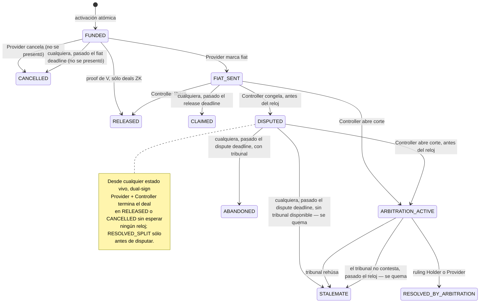

# PluriSwap

Escrow P2P de principal cripto contra fiat offchain. Kernel neutral (sin dueño, sin pausa, sin allowlist), paquetes opt-in, pools de terceros, rampas cero-bps. La privacidad es un valor de diseño.

**[`PROTOCOLO.md`](./PROTOCOLO.md) es la fuente de verdad del protocolo.** Las secciones 1 a 8 explican: visión, actores, compliance, modelo de negocio, cada componente y por qué es así, y lo que falta. El Anexo E es la especificación normativa (catálogo de transiciones, invariantes, encoding, circuitos, implementación) y el Anexo R, el registro fechado de decisiones. El código cita esos anexos (`§E.3.15.4`, `Anexo R, 2026-09-29`).

Estado de verificación: [`INFORME.md`](./INFORME.md) — qué camino se ejercita, cómo, y qué no.
Hallazgos abiertos de la revisión: [`EVALUACION.md`](./EVALUACION.md).

Artefactos operativos (fuera de `PROTOCOLO.md` porque su lector no es quien diseña el protocolo):

- [`REPUTACION.md`](./REPUTACION.md) — qué muestra el perfil de una cuenta, qué de eso no se puede falsificar, y qué tiene que chequear quien la consume. Para frontends e integradores
- [`PANEL_POLICY.md`](./PANEL_POLICY.md) — la política que leen los árbitros del panel: qué se decide, cómo llega la evidencia sellada y con qué estándar se vota

## Cómo termina un deal

Un deal produce **exactamente un** resultado económico. Estas son todas las ramas, y todas se
ejercitan sobre una chain real en cada corrida de `script/e2e.sh` — no sólo en tests.



Tres reglas que explican casi todo el dibujo:

- **Los relojes los ejecuta cualquiera.** Ningún derecho depende de que un keeper actúe: el timeout
  sigue disponible hasta que otra transición válida gane la carrera.
- **Dual-sign sale desde cualquier estado vivo.** Si el Provider y el Controller firman, el deal
  termina donde ellos digan, sin esperar ningún reloj. La excepción es el split: después de una
  disputa (`DISPUTED` o `ARBITRATION_ACTIVE`) sólo hay todo o nada.
- **Un deal con `PAYMENT_PROOF` es proof-o-timeout.** `markFiat`, `claim`, `openDisputed` y
  `openCourt` revierten `EdgeOff`: el grafo se reduce a `FUNDED → RELEASED` o `FUNDED → CANCELLED`.

### Los catorce finales

| Final | Lo dispara | Cuándo | Holder / Provider | Completion fee | Bonds | Score |
| --- | --- | --- | --- | :-: | --- | --- |
| `RELEASED` release | Controller | desde `FIAT_SENT` | 0 / 100% | sí | vuelven | ambos limpios |
| `RELEASED` co-signed | dual-sign | cualquier estado vivo | 0 / 100% | sí | vuelven; con la corte abierta, menos el 15% de cada uno al panel | ambos limpios |
| `RELEASED` por proof | cualquiera con proof de V | `FUNDED`, sólo ZK | 0 / 100% | sí | vuelven | ambos limpios |
| `CLAIMED` | cualquiera | pasado el release deadline | 0 / 100% | sí | vuelven | Provider limpio, Holder nada |
| `CANCELLED` cancel | Provider | antes de marcar fiat | 100% / 0 | no | vuelven | **Provider −5** (no se presentó) |
| `CANCELLED` fiat timeout | cualquiera | pasado el fiat deadline | 100% / 0 | no | vuelven | **Provider −5** (no se presentó) |
| `CANCELLED` mutual | dual-sign | cualquier estado vivo | 100% / 0 | no | vuelven; con la corte abierta, menos el 15% de cada uno al panel | nadie |
| `RESOLVED_SPLIT` | dual-sign | `FUNDED` o `FIAT_SENT`, nunca después de disputar | bps firmados | sí | vuelven | ambos limpios |
| `STALEMATE` deadlock | cualquiera | pasado el dispute deadline, **sin** tribunal (o con uno que ya no puede tomar el deal) | 0 / 0 — **se quema** | no | **al sink, los dos** | **ambos −10** |
| `ABANDONED` | cualquiera | pasado el dispute deadline, **con** tribunal | 0 / 100% | sí | vuelven | **el que abrió −5**, el otro limpio |
| `RESOLVED_BY_ARBITRATION` holder | cualquiera, tras el ruling | `ARBITRATION_ACTIVE` | 100% / 0 | no | **el del Provider: 70% al Holder, 30% al panel** | perdedor **−15** |
| `RESOLVED_BY_ARBITRATION` provider | cualquiera, tras el ruling | `ARBITRATION_ACTIVE` | 0 / 100% | sí | **el del Holder: 70% al Provider, 30% al panel** | perdedor **−15** |
| `STALEMATE` tribunal rehúsa | cualquiera, tras el ruling | `ARBITRATION_ACTIVE` | 50% / 50% | no | vuelven, menos el 15% de cada uno a la corte | **ambos −5** |
| `STALEMATE` tribunal mudo | cualquiera | pasado el arbitration deadline | 0 / 0 — **se quema** | no | **al sink, los dos** | **ambos −10**: es el deadlock |

Dos asimetrías que conviene tener presentes, porque son decisiones y no accidentes:

- **Un refund no es un trade**, así que no paga completion fee. Un payout sí, gane como gane. El
  fee de activación (0,3% del Holder) se cobra siempre: por eso no presentarse le cuesta −5 al
  Provider.
- **Un desacuerdo sin tribunal no le paga a nadie; con tribunal, lo pierde quien no escaló.** Si las
  partes firmaron sin ARBITRATION, después de disputar sólo pueden cancelar o liberar (no hay split),
  y si nadie cede antes del reloj el principal se quema, junto con los bonds de ambos, y −10 a cada
  uno. Existe para que rendirse sea la mejor respuesta de un tramposo racional. Si
  firmaron con tribunal, el Controller que abrió la pelea y no la escaló la pierde: el principal va
  entero a la contraparte, y los bonds vuelven porque el abandono es culpa *asumida*
  (Anexo R, 2026-09-24).
- **El panel se paga con el bond, no con un fee** (Anexo R, 2026-10-05). Un deal con panel lleva bond de
  los dos lados; abrir la corte no cuesta nada; el que pierde deja su lock, 30% al panel y 70% al
  ganador. Un pool es una cuenta más: escalera, cupo y bond propios, y actúa por un operador verificado.

### La reputación, medida

El cap es **lo máximo que podés tener abierto al mismo tiempo**, no un límite por deal. Un deal
cerrado al tope vale 2 puntos, porque el cap de T1 *es* la unidad de volumen del score:

| Deals cerrados al tope | Score | Cap | Cap con bond |
| ---: | ---: | ---: | ---: |
| 0 | 0 | 250 | 400 |
| 5 | 10 | 500 | 700 |
| 10 | 25 | 1.000 | 1.500 |
| 15 | 50 | 2.000 | 5.000 |
| 21 | 104 | 5.000 | sin límite |

Veintiún deals limpios de T1 a T5, acelerando solo — a cap más alto, más volumen por deal. Un
abandono, un stalemate del tribunal o no presentarse resta 5, un deadlock resta 10, y cualquiera de los dos **baja de
tier en el acto**. Lento de ganar, rápido de perder.

Esa curva es la del sujeto en aislamiento. En un mercado son **21 contrapartes distintas** (el crédito
es una vez por contraparte, §E.3.14.7) y el cap que ata es el más chico de los dos lados: contra novatos
cada deal vale 2 puntos y llegar arriba son ~50 personas. La escalera premia amplitud.

Y son contrapartes **verificadas** (2026-10-01): una cuenta puede operar sin Passport, y sus deals
completados entran al **registro** público de las dos puntas —lo que el listado muestra como deals y
volumen—, pero ninguno de los dos suma crédito para el tier. Las penalidades aplican igual, una cuenta
sin Passport no traba bonds y se queda en T1; si después se verifica, conserva lo que tiene
(§E.3.15.3, *Cuentas sin Passport*).

`script/ReputationLadder.s.sol` camina esta curva on-chain y la narra; `test/ReputationCurve.t.sol`
la pinea para que la tabla de arriba no se pudra en silencio.

### Dónde se ejercita cada cosa

| Script | Qué camina |
| --- | --- |
| `Paths.s.sol` | los doce finales Core (CASE-CORE-03..15), sin paquetes |
| `TrioDeal.s.sol` | un deal empaquetado: Passport + reputación + bonds (stand-ins del lab) y el panel, hasta `RELEASED` |
| `CatalogDeals.s.sol` | release por payment proof, y un arbitraje ganado por el Provider |
| `ReputationLadder.s.sol` | la curva: tiers, los dos rechazos del cap, lo que suma un bond, la democión |
| `ArbitrationPaths.s.sol` | los cinco finales de veredicto, con bonds puestos |
| `PoolDeal.s.sol` | un pool como Holder-contrato (EIP-1271 + pull exacto) |
| `DeployPrivate.s.sol` | la capa privada de §E.3.15 entera —el stack oficial—, con su panel, su factory de pools y su cableado verificado |
| `RampDeal.s.sol` | la rampa Stargate (sólo en una chain real) |
| `Doctor.s.sol` | audita un deployment vivo: presencia, forma, consistencia y que cada verifier corre el circuito comprometido |

Cobertura completa, incluido **lo que no está cubierto**: [`INFORME.md`](./INFORME.md).

## Stack

Foundry, Solidity `0.8.28`, Cancun, `via_ir`. OpenZeppelin v5. Arbitrum (Sepolia `421614` hoy). Sin proxy, sin `Pausable` / `Ownable` sobre settlement.

## Build y test

Auditar un deployment vivo (read-only, sin key):

```shell
forge script script/Doctor.s.sol:Doctor --rpc-url $RPC
```

Desplegar la cadena entera a una chain real:

```shell
RPC_URL=$ARBITRUM_SEPOLIA_RPC_URL DEPLOY_KEY=0x... script/e2e.sh
# ETHERSCAN_API_KEY=... para verificar el source en el explorer
```

```shell
forge build
forge test                       # unit + fuzz (256 runs) + invariants (32 x 256)
FOUNDRY_PROFILE=ci forge test    # fuzz 2048, invariants 128 x 512
```

CI (push y PR): `forge fmt --check`, `forge build --sizes` con gate de margen de bytecode, `forge test`, Slither (`--fail-medium`), Aderyn (`--fail-high`), **deploy + catálogo Core sobre una chain fría** (`script/e2e.sh`: despliega todo el stack en anvil, camina CASE-CORE-03..15, verifica los terminales que aterrizaron y audita el resultado con `Doctor.s.sol`), gates de drift de fixtures (bun regenera los vectors de los circuits y el fixture de los singletons Poseidon, y exige `git diff --exit-code`) + suite JS del consumer side de F4 (verify/chain, semántica con stubs); CI nunca necesita nargo/bb — proofs, verifiers y VKs viven como fixtures comprometidos. Nightly con perfil `ci`. Detalle y ley de TDD en `PROTOCOLO.md` §E.5.4.

## Layout

```
src/Escrow.sol              kernel
src/interfaces/IEscrow.sol  superficie de lectura (packages, pools, ramps)
src/libraries/              Consent, Terms, Settlement, Clocks, Types, PackageId, Packages (external)
src/packages/               módulos opt-in detrás de interfaces
src/pools/                  Holder-contrato vault + factory
src/ramps/                  composers (Stargate)
circuits/                   la capa ZK: 12 circuitos Noir + el twin JS + la lib de consumer side F4 (verify/chain; ver circuits/README.md)
verifiers/                  subproyecto de los verifiers Honk generados (via_ir off)
script/                     deploy y deal scripts
deployments/                addresses, no secrets
test/                       un área de catálogo por archivo (+ fuzz/, invariant/, fork/)
mocks/                      stand-ins de test; nunca identidad de producción
```

Diseño, decisiones y detalle normativo: [`PROTOCOLO.md`](./PROTOCOLO.md).
